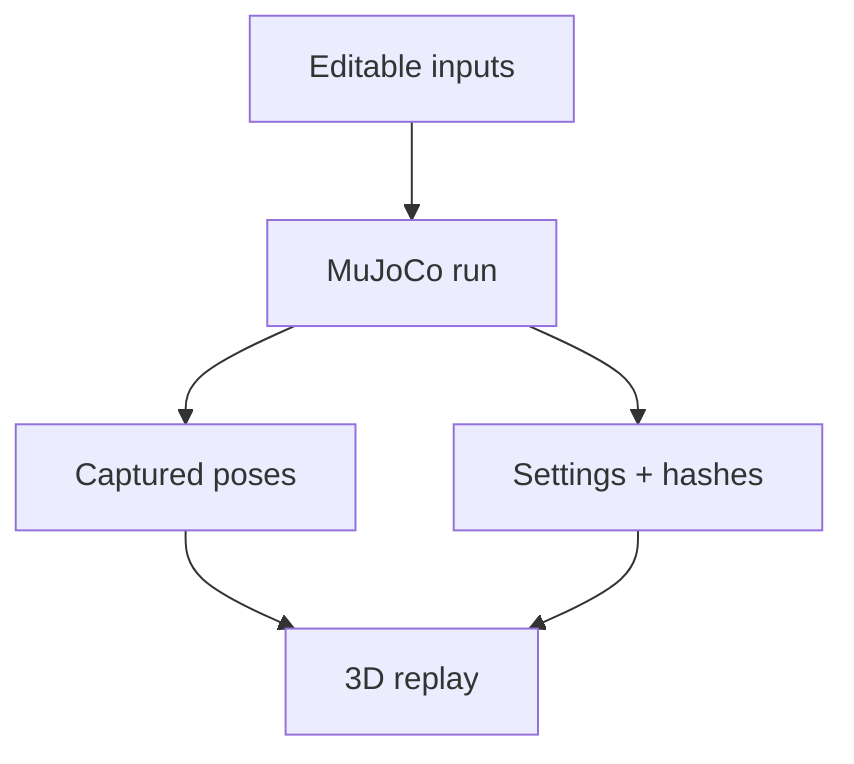

# Recorded robot simulation

Recorded solver poses replay in an inspectable 3D viewer; the browser does not recompute dynamics. Two examples:

- **Gyropup**, a work-in-progress wheel-legged robot, in four recorded MuJoCo runs from its repository's dated
  snapshot: [open the viewer](../../../software/cadagent/webkit/simulation/examples/gyropup-v2/viewer.html) ([its files](../../../software/cadagent/webkit/simulation/examples/gyropup-v2/README.md)). Its
  converter, [gyropup.py](gyropup.py), turns the snapshot into the viewer's format; it runs no physics.
- **An original two-link arm**, the small editable example: change the illustrative masses, dimensions, damping and
  controller settings in [config.json](config.json), regenerate with MuJoCo, and compare.



| File | Purpose |
| --- | --- |
| [config.json](config.json) | SI geometry, illustrative masses, joint limits and sinusoidal PD control settings. |
| [produce.py](produce.py) | Original model producer, actual solver sampling, bounded inputs and output verification. |
| [capture.mjs](capture.mjs) | Real browser thumbnail and source-bound capture receipt; uses the existing Playwright context. |
| [gyropup.py](gyropup.py) | Converter from Gyropup's recorded snapshot (joint frames, summary, rig meshes) to recordings, meshes and a receipt. |
| [capture-gyropup.mjs](capture-gyropup.mjs) | The toolkit and home cards' animation and still: the Gyropup viewer seeked through recorded times. |

## Gyropup's recorded scenarios

Four scenarios, chosen for what a visitor can see happen: driving off a 50 mm kerb (the card), one wheel up a plank
while the body stays level, push recovery and an 80 mm drop. The viewer shows each scenario's pass verdict, its
highest motor torque as a fraction of that motor's peak-torque limit (its control range) and the largest fore-aft lean,
copied from the snapshot's summary: the snapshot's own numbers, not a cad-agent verification. The lean is Gyropup's
`max_theta_deg`: the largest fore-aft (pitch) angle from vertical of the line from the wheel axle to the centre of mass
of every body but the wheels, measured at every solver step from the start (sideways tilt is not in it), shown to the two decimals the summary records (the landing's 0.04°: a straight drop
barely tips that line); a run whose summary has none shows none. The camera follows the robot in every run that
travels more than 0.1 m from its start, so it keeps the size of a phone's view; the landing stays put and is framed
whole. The receipt records both rules.

Limits: Gyropup's README calls this snapshot a historical demo, generated 2026-10-25 to 26 and not a validation of
the latest CAD or of physical hardware. The browser interpolates between recorded frames without enforcing contacts
or joint constraints. The rig's bought parts are the project's own envelopes (boxes and cylinders), not vendor CAD.

<details>
<summary>Regenerate Gyropup's scenarios: converter and method</summary>

From the repository root, with a clean Gyropup checkout (read only; nothing is written there):

```bash
python docs/examples/robot-replay/gyropup.py --gyropup ../gyropup
python docs/examples/robot-replay/gyropup.py --check                      # committed bytes match their receipt
python docs/examples/robot-replay/gyropup.py --check --gyropup ../gyropup  # and a fresh conversion, byte for byte
node docs/examples/robot-replay/capture-gyropup.mjs                       # then refresh the cards' pictures
```

The converter reads `hardware/exports/sim/v2/` at the checkout's revision: each chosen scenario's recorded MuJoCo
joint positions, `summary.json` and the browser rig (`rig/manifest.json` and its STL meshes),
the same files gyropup.com's simulator replays. Each frame's free joint poses the body; the five-bar leg links, the
wheels and the turret turn about their recorded joint angles with the rig's own dimensions, as Gyropup's
`robot_v2.js` poses them. The meshes are merged per body and colour and packed with `pack_view`. It needs numpy and
cad-agent, not MuJoCo, because it converts recorded poses and does not re-simulate.

Timing: the snapshot declares 30 frames per second, but Gyropup's run loop (`software/simulation/scenarios.py`) keeps
one frame every `round(1 / (30 × timestep))` = 33 solver steps of 1 ms (`robot_v2.py`'s MJCF timestep). The converter
reads both lines from the checkout (and refuses if either differs), stamps the frames at that true 33 ms interval and
checks the frame count against each run's length, so durations (7.0, 11.0, 9.0 and 5.0 s, less the last partial
interval) and events such as "push at 2.0 s" read in solver time. Each frame is taken just after its step, 1 ms later
than its stamp. The receipt records the Gyropup
revision, every source file's SHA-256, the converter's own hash and every artifact's hash.

</details>

<details>
<summary>Two-link arm: regenerate the recording and its thumbnail</summary>

Install the existing robot extra (`python -m pip install -e '.[robot]'`). The committed receipt uses MuJoCo 3.3.7;
install that version to reproduce its bytes. From the repository root:

```bash
python docs/examples/robot-replay/produce.py
python docs/examples/robot-replay/produce.py --check
```

To refresh the owned thumbnail after reviewing the viewer, install `tools/site`'s locked development dependencies
and the existing Pillow extra, then run `node docs/examples/robot-replay/capture.mjs`. The capture uses Chromium,
the dark theme and recorded time 3.2 s; its receipt records source hashes and browser version.

The [owned recording](../../../software/cadagent/webkit/simulation/examples/two-link-arm/README.md) includes the generated
MJCF, frame data and receipt. Serve `software/cadagent/webkit` over HTTP and open `simulation/viewer.html`, or copy the full
toolkit with `cad-agent webkit kit` and serve that folder. Browser playback needs neither Python nor MuJoCo.

</details>

<details>
<summary>Two-link arm: sampling, controls and model limits</summary>

Each solver step computes a bounded joint torque `clip(kp × (target − qpos) − kd × qvel)`. Targets are editable
sinusoids. `mj_step` advances dynamics; `mj_forward` refreshes derived body transforms at the integrated state.
At each whole sampling stride, `data.xpos` and `data.xquat` supply world body poses. MuJoCo's wxyz quaternions are
reordered to xyzw; metres and the right-handed Z-up frame remain unchanged. The viewer rotates a single root into
the shared stage's Y-up world, with no unit scaling.

Rigid links use uniform-box inertias and ideal joints. Decorative geometry adds no payload inertia. Inputs are
illustrative estimates, not measured equipment parameters. There is no motor electrical/thermal model, backlash,
flexibility or collision-avoidance controller. The finite recording does not establish physical fit, strength or
safe operation. Interpolated browser poses do not re-enforce constraints between samples.

The receipt binds producer, configuration, generated model and frame bytes. It records engine version, effective
settings, applied torque and solver warnings. Hash agreement proves identity, not model validity; changing an
input requires regenerating both recording and receipt. A different engine version may change the result.

</details>

Official references: [mj_step](https://mujoco.readthedocs.io/en/3.3.7/APIreference/APIfunctions.html#mj-step),
[mj_forward](https://mujoco.readthedocs.io/en/3.3.7/APIreference/APIfunctions.html#mj-forward),
[mjData transforms](https://mujoco.readthedocs.io/en/3.3.7/APIreference/APItypes.html#mjdata), and
[body inertia](https://mujoco.readthedocs.io/en/3.3.7/XMLreference.html#body-inertial).

[Worked examples](../README.md)
