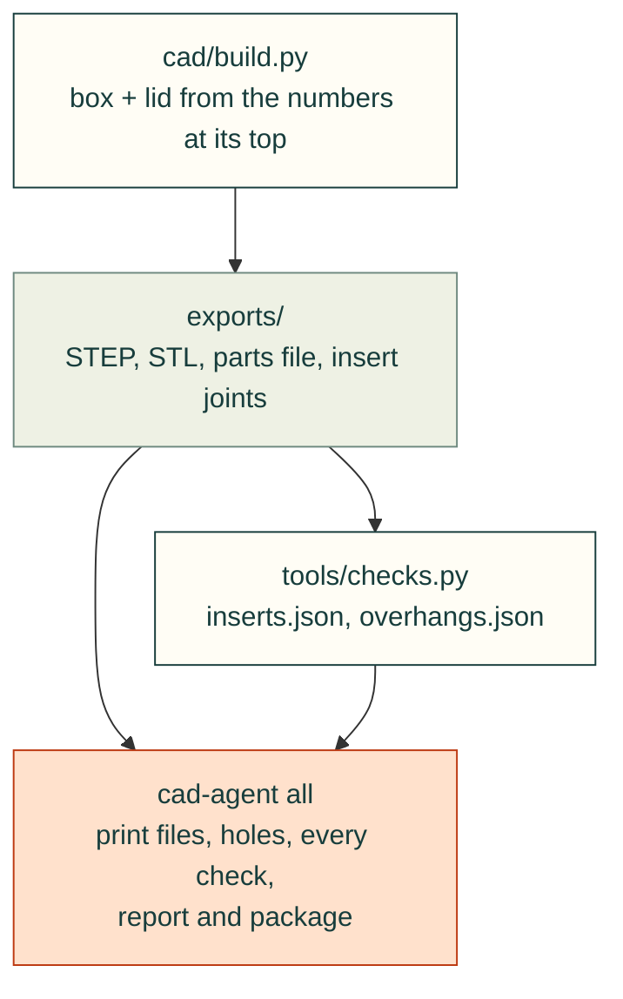

# Starter box

A 60 × 40 × 25 mm box and a lid held by four M3 screws in heat-set inserts: the smallest cad-agent project, to copy
and change. `cad-agent init my-box` copies it.

```bash
cad-agent init my-box && cd my-box
cad-agent all          # build, print files, every check, report: docs/cad-agent-report.html
```



| File | What it is |
|---|---|
| `cad/build.py` | the parts, from the numbers at its top; writes STEP, STL and the parts file to `exports/` |
| `tools/checks.py` | the insert joints and the overhang screen, each as `exports/<name>.json` with a `pass` |
| `cad-agent.yaml` | the steps that run, the checks the report reads, the printer and the package |

## What to change

- **Size, walls, lid:** `SIZE_MM`, `WALL_MM`, `FLOOR_MM`, `LID_MM` and `CORNER_MM` in `cad/build.py`.
- **Insert and screw:** `INSERT` (any key of `cadagent.mechanical.inserts.INSERTS`), `SCREW_MM` and `HEAD_MM`. The
  insert's hole (the maker's hole + 0.2 mm, 4.20 mm for this M3) and its boss come from `inserts.hole_design` and
  `inserts.boss_design`, so they follow the insert.
- **Filament:** `MATERIAL`, one the insert check has a datasheet for.
- **Printer:** `printer.bed_mm` in `cad-agent.yaml`.
- **A new part:** add it to `parts` in `cad/build.py`; `cad-agent all` exports, checks and packages it.
- **A new check:** a script that writes `exports/<name>.json` with a top-level `"pass": true` or `false`, a step that
  runs it, and a `checks:` row that reads it ([the project contract](https://cad-agent.valpatel.com/docs/toolkit#the-project-contract)).

`exports/checks.log` gives the most torque to tighten the screws to (about 0.2 N m here) and the joint's warnings:
a printed part relaxes and loses some of the clamp, so the joint warns but passes. `cad-agent all` also checks every
hole for material inside ("Holes clear"). The checks say what CAD can: a printed
box still needs a test fit, and the insert numbers are a model to test, not a rating
([inserts](https://cad-agent.valpatel.com/docs/inserts)).
