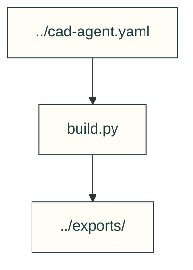

# Starter CAD

The copied starter build script uses toolkit joint calculations for a box and lid.

| File or folder | Purpose |
|---|---|
| [build.py](build.py) | Generate STEP/assembly outputs from configurable dimensions. |

[Parent map](../README.md)
