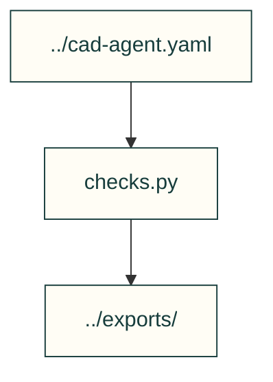

# Starter checks

Checks copied with the starter and consumed by its cad-agent.yaml commands.

| File or folder | Purpose |
|---|---|
| [checks.py](checks.py) | Write insert-joint and example check verdicts. |

[Parent map](../README.md)
