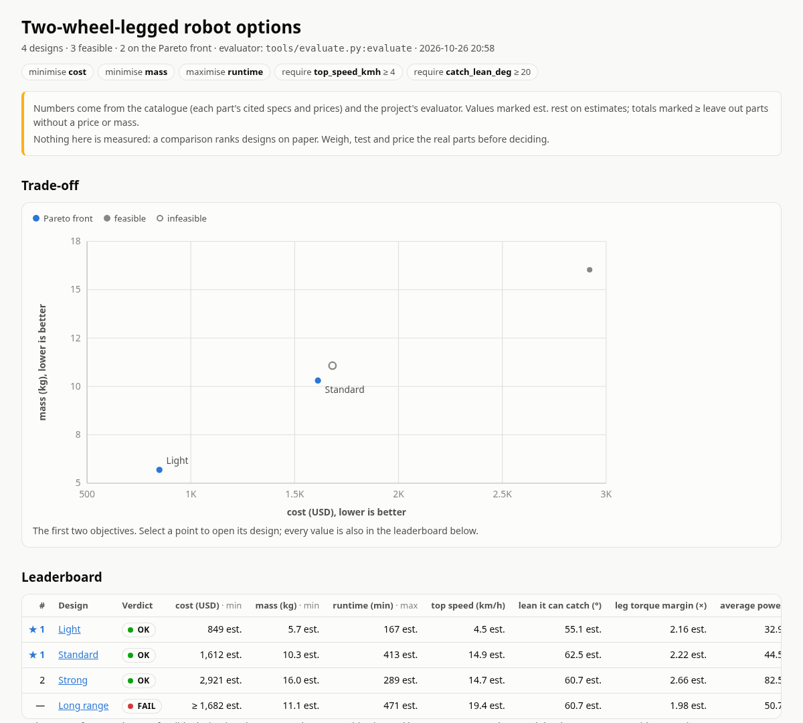
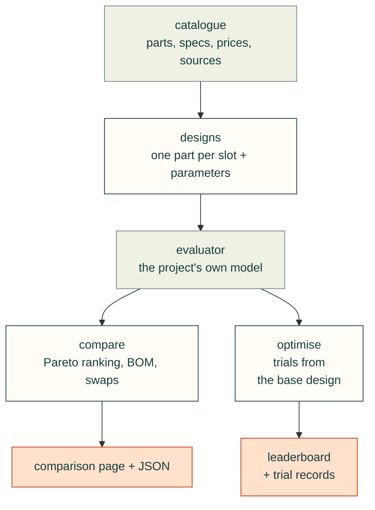
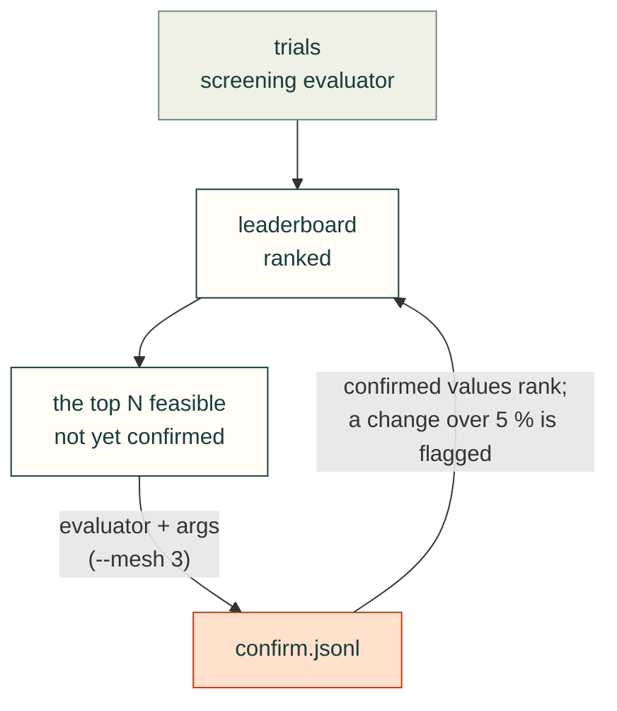

# Explore and compare designs (`cadagent.simulation.explore`)

For any product built from bought and made parts (an enclosure, a robot, a board, a jig): pick parts from a
catalogue for each slot of a design, evaluate every design with the project's own model, and rank the trade-offs.
cad-agent provides the catalogue checks, the bill of materials, the ranking, the pages and a search loop. The project
provides the parts, the designs and, optionally, an evaluator with its physics. A search that changes only parameters
(a wall thickness, a fillet radius) needs no catalogue at all.

```bash
cad-agent catalogue               # check the catalogue, and every design against it
cad-agent compare --swaps --open  # evaluate and rank the designs; try every one-part swap; open the page
cad-agent optimise --trials 200   # search parts and parameters for better trade-offs
```

Worked example: [`examples/explore-two-wheel`](../examples/explore-two-wheel/) compares small two-wheel-legged robot
configurations. The tests use a second, non-robot project: an electronics enclosure choosing a fan, a power supply and
screws sold in packs (`tests/explore_fixtures.py`).



*The page `cad-agent compare` wrote for the worked example (2026-10-26). Light and Standard are on the Pareto front;
Long range fails a requirement. Every number comes from the catalogue's cited specs and the project's evaluator:
nothing on it is measured.*



## What it does, and what it does not

| Piece | Module | What it gives you |
|---|---|---|
| Catalogue | `cadagent.simulation.explore.catalogue` | Part lists (JSON or YAML) with specs, prices with the date checked, sources and confidence flags; loading and per-item checks |
| Designs | `cadagent.simulation.explore.design` | One catalogue part per slot (or an inline custom part) plus free-form parameters; `extends` for variants; the bill of materials with cost and mass totals |
| Evaluator | `cadagent.simulation.explore.evaluate` | Runs the project's evaluator (a Python function, or a command in any language that speaks JSON) and turns its output into metrics, checks and extra BOM lines |
| Comparison | `cadagent.simulation.explore.compare`, `page` | Objectives and constraints, Pareto ranking, one-part swaps, `comparison.json`, a standalone HTML page and design cards for `cad-agent site` |
| Search | `cadagent.simulation.explore.optimise` | Tries many designs: random and grid sampling built in, NSGA-II and TPE through optuna (`pip install -e ".[explore]"`); leaderboard and resumable records |

Not included, on purpose:

- **Physics and product rules.** Torque margins, airflow, thermal rise, voltage compatibility: all in the project's
  evaluator. cad-agent knows prices, masses and quantities, and nothing about what a part does.
- **An interactive part picker in the browser** (a guided, choose-your-own-adventure designer). Live numbers in the
  browser need the evaluator to run there, so it would be a second copy of the project's model. A project that wants
  one can write its evaluator in JavaScript and use the same file from cad-agent as a command evaluator
  (`{command: [node, tools/evaluate.mjs]}`), so the page and `cad-agent compare` agree. The static comparison page and
  `--swaps` cover "what if I picked this part instead" without a second model.
- **Fetching prices, specs or product images.** Catalogue numbers are entered from datasheets and shops with their
  sources and dates; nothing scrapes vendor pages, and vendor images and CAD files are not stored.

## Configuration

Everything lives under `cad: explore:` in `cad-agent.yaml`; every key is optional.

```yaml
cad:
  name: my-robot
  explore:
    catalogue: ["catalogue/*.json", "catalogue/*.yaml"]
    categories: [wheel_motor, battery, compute]      # when set, any other category is an error
    currency: usd                                     # prices are read from price_usd (default usd)
    max_price_age_days: 90                            # older price_checked dates are warnings; null: no check
    slots:
      wheel_motor: {category: wheel_motor, qty: 2, required: true, group: Drive}
      battery:     {category: battery, required: true, group: Power}
      compute:     {category: compute, choices: [sbc-8gb, edge-ai-module]}    # only these parts fit
      lidar:       {category: sensor, where: {specs.type: lidar}}           # parts whose fields match
    designs: ["designs/*.json"]                       # the default
    evaluator: tools/evaluate.py:evaluate             # or {command: [node, tools/evaluate.mjs], timeout_s: 120}
    objectives: [{metric: cost_usd, goal: min}, {metric: runtime_min, goal: max}]
    constraints: [{metric: top_speed_kmh, min: 4}]
    metrics: {runtime_min: {label: runtime, unit: min, digits: 0}}    # display only
    card_metrics: [cost_usd, mass_kg, runtime_min]                    # for the site's design cards
    out: exports/explore                              # the default
    search: {...}                                     # see Search
```

| Key | Default | Meaning |
|---|---|---|
| `catalogue` | none | globs or paths of catalogue files, relative to the project root or absolute (`**` works); a pattern that matches nothing is an error; required only when `slots` are declared (without it, designs differ only in `params` and their BOMs are empty) |
| `categories` | any | allowed categories |
| `currency` | `usd` | three-letter code; prices are read from `price_<currency>` |
| `max_price_age_days` | `90` | warn about prices checked longer ago; `null` turns it off |
| `slots` | none | per slot: `category` (parts must match; swaps and searches draw from it), `choices` (only these ids fit), `where` (field conditions: `{specs.type: lidar}`; a list means one of, `null` means the field is absent), `qty` (default quantity), `required`, `group` (BOM subtotal), `label` |
| `designs` | `designs/*.json` | design files |
| `evaluator` | none | `file.py:function`, `package.module:function`, or `{command: [...], timeout_s}` |
| `objectives` | `cost_<currency>` and `mass_kg`, both `min` | what "better" means; Pareto ranking uses all of them |
| `constraints` | none | `{metric, min, max}`; a design that misses one, or lacks the metric, is infeasible |
| `metrics` | from the key names | display `label`, `unit` and `digits` per metric |
| `card_metrics` | the first six columns | metrics on the site's design cards |
| `out` | `exports/explore` | where the comparison and the search write |
| `search` | none | the optimiser |

Units come from the key names, as everywhere in cad-agent: `runtime_min` is in minutes, `top_speed_kmh` in km/h,
`catch_lean_deg` in degrees, `cost_usd` in US dollars.

## Catalogue

A catalogue file is a list of items, `{"items": [...]}` with optional `"defaults"` merged under every item (a
category for the whole file, a shared source), or `{"items": {"<id>": {...}}}` keyed by id. JSON and YAML both work;
an unquoted YAML date (`price_checked: 2026-10-26`) is read as the text `"2026-10-26"`, in designs too.

```json
{
  "id": "hub-165-36v",
  "category": "wheel_motor",
  "name": "165 mm hub motor, 36 V",
  "price_usd": 95.0,
  "price_checked": "2026-10-26",
  "pack_qty": 1,
  "mass_g": 1900,
  "specs": {"tyre_diameter_mm": 165, "peak_torque_nm": 8.0, "voltage_range_v": [24, 48]},
  "confidence": "datasheet",
  "estimates": ["specs.peak_torque_nm"],
  "sources": ["https://example.com/datasheet.pdf"],
  "buy": [{"seller": "Example shop", "url": "https://example.com/p/165", "in_stock": true}],
  "preferred": true,
  "notes": "Anything that matters when choosing it."
}
```

| Field | Rule |
|---|---|
| `id` | unique across the catalogue; letters, digits, `.` `_` `-` `+` |
| `category` | required; a slot takes one category |
| `name` | or `vendor` + `model`, or `description`; falls back to the id |
| `price_<currency>` | one pack before shipping and tax, a number ≥ 0 or `null` (no public price); needs `price_checked` (`YYYY-MM-DD`) |
| `pack_qty` | pieces per pack (screws, inserts); a BOM line buys whole packs |
| `mass_g` | one piece; `specs.mass_g` is read too (they must agree) |
| `specs` | everything else the evaluator reads, units in the key names |
| `confidence` | `measured`, `datasheet`, `product_page`, `seller_listing` or `estimate` |
| `estimates` | fields that are estimates even when the rest of the item is not (`mass_g`, `specs.<key>`) |
| `sources`, `buy` | where the numbers come from; an item with neither is flagged |
| `preferred` | listed first in its category |

Unknown values are `null`, never guessed. A price in another currency (`price_eur` in a `usd` project) is not
converted: convert it and note the rate in `price_note`. Every other field is kept and passed to the evaluator. In
YAML, dates (`price_checked: 2026-10-26`) are read as ISO text, quoted or not.

`cad-agent catalogue` reports **errors** (a wrong or missing id or category, a price without a date, a date in the
future, a negative price, a number that is not finite (NaN or infinity: use `null` for an unknown value), a value JSON
cannot carry, disagreeing masses, an unknown confidence, slot `choices` that are not in the catalogue) and
**warnings** (no price, no mass, no source, an old price, a source or buy link that is not `http(s)`, which pages show
as text rather than a link, a required or narrowed slot that no part fits), then checks every design against the
catalogue. It exits 1 when there is an error. A design that uses a part with a non-finite number is an `error`.

## Designs

```json
{
  "name": "Long range",
  "extends": "standard.json",
  "parts": {
    "battery": "pack-13s-10ah",
    "leg_actuator": {"part": "qdd-17nm", "qty": 4},
    "wiring": {"custom": {"name": "Wiring allowance", "category": "hardware", "price_usd": 45,
                          "price_checked": "2026-10-26", "mass_g": 400, "confidence": "estimate"}},
    "camera": null
  },
  "params": {"leg": {"length_mm": 160}},
  "notes": "Why this variant exists."
}
```

- A slot holds a catalogue id, `{"part": id, "qty": n}`, an inline `{"custom": {...}}` part (checked like a
  catalogue item), or `null`. The quantity defaults to the slot's `qty`, else 1. One part per slot: use more slots for
  more parts.
- `extends` starts from another design (relative to this file): mappings merge key by key, so
  `{"leg_actuator": {"qty": 2}}` changes only the quantity (a parent's bare id counts as `{"part": id}`); in a slot,
  `part` and `custom` replace each other and the quantity stays; anything else replaces; `null` empties a slot.
  `name` is not inherited and defaults to the file name.
- `params` is free-form for the evaluator.
- An unknown part, a part that does not fit the slot (category, `choices`, `where`), a bad quantity or an empty
  required slot makes the design an `error`; a slot that is not configured is a warning (a typo shows).
- Narrow a slot when its category is broad. In a real catalogue "compute" may hold main computers and
  microcontrollers alike; without `choices` or `where`, a swap would happily put a CAN transceiver where the main
  computer goes, and only the evaluator's checks could object.

The **bill of materials** has a line per filled slot plus the evaluator's own lines, each with quantity, packs, unit
and line price, mass, confidence, the date the price was checked, a source link and stock. The totals become two
metrics every design has: `cost_<currency>` and `mass_kg`. A line without a price or mass is left out of that total,
which is then marked **incomplete**, shown as `≥` (a lower bound: the true value is at least that) and lists what it
leaves out in `missing`; a total that includes an estimate is marked **est.**.

## Evaluator

The evaluator is the project's model. In Python, `evaluator: tools/evaluate.py:evaluate` (or `package.module:function`):

```python
def evaluate(candidate):                                  # cadagent.simulation.explore.design.Candidate
    motor = candidate.part("wheel_motor")                 # the catalogue item (a dict), or None
    torque = candidate.spec("wheel_motor", "peak_torque_nm")
    wheels = candidate.qty("wheel_motor")
    leg_mm = candidate.param("leg.length_mm", 160)        # dotted paths into params
    mass = candidate.bom["totals"]["mass_kg"]             # the catalogue parts (not your own lines)
    return {
        "metrics": {"top_speed_kmh": 14.9, "runtime_min": {"value": 413, "estimate": True}},
        "checks": [{"id": "volts", "level": "fail", "text": "The battery is above the motor's 48 V."}],
        "lines": [{"name": "Printed parts", "qty": 1, "price_usd": 32, "mass_g": 1600, "estimate": True}],
        "summary": "One line for the comparison.",
        "data": {},                                       # anything else to keep in comparison.json
    }
```

Every key is optional; an unknown key is reported, not fatal. A metric is a number (or true/false, text, `null`) or
`{"value", "unit", "label", "digits", "estimate", "incomplete"}`; a value that is not finite becomes `null` and makes
the design an `error`. Check levels are `ok`, `warn` and `fail`; any other level counts as `fail`. `lines` count in the cost and
mass. A metric with the same name as a BOM metric replaces it (`mass_kg` from CAD, say). NumPy scalars are read as
plain numbers. The evaluator's folder is appended to `sys.path`, so it can import its neighbours without shadowing a
library. Each part the evaluator gets is its own copy; `candidate.catalogue` is shared, so read it only.

In any language, `evaluator: {command: [node, tools/evaluate.mjs, "{result}"], timeout_s: 120}`: the request arrives
as JSON on stdin, and the evaluator writes the result above as JSON to the file `{result}` names; cad-agent reads it
once the command exits. Without `{result}` the reply is the JSON on stdout. **Use `{result}` whenever the evaluation
runs native code:** gmsh, OpenCASCADE and most solvers write to file descriptor 1 from C, past Python's `sys.stdout`,
so `contextlib.redirect_stdout` does not catch them, and their lines land in the reply, which is then not JSON.

<details>
<summary>The command's placeholders, its stdin, a stdout reply, and how it is stopped</summary>

| In the argv | Becomes |
|---|---|
| `{result}` | a file path (in a private temporary folder) the evaluator writes its JSON result to; stdout is then only a log |
| `{design}` | a temporary JSON file with the resolved design |
| `{id}` | the design's id as a plain file name for a folder of per-design outputs (letters, digits and `. _ + -` only, such as `trial-00007`; an id with other characters, like `designs/a/std`, has them replaced and gets a short hash) |
| `{python}` | the project's python |

The request on stdin is `{id, name, file, design, params, currency, parts: {slot: {item, qty, custom}}, bom}`. A reply
on stdout may have log lines before the JSON (the last line is tried too), but nothing after it. An evaluator that
must reply on stdout can keep it clean with `os.dup2`: copy fd 1 for the reply, point fd 1 at stderr
(`os.dup2(2, 1)`), and write the JSON to the copy. The command runs in the project root with `CAD_AGENT_PROJECT` set,
in its own process group: a timeout kills the evaluator and everything it started, anything it leaves running when it
exits is killed too, and Ctrl-C stops them.

</details>

An exception, a non-zero exit, a timeout, output that is not JSON or a number that is not finite (NaN or infinity in
`metrics`, `lines` or `data`) makes that one design an `error` with the reason; the other designs are still evaluated,
and the BOM's cost and mass are still shown.

## Comparison

`cad-agent compare [DESIGN ...] [--swaps] [--workers N] [--json] [--open]` evaluates the configured designs (or the
files given, relative to the project root) and writes, under `out`:

| File | What |
|---|---|
| `comparison.json` | every design in leaderboard order with its metrics, checks, BOM, rank, and swaps |
| `compare.html` | one standalone page (light and dark, opens from `file://`): a trade-off chart of the first two objectives, the sortable leaderboard, and per design its checks, BOM, parameters and swaps |
| `designs.json` | design cards for the project site: set `site: designs: exports/explore/designs.json` |

`cad-agent site --serve` adds the comparison page (and the search leaderboard) to the site's top bar when they are in
the default `exports/explore`.

A design is **feasible** when its verdict is `ok` or `warn`: no failed check, every constraint met, and a number for
every objective. Feasible designs are sorted into **Pareto fronts**: rank 1 is the front, where no other feasible
design is at least as good on every objective and better on one; rank 2 is the front once rank 1 is removed, and so
on. Infeasible designs follow, fewest failures first.

**Incomplete totals are lower bounds, never savings.** A cost of `≥ 1,240` (a part without a price) is never counted
as better than a value it might exceed: a design does not beat another on that objective unless it certainly does.
Two totals that leave out exactly the same lines (the same unpriced camera in both) compare by what they show, since
their difference is known. A rank that rests on a lower bound is marked `≥` on the page. A constraint that an
incomplete total might break (a maximum), or does not reach yet (a minimum), cannot be confirmed: that is a warning,
not a pass. `--swaps` evaluates every one-part swap of every design (each
other catalogue part of the slot's category) and shows, per swap, the change in each objective, whether it is still
feasible, and whether it beats the design on every objective; a `?` marks a change that cannot be told because one
of the totals leaves out a part without a value. With a large catalogue that is many evaluations (one process each
for a command evaluator): `--workers N` runs N at a time.

Exit codes: 0 when every design was evaluated (whatever its verdict), 1 when a design could not be evaluated or the
catalogue failed to load, 2 when the configuration or the evaluator is unusable.

## Search

```yaml
    search:
      base: designs/standard.json           # every trial starts from this design
      sampler: nsga2                        # random | grid (built in) | nsga2 | tpe (optuna)
      trials: 200                           # per run; grid stops when every combination is done
      workers: 4                            # evaluations at the same time
      seed: 1
      population: 24                        # nsga2
      space:
        - {slot: wheel_motor}                                  # every catalogue part of the slot's category
        - {slot: camera, choices: [depth-camera, null]}        # or these; null leaves the slot empty
        - {param: leg.length_mm, low: 120, high: 200, step: 20}
        - {param: frame.material, choices: [pla, petg]}
```

`cad-agent optimise [--trials N] [--workers N] [--sampler S] [--seed N] [--fresh] [--no-confirm]` builds each trial from the base
design, writes it to `out/search/trials/trial-00007.json`, evaluates it exactly as `compare` would, and writes
`out/search/trials.jsonl` (one record per trial, with its full evaluation) and `leaderboard.json` +
`leaderboard.html` (refreshed while it runs, at most a tenth of the time; the JSON keeps metrics, checks and BOM
totals). With random, nsga2 and tpe the first trial of a new search is the base design itself, when the space can
express it; grid goes through the combinations in order.

- **random** and **grid** need nothing installed. Grid tries every combination once (ranges need a `step`).
- **nsga2** (multi-objective genetic search) and **tpe** use optuna (3.4 and later). Failed checks, unmet
  constraints, and minimised totals that leave out more parts than the base design's are passed as optuna
  constraints, so infeasible trials still guide the search and it cannot drift towards parts without a price. A trial
  that could not be evaluated is marked failed. The study is kept in `out/search/study.db`; its bookkeeping costs a
  few tens of milliseconds per trial, which matters only when the evaluator itself takes milliseconds.
- A combination that was already evaluated is not evaluated again, including one proposed while it is still running;
  the summary counts evaluations and repeats separately.
- Running again continues: the numbering, the records and the optuna study carry on, and the sampler gets a new seed
  so it does not replay its first proposals. `out/search/search.json` records what the trials were computed against
  (objectives, constraints, the space with its choices, slot settings, the base design, the evaluator and its file,
  the catalogue parts in play); if any of them changed, the run stops and says what, and `--fresh` starts over.
- Ctrl-C stops the command evaluators that are running (with whatever they started), writes the leaderboard, and
  says how many Python evaluations it is still waiting for; a second Ctrl-C stops without them. A Python evaluator
  cannot be stopped from outside in the middle of a call.
- With `workers` above 1, Python evaluators run in threads: they must be thread-safe, and they only run in parallel
  where they wait on something else (a subprocess, a solver that releases the GIL). For CPU-heavy work use a command
  evaluator, so each trial is its own process.

Exit code 0 when the run finished with at least one feasible trial, 1 otherwise.



*`cad-agent optimise` on `examples/explore-two-wheel`: the trials arrive, a repeated combination is not evaluated again, and the front over cost, mass and runtime is redrawn as trials join it. An illustration drawn from the example's own seeded run; its parts and prices are made up.*

### Confirm the leaders

A search judges every trial with one evaluator, at one fidelity: a coarse mesh, a short simulation. Some leaders are
artefacts of it. In Gyropup's hip-frame sweep, the leader read a safety factor of 2.06 at a 4 mm mesh and 1.81 at
3 mm, because its peak sat at a sharp corner, where the stress never converges. `confirm` evaluates the leaders again
at a higher fidelity once the trials are done, and ranks them on what that says:

```yaml
    search:
      ...
      confirm:
        top: 3                    # the first 3 feasible trials of the leaderboard (default 3)
        args: [--mesh, "3"]       # appended to the evaluator's command
        tolerance_pct: 5          # flag a change of more than 5 % (the default)
```



- **Ranking.** A confirmed trial is ranked on its confirmed evaluation (metrics, checks, verdict); the others keep
  their screening values. When that brings an unconfirmed trial into the top N, it is confirmed too, up to `limit`
  evaluations a run, so the top N of the leaderboard end up confirmed.
- **Both values are kept.** `leaderboard.json` gives each confirmed trial a `confirm` block (`values: {metric:
  {screen, confirmed, change_pct}}`, `flag`, `reasons`); the page adds a Confirmed column, the screening value under
  each changed one ("was 2.06"), and a table per trial.
- **Flags.** A change of more than `tolerance_pct` in an objective or constraint, a value that appears or goes, a
  trial that becomes feasible or infeasible, or a confirmation that fails is flagged with a `warn` check. 5 % is a
  common bar for a converged mesh; tighten it where a gate has little margin. A failed confirmation leaves the trial
  ranked on its screening values, and it is tried again on the next run.

<details>
<summary>Every <code>confirm</code> key, and how confirmations are reused</summary>

| Key | Default | Meaning |
|---|---|---|
| `top` | `3` | how many of the first feasible trials to confirm |
| `args` | none | appended to the evaluator's command (a command evaluator only); placeholders such as `{id}` work |
| `evaluator` | the search's | a different evaluator for the confirmation (a Python function or a command); `args` are appended to it |
| `timeout_s` | the evaluator's | the confirmation's timeout: a finer mesh takes longer |
| `tolerance_pct` | `5` | flag a change of more than this, in percent of the screening value |
| `limit` | `3 × top` | confirmations per run, at most |

Either `args` or `evaluator` is needed: the same evaluator again would only repeat each trial. A confirmation's `{id}`
is the trial's id with `-confirm` added (`trial-00007-confirm`), so its outputs do not overwrite the screening ones.
Confirmations are kept in `out/search/confirm.jsonl` and reused while the confirm evaluator's argv, its files and its
timeout are unchanged. A new `tolerance_pct` re-flags them without running anything, other `args` run them again, and
`--fresh` deletes them with the trials. `--no-confirm` skips the stage for one run, and the leaderboard keeps the
confirmations made before. The sampler (optuna's included) only ever learns the screening values, so the search
itself stays at one fidelity.

</details>

## Python API

```python
from cadagent.simulation.explore import (explore_config, load_configured, check_catalogue, load_design, resolve, bom,
                                         load_evaluator, evaluate_design, compare_designs, comparison, write_comparison,
                                         swaps)
from cadagent.simulation.explore.optimise import run_search, search_config
```

## Limits

- A comparison ranks designs on paper. It is as good as the catalogue's numbers (with their sources, dates and
  confidence) and the evaluator's model. Estimates are flagged and incomplete totals are lower bounds, but nothing
  here is measured: weigh, test and price the real parts before deciding.
- The search finds the best trade-offs of the model, not of the product. Check a winning trial with CAD, FEA and a
  prototype before building on it.
- A confirmation is a second evaluation, not proof of convergence. Two meshes that agree within 5 % can both be wrong
  at a singular corner, and an unconfirmed trial's screening values may be off by as much as the confirmed ones moved.
- A Pareto front with many objectives can be large; add constraints, or fewer objectives, to narrow it.
