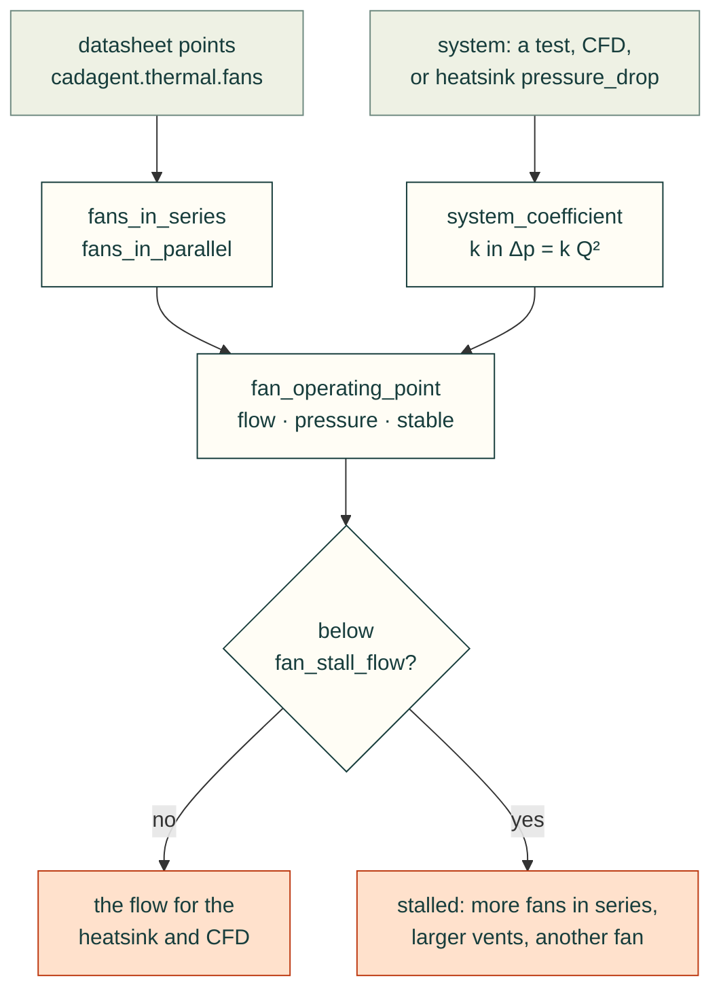

# Airflow and fans

A fan does not deliver the airflow printed on its box. It delivers what its pressure-flow curve gives where that curve
meets the enclosure's own curve, the pressure the air needs to get through vents, boards and fins at each flow. That
crossing is the operating point. `cadagent.formulas` finds it, for one fan or several in series or in parallel, and
says when it falls in the fan's stall region. `cadagent.thermal.fans` holds fan curves read from datasheets. The
explorer below runs the browser port of the same functions, tested against the Python on shared vectors.

## Try it: the fan-curve explorer

The teal line is the datasheet curve of an ebm-papst W2G115-AD15-13, a 115 mm axial fan, at the supply voltage you
pick. The rust parabola is the system: set how much pressure the enclosure needs at 100 m³/h, which fixes k in
Δp = k Q². The dot is where they cross. The shaded band is the stall region: the dip and flat top left of the curve's
last peak. The default runs at 150 m³/h, clear of the stall region, which is below 132 m³/h.

<cad-fan-curve fan="12" system="12" count="1" arrangement="parallel">

</cad-fan-curve>

Try these:
- **Make the enclosure tighter: 25 Pa at 100 m³/h** (smaller vents, a filter). The point drops to 112 m³/h and into the
  stall region. On that flat stretch a little more resistance costs a lot of air, and the fan gets loud.
- **Add a second fan in parallel.** At 25 Pa you get 140 m³/h, and each fan still stalls at 70 m³/h. **Switch to series**
  and the pair gives 148 m³/h, clear of the stall region: in a restrictive system, fans in series win.
- **Open the enclosure up: 4 Pa at 100 m³/h.** Now two fans in parallel give 275 m³/h and two in series only
  186 m³/h. In an open system, fans in parallel win.
- **Change the voltage.** The same fan at 8 V and 16 V is a smaller and a larger curve, each with its own stall region.

## How to read it

The stall region is left of the peak that ends the curve's last rise in pressure. There, the air separates from the
blades: the fan is noisier, and its flow is set by a flat or rising stretch of the curve, so it swings with small
changes in the system. A system curve can also cross a deep dip more than once. The fan can then settle at either
crossing, and the result is flagged unstable. The maker's own table of measured points lies right of the peak at every
voltage, which is the range the fan is meant to run in.



## From Python

SI units: flow in m³/s, pressure in Pa, k in Pa·s²/m⁶.

```python
from cadagent import formulas as fx
from cadagent.thermal.fans import FANS
fan = FANS["w2g115-ad15-13-12v"].curve()                 # [(Q m3/s, dp Pa)] from the datasheet
k = fx.system_coefficient(12.0, 100 / 3600)              # 12 Pa at 100 m3/h
op = fx.fan_operating_point(fan, k)                      # flow 0.0416 m3/s (150 m3/h), 26.9 Pa
op["stable"], op["stall"]                                # True, False
fx.fan_stall_flow(fan) * 3600                            # 132.2 m3/h: below it, the stall region
fx.fan_operating_point(fx.fans_in_series(fan, 2), fx.system_coefficient(25.0, 100 / 3600))
```

For a plate-fin heatsink, `cadagent.thermal.heatsink` gives the pressure drop and the thermal resistance at a flow.
For where the air really goes inside an enclosure, `cadagent.simulation.cfd` models the fan as an actuator disc. Each
formula states its units, limits and source in `fx.catalogue()`, and they are listed with the others on
[Engineering formulas](formulas.md#what-it-computes).

## Limits

- **Steady flow at one air density.** The datasheet's pressures are for 1.2 kg/m³ of air. Hot or thin air moves less
  mass for the same curve.
- **The maker's test rig, not your enclosure.** The curve is measured with a free inlet and a ducted outlet (ISO 5801,
  category A). A grille, a finger guard or a board close to the fan costs pressure that the curve does not show.
- **The system curve is the hard part.** A real one comes from a test or from CFD (`cadagent.simulation.cfd`), not
  from a guessed k. Δp = k Q² is turbulent loss; filters and fin channels add a linear part, `r` in
  `fan_operating_point`.
- **Identical fans, sharing evenly.** Series fans close together lose pressure to swirl. In the stall region, fans in
  parallel can share unevenly: one stalls and the others carry more. Neither is modelled.
- **The curve is read from the datasheet's chart** to about 1 m³/h and 1 Pa. The stall peak is found from its points,
  so a dip shallower than that reading still counts.

<details>
<summary>What we looked at before building the explorer, and the tests that keep it honest</summary>

- **[fluids](https://github.com/CalebBell/fluids)** by Caleb Bell (MIT): duct and fitting losses to build a system curve
  from parts. Use it for the k of a real duct run. It pulls in SciPy, so it cannot run in the page, and the page must
  compute what agents get.
- **Fan makers' selection tools** match their own fans to a system curve. They are the place to choose a fan, but they
  are the makers' software, not code we can test or embed.
- **So the solver is built**, on the existing `fan_operating_point` (exact roots on each straight segment of the
  curve), with the fan data read from the datasheet's vector chart rather than digitised from a picture.
- **Tests:**
  - `tests/test_formulas.py` solves one fan, two in series and two in parallel on a straight-line curve by hand
    (in a restrictive system, (√17 − 1)/8, 1/2 and (√65 − 1)/16 of the free-air flow), and the crossover where
    series and parallel give the same air.
  - It also finds every operating point the datasheet tabulates, on the datasheet's own system curves, within its
    rounding (5 m³/h, 1 Pa), and checks that the table lies right of the stall peak at every voltage.
  - `tests/webkit-formulas.test.mjs` runs the port on the golden vectors, including the stall dip with three
    crossings. They match bit for bit.
  - `tests/website-browser.mjs` runs the explorer at 360 and 1366 px under the site's security policy, in Chromium
    and WebKit, with the fan vectors run again in each engine.

</details>

Sources: F. M. White, *Fluid Mechanics*, 7th ed., McGraw-Hill, 2011, Section 11.5 (matching pumps and fans to system
characteristics, in series and in parallel); ebm-papst Mulfingen, data sheet W2G115-AD15-13, item no. 50788-5-9980,
approved 2016-05-09, p. 5 (air performance curves and measured values).
