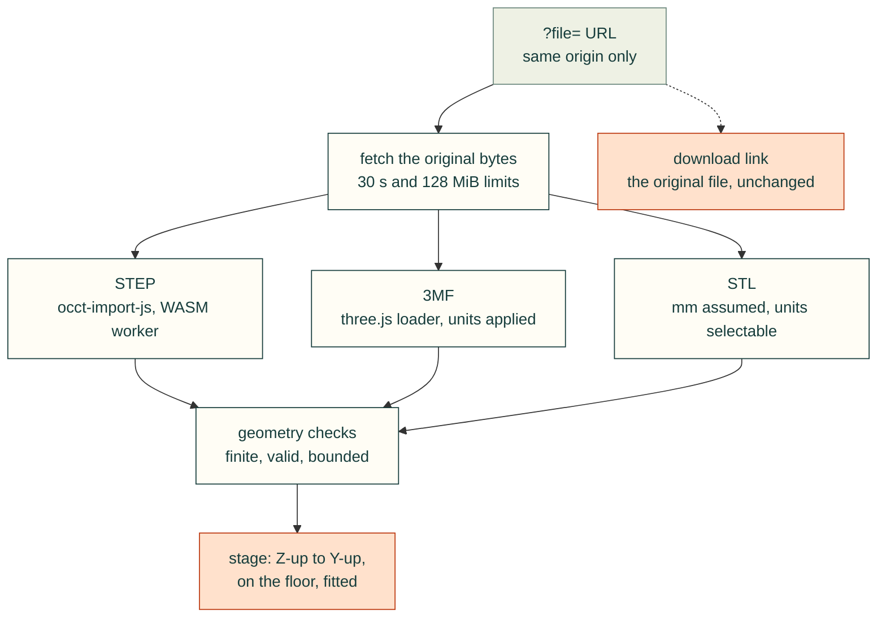

# Viewing original CAD files

The standalone `webkit/file-viewer.html` opens original STL, STEP/STP and core 3MF
files. It parses the requested file itself; it never substitutes a similarly named
STL or an assembly manifest. The download link retains the original URL and bytes.

```html
<a href="kit/file-viewer.html?file=%2Fexports%2Fbracket.step&back=%2Fbuild.html">View bracket</a>
```

Files and the optional back link must be on the current origin. Deploy the entire
webkit directory, including its vendor assets. No CDN, upload service or application
server is required. Serve JavaScript modules and WASM with their correct MIME types.
The runtime WASM is 7,604,031 bytes (below Cloudflare's 25 MB asset limit).
[Dependency notices](../src/cadagent/webkit/vendor/FILE-VIEWER-NOTICES.md) include
exact source revisions, licenses, hashes, build instructions and library replacement
instructions. Keep these notices with copies of the viewer.



## Behavior and limits

- Mouse drag orbits; touch uses the standard OrbitControls pan/pinch gestures.
  Wheel movement follows pixel deltas with easing: a 120px notch changes radius by
  about 1.57%, rather than jumping through large zoom steps.
- Fit preserves the viewing direction. Isometric, Front, Side and Top select a
  standard view. The model is fitted into the actual canvas, outside the header
  and controls. All controls have at least 44px touch targets.
- STEP uses pinned occt-import-js 0.0.23 in a dedicated worker. Open CASCADE
  tessellates the requested STEP's surfaces with millimeter output,
  `bounding_box_ratio` linear deflection 0.001 and angular deflection 0.2 radians.
  This is a visual tessellation, not a manufacturing or topology validation.
- 3MF uses the official Three r160 loader, with declared units explicitly applied.
  Build/component transforms are baked into geometry, including reflected-instance
  winding. Core geometry, material colors and vertex colors are supported. Texture
  images are omitted with a visible limitation; no image load is started in the
  worker. Required extensions and mixed-unit model documents are rejected with an
  explanation instead of silently approximated. These limits do not alter downloads.
- STL has no unit metadata. Millimeters are the default assumption, shown in file
  details; the unit selector can reinterpret inches, feet, centimeters, meters or
  microns. STL's exported orientation can differ from the same design's STEP.
- Geometry packets are checked for nonempty finite vertices, valid triangle
  indices, nondegenerate surfaces, valid normals/colors/material groups and bounded
  triangle counts. CAD Z-up becomes stage Y-up, with mm converted to meters. The
  display is centered horizontally and placed on the floor without altering the
  original file or internal relative placement.
- Preview limits: 128 MiB downloaded bytes, 128 MiB expanded ZIP entries, 10,000 ZIP
  entries, 2 million triangles; ordinary single-volume ZIP only (no ZIP64).
  Downloads have a 30-second deadline including body reading; parsing has a 120-second
  deadline. Cancel terminates the worker, including active WASM CPU work.
- Status names actual phases rather than fabricated percentages. HTTP, parse,
  renderer or worker failures expose Retry. An initial entry-module/renderer failure
  offers a page reload before any usable scene exists. Later file retries keep the
  previous scene alive and name that retained model while the candidate is loading
  or failed. Request generations prevent late responses from replacing a newer file.

## Embedding

Link `file-viewer.css` and provide the existing Three import map before importing:

```js
import {createFileViewer} from './kit/file-viewer.js';
const viewer = createFileViewer(host, {
  file: '/exports/bracket.step',
  back: '/build.html',
  onState({state, message, info}) { /* loading, ready, error, cancelled, empty */ }
});
await viewer.load('/exports/other.3mf');
viewer.fit('top'); // fit, iso, front, side, top
viewer.cancel();
await viewer.retry();
viewer.dispose();
```

## Product themes

The default remains dark. Set `theme: 'light'`, `'dark'` or `'auto'` when mounting;
the standalone page also accepts `?theme=light` (or `dark` / `auto`). Auto follows
the OS preference while mounted. `viewer.setTheme(...)` changes appearance without
reloading the file, resetting the camera or changing the original model materials.

For a product palette, pass an object:

```js
const viewer = createFileViewer(host, {
  file: '/exports/bracket.step',
  theme: {mode: 'light', colors: {accent: '#126d58', surface: '#fffaf2'},
          fontFamily: 'Inter, system-ui, sans-serif'}
});
```

Color values are six-digit sRGB hex. Supported keys are `background`, `canvas`,
`surface`, `text`, `muted`, `border`, `control`, `controlHover`, `controlText`,
`focus`, `error`, `accent`, `grid` and `glow`. Supply fonts locally in the consumer;
the viewer does not fetch a font or stylesheet from a remote service. Invalid
options throw before replacing the active appearance.

The same values are CSS custom properties: `--file-background`, `--file-canvas`,
`--file-surface`, `--file-text`, `--file-muted`, `--file-border`, `--file-control`,
`--file-control-hover`, `--file-control-text`, `--file-focus`, `--file-error`,
`--file-accent`, `--file-grid`, `--file-glow` and `--file-font`. Override them after
the default stylesheet on `.file-viewer[data-file-theme=light]` (or `dark`). Set
matching root tokens and `data-file-theme` on the standalone HTML element to theme
its loading/error fallback too. Stage canvas/accent/grid/glow colors are read from these
tokens whenever `setTheme` runs; use six-digit hex for those four CSS tokens.
Other CSS tokens accept ordinary CSS color values. Consumer palettes must retain
readable contrast; colors do not imply a manufacturing-readiness assessment.

The reusable stage exposes `setPalette({accent, grid, glow, background})` and the equivalent
initial `palette` option. Existing stage callers keep their original palette when
neither is supplied. Palette changes preserve camera, controls and model materials.

`stage`, `root`, current `model` and `info` are exposed for inspection. `info`
includes format, original source URL/name/byte length, triangle count, source bounds
in millimeters, unit interpretation and warnings. A canceled/stale load returns
false; a usable replacement returns true. `dispose()` stops rendering, aborts work,
terminates parsing and releases model/WebGL resources. The standalone page exposes
this API as `window.__fileViewer` and sets `body.dataset.ready='1'` after its first
usable frame. `?view=iso&ui=0` is available for a clean automated capture.

## Reproducing validation

```sh
npm run test:webkit-unit
node tests/webkit-file-viewer-browser.mjs
PLAYWRIGHT_BROWSER=webkit node tests/webkit-file-viewer-browser.mjs
```

The fixtures use an independently specified 10 × 20 × 30 mm box in all three formats,
a declared-inch 3MF, and translated/reflected 3MF instances. Browser checks cover
original download identity, malformed bytes/indexes/STEP, unsupported required
extensions, texture limitations, retained-scene retry, stale cancellation,
bounded worker stalls, import failure recovery, actual projected bounds on 320px
portrait and short landscape, small wheel deltas, orbit and standard views.
Screenshots and JSON receipts default to `/tmp/cad-agent-file-viewer`.

`tests/webkit-file-corpus.mjs` runs the exact shipped worker modules through a
small test-only Node adapter, without a GPU. Its input is a JSON object with
`files:[{path,sha256}]`; it verifies each original's hash before parsing and records
per-file geometry/bounds/triangles, timing, warnings and failures. Run a large CAD
corpus detached on an available compute host according to the `cad-remote-runs`
skill, and record source revision, manifest hash, log, result path and done marker
in the tracking issue. Do not infer that every model renders well from a parser-only
pass; retain representative browser and phone screenshot checks separately.

Initial development evidence (2026-10-29): actual product barrel originals loaded
as 4,744 STL triangles, 2,888 STEP triangles and 4,632 3MF triangles, each from its own
bytes. STEP and print orientation differ; no sibling was substituted. The published corpus then passed 495/495 parser checks on an isolated GB10 compute
worker (Node 22.23.4), with no failures or warnings: 288 STL, 188 STEP and 19 3MF,
97,454,120 input bytes. The 27 tracked vendor reference STLs outside published roots
were excluded. Total parser time was 97.178 seconds; the largest/slowest input was
`exports/leg/leg_stand.step` (4,842,223 bytes, 120,166 triangles, 4.067 seconds).

The exact [manifest](validation/file-viewer-corpus-manifest.json) and
[per-file results](validation/file-viewer-corpus-results.json) retain source hashes,
parser revision and limits. The manifest SHA256 is
`9fd0962b2e2d2eeb04883de8bdd92390f291ebf98bc3753ad29a220b6eced5ea`.
These are parser-only results. Separately, the Chromium and WebKit browser suites
exercise rendering, measured phone/landscape framing, keyboard retry, stalled-body
timeouts, main-thread responsiveness during busy parsing and native worker
cancellation. Chromium also verifies native two-touch pinch. Both browsers render
the known-dimension STEP/STL/3MF fixtures and preserve exact original download URLs.
An independent reviewer additionally checked outward winding/signed volume for
reflected 3MF instances and the STEP fixture, and verified the original download hash.

The final [validation summary](validation/file-viewer-validation.json) records 26
Chromium and 25 WebKit browser cases (the additional Chromium case uses native CDP
two-touch pinch), 8 unit tests, 47 wheel-file checks and runtime source hashes.
