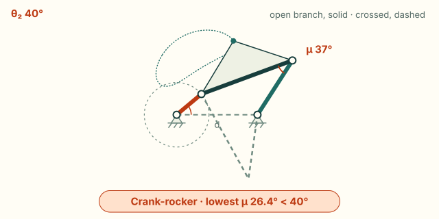
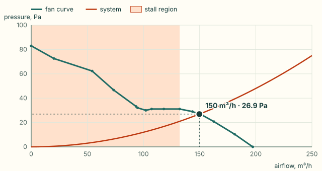
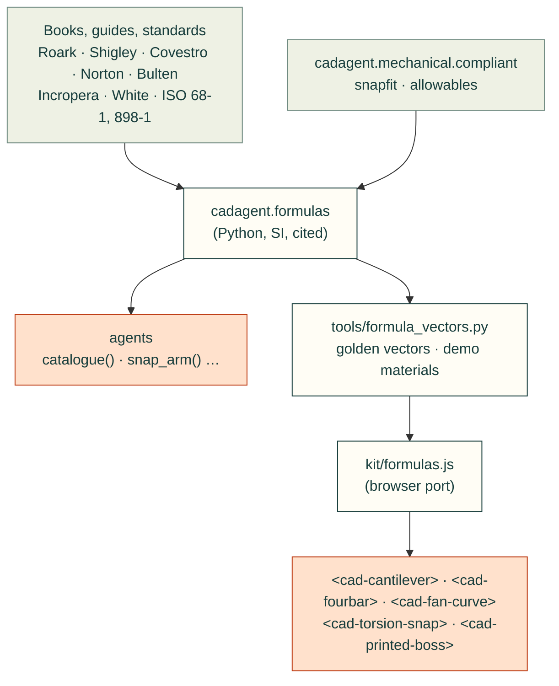

# Engineering formulas

`cadagent.formulas` holds the closed-form equations that 3D-printed mechanisms keep needing: beams and snap arms,
torsion bars, springs, screws, four-bar and five-bar linkages, wall conduction and fan operating points. Agents call it from Python
instead of re-deriving the equations. The website's demonstrations call a browser port of the same functions, and the
two are tested against one set of golden vectors, so a demo never shows a number an agent would not get. Every
function states its SI units and its validity limits, and cites its source by author, title, edition and section.

## Try it: the snap-arm explorer

The explorer (`<cad-cantilever>`, also on [Snap fits](compliant.md#try-it-the-snap-arm-explorer)) runs the browser port
of `snap_arm`. Sliders set the length, root thickness, width and deflection, and you pick the material and print
direction. The beam bends along its computed curve, coloured by strain, with the root strain, force and pass or fail
against the filament's allowable strain.

<cad-cantilever material="copa-polymaker-dry" direction="along" design="1" length="20" thickness="1.6" width="6" deflection="1.5">

</cad-cantilever>

## Try it: the four-bar animator

The animator (`<cad-fourbar>`, also on [Linkages](linkages.md#try-it-the-four-bar-animator)) runs the browser
port of `grashof`, `fourbar_input_limits`, `fourbar_angles` and `transmission_angle`. Sliders set the four links. The
crank turns, or rocks and stops where the linkage locks, on the assembly you pick, with the other assembly dashed. The
chart plots the transmission angle over a turn of the input against the 40° guideline. Rigid links on ideal pins,
position only.

<cad-fourbar crank="40" coupler="120" rocker="80" ground="100" branch="open" angle="40">

</cad-fourbar>

## Try it: the fan-curve explorer

The explorer (`<cad-fan-curve>`, also on [Airflow and fans](fans.md#try-it-the-fan-curve-explorer)) runs the browser
port of `fans_in_parallel`, `fans_in_series`, `system_coefficient`, `fan_operating_point` and `fan_stall_flow` on a
real fan's datasheet curve. Set the supply voltage, the pressure the enclosure needs at 100 m³/h, and one to four
fans in parallel or in series. The dot marks the operating point; the shaded band is the fan's stall region.

<cad-fan-curve fan="12" system="12" count="1" arrangement="parallel">

</cad-fan-curve>

Two more explorers run the same port: the [torsion-snap explorer](compliant.md#try-it-the-torsion-snap-explorer)
(`torsion_snap_bar`: a rectangular bar twisted by a lever) and the
[screw-boss explorer](screw-bosses.md#try-it-the-screw-boss-explorer) (`screw_boss`: a thread-forming screw tightened
in a printed boss).

## Limits

- **A closed form is not proof of fit or strength.** Each result holds only inside the limits it states. A printed
  part is weaker across its layers than any isotropic formula assumes, and creeps under a held load. Print the part
  and measure it.
- **Small deflection and linear elasticity.** These hold for every beam, torsion and spring formula here. For large
  deflections, contact or plastic strain, use FEA (`cadagent.simulation.fea`) and a test.
- **Screws.** Torque gives preload to about ±25 % even with a known nut factor; in plastic the factor is unknown
  until measured. Thread stripping assumes even load sharing, which real threads do not have.

## Why it is built, not adopted

We looked before writing anything. Each closed form here is a few lines long. The browser has to compute exactly
what the Python does, and a Python dependency cannot be mirrored in a web page. CI's core job installs only PyYAML
and NumPy. So the equations are written out here and tested against their sources. Beyond them, use fluids and ht
for duct losses and convection, pint for unit-checked quantities, SymPy to derive new closed forms, and pylinkage
for linkage synthesis.

<details>
<summary>The projects we surveyed, and what is reused from this repo</summary>


- **[fluids](https://github.com/CalebBell/fluids) and [ht](https://github.com/CalebBell/ht)** by Caleb Bell (MIT):
  pipe and duct losses, fittings, and hundreds of convection correlations. When a design needs a Nusselt number or a
  duct loss coefficient, use them. `ht.conduction.k_to_R` is the same plane-wall resistance as `wall_resistance`
  here. Our composite wall with surface films follows the same series-resistance layout as `ht`'s cylindrical
  version.
- **[pint](https://github.com/hgrecco/pint)** (BSD-3) for callers who want unit-checked quantities. These functions
  take plain SI floats, so the browser port can match them.
- **[SymPy](https://www.sympy.org)** (BSD-3) for deriving new closed forms. The tapered-arm integrals here were done
  by hand and checked numerically in the tests.
- **[pylinkage](https://github.com/HugoFara/pylinkage)** (MIT) for linkage synthesis and optimisation; here only
  position analysis.
- **[me-toolbox](https://pypi.org/project/me-toolbox/)** (MIT, by Omri Stein) for Shigley-style springs, fasteners
  and fatigue. It was read for scope. Its author describes it as a personal tool, and it pulls in SymPy.
- **Reused from this repo, never forked:**
  - The snap-arm functions call `cadagent.mechanical.compliant.snapfit`, so they match `cad-agent snapfit` exactly.
  - The demo's materials come from `cadagent.mechanical.compliant.allowables`.
  - The straight-line fan curve is the same model as `cadagent.thermal.heatsink.FanCurve`. A test checks that the two
    solvers find the same operating point.

</details>

How the sources, the Python, the golden vectors and the browser port connect:



## What it computes

SI units throughout: metres, newtons, pascals, kelvin, watts, radians, m³/s. A strain is a fraction (0.02 = 2 %).

<details>
<summary>All 84 functions in <code>catalogue()</code>: what each computes, its source and where it is valid</summary>

| Function | What | Source | Valid within |
|---|---|---|---|
| `rect_second_moment` | I = b h³ / 12 | Roark 8th ed., Table A.1 | solid rectangle |
| `cantilever_tip_deflection` | y = F L³ / 3 E I | Roark 8th ed., Table 8.1, case 1a | Euler–Bernoulli, small deflection |
| `beam_stiffness` | 3, 12, 48, 192 E I / L³ (cantilever, guided, simply supported, fixed–fixed) | Roark 8th ed., Table 8.1 | point load; slender beam |
| `cantilever_shape` | the deflected curve, constant or tapered arm | Roark 8th ed., Section 8.1, integrated exactly | end load |
| `cantilever_strain_profile` | surface strain along the arm over the root's | Roark 8th ed., Section 8.1 (σ = M c / I) | end load |
| `cantilever_thickness_profile` | thickness along the arm (design 2 tapers to h/2) | Covestro guide, Table 1 | linear taper |
| `cantilever_taper_factor` | exact k in y = k ε L² / h: 2/3, 1.0904, 0.8552 | Roark, integrated; Covestro Table 1 prints 0.67, 1.09, 0.86 | rectangle |
| `snap_root_strain` | ε = y h / (k L²), the guide's factors | Covestro guide, Table 1 (via `snapfit`) | small deflection, one part rigid |
| `snap_deflection_force` | P = (b h² / 6) Es ε / L | Covestro guide, Table 1 (via `snapfit`) | secant modulus at that strain |
| `snap_arm` | strain, force, stiffness, pass/fail, permissible deflection | Covestro guide, Table 1 (via `snapfit`) | a pass has no extra margin |
| `shear_modulus` | G = E / 2(1 + ν) | Roark 8th ed., Section 2.2 | isotropic only |
| `torsion_constant_round`, `torsion_constant_rect` | K for solid, hollow and rectangular bars | Roark 8th ed., Table 10.1 (solid and hollow concentric circular, solid rectangular sections) | Saint-Venant torsion; the rectangle within 0.5 % |
| `torsion_shear_stress_round`, `torsion_shear_stress_rect` | peak shear stress | Roark 8th ed., Table 10.1 | away from ends and steps |
| `torsion_bar_twist`, `torsion_bar_stiffness` | θ = T L / K G, T / θ = K G / L | Roark 8th ed., Section 10.1 | constant section |
| `torsion_shear_strain_rect` | peak shear strain from the twist, γ = θ K (τ / T) / L: the section alone sets it | Roark 8th ed., Table 10.1 | within 0.8 % of the series |
| `torsion_snap_bar` | a rectangular torsion snap: shear strain against the guide's (1 + ν) ε, torque, force at the lever, permissible twist | Covestro guide, Section C; Roark 8th ed., Table 10.1 | small twist (it flags the trapeze effect past a tenth of the torque); isotropic G, so the force is an upper bound |
| `spring_index`, `spring_rate` | C = D / d, k = G d⁴ / 8 D³ Na | Shigley 10th ed., Sections 10-1, 10-3, Eqs. (10-1), (10-9) | 4 ≤ C ≤ 12; 15–85 % of travel |
| `bergstrasser_factor`, `spring_shear_stress` | K_B = (4C + 2)/(4C − 3), τ = K_B 8 F D / π d³ | Shigley 10th ed., Sections 10-1, 10-2, Eqs. (10-5), (10-7) | static, round wire |
| `preload_from_torque`, `torque_for_preload` | F = T / K d, with `NUT_FACTORS` | Shigley 10th ed., Section 8-8, Eq. (8-27), Table 8-15 | ±25 % at best |
| `nut_factor` | K from thread and collar friction, at any flank angle (60° by default) | Shigley 10th ed., Section 8-8, Eq. (8-26) | collar at 1.25 d; ISO pitch diameter |
| `tensile_stress_area` | As = π/4 (d − 0.9382 p)² | ISO 898-1:2013; Shigley Table 8-1 | ISO metric |
| `thread_shear_areas`, `thread_strip_force` | 0.75 π D1 Le (screw), 0.875 π d Le (hole) | ISO 68-1:1998 basic profile | even load sharing, no tolerances |
| `thread_radial_pressure` | the flanks' outward push, p = F tan(α / 2) / π d Le | Shigley 10th ed., Section 8-2 | frictionless flank, even load |
| `boss_hoop_stress` | hoop stress at the bore, p (D² + d²) / (D² − d²) | Shigley 10th ed., Section 3-14 | Lamé cylinder, isotropic |
| `screw_boss` | a thread-forming screw in a boss: clamp band, strip force and torque, the tightening window, hoop stress, boss proportions | Covestro, *Self-tapping screws for thermoplastics* (2016-04), Section A; Bulten, DELTA PT brochure (2025), p. 7 | the drive torque is measured, not computed, and makes no clamp: unmeasured, the clamp band allows for up to T / 1.2 of it |
| `proof_load` | Fp = At Sp, a property class's proof strength on the stress area | Shigley 10th ed., Section 8-9 and Table 8-11 | the class minimum: a floor, not one screw's strength |
| `annulus_stress` | F / (π/4 (D² − d²)): a limiter's wall, the pressure under a head | Shigley 10th ed., Section 3-9 | uniform over full contact; no buckling |
| `limiter_stack` | a compression limiter's standout over the plastic it goes through, worst case either way: proud, short or either | Shigley 10th ed., Section 1-14 (worst-case tolerance stack) | rigid parts, the tolerances given |
| `limiter_plastic_load` | the plastic's share of the preload before the head lands on a short limiter, min(k s, F) | Shigley 10th ed., Section 8-7 | the plastic as a linear spring |
| `frustum_stiffness` | a clamped member's stiffness as a hollow cone from the head's face, π E d tan α / ln[...] | Shigley 10th ed., Section 8-5, Eqs. 8-19 and 8-20 | linear elastic, isotropic; the cone's 30° half angle fits steel |
| `press_fit_pressure`, `press_fit_force` | the contact pressure of a press fit (a limiter in its hole), and the force that pushes it out | Shigley 10th ed., Section 3-16 | smooth, elastic, long fit; a knurl cuts in instead |
| `preload_retained`, `preload_retained_limited` | the preload left when the plastic in the clamp relaxes to a measured ratio, without and with a limiter (the screw, limiter and plastic as three springs, or the cautious bound) | Shigley 10th ed., Sections 8-7 and 8-9 | the relaxation ratio is measured, not computed |
| `insert_displaced_volume`, `overflow_volume` | the plastic a heat-set insert pushes aside, and the pocket below it in a blind hole | SPIROL's inserts guide (05/26), p. 5 (the hole deeper than the insert); plain geometry | incompressible melt, none lost to the iron |
| `insert_shear_force`, `insert_shear_torque` | an insert's pull-out (push-out) and torque-out: c τ π D L and c τ π D² L / 2 on the knurl's cylinder | Shigley 10th ed., Section 3-9; c fitted to published tests (`cadagent.mechanical.inserts.calibration`) | near the tests c came from: M3 x 5.7 and M6 x 12.7 in printed PLA and PETG |
| `insert_clamp_path` | where the screw's tension goes: into a shoulder (seat), through a flush insert, or into the knurl (jack-out) | Shigley 10th ed., Section 8-7; the makers' flush rule (PEM bulletin SI, SPIROL) | any recess jacks out; proud by 0.13 mm still counts as flush |
| `insert_limited_torque` | the most to tighten into an insert: the screw's proof, the insert's torque-out through the thread's share, and jack-out with any separating load | Shigley 10th ed., Sections 8-8 and 8-9 | thread torque turns the insert; jack-out combined linearly |
| `grashof` | Grashof class, whether the input crank turns fully, and the inversion (crank-rocker, double crank, rocker-crank, double rocker, triple rocker) | Norton 5th ed., Chapter 2 | rigid links |
| `fourbar_angles` | coupler and output angles, open or crossed | Freudenstein (1955); Norton 5th ed., Chapter 4 | position only; a gap under 1e-12 of the longest link counts as closed |
| `transmission_angle` | angle between coupler and rocker | Norton 5th ed., Chapter 4 | position only; the same closing test |
| `fourbar_input_limits` | the input angles where coupler and rocker fold or stretch into line and the linkage locks | Norton 5th ed., Chapter 4 (toggle positions) | position only; the same closing test |
| `fivebar_point` | a five-bar's tip from its two crank angles, on either assembly | Gonçalves, Carvalho and Santos (COBEM 2009), Section 2.2, after Liu, Wang and Zheng (2006) | position only; a crank of 0 makes it a four-bar |
| `fivebar_inputs` | the two crank angles that put the tip at a point, on any of the four working modes | Gonçalves et al. (2009), Section 2.1 | position only; the tip inside both arms' reach |
| `fivebar_jacobians` | how near the five-bar is to a lock (distal links in line) or an arm's edge (crank and distal link in line), and the transmission angle | Gosselin and Angeles (1990) | first order: where a singularity is, not a force |
| `rating_life`, `required_dynamic_rating` | a rolling bearing's basic rating life L10 = (C / P)^p (p = 3 ball, 10/3 roller), and the C a life needs | SKF *Rolling bearings* (2018-10), Section B.3, p. 89 (ISO 281) | 90 % of a group of bearings; no lubrication or contamination factors |
| `life_hours` | a life in millions of revolutions as hours at a speed, 10⁶ L / 60 n | SKF (2018-10), p. 89 | constant speed |
| `reliability_factor` | a1 for 90 to 99.95 % reliability | SKF (2018-10), Table 3, p. 90 (ISO 281), and the Weibull form that rounds to it | ISO 281's range |
| `equivalent_load`, `deep_groove_factors`, `deep_groove_load` | P = X Fr + Y Fa; a deep-groove ball bearing's e, X and Y by f0 Fa / C0 and clearance | SKF (2018-10), p. 91, p. 254 and Table 9, p. 257 (ISO 281 Table 3) | single row; interpolated, clamped outside the table |
| `static_equivalent_load`, `static_safety`, `static_rating_iso76` | P0 = 0.6 Fr + 0.5 Fa (not below Fr), s0 = C0 / P0, and C0 = f0 Z Dw² from the internal geometry | SKF (2018-10), pp. 104–106 and 254; ISO 76:2006 | radial ball bearings |
| `miner_life`, `duty_cycle_load`, `revolution_fractions`, `varying_load_mean` | a duty cycle's life (Palmgren–Miner) and its cubic-mean load; time shares into revolution shares; (Fmin + 2 Fmax) / 3 | SKF (2018-10), pp. 90 and 92 | linear damage; blocks in any order |
| `harris_factor`, `critical_amplitude`, `rumbarger_factor`, `rolling_travel` | an oscillating bearing: oscillations per revolution (90 / θ), the critical amplitude 360 / Z(1 ± γ), the shorter life below it, the arc a contact rolls | Menck and Stammler, *Wind Energy Science* 9 (2024), Eqs. (3)–(5); SKF (2018-10), Table 4, p. 91 | not below 10°, where wear and false brinelling govern |
| `stribeck_ball_load`, `hertz_point_contact`, `ball_raceway_contact` | the most loaded ball (5 Fr / Z), and the exact Hertz ellipse and peak pressure of a ball in its groove | NSK Technical Report E728h (2024), Sections 5.2 and 5.4; Johnson 1st ed., Chapter 4; Hamrock and Brewe (1983) | elastic, frictionless; the groove's osculation is the maker's |
| `wall_resistance`, `film_resistance` | R = L / k A, R = 1 / h A | Incropera 7th ed., Section 3.1.2, Eqs. (3.6), (3.9) | steady, 1-D |
| `wall_heat_flow` | layers and films in series: heat flow and every face temperature | Incropera 7th ed., Section 3.1.3 | no contact resistance |
| `fan_curve_line`, `system_coefficient` | the datasheet fan line; k in Δp = k Q² | White 7th ed., Section 11.5 | same air density |
| `fans_in_series`, `fans_in_parallel` | identical fans: pressures add at one flow, flows add at one pressure | White 7th ed., Section 11.5 | no interaction losses |
| `fan_stall_flow` | the flow at the peak that ends the curve's last rise: below it, the stall region | White 7th ed., Section 11.5 | read from the curve's points |
| `fan_operating_point` | fan curve against Δp = r Q + k Q², solved exactly per segment; flags more than one crossing (unstable) and a point in the stall region | White 7th ed., Section 11.5 | steady flow |

</details>

`fx.catalogue()` returns the same list as data, with each function's units, limits and full citation, so an agent
can find the formula it needs without reading the source.

```python
from cadagent import formulas as fx
arm = fx.snap_arm(length=0.020, thickness=0.0016, width=0.006, deflection=0.0015,
                  modulus=2.703e9, allowable_strain=0.020)       # CoPA, along the layers
arm["strain"], arm["force"], arm["passes"]                        # 0.0090, 3.1 N, True
fx.preload_from_torque(torque=0.5, diameter=0.003)                # 833 N with K = 0.2
fx.fan_operating_point(fx.fan_curve_line(15.2, 0.0108), k=2e6)   # flow, pressure, stability
```

In the browser, `kit/formulas.js` exports the functions the demos use (`snapArm`, `cantileverShape`,
`cantileverStrainProfile`, `fourbarAngles`, `fanOperatingPoint` and the others in the golden vectors) in the same SI
units. `kit/formulas-data.js` carries the demos' data: the printed filaments, and the fan curves of
`cadagent.thermal.fans`.

## Tests that keep it honest

`tests/test_formulas.py` checks each function against a published value or an independent derivation written out
in the test.

<details>
<summary>What each family is tested against: beams, torsion, springs, screws, linkages, heat and air</summary>

- **Beams.**
  - Beam stiffness by the direct stiffness method.
  - The tapered-arm curves by numerical integration, and the Covestro Table 1 factors as the exact integrals rounded.
  - Example I of the guide in SI units, and agreement with `cad-agent snapfit` to 1e-12.
- **Torsion.**
  - Rectangular sections against the Saint-Venant series (within 0.5 %, the worst at aspect 1.145), and against the
    tabulated coefficients in Shigley, Section 3-12.
  - The peak shear strain against the series (within 0.8 %, the worst at aspect 1.136), and its thin-strip limit.
  - The guide's torsion snap as the same mechanics; the rectangular snap's torque, force and permissible twist from
    first principles (`tests/test_torsion_snap_boss.py`).
- **Springs.**
  - The rate derived from the wire as a torsion bar.
  - Bergsträsser against Wahl.
- **Screws.**
  - The ISO stress areas against their tabulated values.
  - K ≈ 0.2 from Eq. (8-26) at a friction of 0.15.
  - The 0.75 and 0.875 shear-area factors derived from the ISO 68-1 profile.
  - The flank's radial push from its statics, and Lamé's hoop stress against the equilibrium of half the ring.
- **Linkages.**
  - Loop closure, and an independent circle-intersection construction, at every input angle.
  - Kites (a = b, c = d) and near-kites, every 0.1 degree, where the textbook root divides 0 by 0.
  - Parallelograms and other change-point linkages, every 0.1 degree and every 1e-9 rad near 0 and 180 degrees,
    where the two branches meet and round-off can push the discriminant below 0. Each branch must be the one
    asked for.
  - The input's limit angles on linkages whose crank cannot turn fully, where the linkage closes in one position.
  - `fourbar_input_limits` on every four-bar with links 1 to 6: the input turns fully exactly when `grashof` says so,
    and `fourbar_angles` closes exactly inside the limits.
  - Norton's Example 4-1.
  - The five-bar (`tests/test_linkages.py`) against Liu, Wang and Zheng's direct and inverse kinematics as Gonçalves
    et al. print them, a line and a quadratic rather than two circles, on two symmetric 5Rs every 15 degrees; the
    tip's reach against the two annuli; the Jacobians against finite differences; and a four-bar as a five-bar
    without a second crank against `fourbar_angles`.
- **Heat and air.**
  - The composite wall face by face.
  - The fan point against the quadratic root and against `cadagent.thermal.heatsink.operating_point`.
  - A stall dip flagged unstable, and the stall region's edge on dips and flat tops.
  - One fan, two in series and two in parallel solved by hand, and where series and parallel give the same air.
  - Every operating point the ebm-papst datasheet tabulates, found again from its curves and system curves.

</details>

`tools/formula_vectors.py --check` fails when the committed golden vectors or the demo's material table no longer
match the Python. `tests/webkit-formulas.test.mjs` runs the browser port on those vectors to 1e-12.
