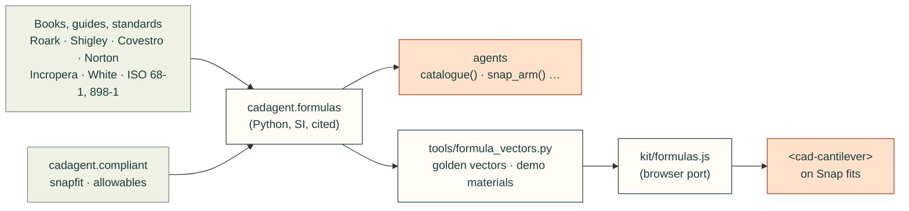

# Engineering formulas

`cadagent.formulas` holds the closed-form equations that 3D-printed mechanisms keep needing: beams and snap arms,
torsion bars, springs, screws, four-bar linkages, wall conduction and fan operating points. Agents call it from Python
instead of re-deriving the equations. The website's demonstrations call a browser port of the same functions, and the
two are tested against one set of golden vectors, so a demo never shows a number an agent would not get. Every
function states its SI units and its validity limits, and cites its source by author, title, edition and section.



## Why it is built, not adopted

We looked before writing anything. Each closed form here is a few lines long. The browser has to compute exactly
what the Python does, and a Python dependency cannot be mirrored in a web page. CI's core job installs only PyYAML
and NumPy. So the equations are written out here and tested against their sources. These are the projects to use
for the work beyond them:

- **[fluids](https://github.com/CalebBell/fluids) and [ht](https://github.com/CalebBell/ht)** by Caleb Bell (MIT):
  pipe and duct losses, fittings, and hundreds of convection correlations. When a design needs a Nusselt number or a
  duct loss coefficient, use them. `ht.conduction.k_to_R` is the same plane-wall resistance as `wall_resistance`
  here. Our composite wall with surface films follows the same series-resistance layout as `ht`'s cylindrical
  version.
- **[pint](https://github.com/hgrecco/pint)** (BSD-3) for callers who want unit-checked quantities. These functions
  take plain SI floats, so the browser port can match them.
- **[SymPy](https://www.sympy.org)** (BSD-3) for deriving new closed forms. The tapered-arm integrals here were done
  by hand and checked numerically in the tests.
- **[pylinkage](https://github.com/HugoFara/pylinkage)** (MIT) for linkage synthesis and optimisation; here only
  position analysis.
- **[me-toolbox](https://pypi.org/project/me-toolbox/)** (MIT, by Omri Stein) for Shigley-style springs, fasteners
  and fatigue. It was read for scope. Its author describes it as a personal tool, and it pulls in SymPy.
- **Reused from this repo, never forked:**
  - The snap-arm functions call `cadagent.compliant.snapfit`, so they match `cad-agent snapfit` exactly.
  - The demo's materials come from `cadagent.compliant.allowables`.
  - The straight-line fan curve is the same model as `cadagent.heatsink.FanCurve`. A test checks that the two
    solvers find the same operating point.

## What it computes

SI units throughout: metres, newtons, pascals, kelvin, watts, radians, m³/s. A strain is a fraction (0.02 = 2 %).

| Function | What | Source | Valid within |
|---|---|---|---|
| `rect_second_moment` | I = b h³ / 12 | Roark 8th ed., Table A.1 | solid rectangle |
| `cantilever_tip_deflection` | y = F L³ / 3 E I | Roark 8th ed., Table 8.1, case 1a | Euler–Bernoulli, small deflection |
| `beam_stiffness` | 3, 12, 48, 192 E I / L³ (cantilever, guided, simply supported, fixed–fixed) | Roark 8th ed., Table 8.1 | point load; slender beam |
| `cantilever_shape` | the deflected curve, constant or tapered arm | Roark 8th ed., Section 8.1, integrated exactly | end load |
| `cantilever_strain_profile` | surface strain along the arm over the root's | Roark 8th ed., Section 8.1 (σ = M c / I) | end load |
| `cantilever_thickness_profile` | thickness along the arm (design 2 tapers to h/2) | Covestro guide, Table 1 | linear taper |
| `cantilever_taper_factor` | exact k in y = k ε L² / h: 2/3, 1.0904, 0.8552 | Roark, integrated; Covestro Table 1 prints 0.67, 1.09, 0.86 | rectangle |
| `snap_root_strain` | ε = y h / (k L²), the guide's factors | Covestro guide, Table 1 (via `snapfit`) | small deflection, one part rigid |
| `snap_deflection_force` | P = (b h² / 6) Es ε / L | Covestro guide, Table 1 (via `snapfit`) | secant modulus at that strain |
| `snap_arm` | strain, force, stiffness, pass/fail, permissible deflection | Covestro guide, Table 1 (via `snapfit`) | a pass has no extra margin |
| `shear_modulus` | G = E / 2(1 + ν) | Roark 8th ed., Section 2.2 | isotropic only |
| `torsion_constant_round`, `torsion_constant_rect` | K for solid, hollow and rectangular bars | Roark 8th ed., Table 10.1 (solid and hollow concentric circular, solid rectangular sections) | Saint-Venant torsion; the rectangle within 0.5 % |
| `torsion_shear_stress_round`, `torsion_shear_stress_rect` | peak shear stress | Roark 8th ed., Table 10.1 | away from ends and steps |
| `torsion_bar_twist`, `torsion_bar_stiffness` | θ = T L / K G, T / θ = K G / L | Roark 8th ed., Section 10.1 | constant section |
| `spring_index`, `spring_rate` | C = D / d, k = G d⁴ / 8 D³ Na | Shigley 10th ed., Sections 10-1, 10-3, Eqs. (10-1), (10-9) | 4 ≤ C ≤ 12; 15–85 % of travel |
| `bergstrasser_factor`, `spring_shear_stress` | K_B = (4C + 2)/(4C − 3), τ = K_B 8 F D / π d³ | Shigley 10th ed., Sections 10-1, 10-2, Eqs. (10-5), (10-7) | static, round wire |
| `preload_from_torque`, `torque_for_preload` | F = T / K d, with `NUT_FACTORS` | Shigley 10th ed., Section 8-8, Eq. (8-27), Table 8-15 | ±25 % at best |
| `nut_factor` | K from thread and collar friction | Shigley 10th ed., Section 8-8, Eq. (8-26) | 60° thread |
| `tensile_stress_area` | As = π/4 (d − 0.9382 p)² | ISO 898-1:2013; Shigley Table 8-1 | ISO metric |
| `thread_shear_areas`, `thread_strip_force` | 0.75 π D1 Le (screw), 0.875 π d Le (hole) | ISO 68-1:1998 basic profile | even load sharing, no tolerances |
| `grashof` | Grashof class, whether the input crank turns fully | Norton 5th ed., Chapter 2 | rigid links |
| `fourbar_angles` | coupler and output angles, open or crossed | Freudenstein (1955); Norton 5th ed., Chapter 4 | position only |
| `transmission_angle` | angle between coupler and rocker | Norton 5th ed., Chapter 4 | position only |
| `wall_resistance`, `film_resistance` | R = L / k A, R = 1 / h A | Incropera 7th ed., Section 3.1.2, Eqs. (3.6), (3.9) | steady, 1-D |
| `wall_heat_flow` | layers and films in series: heat flow and every face temperature | Incropera 7th ed., Section 3.1.3 | no contact resistance |
| `fan_curve_line`, `system_coefficient` | the datasheet fan line; k in Δp = k Q² | White 7th ed., Section 11.5 | same air density |
| `fan_operating_point` | fan curve against Δp = r Q + k Q², solved exactly per segment; flags a stall dip | White 7th ed., Section 11.5 | steady flow |

`fx.catalogue()` returns the same list as data, with each function's units, limits and full citation, so an agent
can find the formula it needs without reading the source.

```python
from cadagent import formulas as fx
arm = fx.snap_arm(length=0.020, thickness=0.0016, width=0.006, deflection=0.0015,
                  modulus=2.703e9, allowable_strain=0.020)       # CoPA, along the layers
arm["strain"], arm["force"], arm["passes"]                        # 0.0090, 3.1 N, True
fx.preload_from_torque(torque=0.5, diameter=0.003)                # 833 N with K = 0.2
fx.fan_operating_point(fx.fan_curve_line(15.2, 0.0108), k=2e6)   # flow, pressure, stability
```

In the browser, `kit/formulas.js` exports the functions the demos use (`snapArm`, `cantileverShape`,
`cantileverStrainProfile` and the others in the golden vectors) in the same SI units.

## Demonstrations

- **Snap-arm explorer** (`<cad-cantilever>`, on [Snap fits](compliant.md#try-it-the-snap-arm-explorer)). Sliders
  set the length, root thickness, width and deflection, and you pick the material and print direction. The beam
  bends along its computed curve, coloured by strain, with the root strain, force and pass or fail against the
  filament's allowable strain.

## Limits

- **A closed form is not proof of fit or strength.** Each result holds only inside the limits it states. A printed
  part is weaker across its layers than any isotropic formula assumes, and creeps under a held load. Print the part
  and measure it.
- **Small deflection and linear elasticity.** These hold for every beam, torsion and spring formula here. For large
  deflections, contact or plastic strain, use FEA (`cadagent.fea`) and a test.
- **Screws.** Torque gives preload to about ±25 % even with a known nut factor; in plastic the factor is unknown
  until measured. Thread stripping assumes even load sharing, which real threads do not have.

## Tests that keep it honest

`tests/test_formulas.py` checks each function against a published value or an independent derivation written out
in the test:

- **Beams.**
  - Beam stiffness by the direct stiffness method.
  - The tapered-arm curves by numerical integration, and the Covestro Table 1 factors as the exact integrals rounded.
  - Example I of the guide in SI units, and agreement with `cad-agent snapfit` to 1e-12.
- **Torsion.**
  - Rectangular sections against the Saint-Venant series (within 0.5 %, the worst at aspect 1.145), and against the
    tabulated coefficients in Shigley, Section 3-12.
  - The guide's torsion snap as the same mechanics.
- **Springs.**
  - The rate derived from the wire as a torsion bar.
  - Bergsträsser against Wahl.
- **Screws.**
  - The ISO stress areas against their tabulated values.
  - K ≈ 0.2 from Eq. (8-26) at a friction of 0.15.
  - The 0.75 and 0.875 shear-area factors derived from the ISO 68-1 profile.
- **Linkages.**
  - Loop closure, and an independent circle-intersection construction, at every input angle.
  - Kites (a = b, c = d) and near-kites, every 0.1 degree, where the textbook root divides 0 by 0.
  - Norton's Example 4-1.
- **Heat and air.**
  - The composite wall face by face.
  - The fan point against the quadratic root and against `cadagent.heatsink.operating_point`.
  - A stall dip flagged unstable.

`tools/formula_vectors.py --check` fails when the committed golden vectors or the demo's material table no longer
match the Python. `tests/webkit-formulas.test.mjs` runs the browser port on those vectors to 1e-12.
