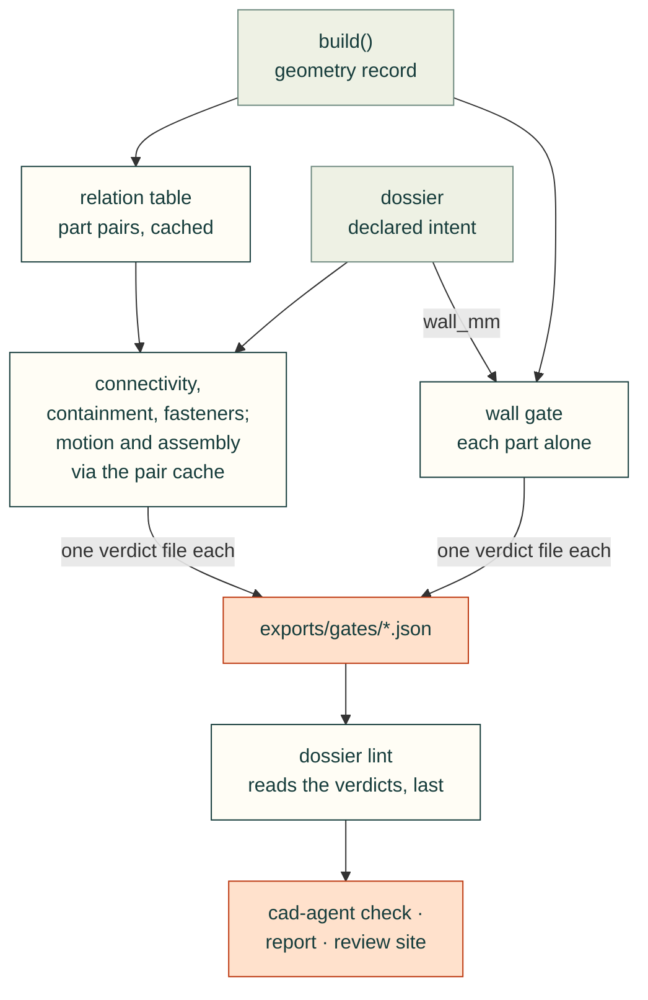
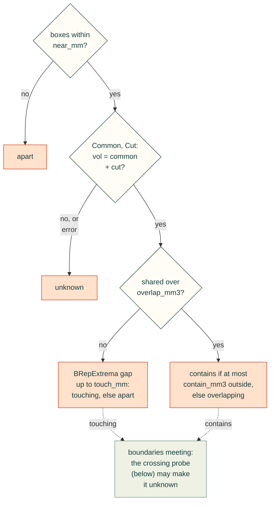
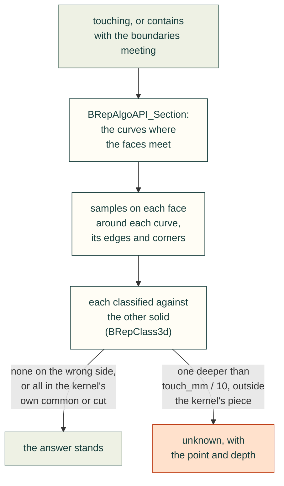

# Integrity gates (`cadagent.review.gates`)

Assembly-level checks computed from the CAD model, each written as one verdict file. They answer what per-part
checks cannot: is this part touching the one it should be fastened to, is the ball inside the hopper, is this wall
thick enough. The design behind them is [`design-process-plan.md`](design-process-plan.md) §4; the declarations
they read come from the dossier ([`dossier.md`](dossier.md)).

**What a gate does not do.** A gate checks the model against declared intent with stated tolerances. It does not
prove that printed parts fit, move or hold: no tolerance stack, no print shrink, no deflection. Every verdict says
`physical_fit_verified: false` and lists its assumptions.



Status: the shared machinery (T3), the minimum-wall gate (T8), the connectivity gate (T4), the containment gate (T5),
the fastener gate (T6), the motion gate (T7), the assembly-access gate (T9), the gate bench (T12), the dossier lint
(T2, [`dossier.md`](dossier.md#lint-and-status)), the `cad-agent gates` command with its `check` and report rows
(T14, [below](#running-the-gates-cad-agent-gates)) and the site's gates page with the connectivity graph (T15,
[`dossier.md`](dossier.md#on-the-review-site)) are built.

## The assembly and the relation table

<details>
<summary>The Assembly and relation-table API: adding parts and cavities, the table, one pair, a posed copy</summary>

```python
from cadagent.review.gates import Assembly, Tolerances, PairCache, relation_table, relate_pair, relate

asm = Assembly.from_build(build_result)                 # from a dossier build (live or load_geometry): see below
asm = Assembly()                                        # or by hand:
asm.add("base", base)                                   # CadQuery / build123d shape or TopoDS_Shape
asm.add("arm", arm, location=(40, 0, 12), body="arm", group="S2")
asm.add("lid", lid, cq.Location(...), content_hash=recorded)  # placement: Location, gp_Trsf, TopLoc, 3x4/4x4 rows
asm.add_cavity("hopper_cavity", void, part="hopper")    # a declared void: not a part, never in the pair table
asm = Assembly({"base": base, "lid": lid})              # or a mapping of shapes already placed
asm = Assembly.from_cadquery(cq_assembly)               # parts named by path, bodies by top-level child

table = relation_table(asm, Tolerances(), cache=PairCache(".cadagent-cache/gates"))
table.get("lid", "base")            # Relation, oriented as asked (see "Pairs the table did not examine")
table.get("lid", "far", exact=True) # run the kernel for a pair not yet examined
table.contacts()                    # touching + overlapping + contains: the contact-graph edges
table.interferences()               # overlapping + contains: shared volume
table.of("lid")                     # every exact relation of one part, with it as `a`
table.stats                         # parts, pairs, candidates, kernel_queries, cache_hits, seconds, states
table.to_dict()                     # JSON-ready evidence, with the kernel version

relate_pair(asm, "ball#3", "hopper_cavity", cache=cache)   # one named pair (parts or cavities), cached
relate(shape_a, shape_b)            # two bare shapes, uncached
asm.posed("arm", location)          # a copy with one body (and its cavities) moved; static parts untouched
```

</details>

A multi-solid part whose solids share volume is refused by `Assembly.add` (fuse it first): the boolean kernel
reports the common of such a compound with anything as done and empty. `solid_interference(shape)` lists the
offending solid pairs.

### From a dossier build

`Assembly.from_build(result)` takes a `cadagent.review.dossier` `BuildResult`, from the build itself or from
`load_geometry("exports/dossier-geometry.json")` in another process:

- parts and placed fasteners from `assembly_shapes(with_hashes=True)`, already in assembly coordinates, keyed as
  the build keys them (`"hopper"`, `"ball#3"`, `"screw_0"`), each with the **content hash recorded at build time**;
  a shape read back from BREP is never re-hashed, so the pair cache stays warm across processes;
- `Part.kind` from `result.kind(key)` (`"part"` or `"fastener"`) and `group` = the part's section;
- every cavity through `add_cavity`, with its recorded hash;
- `asm.joints` and `asm.fastener_axes` copied from the result for the motion and fastener gates;
- body labels from `moving_bodies(joints, fasteners, grounded)` (the rule is final; see the motion gate): a joint's
  `moving` part seeds its body, which grows transitively across `fixed` joints and fasteners (the fastener, what it
  clamps and what it threads into), never into a grounded part or a joint's `fixed` part.

### States

Following build123d-mcp's `clearance` (Apache-2.0, vendored; semantics adapted, no code copied):

| State | Meaning | Witness |
|---|---|---|
| `apart` | no shared volume, gap > `touch_mm` | `gap_mm`, closest points `point_a`, `point_b` |
| `touching` | no shared volume, gap ≤ `touch_mm` | as apart, plus `contact_area_mm2` (0 for point or line contact, and for a gap inside `touch_mm`) |
| `overlapping` | shared volume, neither inside the other | `overlap_mm3`, `a_outside_b_mm3`, `b_outside_a_mm3`, `overlap_centroid`, `overlap_box` |
| `contains` | one item has at most `contain_mm3` outside the other | as overlapping, plus `contained` (`a_in_b`, `b_in_a`, `both`), `wall_mm` and its `inner_point`, `outer_point` |
| `unknown` | the kernel failed, or its volumes disagreed (`error` says which) | a gate must fail on it |
| `unchecked` | from `get()` only: a pair excluded by `only=` or `skip_pairs` whose boxes do not prove a gap | a gate must fail on it or ask `exact=True` |

**`contains` between two parts is an interference.** A pin buried in a block is `contains`, not `overlapping`;
`Relation.interferes` and `table.interferences()` cover both. Only against a declared cavity solid is `contains`
the goal (the containment gate); between parts it needs an intended-overlap declaration like any other overlap.

### Tolerances (absolute)

| Field | Default | Meaning |
|---|---|---|
| `touch_mm` | 0.01 | a gap at or below this, with no shared volume, is touching |
| `overlap_mm3` | 0.001 | shared volume above this is an overlap (a 0.1 mm cube) |
| `contain_mm3` | 0.001 | an item with no more than this outside the other is inside it; a ball resting on a cavity wall has exactly 0 outside |
| `near_mm` | 1.0 | broad-phase margin: pairs whose boxes are within this get exact queries, so a 0.5 mm hover is measured |
| `volume_check_mm3` | 0.01 | allowed disagreement in `vol = common + cut` (plus 1e-6 of the larger volume) before a pair is `unknown` |

### Method, fail-safe rules and cost

AABB broad phase (`BRepBndLib.AddOptimal`, numpy over all pairs). For each candidate: `BRepAlgoAPI_Common` for the
shared volume and `BRepAlgoAPI_Cut` for each item's volume outside the other, all non-destructive (OCCT otherwise
raises the arguments' tolerances in place, changing the caller's shapes), then `BRepExtrema_DistShapeShape` for the
gap when nothing is shared.



*How a pair in the relation table gets its state, drawn from the rules on this page; the states are those in the
table above. The box test is the table's broad phase: `relate(a, b)` on two bare shapes skips it and starts at
Common and Cut. A `touching` or `contains` whose boundaries meet goes on to the
[near-tangent probe](#near-tangent-crossings-46).*

On solids, `BRepExtrema_DistShapeShape` first runs an inner-solution test: does any vertex of one lie inside the
other? OCCT 7.9 builds a new point classifier for each small chunk of vertices (about ten chunks per thread, at
least three vertices each), and that is most of a many-faced pair's time. So the gates run the same test once
(`_inner_vertex`, one classifier per solid). When no vertex is inside and the faces are clear of each other, they
take BRepExtrema's distance between the faces: the same gap and points (#186). Anything else (a vertex inside or
near, free edges or vertices, a kernel error) goes to BRepExtrema on the whole shapes, as before.

OCP 7.9 binds no error report on these operations (`HasErrors` is absent; `DSFiller()` reports warnings but crashes
the interpreter at exit), and `IsDone()` stays true on invalid input. So every answer is cross-checked:
`vol(a) = common + cut(a, b)`, and the same for `b` when they overlap. A mismatch, an exception, a missing solid or a
self-interfering compound gives `unknown`, never `touching`, `apart` or `contains`.

Measured with `tools/gate_timing.py` on the synthetic 100-part assembly (4,950 pairs, 90 candidates), on a workstation
at load average 11: broad phase 0.006 s, narrow phase 1.9 s cold, 0.03 s warm from the cache. The cross-check's
extra `Cut` roughly doubled the cold narrow phase. Real parts with hundreds of faces cost 10–100× more per pair. On
Gyropup's leg (the README hero's clearance sweep, 811 pairs, PR #198) on a 24-core workstation, the single
inner-solution test cut the time from 951 s to 685 s of calls, every relation byte-identical. It saves less on fewer
cores, since OCCT's own test builds about ten classifiers per thread. Most of what remains is BRepExtrema's own
search between nearby edges and faces.

### Near-tangent crossings (#46)

OCCT's boolean can miss a shallow crossing between two curved faces that are nearly tangent. Common and Cut then
agree with each other, so the `vol = common + cut` cross-check holds, and they read no crossing at all. A ball
pushed 0.011–0.23 mm through a cone wall read `contains` against the cavity and `touching` against the wall's part,
with up to 0.64 mm³ really outside. So wherever a `touching` or `contains` answer has the two boundaries meeting
(gap or wall within a tenth of `touch_mm`), `relate` checks it with tools that do no boolean:



<details>
<summary>How the probe samples: the section's curves, edges with no face pair, and the kernel's own piece</summary>

- **Why the section.** It finds the intersection curve where the boolean misses it: a closed curve around every
  missed crossing in the tests. The samples are a grid over each curve's box on each face (so a 1 mm cap gets
  0.1 mm spacing), the face's edges in that box and its vertices. Where the curve is an iso-line of the face (a
  circle on a cylinder), the rows across it close in on the curve by halves and also span the face. A sample on
  the wrong side by more than the floor (`touch_mm / 10`, 0.001 mm by default) is confirmed by its exact
  distance to the other part's faces.
- **Edges with no face pair.** The kernel names the two faces of a curve where faces intersect. A section edge
  that lies along an existing edge has none: the rim of a face contact, or a face split exactly at the other
  part's surface, which a crossing can still go through. The section's history names that edge, and the faces
  next to it get a coarse pass first (4 × 4), then the full grid if any sample is on the wrong side.
- **Why the kernel's piece.** A sample inside the kernel's own common (for `touching`) or cut (for `contains`) is a
  crossing the kernel saw and measured: a box corner 0.02 mm into a plate shares 7e-6 mm³ and stays `touching`.

</details>

- **The answer.** A crossing outside the kernel's own piece is `unknown`: its volume is not measured, so neither
  `touching` nor `overlapping` can be stated. `witness["crossing_probe"]` names the surface, the point, its depth (a lower
  bound) and the other part's nearest point; the containment gate turns it into an escape. If the probe itself
  fails, the pair is `unknown` too.
- **What it costs.** Only pairs whose boundaries meet pay: 0.03–0.06 s per ball pair above. On the README hero's
  clearance sweep (811 calls on Gyropup's leg), it ran on the 168 touching calls and took 3.7 s in all (at most
  0.09 s a call), against 760 s for the sweep, with every relation unchanged. Those are face contacts, so none
  of their section edges has a face pair: the coarse pass ran next to all of them and found nothing. The full
  grid there (145,441 samples) found no point on the wrong side either. On the gate bench it runs on the table's
  31 touching pairs and takes 0.3–0.4 s of the table's 1.5–1.6 s.
- **Limits.** A safety net, not a proof. A crossing the section also misses, one whose samples all lie within the
  floor, or one between samples is not seen. Next to an edge with no face pair, so is one the coarse pass steps
  over. The depth is that of the deepest sample, so at most the true depth. `apart` rests on
  `BRepExtrema_DistShapeShape`, which read 0 at every crossing tried. A fuzzy boolean does not help. In OCCT's
  [Boolean Operations guide](https://dev.opencascade.org/doc/overview/html/specification__boolean_operations.html)
  ("Fuzzy Boolean Operation"), the fuzzy value is an additional tolerance under which touching and near-coincident
  entities coincide. That hides shallow crossings rather than finding them, and `SetFuzzyValue` from 1e-5 to 1e-3
  fixed only 3 of 12 missed crossings.

<details><summary>Which crossings the boolean missed (OCP 7.9.3, x86_64)</summary>

Every pair below swept its depth around the tolerances (0.001–0.2 mm), at several positions and angles. Only the
sphere against a cone wall was ever misread; the planar cases and the other curved pairs were measured right.

| Fixture | Depths | Misread before | After |
|---|---|---|---|
| ball (r 4) through a cone wall, 5 angles, 50 depths, against the cavity and the wall's part | 0.0055–0.28 mm | 24 of 500: `contains` or `touching`, from 0.011 mm (0.0016 mm³ outside) to 0.23 mm (0.64 mm³) | all 24 `unknown`, depth within 0.001 mm |
| ball through a plate's face, 4 orientations | 0.001–0.08 mm | none | unchanged |
| cylinder (r 3) on a plate at 0°, 0.5° and 2°, two seam positions | 0.002–0.1 mm | none | unchanged |
| two boxes, one tilted 0.05–1°, a corner through the other's face | 0.001–0.08 mm | none | unchanged |
| ball in a bore, in a spherical cavity, against a torus; crossing rods; a cylinder on a cone | 0.002–0.2 mm | none | unchanged |

The tests (`tests/test_gate_relations.py`) run the cone at three angles and the three planar families with the
boolean made to miss the crossing as it does on the cone. They also run a ball and a cylinder whose faces are
split exactly at the plate's face, where the section's only edge has no face pair.

</details>

### Pairs the table did not examine

`get(a, b)` answers `apart` (with `exact=False` and `gap_lower_bound_mm`) only when the boxes prove a gap over
`touch_mm`; a pair the table skipped (`skip_pairs`, or outside `only=`) with touching boxes reads `unchecked`.

### The pair cache

<details>
<summary>How the cache keys a pair, where it lives, and why deleting it is safe</summary>

`PairCache(directory)` stores one JSON file per pair, keyed by the sha256 of both items' keys, the tolerances, the
relation version and the OCP version (a kernel upgrade re-queries everything). An item's key is its content hash
(`cadagent.review.evidence.shape_content_hash`, shared with the dossier: sha256 of the BREP text without triangulation,
flag lines stripped) plus its placement matrix rounded to 1e-9. A rebuild that moves or changes one part re-queries
only that part's pairs, across processes. Keep the cache out of `exports/`: the default is `.cadagent-cache/gates/`,
which is gitignored; deleting it is always safe.

</details>

## Verdicts

```python
from cadagent.review.gates import Check, verdict, write_verdict

checks = [Check("wall:hopper", "fail", "thinnest 0.800 mm < 2.4 mm", parts=["hopper"], evidence={...})]
data = verdict("wall", checks, assumptions=["rays along the inward normal ..."], limits={"tol_mm": 0.01},
               exclusions=[{"parts": ["insert_0", "hopper"], "reason": "heat-set knurl"}])
write_verdict("exports/gates/wall.json", data)       # unbound: `check` reads it as stale (see Inputs below)
```

The file (`schema: cadagent.gate/1`) has `pass`, `status` (`pass`/`warn`/`fail`), `counts`, `checks`, `findings`
(the checks that are not pass), `exclusions`, `limits`, `assumptions` and `physical_fit_verified: false`. `pass` is
false when any check fails **or when no check ran**. Warnings never fail the gate. At least one assumption is
required, every exclusion needs a reason, and the file has no timestamp, so an unchanged run writes identical bytes.

**Inputs.** `cad-agent gates` adds `inputs` to every verdict, so a verdict from an earlier build is never taken as
current:

```python
from cadagent.review.gates.verdict import bind_inputs, stale_reason, geometry_digest, record_hashes

bind_inputs(data, record, record_file="exports/dossier-geometry.json", declarations=decl, options=opts)
# data["inputs"] = {"geometry": {"file", "digest", "hashes": {key: content hash}}, "declarations": sha256, "options": sha256}
stale_reason(data, record, declarations=decl, options=opts)   # None, or why the verdict is stale
```

<details>
<summary>What the geometry digest covers, and when a verdict reads stale</summary>

`geometry_digest(record)` is the sha256 of the geometry record's canonical JSON without the fields that say who
built it or where: `actor`, `parameters`, `shapes_dir`, `out_dir` and `hash` at the top level, `declared_at` and
`file` in each part, cavity, joint, fastener, instance and step (only those fields: a part named `file` is still
digested). A rebuild that changes a shape, a flag, a joint, a fastener or a step changes it; the same geometry
rebuilt by someone else does not. `hashes` lets the stale message name the shapes that changed. `toolkit` records
the cad-agent version; it is not compared (an editable install keeps one version across code changes, and a
release would void every verdict whether its gate changed or not), so rerun the gates after an upgrade. A verdict
without `inputs` is stale. `cad-agent check` and the dossier lint (`verdict-stale`) compare the geometry, the
gate's declarations and its options; `lint()` called without a project compares the geometry only. The gates'
`out=` argument writes an unbound verdict: a gate run by hand, or a project's own gate writing into
`exports/gates/`, binds it with `bind_inputs` first, or `check` reports it as stale.

</details>

## Minimum wall (`cadagent.review.gates.wall`)

```python
from cadagent.review.gates.wall import check_wall, wall_gate, mesh_thickness, brep_thickness, brep_thickness_near

check_wall("hopper", 2.4, mesh=shape_or_stl_or_trimesh, shape=brep)           # -> Check
wall_gate({"hopper": {"wall_mm": 2.4, "mesh": m, "shape": s}, ...}, out="exports/gates/wall.json")
```

Two samplers measure thickness by rays along the inward surface normal:

- **mesh rays** from every triangle centroid (sub-sampled by area to `max_rays`, seeded), using trimesh with
  `rtree` or an exact numpy fallback. The mesh is repaired first (vertices within 1e-5 mm merged, degenerate and
  duplicate triangles dropped): CadQuery's tessellation leaves open seams at sphere poles, cone apexes and fillet
  corners;
- **exact B-rep rays** from an n × n UV grid on every face, n ≈ √area / `spacing_mm` (2 mm), between `grid` (3) and
  `max_grid` (16), so a small face is probed whatever its area and a large curved one is not under-sampled.

With both given, every thin mesh sample (up to 500, thinnest first) is **re-measured exactly** from the nearest B-rep
point along its surface normal (`brep_thickness_near`); readings the B-rep does not confirm are chord or facet-normal
error and are dismissed (`dismissed_as_chord_error` in the evidence). A mesh still open after repair is then a
warning, with the B-rep rays as the evidence; without a B-rep it fails.

A check fails when a sample (a confirmed one, with a B-rep) is thinner than `wall_mm - tol_mm` (default 0.01 mm), or
when more than 1 % of rays find no exit. Evidence: per-sampler summaries (min, p1/p5/p50, thin samples and area)
and up to ten witnesses with entry point, exit point and thickness.

Limits. Walls met at a slant and regions between samples are not measured. A sharp edge (a cone's apex or rim, a
chamfer meeting a face at an acute angle) reads thin near its tip, which is correct. A mesh alone reads curved walls
thin by its chord error (0.03–0.09 mm seen on 2.4 mm shells tessellated at 0.05 mm), and on thick curved bodies a
sliver triangle's tilted normal can exit through a neighbouring face (16.7 mm read on a 20 mm filleted block): pass
the B-rep, or set `tol_mm` to cover it. The threshold is the part's own (the dossier's `material.wall_mm`).

## Containment (`cadagent.review.gates.containment`)

<details>
<summary>The containment gate's calls: declarations, poses, support, mesh items, exclusions, closed_by</summary>

```python
from cadagent.review.gates.containment import containment_gate, check_contains, Contains, contains_declarations

containment_gate(asm, [{"container": "hopper", "cavity": "hopper_cavity", "what": "ball", "count": 8}],
                 out="exports/gates/containment.json")
containment_gate(asm, contains_declarations(dossier))          # every card's `contains:` entry
containment_gate(asm, decls, poses={"home": {}, "turned": {"turret": cq.Location(...)}})   # per pose
containment_gate(asm, decls, support="fail", down=(0, 0, -1), support_mm=0.05)
containment_gate(asm, decls, meshes={"ball#8": "scan.stl"})    # mesh-only items: sample-only
containment_gate(asm, decls, exclusions=[{"parts": ["ball#0", "hopper"], "reason": "..."}], cache=cache)
containment_gate(asm, [{..., "closed_by": ["lid"]}])           # the cavity may reach into the lid's box
check_contains(asm, decl, pose="turned")                       # -> [Check] for one declaration, one pose
```

</details>

The cavity must be a registered `@cavity` solid (`Assembly.add_cavity`); there are no derived cavities. Instances of
`what` are the parts named `what` or `what#0`, `what#1`, ... Checks per declaration (ids `contains:<cavity>:...`,
prefixed `<pose>/` when `poses` is given):

| Check | Fails when | Evidence |
|---|---|---|
| `<inst>:inside` | more than `contain_mm3` of the instance is outside the cavity, or the kernel was unsure | `outside_mm3`, `outside_fraction`, `depth_mm` and the `furthest_outside_point` with its `nearest_cavity_point`; for a contained one its `clearance_mm` from the boundary |
| `<inst>:wall` | the instance shares more than `overlap_mm3` with the container's solid (touching is the intended rest) | the relation, with the overlap volume and centroid |
| `<what>:interpenetration` | two instances share volume | every overlapping pair with `overlap_mm3` and its centroid |
| `<what>:count` | the instances found differ from `count` (or none is found) | declared, found (B-rep and mesh) |
| `<what>:support` | `support="fail"` and an instance rests on nothing; a warning with `"report"` (default); skipped with `"off"` | `unsupported`, `on_cavity`, `rests_on` |
| `<what>:cavity` | the cavity is not registered (`unknown-cavity`) or belongs to another part (`cavity-wrong-part`), the dossier lint's codes | `lint` |
| `<what>:cavity-fit` | the cavity shares volume with the container's material, or its box reaches outside the box of the container and its `closed_by` parts (by more than `touch_mm`) | the relation, `cavity_box`, `host_box`, `box_overshoot_mm` per axis |

- **A cavity drawn too big** would pass contents that are not in the container: a ball beside the box, or stacked
  above its rim, touches no material, so the wall check cannot see it. The `cavity-fit` check looks at the cavity
  itself. It does not catch a cavity that stays within the container's box and outside its material (beside an
  L-shaped container): contents in that extra volume read inside.
- **Tangent contact is inside.** A ball resting on a cavity wall has 0 mm³ outside and is `touching` the container.

<!-- the site places a figure here (docs/pages.yaml) -->

- **Contact probe.** OCCT's surface intersection can miss a shallow near-tangent crossing: a 4 mm sphere pushed
  0.03–0.1 mm through a cone wall read 0 mm³ outside at 5 of 50 positions tried, a consistent common = volume, cut = 0
  that the `vol = common + cut` cross-check cannot see. So every instance whose exact gap to the cavity boundary is
  within `touch_mm` is re-checked: points on its surface are classified against the cavity with
  `BRepClass3d_SolidClassifier`, which uses no surface intersection. The points are the tessellation nodes
  (`probe_deflection_mm`, 0.01) plus a UV grid of about `probe_spacing_mm` (0.5) on every face, trimmed to the face:
  BRepMesh puts no node inside a plane or along a cylinder's or cone's straight direction, so nodes alone are blind
  to a crossing in the middle of such a face. A point outside by more than `touch_mm` fails the instance with its
  depth (`kernel_missed_crossing`; the volume is not measured). Blind spots: a crossing whose footprint falls between
  samples (the grid is at most 64 × 64 per face, so coarser than the spacing on faces over 32 mm across), or no deeper
  than `touch_mm`. On a 4 mm ball against a cone wall, every crossing of 0.015 mm or more was caught at 16 angles; at 0.01 mm (= `touch_mm`) the boolean and the probe both missed 5 of 16. It
  costs about 0.3–0.5 s per touching ball; `probe=False` turns it off. The relation itself now checks the same
  blind spot with the section ([near-tangent crossings](#near-tangent-crossings-46)): an instance it reads as
  crossing fails here with the depth it found (`kernel_missed_crossing`).
- **Furthest point outside.** The furthest of the vertices of a tessellation of the escaped piece (`cut(instance,
  cavity)`), then climbed to the piece's extreme point along the outward direction: exact for a ball through a flat
  or cylindrical wall, a lower bound in general.
- **Support.** An instance rests on X when moving it `support_mm` along `down` pushes more than `overlap_mm3`
  *further* out of the cavity or into another instance than before the move, so volume already outside or overlapping
  is not support (boolean volumes; for a pair sharing no volume and within `support_mm`, the surface probe as
  fallback, counting only points the move takes across);
  supported means resting on the cavity, or on a supported instance, followed down the chain. A static contact test
  along one direction, not a settling or stability simulation; other parts (a board in the hopper) do not count.
- **Poses.** `poses={name: {body: location}}` applies `Assembly.posed` per body. A container that turns while its
  contents are modelled in fixed positions (the incident) fails in the pose where they part.

**Limits of mesh-only items.** An item given only as a mesh is sampled, not solved: its outside and wall volumes are
Monte Carlo estimates with a standard error, and it gets no interpenetration or support check.

<details>
<summary>Mesh-only items, and what the gate costs</summary>

- **Mesh-only items** (`meshes={key: trimesh | STL path | shape}`) are **sample-only**: points uniform in the mesh's
  box are kept when inside it (generalised winding number, no `rtree` needed; computed in chunks sized to keep about
  128 MB of temporaries whatever the triangle count, so time, not memory, grows with the mesh) and classified against the exact cavity
  and container solids, so the outside and wall volumes are Monte Carlo estimates with a standard error
  (`mesh_samples`, 4000, seeded); the mesh's vertices give the furthest-outside witness. Mesh items get no
  interpenetration or support check.
- **Cost.** The 8-ball gate bench: about 2 s cold (the four balls on the floor are probed); 40 balls in a cone: about
  9 s cold on a loaded workstation. Every query goes through `cache` (`PairCache`), keyed on the content hashes and
  placements, so an unchanged rerun reads the cache.

</details>

## Connectivity and floating parts (`cadagent.review.gates.connectivity`)

Does every part hang on something, and is every declared connection really there?

```python
from cadagent.review.gates.connectivity import Declarations, connectivity_gate, connectivity_from_build, analyse, to_dot

decl = Declarations.from_build(result, dossier, extra)     # build record + YAML dossier + plain-data extras
v = connectivity_gate(Assembly.from_build(result), decl, cache=cache, out="exports/gates/connectivity.json")
v = connectivity_from_build(result, dossier, out=...)      # the same in one call
decl = Declarations(grounded=["base"], free={"ball": "loose in the hopper"},     # or by hand
                    interfaces=[{"id": "I7", "between": ["hopper", "base"], "kind": "fastened", "clearance": 0.2}],
                    joints={"I9": {"kind": "revolute", "moving": "flap", "fixed": "hopper"}},  # None: assembly.joints
                    fasteners={"m3": {"clamps": "lid", "into": "insert_0",          # axes and length let a fastener
                                      "axes": [((17.4, 22.4, 47), (0, 0, -1))], "length_mm": 8}},  # without a solid count
                    contains=[{"what": "ball", "cavity": "hopper_cavity"}],      # container: the cavity's part
                    intended_overlaps=[{"parts": ["hopper", "insert_0"], "reason": "heat-set"}],
                    strict_interfaces=False, touch_mm=None, max_joint_gap_mm=1.0)
```

`from_build` joins: `grounded` and `free` flags, fastener axes and lengths from the build record; `gates:`
(`grounded`, `free_parts`, `intended_overlaps`, `ignore_pairs`, `strict_interfaces`, `touch_tol_mm`) and every
interface and card `contains` from the dossier; the same keys from `extra` (the bench passes its plain-data
declarations there). A `contains` with `free: true` makes its items allowed-free with that as the reason.
Interfaces declared twice are merged when equal; differing ones keep the first and warn (`duplicate:interface:<id>`).

**The graph.** Nodes are the assembly's keys (instances and placed fasteners). Edges:

| Edge | From |
|---|---|
| `contact` | the relation table: `touching`, `overlapping` or `contains` between two parts (`ignore_pairs` dropped) |
| `contained` | an instance of a declared `contains` that lies inside its registered cavity (`relate_pair`), touching or not |
| `fastener` | a fastener with no modelled solid whose axis, from the seat over `length_mm`, comes within `touch_mm` of what it clamps and of what it threads into (`fastener_reach`) |
| `joint` | every joint instance pair, with the measured gap and whether it `holds` |

**Bodies.** Each non-fixed joint's `moving` instances seed a moving body, which grows transitively across `fixed`
joints and fastener declarations (the fastener, what it clamps, what it threads into). A link from a body into a
grounded part, a joint's `fixed` part or another body fails `bodies:<b>` (a moving part bolted to what it moves
against). Parts labelled into a moving body by the assembly keep that label; everything else is the static frame.
Group ids are `static` and `body:<name>`.

**Rigid edges.** An edge holds something up when both ends are in one group, neither end is an allowed-free part,
and it is not a joint (a `fixed` joint counts when it holds). A contact across groups (the arm on its stop) or with a
loose part is kept in the graph but holds nothing up: a static part touching only a moving body floats (it stays
behind when the body moves), and so does a part resting only on a loose ball.

**Joints hold when measured.** A non-fixed joint holds a moving instance when the instance is within the declared
`clearance` of an interface with the joint's id, else within `max_joint_gap_mm` (1 mm), of a `fixed` instance; a
`fixed` joint needs contact or a declared clearance. Every instance is checked. A component is grounded when it
holds a grounded part, or a held moving instance whose `fixed` part is in a grounded component (chains followed).

**Checks** (ids in the verdict):

| Id | Fails when |
|---|---|
| `ground` | no grounded part, a grounded name not a part in the assembly (sections are refused), or a grounded part in a moving body. `ground:<name>` warns when a grounded part has several instances (each is ground) |
| `connect:static`, `connect:body:<b>` | a component of the group is not grounded. One check per group; each island has its witness: the nearest grounded part (same group first), the exact gap, both closest points, what it touches across bodies or among loose parts, and the joints that do not hold it |
| `joint:<id>` | a party is not a part; a moving instance not within its limit of a `fixed` instance; the `fixed` part in the moving body itself or not grounded; a `fixed` joint across two bodies |
| `bodies:<b>`, `body-label:<key>` | a declared rigid link ties a moving body to ground, a joint's fixed part or another body (fail); a part's given moving-body label differs from the derived one (warn) |
| `interface:<id>` | not two parties; a mechanism kind (`revolute`, `slider`, `cylindrical`, `planar`, `ball`) with no joint of that id, or one between other parts; any other geometric kind with no contact between its parties and no gap within `clearance` (`gap` needs a `clearance`). Parties are part names, instance keys or section ids; one contact between any instances realises it |
| `fastener:<name>` | a modelled solid that does not touch what it clamps or what it threads into; a fastener without a solid whose measured axis misses either. Without a solid and without axes or length it warns and joins nothing |
| `contact:<a>\|<b>` | a contact no interface, joint (its parts or `intended_contacts`), fastener, `contains` or intended overlap declares, and neither part free: a **warning**, a failure with `strict_interfaces` |
| `free:<part>` | an allowed-free part with no reason (fail; it is then checked like any part) or one naming nothing (warning) |
| `relation:<a>\|<b>` | the kernel could not decide the pair (`unknown`) |
| `tolerances` | (warning) the declarations' `touch_mm` differs from the given table's, which is used |

**What it could not check.** The verdict's `not_checked` lists non-geometric interfaces (`electrical`,
`thermal`, `fluid`, `other`), fasteners that could not be measured, `contains` whose cavity is not registered,
interfaces whose pairs are all ignored, and pairs the table skipped.

<details>
<summary>The verdict's other keys, and the graph as DOT and SVG</summary>

An island made only of allowed-free parts is an `exclusion` with their reasons. The fasteners in `not_checked` are
those without a solid that could not be measured. The verdict's other extra keys: `graph` (`nodes` with `group`, `body_given`, component,
`grounded`, `free`, `held`, `floating`; `edges` with `rigid` and `declared_by`; `components` with `grounded` and
`via_joint`; `groups`; `missing`: unrealised declarations), `floating`, `undeclared_contacts`, `unrealised` and
`relation_stats`. `to_dot(verdict)` / `write_dot(verdict, path)` give a Graphviz graph (one cluster per group,
floating parts red, joints that do not hold and unrealised declarations red); `connectivity_gate(out=...)` writes it
beside the verdict as `.dot`. The site's gates page draws it as SVG (`cadagent.publish.dotsvg.dot_to_svg`: Graphviz when
installed, else a built-in layout); `dot -Tsvg` renders it by hand. The toolkit does not need Graphviz.

</details>

A relation table passed in (`table=`) is read, never changed: witness and joint queries go through `relate_pair`
and the cache. `analyse(nodes, relations, declarations, contained=..., measure=..., lower_bounds=...,
fastener_reach=...)` is the kernel-free core: it runs on any relation rows, which is how the rules are tested in core
CI.

Limits. The graph is the model's geometry within the relation tolerances: contact in the model does not prove that
printed parts meet, stay put or carry load. A joint within its allowed gap is trusted as a connection; the gap is
reported. A fastener without a solid is judged by its axis line alone (no thread, no head seat). A multi-instance
grounded part makes every instance ground. Body labels are derived from declarations, not from motion. Witness search
spends at most three extra exact queries per island or interface on pairs the table did not measure; a
joint measures every moving × fixed instance pair.

**Where this differs from the plan (§4.2).** The plan's single graph becomes per-group graphs, so a cross-body or
loose-part contact cannot hold a part up; items in a declared cavity count as held (`contained`); a joint is a
connection only within a measured gap; a mechanism interface is realised by its joint, not by contact; contacts
involving a free part are not reported as undeclared; the graph is exported as DOT for the site (T15) to render as
SVG.

## Fasteners and stacks (`cadagent.review.gates.fasteners`)

Does every screw seat, clamp, engage and stop where the model says, and can its tool reach it when it goes in?

```python
from cadagent.review.gates.fasteners import (fastener_gate, fastener_gate_from_build, fasteners_from_build,
                                             FastenerSpec, FastenerOptions, evaluate, measure, table_markdown,
                                             tool_envelope)

v = fastener_gate_from_build(result, dossier, extra, out="exports/gates/fasteners.json")   # + fasteners.md beside it
v = fastener_gate(asm, {"lid_screws": FastenerSpec(name="lid_screws", clamps="lid", into="insert", axes=[...],
                                                   length_mm=8, diameter_mm=3, thread_start_mm=3, min_engagement_mm=1.5,
                                                   tool="hex 2.5", stack=["lid", "gasket"], head_d_mm=5.5)},
                  steps=result.steps, tools={"hex 2.5": {"envelope_d": 6, "length": 60}},
                  options=FastenerOptions(tip_clearance_mm=0.5), cache=cache,
                  intended_overlaps=[{"parts": ["screw", "foam"], "reason": "screw pierces the foam pad"}])
print(table_markdown(v))           # the lesson-04 table
```

`fasteners_from_build` reads the geometry record's `fasteners` (key, clamps, into, tool, the stack numbers, every
axis and placed solid) and adds gate options from the dossier's `gates: fasteners:` and `extra["fasteners"]`, keyed by
fastener name or catalogue key: `stack` (the clamped parts, head side first; default `[clamps]`), `head` (`flat` for
a countersunk head), `head_d_mm`, `head_h_mm`, `pitch_mm`, `hole_clearance_mm`, `tip_clearance_mm`. Tools come from
`gates: tools:` and `extra["tools"]` (`tool_envelope`): `{envelope_d, length}`; `{segments: [{d, length}, ...]}`
(a driver's shaft then handle, nearest the head first); `start: head | seat` (a key in the socket, or a socket over
the head); `offset_mm`; `swing: {radius, at, thickness, min_deg}` for an L key's arm, which needs a free arc of
`min_deg` (60) in 12 sectors.

**How it reads the model.** Everything is in the screw's own frame: `t` is the distance from the seat along the
advance direction, and the head is at `t < 0`. Lines parallel to the axis are cut through the solids
(`IntCurvesFace_ShapeIntersector` crossings, the spans between them classified with `BRepClass3d_SolidClassifier`):
- the *annulus*: `lines` angles (8), each with three rings at 0.3, 0.55 and 0.8 of the way from the shank to the
  head rim, where the head and the clamped parts bear. The outer ring must bear at every angle (an edge or a
  pocket shows there); the inner rings may run through a chamfer at the hole, but material above the seat on any
  ring is a burial. The stack needs one clean ring per angle, so a chamfer or lead-in at one radius does not
  decide;
- the *axis*;
- the *thread probe*: 4 lines at 0.92 d/2 and 4 just outside d/2 (by 0.2 `hole_clearance_mm`, inside the smallest
  clearance hole); the set whose thread starts first wins, so a receiver modelled at its minor or at its nominal
  diameter is found (the inner set would meet only a nominal blind bore's bottom). A receiver whose only "thread"
  is where its material crosses the axis below a wider bore is reported as no thread modelled. Gaps up to 1.5 pitches
  (0.5 d without a pitch) are bridged, so thread crests and relief grooves read as one region; it is kept where every
  line agrees, and engagement is the sum of its stretches up to the tip;
- *radial rays* at three depths and 8 angles in each clamped part below the seat, out to the head rim plus 1 mm, for
  its hole radius (a part with a hole wider than every ring is found on lines just outside the head).

The placed screw solid gives the length and head (its box in the axis frame) and its overlaps (the relation table,
cached; each overlap's extent along the axis from the common solid). Without a solid, the head is the declared
`head_d_mm` x `head_h_mm`, or else 1.6 d x 1.0 d, and the length is the record's.

**Checks** (ids `fastener:<instance>:<check>`; `fastener:<name>:declaration` for a fastener that cannot be placed):

| Check | Fails when |
|---|---|
| `seat` | at some angle the first part under the head (on the outer ring) is not `clamps`, or stands more than `seat_tol_mm` (0.05) off the seat or above it (head buried); at some angle nothing, or only another part further below, is under the head (it overhangs an edge or a pocket); the head's volume overlaps any part (a pocket wall). For a `flat` head, the solid must touch `clamps` within `seat_tol_mm` (warns without a solid) |
| `stack` | a `stack` part is missing under the head or out of order; an undeclared part sits inside the stack; a gap over `gap_tol_mm` (0.05) between two parts, or under the last one (nothing pulls it down) |
| `holes` | a clamped part has material on the axis, a hole under `d + hole_clearance_mm` (0.1, diametral), or a hole no smaller than the head (pull-through); the receiver has material on the axis at the thread start (no pilot or tap hole); the screw's solid overlaps a clamped part below the seat, or the receiver above its thread |
| `engagement` | no thread of `into` on the axis; the screw stops short of it; the axial overlap with the receiver's thread is under `min_engagement_mm` (else `min_engagement_d` x d, 0.8, labelled in the evidence) |
| `tip` | a solid on the axis before the tip (past the stack: the host, another part, the receiver's own bottom); the next solid past the tip is closer than `tip_clearance_mm` (0.5, bottoming); the solid overlaps another part, or the receiver past its thread; the kernel could not decide a pair |
| `length` | the placed solid's length differs from the record's by over `length_tol_mm` (0.05); the length is outside the window the stack allows (thread start + minimum engagement, up to the next solid on the axis less `tip_clearance_mm`); the record's `thread_start_mm` differs from the model by over `stack_tol_mm` (recompute the stack). Warns on a `thread_depth_mm` that differs from the model and on an uncommon stock length (the metric list for a metric d, the inch list otherwise, or `stock_lengths_mm`); the evidence lists the stock lengths that fit |
| `tool` | no tool declared (on the fastener or its install step), no envelope for it, the envelope overlapping a part present at the install step (more than `overlap_mm3`, or undecided), or the swing's free arc under `min_deg`. Warns when steps exist but none installs the fastener (then it is checked against every part), and when a part fitted at a later step overlaps the envelope, so it must come off before the screw can be removed for service (`service_access`, on by default) |

**Bodies and poses.** `poses={body: location}` runs every check and tool sweep with those bodies moved
(`Assembly.posed`). A fastener moves with its body: its placed solid's, else its clamped part's, else its
receiver's. From a dossier build these come from `relations.moving_bodies`, the closure over fixed joints and
fastener `clamps`/`into` (final, shared with the connectivity and motion gates), so the screws that hold a moving
part, and their axes, go with it. Each table row names its `body`, and `limits.poses` records the matrices. The
assembly steps are taken in the pose given: a fastener driven with a flap turned to its service position is checked
by posing the flap.

**Install step and the parts present.** The step that installs a fastener is the first to list it by name in
`fasteners`; failing that, the first to list its catalogue key and to fit or sit on a part it clamps or threads into;
failing that, the first to list its key at all. Present at that step: the parts fitted at it or before; parts that no
step fits, which are counted as present (conservative); and the solids of fasteners installed at it or before (or
installed by no step). Without steps, everything counts as present.

<details>
<summary>The verdict's table, row by row; the kernel-free core and the tool sweep's API; cost</summary>

**Output.** The verdict (`cadagent.gate/1`) carries `table`, one lesson-04 row per instance:
- the fastener, its stack and receiver;
- the seat and thread-start points;
- grip, measured thread start (and the record's), thread depth, engagement in mm and threads, the minimum;
- length, whether it is a stock length, the window that fits, and the thread depth that length requires;
- tip clearance;
- the tool, its step and whether it is clear;
- the status and the failed checks.

With `out=`, a Markdown copy of the table (`table_markdown`) is written beside the JSON as `.md`. For an axis along a
world axis, the `seat` and `thread start` columns show the coordinate along it (`Z 47.00`); for a tilted axis they
show the whole point.

`evaluate(spec, measurement)` is the kernel-free core: core CI feeds it hand-written measurements. `measure` and the
gate need OCP. `tool_access(assembly, spec, i, tool, envelope, present, step)` runs the tool sweep alone and
`tool_check(id, instance, spec, result)` turns it into the `tool` check; the assembly gate uses both. Cost: on the gate bench, about 0.6 s for four screws (28 checks).

</details>

Limits. Threads are envelopes: engagement is the axial overlap with the receiver's modelled thread region, not a
pull-out rating. A receiver bored wider than d + 0.4 `hole_clearance_mm` has no thread, and a plain hole between d
and that is taken for thread (for M3 at the default 0.1, Ø3.00 to under Ø3.04); between that and the smallest
clearance hole (Ø3.10) a hole is neither, and fails. A break in the thread wider than the bridge counts
as no thread there. The annulus and the radial rays are samples, so a feature between them is missed. There is no
minimum bearing width: a head that overlaps its hole by the outer ring's margin passes. A countersunk seat is judged only by contact. The tool is a straight sweep of a
declared envelope along the axis: there is no angled approach and no hand room beyond the envelope. Parts no step
fits are assumed present.

<details>
<summary>Where this differs from the plan (§4.4)</summary>

**Where this differs from the plan (§4.4).**
- The stack is read from the model along the axis rather than computed from the declared numbers. The numbers are
  compared with the model (`length`), and any drift fails.
- A hole is a measured radius, not a boolean of shank plus clearance.
- Seat, stack contact and pull-through are checks the plan did not list.
- The tool sweep is a fused solid checked with `relate`, not `connectors.check_ports`. Port windows are a 2D panel
  model and do not fit an axis sweep.
- An uncommon length warns rather than fails.

</details>

## Motion-range interference (`cadagent.review.gates.motion`)

Does anything that moves hit something over its declared range?

```python
from cadagent.review.gates.motion import motion_gate, motion_from_build, run_motion

v = motion_gate(asm, out="exports/gates/motion.json")          # joints from Assembly.from_build (asm.joints)
v = motion_gate(asm, {"I9": {"kind": "revolute", "moving": "flap", "fixed": "hopper",       # or by hand
                             "axis": ((31, 0, 70), (0, 1, 0)), "range": [0, 70], "unit": "deg",
                             "intended_contacts": [("flap", "hopper_stop")], "samples": 24}},
                cache=PairCache(), samples={"I9": 30}, default_samples=12, max_step_deg=2.0, max_step_mm=1.0,
                combine=[["I9", "I10"]], intended_contacts=[("flap", "seal")], strict_contacts=False,
                intended_overlaps=[{"parts": ["brush", "drum"], "reason": "bristles"}], ignore_pairs=[("a", "b")],
                refine_steps=8, max_poses=2000,
                contains=[{"container": "cup", "cavity": "cup_void", "what": "ball"}], containment_options={})
v = motion_from_build(result, dossier, extra)    # from_build + gates: (motion_samples, intended_overlaps,
                                                 # ignore_pairs, touch_tol_mm) + cards' contains
```

**What moves.** A joint's `moving` part's body, as `Assembly.from_build` labels it with `moving_bodies`: the
transitive closure over `fixed` joints and fastener `clamps`/`into`, stopped at grounded parts and at any joint's
`fixed` part. This settles the open question in `dossier.md` and is final (the connectivity gate uses the same
rule). A hand-built `Assembly` uses its own `body=` labels. A chain therefore hangs each child joint's `fixed`
part on its parent's moving part itself, or labels the bodies by hand: a bracket fastened to the parent body and
also a child joint's `fixed` part stays in the static frame, which the connectivity gate reports (`bodies:`).

**Sampling.** Ranges are offsets from the pose the model was built in (0 = as modelled); axes are in assembly
coordinates at that pose. A revolute joint rotates (right-handed about the axis direction), a slider translates
along it, a cylindrical joint does both on a grid of the two. A joint needs the ranges of its kind (a revolute `range_deg`,
or `range` with `unit: deg`; a slider `range_mm`; a cylindrical both), else `joint:<id>` fails. Each axis gets
`samples={id: n}` (the caller's override), else the joint's own `samples`, else `default_samples` (12;
`gates.motion_samples` from the dossier), raised until the step is at most `max_step_deg`/`max_step_mm`, evenly
spaced with both ends included. A zero-length range is one pose and a `range:` warning. `planar` and `ball` joints
have no range: a warning, listed in `not_checked`; `fixed` joints are rigid links, not sampled.

**Chains and combinations.** A joint whose `fixed` part lies in another joint's moving body rides on it: the chain
is one group, sampled on the full grid (parent samples × child samples), each child's transform carried by its
parent's. Independent joints are sampled one at a time with the others at home (0 clamped into their range);
`combine=[[...]]` grids them together. Independent groups whose swept boxes come within `near_mm` of each other
get a `combination:` warning, since nothing sampled them moving at once. A grid over `max_poses` (2000) is
coarsened evenly on every axis, with a `density:` warning.

**Pairs and cost.** Per pose: every part of a moving body against every part outside it (the static frame, other
bodies, both bodies of a chain). Pairs that never move relative to each other, static against static and parts of
one body, are the same in every pose and are never queried: they are the relation table's and the connectivity
gate's. Broad phase: each part's exact home box, its corners moved with the pose (a box enclosing the moved part),
against `near_mm`; the narrow phase is `relate` (contact area off), memoised in memory and through `cache` on both
parts' content hash and posed placement (the pose is in the key), so a repeated pose costs nothing and an unchanged
rerun reads only the cache.

<details>
<summary>The checks, by id: when each fails and its evidence</summary>

| Check | Fails when | Evidence |
|---|---|---|
| `collision:<a>\|<b>` | a moving part shares more than `overlap_mm3` with another (overlapping or contains) at any pose, unless declared in `intended_overlaps`; also an intended contact driven into its face (`intended_contact: true`) | `first_pose`: the colliding pose nearest home (the sum over axes of the distance from home as a fraction of the range; ties in sweep order), the one met first moving out from rest; its `overlap_mm3`, `overlap_centroid` and `overlap_box`; `last_clear_pose`, its clear grid neighbour nearest home (one sample away on one axis), with `last_clear_gap_mm` and the closest points `point_a`/`point_b`; `colliding_poses`, `worst_pose`, `worst_overlap_mm3`; the `onset` bisected between the two along that axis (`joint`, `clear`, `hit`, the overlap at the hit side and the gap and closest points at the clear side; `others` gives the other axes' values, held fixed, on a grid) |
| `contact:<a>\|<b>` | (warning) a moving part touches one that is not an intended contact; fails with `strict_contacts` | first pose, number of poses, closest points |
| `relation:<a>\|<b>` | the kernel could not decide a pair at some pose (`unknown`) | the relation |
| `motion:<group>` | any of the above in the group; passes otherwise | per axis `density` (samples, declared samples, `step` in deg or mm, the largest radius from the axis of the parts it carries, over the sampled poses, and `max_travel_per_step_mm`); the smallest exact clearance (touching included) among the non-intended pairs measured (`min_clearance_mm`, `at`: pair, pose, points) and, when smaller, the box distance of the nearest pair never measured (`unmeasured_gap_at_least_mm`: its gap is at least this); the intended contacts and the poses where they touch |
| `joint:<id>` | a joint's part is missing, its `fixed` part is in its own moving body, two joints drive one body, joints carry each other in a loop, or a ranged joint has no range; a warning for `planar`/`ball` | |
| `combination:<g1>+<g2>`, `density:<g>` | (warnings) see above | |
| `containment@<group>/<pose>/...` | with `contains=`: the containment gate's checks at every pose of a group that moves the container's cavity or the contents | as the containment gate |

</details>



*The `collision:` check on the gate bench's `flap_hits_frame` seed, in section: the sampled poses, the ones that hit, the last clear pose and the onset bisected between them. An illustration drawn from a 2D model of the bench; `tests/test_motion_figures.py` checks its numbers against the gate's verdict.*

**Intended contacts.** A joint's `intended_contacts`, its own `moving`/`fixed` pair (the bearing) and the
`intended_contacts` argument may touch at any pose: an arm resting on its stop at the range end passes. Shared
volume between them over `overlap_mm3` still fails. The onset is where shared volume first exceeds `overlap_mm3`,
so it lies slightly past the first touch (about 0.02° for a corner 45 mm from the axis at the default tolerances).

**Density, honestly.** The verdict reports the step between samples and the furthest any carried point moves in
one step: step × the largest distance from the axis of the corners of the carried parts' boxes, over every sampled
pose (a child joint's motion included, so a turret carrying an arm slid out is measured at full reach). It bounds
the travel at the sampled poses; on a chain, a child pose between samples can reach a little further. A collision
shorter than one step, or a feature thinner than that travel, can pass between samples: raise `samples` or set
`max_step_*` where the smallest clearance is small next to the travel per step. The verdict never claims a swept
volume.

**Containment per pose.** With `contains=` (`motion_from_build` passes the cards' and `extra`'s), every declaration
whose cavity or contents a group moves runs through `containment_gate` at that group's poses; the others are
listed in `not_checked`. The cost is the containment gate's per pose.

`run_motion(world, joints, ...)` is the kernel-free core: `world` gives part names, body labels, home boxes and
`relate(mats, a, b)` per pose (`AssemblyWorld` wraps an `Assembly`), which is how the rules are tested in core CI.

**Cost.** Gate bench, one joint at 12 samples: 12 poses, 48 exact queries, 0.8 s cold (on a workstation at load 6).
The synthetic 100-part assembly (`tools/gate_timing.py --motion 20`) with three joints at 20 samples each: 60 poses,
92 candidate pairs plus 32 bisection queries, 1.7 s cold, 0.07 s warm from the pair cache. The broad phase keeps
the queries to the pairs that come near: real parts cost more per query (see the relation table), not more queries.

Limits. Sampled poses, not a swept volume. Rigid bodies on ideal axes: no backlash, play, deflection or tolerance
stack, so a clear pose in the model does not prove printed parts clear. Contacts are classified by the relation
table's tolerances (`touch_mm`; a near-tangent crossing the boolean misses reads `unknown`, see
[near-tangent crossings](#near-tangent-crossings-46)). Joint
limits are the declared ranges; nothing checks that a stop actually ends the motion there.

## Assembly-sequence access (`cadagent.review.gates.assembly`)

Can every part go in, in the declared order, along its declared direction, and can each screw's tool reach it then?

```python
from cadagent.review.gates.assembly import (assembly_gate, assembly_from_build, run_sequence, AccessOptions,
                                            steps_markdown)

v = assembly_from_build(result, dossier, extra, out="exports/gates/assembly.json")   # + assembly.md beside it
v = assembly_gate(asm, result.steps, fasteners=fasteners_from_build(result), tools={"hex 2.5": {...}},
                  options=AccessOptions(max_step_mm=1.0, margin_mm=1.0, refine_steps=12, missing_direction="warn"),
                  intended_overlaps=[{"parts": ["insert", "boss"], "reason": "heat-set"}], cache=cache,
                  service=["board"])         # or True: removal for service, as warnings (off by default)
print(steps_markdown(v))
```

`assembly_from_build` takes the steps from the build (`steps_from`: the registry's `assembly.step()` calls, plus
YAML steps in `project.yaml` whose order the build does not declare; the lint reports steps that disagree), the
fasteners from `fasteners_from_build`, the tools from `tools_from` and the intended overlaps from `gates:` and
`extra`.

For a preassembled rigid module, use the additive Python `subassemblies={name: {members, steps}}` and
`service_after={name: removed_parent_keys}` arguments. Its internal sequence is checked separately; every member
and attached fastener then moves rigidly through the parent path. Prerequisite removal remains explicitly
unverified. See [Rigid subassembly insertion](subassembly-insertion.md) for the strict scope, examples and limits.

**Checks** (ids in the verdict):

<details>
<summary>The checks, by id, and when each fails</summary>

| Check | Fails when |
|---|---|
| `steps` | no steps, or two steps share an order (or an order is not an integer); nothing else runs then |
| `cover:<part>` | an instance of the part is fitted by no step, or by more than one. `fit` names a part (all its instances) or one instance key (`ball#3`) |
| `cover:<fastener>` | no step installs the fastener, or steps list it by name more than once |
| `step:<n>:refs` | `fit` is not a part (or is a fastener); an `onto` part does not exist, is the fitted part, or is fitted at this step or later; a `fasteners` entry names no fastener or catalogue key, installs nothing (every fastener of that key goes in at another step: listed twice), or a key listed k > 1 times where a different number go in; a fastener named twice in one step; a direction that is not `+X`..`-Z` or a vector |
| `step:<n>:fasteners` | a fastener installed here clamps (any `stack` part) or threads into a part fitted at a later step |
| `step:<n>:insert` | an instance of the fitted part shares volume with a present part on its way in, or at its seat (`state: seat`), or the kernel could not decide (`unknown`), or the path needed over `max_samples`; a warning (`missing_direction="fail"`: a failure) when the step has no direction |
| `step:<n>:tool:<screw>` | the fastener gate's `tool` rule (`fasteners.tool_check`) on its sweep (`fasteners.tool_access`) at this step: no tool or envelope, or the envelope overlapping a part present when the screw is driven. `step:<n>:tool` warns when a step declares a tool but installs no fastener |
| `service:<instance>` | (warning, with `service=`: True, part names or instance keys) pulled back out along its direction from the finished assembly, the part meets a part fitted or a fastener installed later, other than its own fasteners (those that clamp it or thread into it, listed as `own_fasteners_first`); or the kernel could not decide (`undecided`). Parts no step brings in are not counted |

</details>

**Which step installs a fastener**, and what is present when it is driven, are the fastener gate's rules
(`install_step`, `present_at`), so both gates agree. A catalogue key listed once in a step means "these
fasteners"; listed once per screw, the count must match.

**What an insertion is checked against.** The parts fitted at earlier steps and the solids of fasteners installed at
earlier steps. Parts no step fits are not obstacles (`cover:` fails them; `not_checked` lists them), and instances
fitted at one step are not checked against each other (their order within the step is not declared). A pair
declared in `intended_overlaps` (a press fit, a heat-set insert) is left out, with its reason, as an exclusion.

**The insertion sweep.** The instance moves along `seat - s * direction`, `s` from `margin_mm` beyond the far side
of the obstacle's box down to 0 (one obstacle at a time). This is conservative advancement:
- from each position the part steps by its gap to the obstacle: the box distance while the boxes are at least
  `max_step_mm` apart, the exact gap once they come closer. Moving by less than the gap cannot close it, so far
  from contact nothing is skipped and a long approach costs a few queries;
- only where the gap is under `max_step_mm` (sliding along a face, passing close by) is the line sampled at
  `max_step_mm`;
- shared volume over `overlap_mm3` at a sample blocks the step, and the first contact is bisected (`refine_steps`)
  between the last clear sample and the first hit;
- at the seat (`s = 0`) touching is the expected end and shared volume fails.

The relations are exact B-rep (`relate`, contact area off), memoised and cached in `PairCache` on the content
hash plus the translated placement, so an unchanged rerun reads only the cache.

**Witnesses.** For a blocked pair: `first_contact_mm` = [last clear s, first hit s] (the distance before the seat
where the part first meets the obstacle), the overlap's centroid there (the contact point) and the gap and
closest points on the clear side. For a clear step: the parts it touches on the way or at its seat (`touching`),
and the closest approach to any other present part as two numbers that bracket it: `min_clearance`, the smallest
exact gap measured (at the seat or within `max_step_mm` of an obstacle's box; the closest approach is at most this),
and `clearance_at_least`, a bound that holds over the whole path, between samples too (moving by h changes a gap by
at most h, so between samples h apart with gaps g1 and g2 the gap is at least (g1 + g2 - h) / 2; for a pair whose
swept box never comes near, the box gap). The step table shows `lo..hi`, one number when they agree, or `≥ lo`.

<details>
<summary>The verdict's step table, the kernel-free core, and cost</summary>

**Output.** The verdict (`cadagent.gate/1`) carries `steps`, one row per step: fit, onto, direction, how many
parts are present, the clearance bracket, what it touches, the fasteners it installs with each tool's status, and what
blocked it; plus `not_checked` (steps without a direction, tools with nothing to drive, parts no step brings in)
and `world_stats` (kernel queries, cache and memo hits, tool sweeps). With `out=`, `steps_markdown` writes the step
table beside the JSON as `.md`.

`run_sequence(world, steps, fasteners, ...)` is the kernel-free core: `world` gives part names and kinds, boxes, the
relation of a translated part to another (`relate_at`) and the tool sweep (`AssemblySequenceWorld` wraps an
`Assembly`), which is how the rules are tested in core CI.

**Cost.** Gate bench, 15 steps, 25 parts, four tool sweeps: about 3.7 s cold, 238 exact queries (a part sliding
along a face, like the board down the hopper wall or the pin through its bores, is sampled every `max_step_mm`), on
a workstation at load 6.

</details>

Limits. Straight-line insertion along one declared direction: no rotation, tilt or wiggle, no room for hands or
fixtures. Rigid parts at their modelled size: no tolerance stack, flex or print shrink, so a clear path in the
model does not prove the parts go together. Where the part is within `max_step_mm` of an obstacle the line is
sampled: a feature thinner than the step, crossing another between two samples, can be missed (set `max_step_mm`
smaller where clearances are tight). A near-tangent crossing the boolean misses reads `unknown`
([near-tangent crossings](#near-tangent-crossings-46)).
The tool sweep has the fastener gate's limits.


*`sweep_pair`, the insertion sweep above, on three pairs: the swept-box early-out, a blocked insertion with its
first contact bisected, and the exact samples near an obstacle with the bound between them. An illustration of the
box world in `tests/test_gate_assembly.py`, seen from the side; the travel, gaps, bound, query counts and first
contact are the gate's.*

## Running the gates (`cad-agent gates`)

```bash
cad-agent gates                         # every gate that applies, then the dossier lint
cad-agent gates --only motion assembly  # just these (names: connectivity containment fasteners motion assembly
cad-agent gates --skip motion           #   wall dossier-lint)
cad-agent gates --jobs 3 --no-cache     # three gates at once; every query exact, nothing read from the pair cache
cad-agent gates --build                 # build the geometry first (cad.gates.build)
cad-agent gates --dry-run               # what would run, what does not apply and why
```

It needs a geometry record (`exports/dossier-geometry.json`, written by the registry's `build()`): the build step
writes it, or `cad.gates.build` names the script that `build_module` builds when the record is missing or with
`--build`. It exits 1 when a gate fails and 2 when the project cannot be gated (no `dossier:` or `gates:` key, a
bad configuration, no geometry record and no build).

**What runs.** A gate runs when it has something to check, worked out from the record and the declarations
without the kernel: connectivity when there are parts, containment when a card or the declarations file has a
`contains`, fasteners when the record has fasteners, motion when a joint moves (any kind but `fixed`), assembly
when there are steps (registry or dossier), wall when a part declares a minimum wall (a card's `material.wall_mm`,
the declarations file's `wall_mm`, or `cad.gates.wall.parts`). A gate with nothing to check is listed as not
applicable and its old verdict files are removed. The dossier lint runs last when the project has a dossier, in the
same process, because it reads the other verdicts; it writes `exports/dossier-status.json` too.

<details>
<summary>Worker processes: one per gate, isolated, with a failing verdict when one dies</summary>

**Worker processes.** Each geometric gate runs in a process of its own (`python -m cadagent.review.gates.run <root>
<gate>`, with this interpreter): it loads the geometry with `load_geometry`, runs the gate's `*_from_build`
function with the dossier and the declarations file, binds the verdict to its inputs and writes
`exports/gates/<gate>.json` and `<gate>.md` (the findings, exclusions, assumptions and limits, plus the fastener
table or the assembly step table), and `connectivity.dot`. The verdict is removed before the run, and a gate that
exits abnormally, times out (`cad.gates.timeout_s`, 3600 s) or writes nothing gets a failing verdict naming the
reason and the end of its log (`.cadagent-cache/logs/gate-<name>.log`). So an old passing verdict never survives a
run that did not finish. When `--build` (or the build of a missing record) fails, no gate runs and every geometric
verdict is removed, so `check` fails "not run" rather than passing on the previous build. A gate skipped in
`cad.gates.skip` loses its verdict files too (the dossier lint would otherwise still count them); `--skip` leaves
them for that run. `--jobs N` (or `cad.gates.jobs`) runs N gates at once. That is safe because the gates
share only the pair cache, whose writes are atomic renames, and each writes its own files. Each process holds the
whole geometry, so memory grows with N.

</details>

<details>
<summary>Configuration: every key under cad.gates in cad-agent.yaml</summary>

**Configuration** (`cad-agent.yaml`, every key optional):

```yaml
cad:
  dossier: dossier/project.yaml
  gates:
    geometry: exports/dossier-geometry.json      # default: <exports_dir>/dossier-geometry.json
    build: cad/build.py                          # build_module() it when the record is missing, or with --build
    declarations: dossier/gate-declarations.yaml # plain-data declarations the YAML schema does not cover
    cache: .cadagent-cache/gates                 # the pair cache (gitignored); --no-cache runs without it
    jobs: 2
    timeout_s: 3600
    skip: {motion: "slow; run with --only motion before a review"}    # a reason is required
    connectivity: {tol: {touch_mm: 0.01}}
    containment: {support: fail, probe_spacing_mm: 0.5}
    fasteners: {tip_clearance_mm: 0.5, stock_lengths_mm: [6, 8, 10, 12]}
    motion: {default_samples: 24, max_step_deg: 2.0, combine: [[I9, I10]]}
    assembly: {max_step_mm: 2.0, margin_mm: 1.0, refine_steps: 8, max_samples: 5000, service: true}
    wall: {tol_mm: 0.01, max_rays: 20000, parts: {bracket: 3.0}}
```

| Gate | Options (`cad.gates.<gate>`) |
|---|---|
| all but wall | `tol`: `Tolerances` fields (`touch_mm`, `overlap_mm3`, `contain_mm3`, `near_mm`, `volume_check_mm3`); default `touch_mm` from the dossier's `gates.touch_tol_mm` |
| containment | `support`, `down`, `support_mm`, `mesh_samples`, `seed`, `deflection_mm`, `max_points`, `probe`, `probe_deflection_mm`, `probe_points`, `probe_spacing_mm` |
| fasteners | the `FastenerOptions` fields (`seat_tol_mm`, `gap_tol_mm`, `hole_clearance_mm`, `tip_clearance_mm`, `stack_tol_mm`, `length_tol_mm`, `min_engagement_d`, `look_ahead_mm`, `lines`, `service_access`, `stock_lengths_mm`) |
| motion | `samples`, `default_samples`, `max_step_deg`, `max_step_mm`, `combine`, `intended_contacts`, `strict_contacts`, `refine_steps`, `max_poses`, `containment` (per-pose containment on or off), `containment_options` |
| assembly | the `AccessOptions` fields (`max_step_mm`, `margin_mm`, `refine_steps`, `max_samples`, `tool_access`, `missing_direction`) and `service` |
| wall | `tol_mm`, `max_rays`, `grid`, `spacing_mm`, `max_grid`, `parts` (part: minimum wall in mm) |

Unknown keys, and bad values of `tol` and of the assembly and fastener options, are refused (exit 2) before anything
runs; another bad value (a containment, motion or wall option) fails that gate's run, and its verdict says why. The assembly gate samples every
`max_step_mm` wherever a part slides close along a face, so a long, tight slide costs many queries; a coarser
`max_step_mm` (with the clearance it can then miss stated in the verdict's limits) is the knob for it.

</details>

**Declarations.** The dossier (`gates:`, the interfaces, cards' `contains` and `material.wall_mm`, `assembly`)
and the declarations file are passed to the gates as in the sections above. The file holds what the YAML schema
cannot say yet, with the keys `extra` takes: `grounded`, `free_parts`, `interfaces`, `contains`,
`intended_overlaps`, `ignore_pairs`, `strict_interfaces`, `max_joint_gap_mm`, `fasteners`, `tools`,
`motion_samples` and `wall_mm`. A pair exemption that names a fastener (a screw's thread envelope inside its
insert) belongs in the dossier now: `gates.intended_overlaps` and `gates.ignore_pairs` take part names, instance
keys and fastener names or instance keys, and the lint checks each against the geometry record
(`exemption-unknown-party`, [dossier.md](dossier.md#rules)). The dossier's `gates: tools:` and `gates: fasteners:`
are read by the fastener and assembly gates as before.

**`check`, the report and the site.** With a `dossier:` or `gates:` key, `cad-agent check` and the report have an
"Integrity gates" feature (`cad-gates`): one row per gate. A gate that applies fails when its verdict is missing,
unreadable, stale (its inputs differ from the current geometry record, the declarations or the gate's options) or
failing; it passes with its check and warning counts and links its `.md`. A gate with nothing to check, or skipped
in `cad.gates.skip`, is a skip row with the reason. Other verdicts in `exports/gates/` (a project's own gates) get a
row too; the dossier lint stays the `cad-dossier` feature. The site overview of a project that uses the gates shows
how many verdicts pass on the current geometry, and how many are stale, linked to the gates page
(`site/review/gates.html`, [dossier.md](dossier.md#on-the-review-site)): a row per gate with its state and files,
the connectivity graph and every finding with its witness. `cad-agent all` runs the gates after
`export-3mf` and before the report, rebuilding the record with `cad.gates.build` first unless a build step already
runs that script; when they cannot run (no geometry record), it says so and still runs the dossier lint. Without a `dossier:` or
`gates:` key nothing changes.

The parent side (configuration, the plan, staleness, the report rows) needs no CAD kernel, so it runs in core CI;
only the workers load OCP.

## The gate bench (`tests/fixtures/gate_bench/build.py`)

A generic mechanism declared through the dossier registry: a base, a hopper with filleted corners and a declared
cavity, eight loose balls (one part, eight instances), a board, a lid held by four fasteners into heat-set inserts,
a bracket on a boss, an arm on a pin (a revolute joint) with a filleted stop and an overhead frame, and the
assembly steps. What belongs in the YAML dossier (interfaces, intended overlaps, `contains`, decisions, walls,
tool envelopes) is plain data until the bench gets a `dossier/` directory. `build(seed)` returns the
`BuildResult`, `Assembly.from_build` of it and those declarations, for the clean bench or one of the plan's ten
seeded defects (`SEEDS`).

In the `gusset_over_screw` seed, the lid goes on in one step and the gusset in the next, and the lid's screws are
driven at the gusset's step. The fastener gate's tool sweep at that step meets the gusset. A gusset fitted after the
screws are driven is not in the way then; the gate warns that it must come off before they can be removed.

In the `lid_before_board` seed, the steps are reordered so the lid goes on before the board and the balls; the
assembly gate finds the board (and the balls) meeting the lid's top 40.6 mm above their seats.

`tests/test_gate_bench.py` runs every gate on the clean bench (no finding allowed) and on every seed (its gate must
fail with a finding that names the seeded part; the wall seed's witnesses must lie on the thinned wall).

The bench is also a project, `tests/fixtures/gate_bench/project/`: `cad-agent.yaml` with `cad.gates`, a `cad/build.py`
that registers the bench with the seed named in `cad/parameters.json`, the YAML dossier (four sections, a card per
part, the interfaces, decisions, requirements and the screw-in-insert overlaps, which name the fasteners). `tests/test_gates_cli.py` runs `cad-agent gates --build` on it: the clean bench passes all seven gates
with no finding and every section `gated` (about 10 s with three jobs on a loaded workstation), each geometric
seed fails its gate through the CLI with a finding naming the seeded part (the other verdicts then read stale in
`check`), and the decision seed fails the lint. Every gate
of the plan now has an adapter; a gate added later starts with one that raises `NotImplementedError` and
strict-xfail cases, and its implementer writes the adapter and removes the mark.

## Where this differs from the plan

<details>
<summary>Ten differences from the plan: cache, tolerances, probes, derived cavities, mesh items, motion renders, access, the seed harness and the command</summary>

- **Cache location and key**: `.cadagent-cache/gates/` (gitignored), not `exports/gates/cache/`; the shared content
  hash plus placement, the tolerances and the OCP version, not OCP's identity hash.
- **Containment tolerance**: absolute (`contain_mm3`), not 1e-6 relative.
- **Wall probe**: exact B-rep rays replace the negative-offset probe. `BRepOffsetAPI_MakeOffsetShape` by −t/2
  returned a shell or a null shape on a 0.8 mm rib and on a 2.4 mm-walled box, the cases it was meant for.
- **Derived cavities** are not built; containment takes a declared cavity solid.
- **Containment, mesh-only items**: classified against the exact B-rep cavity (`BRepClass3d`), not with trimesh
  `contains` against a tessellated cavity (the cavity is always a B-rep; trimesh `contains` needs `rtree`).
- **Containment, additions**: the contact probe for near-tangent crossings, the support check and per-pose runs are
  not in the plan; the plan's "40 spheres in a cone, one moved 5 mm up through the wall" moves it 5 mm along the
  wall's outward normal (the cone opens upwards, so "up" leads away from the wall).
- **Motion**: no pose renders (the verdict gives the poses and witness points; the section review packet,
  [review-packet.md](review-packet.md), renders each joint's range ends);
  chains are always gridded and independent joints combined on request (`combine`), where the plan grids only
  joints declared `coupled`; pairs that do not move relative to each other are never queried rather than taken
  from the full per-pose table; the collision onset of a one-axis joint is bisected; containment can run per pose.
- **Assembly access**: the insertion is conservative advancement along the line (gap-sized steps, sampled only
  near contact, the first contact bisected), not a fused swept solid: OCCT's prism of a solid is refused and the
  prism of a curved face is not a valid solid, so an exact sweep is not robust. The sweep runs one obstacle at a time
  from beyond that obstacle's box, rather than from outside the whole present set's box (equivalent: nothing
  beyond the obstacle's box can be hit). Parts no step fits are not insertion obstacles (the coverage check fails
  them). Additions: catalogue-key counts per step, the fastener order check and the optional service removal.
- **Seed harness file**: `tests/test_gate_bench.py` (pytest only collects `test_*.py`), fixture directory
  `gate_bench` (importable name).
- **`cad-agent gates`**: gates run in worker processes (crash and timeout isolation, `--jobs`); the dossier lint is
  part of the command; gate options live in `cad-agent.yaml` (`cad.gates`), with the declarations in the dossier
  plus a plain-data declarations file for what its schema cannot express; verdicts carry their inputs, and `check`
  fails a stale one. The plan had the slow gates as separate `cad-agent.yaml` steps (§4.9); `--only`/`--skip`,
  `cad.gates.skip` and the pair cache cover that.

</details>

## Rendered simulation pivots

The motion gate poses CAD bodies; it does not execute web viewer transforms. Use the separate
[rendered-motion trace check](rendered-motion.md) to compare actual scene landmarks against independent CAD joint
frames and component ownership. Keep both checks when a project publishes an articulated simulation.
