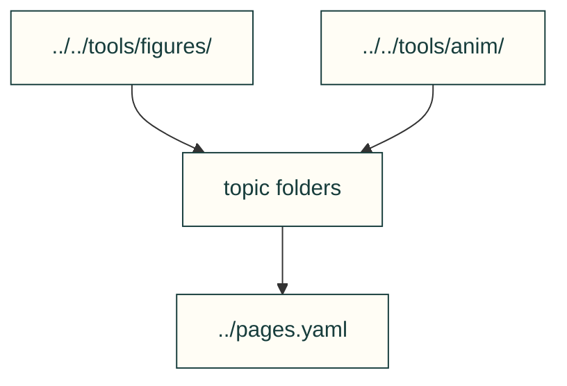

# Committed figures

Generated figures and recorded pictures grouped by topic. Producers and actual inputs live in docs/pages.yaml, figure source records and the owning tool; an image is not physical proof.

| File or folder | Purpose |
|---|---|
| [bearings/](bearings/README.md) | Bearing models, vectors and calculator charts. |
| [cfd/](cfd/README.md) | Recorded CFD result pictures. |
| [compliant/](compliant/README.md) | Compliant mechanism and cantilever diagrams. |
| [explore/](explore/README.md) | Exploration comparison pictures. |
| [fasteners/](fasteners/README.md) | Fastener geometry and assembly illustrations. |
| [fea/](fea/README.md) | Finite-element study pictures. |
| [formulas/](formulas/README.md) | Formula and vector illustrations. |
| [gates/](gates/README.md) | Gate/evidence diagrams and pictures. |
| [gyropup/](gyropup/README.md) | Product-derived historical engineering pictures. |
| [hero/](hero/README.md) | README/banner/badge art and source/provenance records. |
| [inserts/](inserts/README.md) | Heat-set insert geometry and evidence. |
| [joints/](joints/README.md) | Joint and connection diagrams. |
| [kit/](kit/README.md) | Web-kit examples and screenshots. |
| [linkages/](linkages/README.md) | Closed-loop linkage mechanism illustrations. |
| [motion/](motion/README.md) | Motion study illustrations. |
| [packets/](packets/README.md) | Review/delivery packet pictures. |
| [plates/](plates/README.md) | Plate bending illustrations. |
| [process/](process/README.md) | Manufacturing process illustrations. |
| [research/](research/README.md) | Survey charts and research figures. |
| [sheet-metal/](sheet-metal/README.md) | Sheet-metal and hardware drawings. |
| [supply-chain/](supply-chain/README.md) | Generated audit summary graphic. |
| [thermal/](thermal/README.md) | Thermal model illustrations. |
| [fea.jpg](fea.jpg) | Historical FEA card picture. |
| [gyropup.jpg](gyropup.jpg) | Historical product card picture. |
| [topology.jpg](topology.jpg) | Historical topology card picture. |
| [viewer.jpg](viewer.jpg) | Viewer card picture. |

[Parent map](../README.md)
