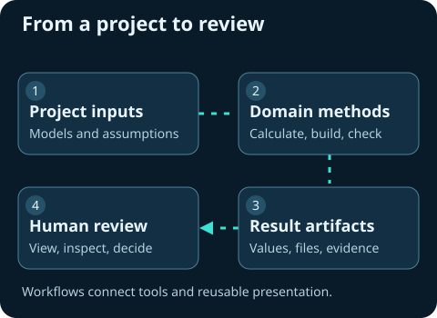

# Architecture explanations

Original conceptual handoff diagrams, generated by [documentation_flows.py](../../../tools/anim/documentation_flows.py). Arrows explain the named workflow; they do not claim measured physics or universal viewer integration. Each source owner is recorded in the SVG description.

<picture>
  <source media="(prefers-reduced-motion: reduce)" srcset="./toolkit-workflow-still.svg">
  
</picture>

| Animated figure | Static alternative | Meaning |
|---|---|---|
| [toolkit-workflow.svg](toolkit-workflow.svg) | [toolkit-workflow-still.svg](toolkit-workflow-still.svg) | Project inputs pass through domain methods to result artifacts and human review. |
| [agent-workflow.svg](agent-workflow.svg) | [agent-workflow-still.svg](agent-workflow-still.svg) | Skills guide tools, tests and independent review. |
| [site-publication.svg](site-publication.svg) | [site-publication-still.svg](site-publication-still.svg) | Owned sources pass through the compiler to dist and publication. |
| [verification.svg](verification.svg) | [verification-still.svg](verification-still.svg) | Known inputs exercise a subject, compare results and retain evidence. |
| [scada-session.svg](scada-session.svg) | [scada-session-still.svg](scada-session-still.svg) | A shared process session publishes snapshots to multiple diagram views. |

Run `python3 tools/anim/documentation_flows.py --check` from the repository root. CSS animates only the handoff lines; all labels and arrows remain visible in still images. Markdown uses a reduced-motion picture fallback.

[Figures](../README.md) · [Style guide](../../practice/style-guide.md)
