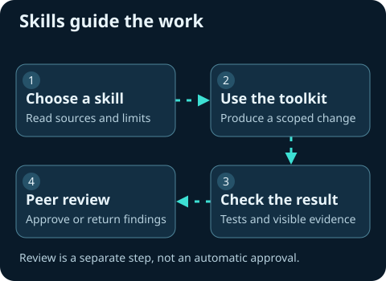
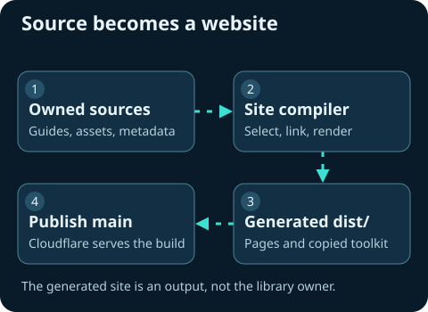
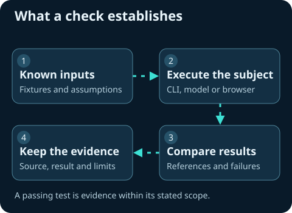
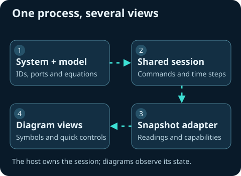

# Architecture explanations

Five different subjects, five visual structures. These original illustrations explain conceptual handoffs, not measured engineering results or a universal viewer host. Each SVG description records its source owners.

## From project inputs to human review

<picture>
  <source media="(prefers-reduced-motion: reduce)" srcset="./toolkit-workflow-still.svg">
  
</picture>

Inputs feed domain tools; their artifacts appear in a review workspace with a model, plot and checklist. The turning tool and moving handoffs explain production and consumption.

[Animated SVG](toolkit-workflow.svg) · [Static SVG](toolkit-workflow-still.svg) · [Source owner](../../../software/cadagent/README.md)

## An independent review loop

<picture>
  <source media="(prefers-reduced-motion: reduce)" srcset="./agent-workflow-still.svg">
  
</picture>

A skill guides authoring and checks. A separate peer review can pass the change or return findings to the author; the amber return path makes that feedback visible.

[Animated SVG](agent-workflow.svg) · [Static SVG](agent-workflow-still.svg) · [Source owner](../../../.agents/agents/cad-pr-reviewer.md)

## Many sources, one publication

<picture>
  <source media="(prefers-reduced-motion: reduce)" srcset="./site-publication-still.svg">
  
</picture>

Guides, assets and metadata converge through the site compiler. The generated dist/ output is published to Cloudflare; it does not own the source library.

[Animated SVG](site-publication.svg) · [Static SVG](site-publication-still.svg) · [Source owner](../../../tools/site/compiler/README.md)

## Compare, then retain evidence

<picture>
  <source media="(prefers-reduced-motion: reduce)" srcset="./verification-still.svg">
  
</picture>

Reference and result traces meet a comparison step. The record keeps the result, revision and limits together. The traces are illustrative, not measured data.

[Animated SVG](verification.svg) · [Static SVG](verification-still.svg) · [Source owner](../../../tests/README.md)

## One session, several views

<picture>
  <source media="(prefers-reduced-motion: reduce)" srcset="./scada-session-still.svg">
  
</picture>

Equipment and control models share a session. Snapshots feed plant, sludge and digester views; controls return to that same session. The equipment sketch is conceptual, not a process design.

[Animated SVG](scada-session.svg) · [Static SVG](scada-session-still.svg) · [Source owner](../../../software/cadagent/webkit/scada/explorer/README.md)

## Files and regeneration

| Animated figure | Static alternative | Visual structure |
|---|---|---|
| [toolkit-workflow.svg](toolkit-workflow.svg) | [toolkit-workflow-still.svg](toolkit-workflow-still.svg) | Artifact workbench |
| [agent-workflow.svg](agent-workflow.svg) | [agent-workflow-still.svg](agent-workflow-still.svg) | Review and feedback loop |
| [site-publication.svg](site-publication.svg) | [site-publication-still.svg](site-publication-still.svg) | Source funnel and publication |
| [verification.svg](verification.svg) | [verification-still.svg](verification-still.svg) | Trace comparison and evidence record |
| [scada-session.svg](scada-session.svg) | [scada-session-still.svg](scada-session-still.svg) | Shared state and view fan-out |

The source is [documentation_flows.py](../../../tools/anim/documentation_flows.py). Run `python3 tools/anim/documentation_flows.py --check` from the repository root. CSS motion illustrates each subject; timing is not a measurement. All information remains visible in the static variants, selected automatically for reduced motion.

[Figures](../README.md) · [Style guide](../../practice/style-guide.md)
