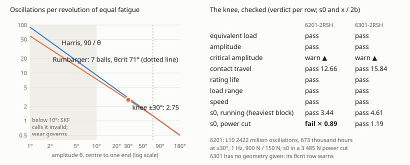
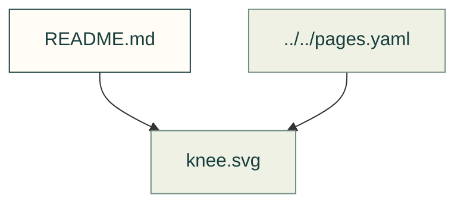

# Bearings

Existing figures for bearings. The caption/source index distinguishes illustrative diagrams from recorded outputs; these pictures do not prove current physical performance.

Files and sources

| File or folder | Purpose |
|---|---|
| [checks.svg](checks.svg) | SVG: checks |
| [knee.svg](knee.svg) | SVG: knee |
| [life-load.svg](life-load.svg) | SVG: life load |
| [xy-table.svg](xy-table.svg) | SVG: xy table |

[Figure index](../README.md) · [Captions and tool inputs](https://github.com/Valpatel/cad-agent/blob/dev/docs/pages.yaml)
