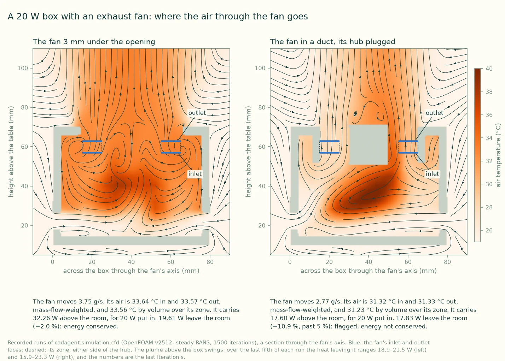
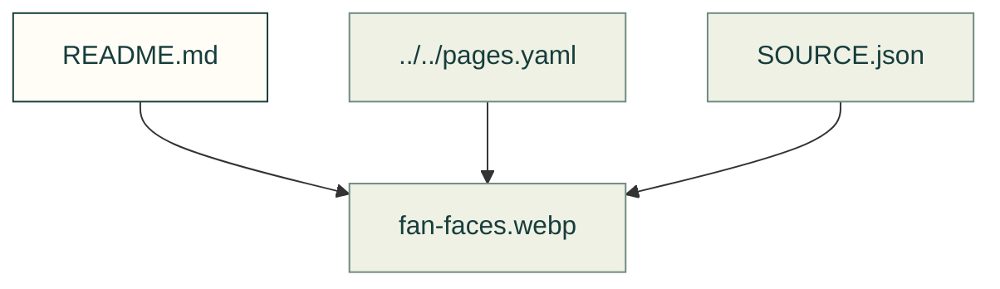

# Flow results

Existing figures for flow results. The caption/source index distinguishes illustrative diagrams from recorded outputs; these pictures do not prove current physical performance.

Files and sources

| File or folder | Purpose |
|---|---|
| [SOURCE.json](SOURCE.json) | Source identities and generation notes for these recorded images. |
| [fan-faces.webp](fan-faces.webp) | Recorded output: Two sections through a vented 20 W box with an exhaust fan, coloured by air temperature with streamlines: with the fan under the opening air loops back through it; with… |

[Figure index](../README.md) · [Captions and tool inputs](https://github.com/Valpatel/cad-agent/blob/dev/docs/pages.yaml)
