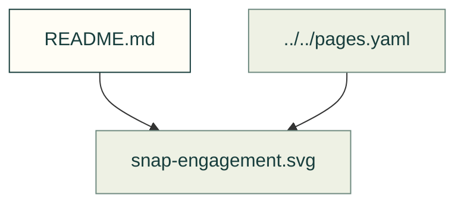

# Compliant mechanisms

Existing figures for compliant mechanisms. The caption/source index distinguishes illustrative diagrams from recorded outputs; these pictures do not prove current physical performance.

Files and sources

| File or folder | Purpose |
|---|---|
| [cantilever-explorer.svg](cantilever-explorer.svg) | Diagram: A CoPA snap arm 20 mm long bent 1.5 mm at the hook along its computed curve; root strain 0.90 percent, 44 percent of the 2.02 percent allowed along the layers, a pass; force 3.10 N |
| [example-1-short.svg](example-1-short.svg) | SVG: example 1 short |
| [example-1.svg](example-1.svg) | Diagram: Example I from the snap-fit design guide, computed: a tapered polycarbonate cantilever hook with its length, thicknesses and deflection drawn to scale, root strain 2.00 percent |
| [snap-engagement.svg](snap-engagement.svg) | Diagram: An animated snap arm bending as a mating edge rides up its hook's lead, with its root strain rising to 1.38 percent against two filaments' allowables: a pass for CoPA, a fail… |
| [torsion-snap-explorer.svg](torsion-snap-explorer.svg) | Diagram: Two PLA torsion bars twisted 8 degrees by a 10 mm lever; peak shear strain 1.11 percent, 86 percent of the 1.28 percent allowed across the layers, a pass; 3.45 N at the lever |

[Figure index](../README.md) · [Captions and tool inputs](https://github.com/Valpatel/cad-agent/blob/dev/docs/pages.yaml) · [snapfit_figures.py](https://github.com/Valpatel/cad-agent/blob/dev/tools/figures/snapfit_figures.py) · [readme_anim.py](https://github.com/Valpatel/cad-agent/blob/dev/tools/readme_anim.py) · [cantilever-still.mjs](https://github.com/Valpatel/cad-agent/blob/dev/tools/site/figures/cantilever-still.mjs) · [torsion-snap-still.mjs](https://github.com/Valpatel/cad-agent/blob/dev/tools/site/figures/torsion-snap-still.mjs)
