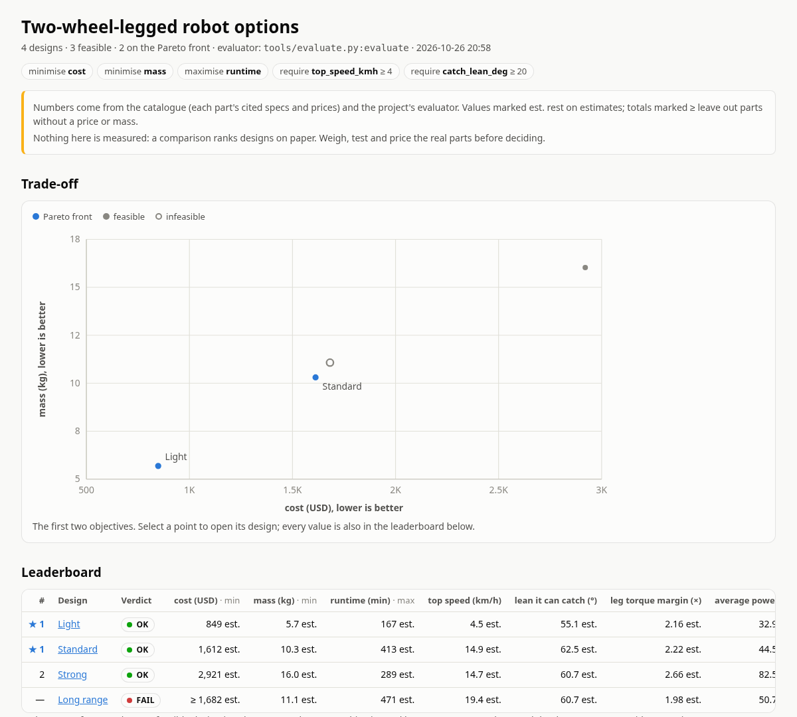
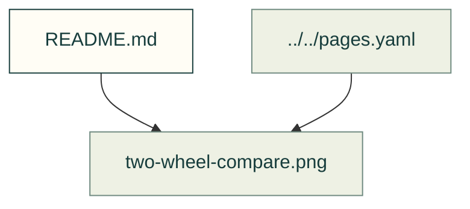

# Design comparisons

Existing figures for design comparisons. The caption/source index distinguishes illustrative diagrams from recorded outputs; these pictures do not prove current physical performance.

Files and sources

| File or folder | Purpose |
|---|---|
| [compare-header.webp](compare-header.webp) | Recorded output: The comparison page's header: Two-wheel-legged robot options, 4 designs, 3 feasible, 2 on the Pareto front; chips for minimise cost, minimise mass, maximise runtime,… |
| [light-bom.webp](light-bom.webp) | Recorded output: A bill of materials table for the Light design: 24 V hub motors, 8 N·m leg actuators, a 6S battery, computer, wiring allowance and the evaluator's printed parts, each… |
| [long-range-bom.webp](long-range-bom.webp) | Recorded output: A bill of materials table: wheel motors, leg actuators, a 13S battery, computer, wiring allowance, a depth camera with no price and the evaluator's printed parts, each… |
| [long-range-checks.webp](long-range-checks.webp) | Recorded output: The comparison page's card for the Long range design: fail, not ranked; three failed checks, the battery's 39 to 54.6 V against what the wheel motors, leg actuators and… |
| [long-range-swaps.webp](long-range-swaps.webp) | Recorded output: The one-part swaps table for the Long range design: the 10S battery is a warning at 70 USD less, 0.7 kg lighter and 90 minutes less runtime; six other swaps fail on… |
| [search-trade-off.webp](search-trade-off.webp) | Recorded output: A scatter chart of 49 trials by cost and mass: most are infeasible open circles; two feasible grey dots; trials 47 and 1 in blue on the Pareto front |
| [two-wheel-charts.json](two-wheel-charts.json) | Recorded numeric inputs or chart data; interpret with its comparison figures. |
| [two-wheel-compare.png](two-wheel-compare.png) | Recorded picture; source identity and interpretation stay with its guide or source record. |

[Figure index](../README.md) · [Captions and tool inputs](https://github.com/Valpatel/cad-agent/blob/dev/docs/pages.yaml)
