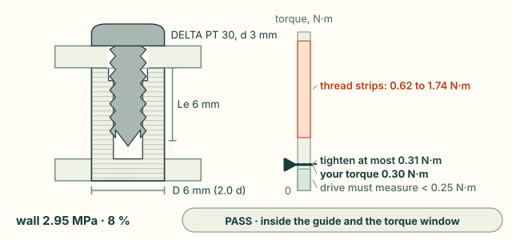
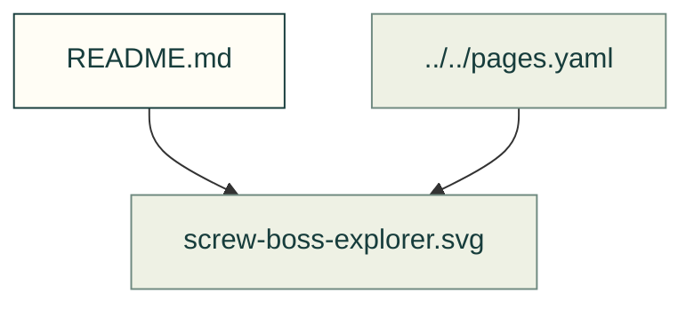

# Fasteners

Existing figures for fasteners. The caption/source index distinguishes illustrative diagrams from recorded outputs; these pictures do not prove current physical performance.

Files and sources

| File or folder | Purpose |
|---|---|
| [screw-boss-explorer.svg](screw-boss-explorer.svg) | SVG: Screw-boss explorer: a DELTA PT 30 screw (3 mm) in a 6 mm boss of Bambu PLA Basic, printed upright, 6 mm of thread, tightened to 0.30 N·m: clamp 22 to 374 N (the low end if the… |

[Figure index](../README.md) · [Captions and tool inputs](https://github.com/Valpatel/cad-agent/blob/dev/docs/pages.yaml)
