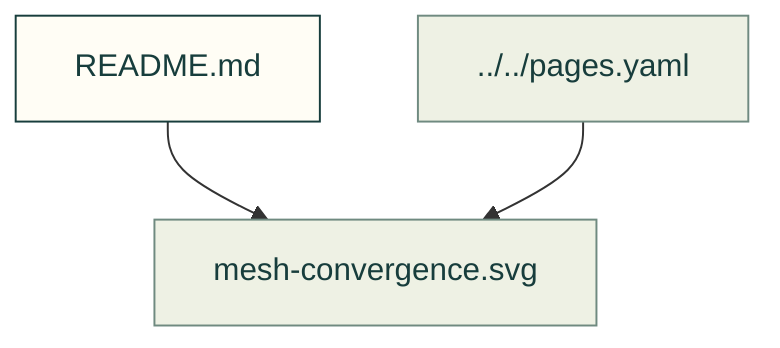

# Finite-element evidence

Existing figures for finite-element evidence. The caption/source index distinguishes illustrative diagrams from recorded outputs; these pictures do not prove current physical performance.

Files and sources

| File or folder | Purpose |
|---|---|
| [corner-convergence.svg](corner-convergence.svg) | Diagram: Peak stress at an L-bracket's inside corner against mesh size; the sharp corner's peak keeps rising as the mesh is refined, the filleted corner's stays flat |
| [layer-check.svg](layer-check.svg) | Diagram: A PETG-CF bar's safety factor against print tilt: the bond check governs from 0 to 58 degrees, worst at 30 degrees (2.07), the bulk check past that (2.66); the solved bar's dots… |
| [layer-criteria.png](layer-criteria.png) | Recorded picture; source identity and interpretation stay with its guide or source record. |
| [layer-spread.svg](layer-spread.svg) | SVG: layer spread |
| [mesh-convergence.svg](mesh-convergence.svg) | SVG: A recorded cad-agent study of a steel L-bracket's inside corner, with refine= asking for 2 mm down to 0.25 mm elements there: sharp, the peak stress keeps rising; with an R1.5… |

[Figure index](../README.md) · [Captions and tool inputs](https://github.com/Valpatel/cad-agent/blob/dev/docs/pages.yaml) · [fea_layer_figure.py](https://github.com/Valpatel/cad-agent/blob/dev/tools/fea_layer_figure.py) · [fea_mesh_figure.py](https://github.com/Valpatel/cad-agent/blob/dev/tools/fea_mesh_figure.py)
