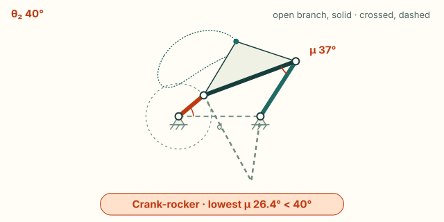
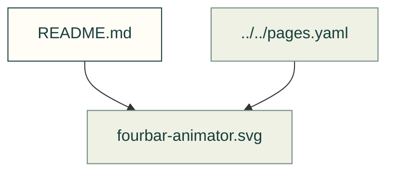

# Formula explorers

Existing figures for formula explorers. The caption/source index distinguishes illustrative diagrams from recorded outputs; these pictures do not prove current physical performance.

Files and sources

| File or folder | Purpose |
|---|---|
| [fourbar-animator.svg](fourbar-animator.svg) | SVG: Four-bar with crank 40, coupler 120, rocker 80 and ground 100 mm, open branch: crank-rocker (the crank turns fully); input travel full turn; lowest transmission angle 26.4° at 0°,… |

[Figure index](../README.md) · [Captions and tool inputs](https://github.com/Valpatel/cad-agent/blob/dev/docs/pages.yaml)
