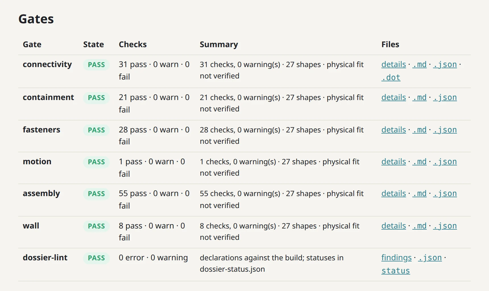
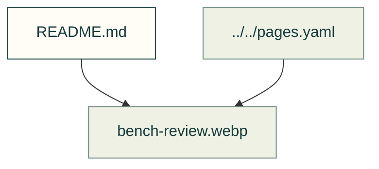

# Design checks

Existing figures for design checks. The caption/source index distinguishes illustrative diagrams from recorded outputs; these pictures do not prove current physical performance.

Files and sources

| File or folder | Purpose |
|---|---|
| [bench-connectivity.svg](bench-connectivity.svg) | Recorded output: A graph of the gate bench's parts linked by contacts and fasteners, grouped into the static frame and the arm's body |
| [bench-part-card.webp](bench-part-card.webp) | Recorded output: The review site's card for the gate bench's arm part, with its status steps, function, material, interfaces, six passing gate checks and the reason it is not higher |
| [bench-requirements.webp](bench-requirements.webp) | Recorded output: The review site's requirements table for the gate bench, three requirements marked verified, each with its traced sections, its verifying gate check and its source |
| [bench-review.webp](bench-review.webp) | Recorded output: The review site's gates table for the gate bench, with connectivity, containment, fasteners, motion, assembly, wall and dossier-lint, each marked pass with its check… |
| [bench-section-interfaces.webp](bench-section-interfaces.webp) | Recorded output: The review site's interfaces table for the gate bench's arm section, six interfaces of kind contact or revolute, then its decision D2, the arm resting on a fixed stop |
| [bench-section.webp](bench-section.webp) | Recorded output: The review page of the arm section, with its purpose, status steps from draft to signed off with gated marked, the reasons it is not higher and its requirement |
| [bench-sections.webp](bench-sections.webp) | Recorded output: The review site's front page for the gate bench, with counts and a table of its four sections with their status, requirements, parts, gates and review state |

[Figure index](../README.md) · [Captions and tool inputs](https://github.com/Valpatel/cad-agent/blob/dev/docs/pages.yaml)
