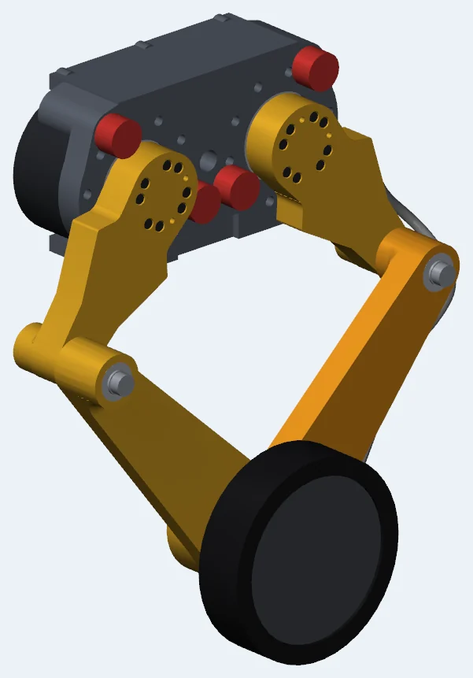
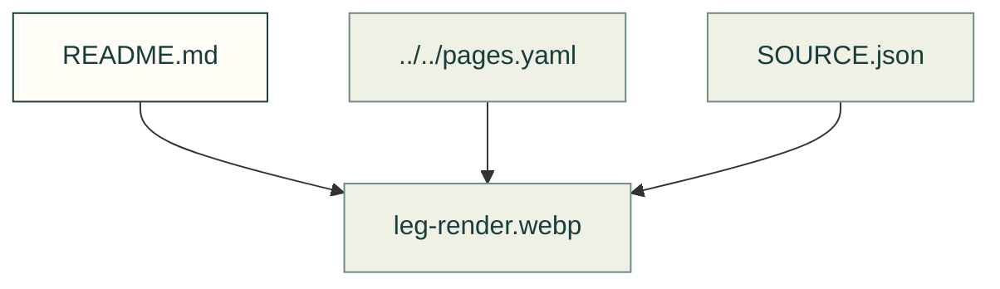

# Recorded Gyropup pictures

Existing figures for recorded gyropup pictures. The caption/source index distinguishes illustrative diagrams from recorded outputs; these pictures do not prove current physical performance.

Files and sources

| File or folder | Purpose |
|---|---|
| [LICENSE.txt](LICENSE.txt) | Attribution and reuse terms for the imported pictures. |
| [SOURCE.json](SOURCE.json) | Source identities and generation notes for these recorded images. |
| [leg-render.webp](leg-render.webp) | Recorded picture; source identity and interpretation stay with its guide or source record. |
| [wheel-link-fea.webp](wheel-link-fea.webp) | Recorded output: Von Mises stress in Gyropup's wheel link, highest beside the axle bore, with a colour bar from 0 to 15 MPa |

[Figure index](../README.md) · [Captions and tool inputs](https://github.com/Valpatel/cad-agent/blob/dev/docs/pages.yaml)
