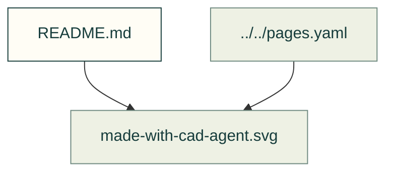

# Banners and sharing

Existing figures for banners and sharing. The caption/source index distinguishes illustrative diagrams from recorded outputs; these pictures do not prove current physical performance.

Files and sources

| File or folder | Purpose |
|---|---|
| [gyropup-leg.svg](gyropup-leg.svg) | SVG: cad-agent: Gyropup's five-bar leg drawn from its real CAD, assembled, then checked for fit, strength and motion |
| [made-with-cad-agent-still.svg](made-with-cad-agent-still.svg) | SVG: Made with cad-agent — still badge |
| [made-with-cad-agent.svg](made-with-cad-agent.svg) | SVG: Made with cad-agent |
| [repository-map-still.svg](repository-map-still.svg) | SVG: Build the builders — a robot-factory still |
| [repository-map.svg](repository-map.svg) | SVG: Build the builders — a robot-factory cinematic |

[Figure index](../README.md) · [Captions and tool inputs](https://github.com/Valpatel/cad-agent/blob/dev/docs/pages.yaml)
