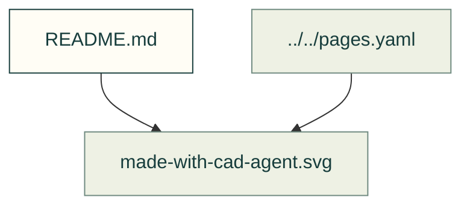

# Banners and sharing

Existing figures for banners and sharing. The caption/source index distinguishes illustrative diagrams from recorded outputs; these pictures do not prove current physical performance.

Files and sources

| File or folder | Purpose |
|---|---|
| [learning-loop.svg](learning-loop.svg) | Original conceptual human/idea and engineering-workbench panorama, with reviewed feedback and reduced-motion still state. |
| [learning-loop-still.svg](learning-loop-still.svg) | Explicit completed collaborative scene for reduced-motion image consumers. |
| [learning-loop-mobile-still.svg](learning-loop-mobile-still.svg) | Completed square composition selected by parent picture media. |
| [learning-loop-mobile.svg](learning-loop-mobile.svg) | Compact square composition of the same human learning story. |
| [thermal-history.svg](thermal-history.svg) | Animated actual heater-zone samples from the recorded 20 W box case; iterations, not elapsed seconds. |
| [result-stills/](result-stills/README.md) | Explicit finished computation pictures and original-evidence links; no new simulation. |
| [airflow-balance.svg](airflow-balance.svg) | Recorded flow and heat-out comparison retaining the failed ducted case. |
| [learning-evidence.json](learning-evidence.json) | Input hashes, sampled trace count and recorded case facts. |
| [gyropup-leg.svg](gyropup-leg.svg) | SVG: cad-agent: Gyropup's five-bar leg drawn from its real CAD, assembled, then checked for fit, strength and motion |
| [made-with-cad-agent-still.svg](made-with-cad-agent-still.svg) | SVG: Made with cad-agent — still badge |
| [made-with-cad-agent.svg](made-with-cad-agent.svg) | SVG: Made with cad-agent |
| [repository-map-still.svg](repository-map-still.svg) | SVG: Build the builders — a robot-factory still |
| [repository-map.svg](repository-map.svg) | SVG: Build the builders — a robot-factory cinematic |

[Figure index](../README.md) · [Captions and tool inputs](https://github.com/Valpatel/cad-agent/blob/dev/docs/pages.yaml)

## Homepage learning loop — design and evidence plan (#605)

The new hero is an original vector explanation, not a simulated hardware result. Its
loop shows authored examples and manufacturer guides entering a messy evidence
network, being organized into topic trees and cited rules, then design → check →
simulate → print → feedback. A clear human review gate precedes contributions.
Hosted agents (including Anthropic's tooling) and local/open models are possible
clients of the same documented files; their presence is not an integration claim.

Use a dark technical canvas, warm white typography, restrained cyan/amber accents,
visible source-document shapes and evolving graph geometry. Keep three readable
stages at phone width; the animation must tell the same story as a useful still.
No logos, particle-only filler, invented benchmark values or implied autonomous
self-modification. Reduced motion freezes the complete readable state.

### Asset audit, 2026-11-11

| Existing evidence | Reuse decision and limit |
|---|---|
| `docs/img/fea/mesh-convergence.svg`, `tools/fea_mesh_figure.py` | Recorded L-bracket study; animate the existing sampled refinement sequence, not a fresh solver result. Convergence is not physical strength proof. |
| `docs/img/cfd/SOURCE.json`, `tests/fixtures/cfd_runs/` | Recorded OpenFOAM traces permit temperature/flow/balance plots. Preserve the ducted case's failed energy/steady criteria; flow markers explain direction, not invented CFD particle trajectories. |
| `docs/img/thermal/fan-curve-explorer.svg` and fan-curve module | Existing operating-point calculation can be animated from the real curve/intersection; do not present a computed operating point as a measurement. |
| `docs/img/motion/*.svg`, `docs/img/compliant/example-1.svg` | Existing computed fixture/worked-example motion, interference and snap geometry; retain their captions and source pages. |
| `tools/site/assets/models/gyropup.*` | Current collected assembly with source revision/hashes; move the existing shared viewer below the hero. Historical wheel-link FEA remains separately dated. No printed-leg changes. |
| J501 clean source `240be82ec5420e989dbfad07d76ab62ea3e83a50` | Audit its existing `exports/view/view.json` and assembly-coordinate STL outputs, including the real carrier-board mesh. Pack these outputs without regenerating CAD. Hash every selected input and preserve source/PCB attribution and fit-prototype limits. |

### Delivery and verification

1. Commit this audit before artwork/code; prototype original hero and evidenced
   output gallery, remove empty/command-only cards, skills and counter sections.
2. Reuse `<cad-model>` for independent Gyropup and J501 viewers. Add explicit
   per-instance loading progress/stage, retained poster, clear failure and retry
   where safe. No download on initial hero paint; keep independent failure states.
3. Every displayed computation image must be animated and source-bound in
   `docs/home.yaml`. Remove cards lacking real visual evidence rather than making
   decorative results. Thermal/airflow captions state solver/model assumptions.
4. Pure checks bind input hashes, numbers, source links, SVG XML, animation/still
   states and removed placeholder content. Browser acceptance covers desktop,
   phone, reduced motion, both themes, actual image loading, animation bounds,
   model progress/ready/failure, lazy independent loading and no-script posters.
5. Coordinate the capped `--client-diagrams` local producer/browser lane with the
   coordinator before launching. Review the prototype headed before final polish.
   Normal independent review/CI/release/public acceptance remain required.

The homepage owns the compiler region after `const home`; #603 owns the frame,
navigation, discovery, catalogue and timestamp regions. No editing another tree.

Owner refinement (2026-11-11): the central story is **helping anyone build what
they need, with high quality and continuously improving AI**. A person's need
starts the loop, evidence/resources support the AI, checks and making produce a
useful object, and real or simulated feedback improves the next round. Graph
cleanup supports that human story rather than replacing it. The first prototype
uses the product's existing `preview/open.png` as J501's honest interim poster;
final acceptance requires a matching shared-viewer poster and complete loading,
reduced-motion, WebGL failure and keyboard evidence.

### Owner art rejection and revised acceptance, 2026-11-11

The owner viewed prototype C and rejected its slow/simple lone-person scene:
“it needs to clearly convey the idea of humans collaborating with self-improving
machines.” The previous 16-second workbench/graph loop is **not accepted art**.
The next scene must show a recognizable capable machine partner working with the
person: a sketch/gesture, machine construction, direct handoff, human testing and
feedback, then a visibly revised second object. Shared knowledge returns to the
machine. Target an eight-second narrative with purposeful one-to-three-second
beats, articulated hands/tool head, assembly motion and clear finished solids.
The reduced-motion composition must show the completed collaboration. A denser
graph, passing loader tests or earlier screenshots cannot substitute for that
visual acceptance. The scene stays conceptual, without claiming physical autonomy
or automatic model training. Review the new source-bound producer headed again.

The owner's subsequent headline is **“Self-improving machines teaching each other
how to build machines.”** Use that ambition above a concrete description of the
open-source toolkit, shared knowledge, design tests and human feedback. The scene
also includes a distinct receiving maker using shared knowledge, not only one
machine looping into itself. No provider integration or physical autonomy is
implied by the conceptual art.

J501 final adoption is on hold while the coordinator audits newer remote source
and derivative-model redistribution. The local `240be82` capture is a legacy
prototype context, not the latest remote product revision. The requested fitted
lid and source-backed right-angle antennas must be resolved from the product's
single source of truth; do not add invented site-only hardware.

Prototype G's actual reduced-motion phone image still moved despite the parent
preference (the existing image-consumer lesson applies). Preserve that failed
receipt. The next producer selects explicit generated finished desktop/mobile
stills in the parent picture, tests real pixels twice, and rejects a deliberately
animated still. The hero now uses the existing CSS-only safe-vector contract.

### Whole-style reset: cinematic sci-fi workshop

The owner rejected the entire prior human/robot cartoon style as sloppy and then
explicitly selected **cinematic sci-fi workshop**. Stop incremental edits to that
illustration; none of its captures is art acceptance. The replacement is authored
in `tools/site/figures/workshop_scene.py`: one consistent projected diorama,
graphite precision machinery, articulated maker arms, a warm foreground human
hand/input station and a physically mounted luminous design core. The eight-second
story constructs a successor machine, probes its access, receives human feedback,
revises the joint/reinforcement, and shares the improved design with a second
anchored station. No portraits, floating paper or random particles. Review the
new storyboard poses before presenting a new headed prototype as improved art.
Evidence-backed computation cards, real model sources and loader fixes remain
separate requirements and are preserved.
