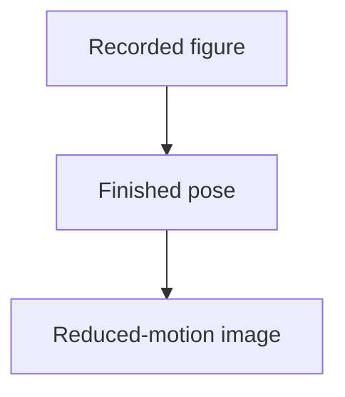

# Finished computation images

The homepage selects these explicit finished images for reduced-motion readers.
Each is derived from its original authored reduced-motion pose, with animation
removed. Source values and engineering limits remain those of the original figure.

| File | Original evidence |
|---|---|
| [airflow-balance-still.svg](airflow-balance-still.svg) | [Recorded balance comparison](../airflow-balance.svg), including the failed ducted case. |
| [thermal-history-still.svg](thermal-history-still.svg) | [Actual sampled temperature history](../thermal-history.svg). |
| [mesh-convergence-still.svg](mesh-convergence-still.svg) | [Recorded mesh refinement](../../fea/mesh-convergence.svg). |
| [rib-in-counterbore-still.svg](rib-in-counterbore-still.svg) | [Build-order check](../../motion/rib-in-counterbore.svg). |
| [connector-window-still.svg](connector-window-still.svg) | [Mating-plug window](../../motion/connector-window.svg). |
| [hinge-sweep-still.svg](hinge-sweep-still.svg) | [Seeded collision sweep](../../motion/hinge-sweep.svg). |
| [module-insertion-still.svg](module-insertion-still.svg) | [Module insertion fixture](../../motion/module-insertion.svg). |
| [search-front-still.svg](search-front-still.svg) | [Seeded optimization trials](../../motion/search-front.svg). |

[Parent figures](../README.md) · [Generator](../../../../tools/site/figures/learning-home.py) · [Input hashes](../learning-evidence.json)
