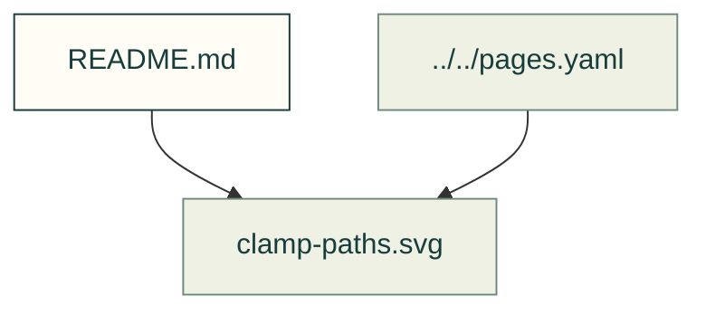

# Inserts and clamp paths

Existing figures for inserts and clamp paths. The caption/source index distinguishes illustrative diagrams from recorded outputs; these pictures do not prove current physical performance.

Files and sources

| File or folder | Purpose |
|---|---|
| [calibration.svg](calibration.svg) | SVG: Published heat-set insert pull-out tests as shear stress on the knurl's cylinder against insert size: printed PLA 16.4-21.5 MPa at M3 and 12.5-16.0 MPa at M6, so the larger insert… |
| [clamp-paths.svg](clamp-paths.svg) | SVG: Three clamp paths for a heat-set insert: pulled into a shoulder (the shoulder carries the clamp), flush (the clamped part bears on the insert) and recessed (the screw jacks the… |
| [coupons.svg](coupons.svg) | SVG: Insert test coupons as CAD: for M3, M5 and M8, a block printed upright (the insert's axis along the build direction) and one printed lying (its axis in the layer plane), each with… |
| [fix-ladder.svg](fix-ladder.svg) | SVG: The fix ladder in order, larger head, washer, large washer, limiter, each re-checked: on the issue's M3 lid the ISO 7089 washers lift the preload cap from 329 N to 774 N at 0.30 N·m… |
| [limiters.svg](limiters.svg) | SVG: A compression limiter proud, flush and short of the plastic it passes through: proud, the plastic is loose round it; flush, the clamp goes through the metal; short, the head… |
| [section.svg](section.svg) | SVG: Section of a printed boss with a M3 heat-set insert (McMaster-Carr 94459A140): hole 4.20 mm, 6.7 mm deep, wall 2.7 mm |
| [washers.svg](washers.svg) | SVG: The issue's M3 lid in PLA with ISO 7089 washers under the head and between the lid and the insert: the lid bears on 19.8 mm² of washer instead of 8.4 mm² of the insert's ring, so… |

[Figure index](../README.md) · [Captions and tool inputs](https://github.com/Valpatel/cad-agent/blob/dev/docs/pages.yaml)
