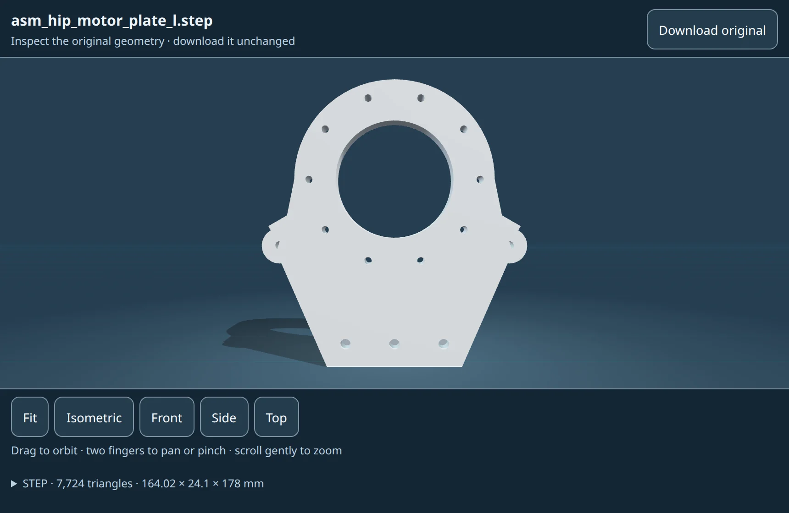
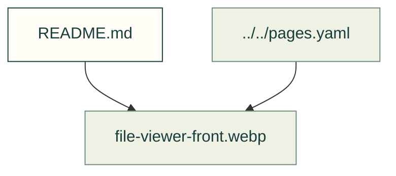

# Web-kit examples

Existing figures for web-kit examples. The caption/source index distinguishes illustrative diagrams from recorded outputs; these pictures do not prove current physical performance.

Files and sources

| File or folder | Purpose |
|---|---|
| [file-viewer-error.webp](file-viewer-error.webp) | Recorded output: The file viewer with an error panel reading that the STEP reader could not find displayable surfaces in this file, a Retry file button, and the view buttons dimmed |
| [file-viewer-front.webp](file-viewer-front.webp) | Recorded output: The same motor plate seen straight from the front, its bore and screw holes in full view |
| [file-viewer-step.webp](file-viewer-step.webp) | Recorded output: The file viewer showing a grey motor plate with a large bore and a ring of screw holes in an isometric view, with view buttons and the file's format, triangle count and… |
| [file-viewer-theme.webp](file-viewer-theme.webp) | Recorded output: The same motor plate in the viewer's light theme, on a white stage with a cream header and controls |
| [part-table-search.webp](part-table-search.webp) | Recorded output: The gate bench's part table filtered by the search "screw", showing 9 of 19 rows, the lid, four heat-set inserts and four M3 screws |
| [part-table.webp](part-table.webp) | Recorded output: A sortable table of the gate bench's parts with columns for part, section, what it does, size and count, and Ordered and Printed checkboxes, above export and import… |

[Figure index](../README.md) · [Captions and tool inputs](https://github.com/Valpatel/cad-agent/blob/dev/docs/pages.yaml)
