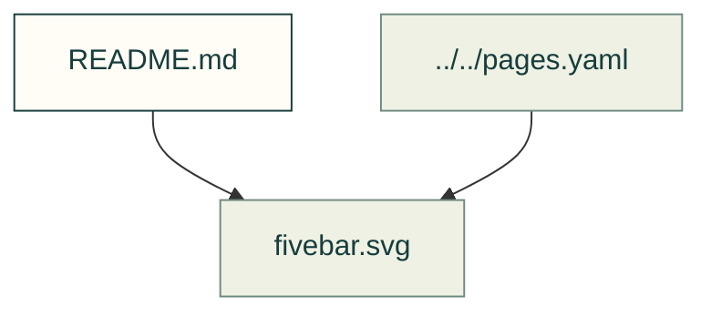

# Linkages

Existing figures for linkages. The caption/source index distinguishes illustrative diagrams from recorded outputs; these pictures do not prove current physical performance.

Files and sources

| File or folder | Purpose |
|---|---|
| [fivebar.svg](fivebar.svg) | Diagram: A five-bar leg hanging from its two hips moves its foot round an elliptical stride inside its reach; beside it, a map of the two crank angles shaded by transmission angle, with… |

[Figure index](../README.md) · [Captions and tool inputs](https://github.com/Valpatel/cad-agent/blob/dev/docs/pages.yaml) · [linkage_figures.py](https://github.com/Valpatel/cad-agent/blob/dev/tools/figures/linkage_figures.py)
