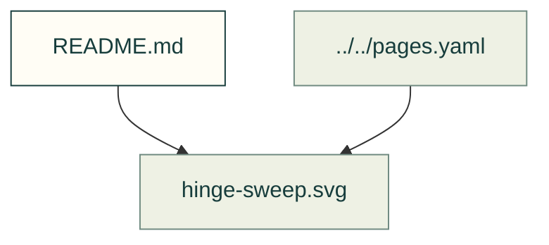

# Motion and clearance

Existing figures for motion and clearance. The caption/source index distinguishes illustrative diagrams from recorded outputs; these pictures do not prove current physical performance.

*Illustration of the gate-bench arm sweep, drawn from the existing fixture; not a physical clearance measurement.*

Files and sources

| File or folder | Purpose |
|---|---|
| [cable-bend.svg](cable-bend.svg) | SVG: cable bend |
| [connector-window.svg](connector-window.svg) | Diagram: An RJ45 plug pushed in along its mating axis through two panel windows: through a window sized from the jack's bounding box the latch sweeps into the wall; through the window… |
| [hinge-sweep.svg](hinge-sweep.svg) | Diagram: A diagram of the gate bench's arm swept from 0 to 60 degrees; it first shares volume with the frame beam between 44.89 and 44.91 degrees |
| [insertion-sweep.svg](insertion-sweep.svg) | SVG: insertion sweep |
| [module-insertion.svg](module-insertion.svg) | Diagram: A diagram of a preassembled module inserted into its parent as one rigid body, then withdrawn |
| [motion-trace.svg](motion-trace.svg) | SVG: motion trace |
| [rib-in-counterbore.svg](rib-in-counterbore.svg) | Diagram: A section through a screw hole in two build orders; a rib added after the counterbore was cut refills it, and with the holes cut last it is clear |
| [search-front.svg](search-front.svg) | SVG: search front |

[Figure index](../README.md) · [Captions and tool inputs](https://github.com/Valpatel/cad-agent/blob/dev/docs/pages.yaml) · [motion_figures.py](https://github.com/Valpatel/cad-agent/blob/dev/tools/figures/motion_figures.py)
