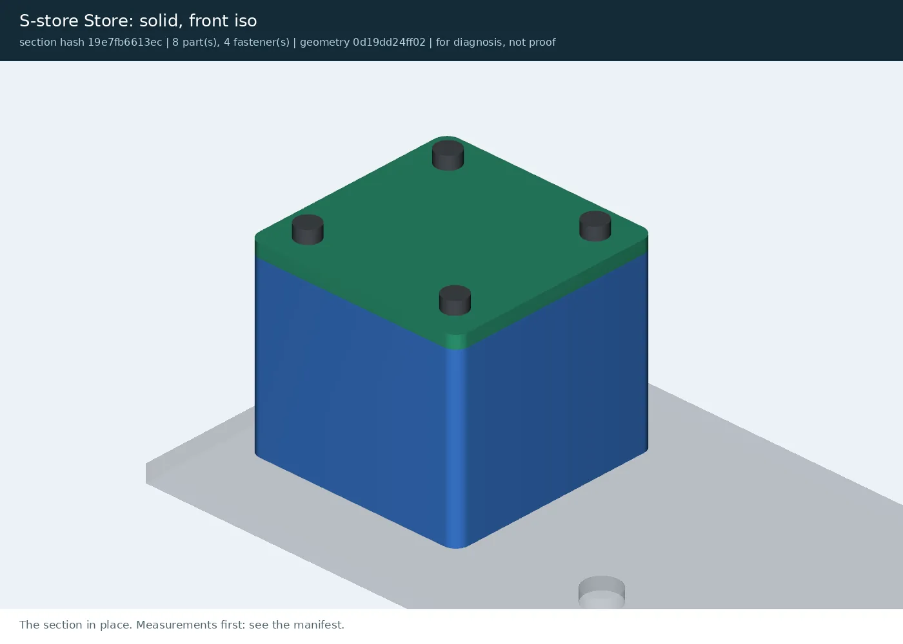
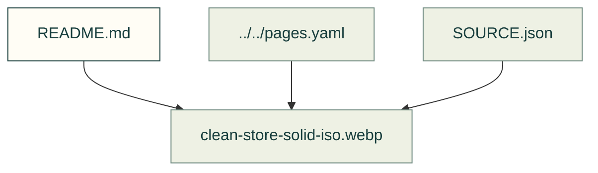

# Review packets

Existing figures for review packets. The caption/source index distinguishes illustrative diagrams from recorded outputs; these pictures do not prove current physical performance.

Files and sources

| File or folder | Purpose |
|---|---|
| [SOURCE.json](SOURCE.json) | Source identities and generation notes for these recorded images. |
| [ball_through_wall-store-cut-cavity-hopper_cavity-plan.webp](ball_through_wall-store-cut-cavity-hopper_cavity-plan.webp) | Recorded output: A plan section through the gate bench's hopper, its walls a blue ring round four orange balls, and a fifth ball sitting in the top wall, half outside the cavity |
| [ball_through_wall-store-findings.webp](ball_through_wall-store-findings.webp) | Recorded output: An x-ray view of the gate bench's store with callouts F1 to F3 pointing at one ball in the hopper's wall |
| [bracket_floats-bracket-findings.webp](bracket_floats-bracket-findings.webp) | Recorded output: The gate bench's L-shaped bracket alone above the base, with callouts F1 and F2 pointing at two witness points under its foot |
| [clean-arm-cut-joint-I-pin-arm.webp](clean-arm-cut-joint-I-pin-arm.webp) | Recorded output: A section through the gate bench's arm joint: the green pin passing through the blue arm block above the base |
| [clean-arm-exploded.webp](clean-arm-exploded.webp) | Recorded output: The gate bench's arm section exploded: the blue hinge block and yellow stop on the base, the purple arm lifted above them, the green pin drawn out sideways |
| [clean-arm-pose-I-pin-arm-max.webp](clean-arm-pose-I-pin-arm-max.webp) | Recorded output: The gate bench's arm raised to 40 degrees, its purple beam below the grey frame |
| [clean-arm-pose-I-pin-arm-min.webp](clean-arm-pose-I-pin-arm-min.webp) | Recorded output: The gate bench's arm lying level on its stop beside the hinge block, the frame's post and beam above it |
| [clean-arm-solid-iso.webp](clean-arm-solid-iso.webp) | Recorded output: The gate bench's arm section: a blue hinge block with a green pin, a purple arm resting on a yellow stop, the grey frame and base around them |
| [clean-store-access-from-top.webp](clean-store-access-from-top.webp) | Recorded output: The gate bench's lid seen from above, four screw heads at its corners |
| [clean-store-cut-cavity-hopper_cavity-plan.webp](clean-store-cut-cavity-hopper_cavity-plan.webp) | Recorded output: A plan section through the gate bench's hopper, its walls a blue ring round four orange balls, all inside the cavity |
| [clean-store-cut-cavity-hopper_cavity.webp](clean-store-cut-cavity-hopper_cavity.webp) | Recorded output: A vertical section through the gate bench's hopper, four orange balls in two rows inside the blue walls, the lid on top |
| [clean-store-cut-fastener-screw_0.webp](clean-store-cut-fastener-screw_0.webp) | Recorded output: A section through the gate bench's hopper and lid along two screws, each head on the lid and its thread in an insert, with the balls below |
| [clean-store-exploded.webp](clean-store-exploded.webp) | Recorded output: An exploded view of the gate bench's store: the hopper at the bottom, a board and the balls above it, then the lid and four screws on top |
| [clean-store-solid-iso.webp](clean-store-solid-iso.webp) | Recorded output: The gate bench's store: a blue hopper with a green lid and four screw heads, standing on the grey base |
| [clean-store-xray-iso.webp](clean-store-xray-iso.webp) | Recorded output: An x-ray view of the gate bench's store: translucent hopper and lid with eight orange balls and four screws inside |
| [flap_hits_frame-arm-pose-I-pin-arm-max.webp](flap_hits_frame-arm-pose-I-pin-arm-max.webp) | Recorded output: The gate bench's arm raised to 60 degrees, its purple beam passing through the grey frame above it |
| [gusset_over_screw-store-access-from-top.webp](gusset_over_screw-store-access-from-top.webp) | Recorded output: The gate bench's lid seen from above, three screw heads at its corners and an orange gusset covering the fourth |
| [lid_before_board-store-findings.webp](lid_before_board-store-findings.webp) | Recorded output: An x-ray view of the gate bench's store with callouts F1.1 to F1.4 and F2 pointing at the underside of the lid, above the balls and the board |
| [screw_too_long-store-cut-fastener-screw_0.webp](screw_too_long-store-cut-fastener-screw_0.webp) | Recorded output: A section along two screws of the gate bench; the right screw is longer and its tip runs past its insert into the hopper |
| [thin_wall-store-cut-cavity-hopper_cavity-plan.webp](thin_wall-store-cut-cavity-hopper_cavity-plan.webp) | Recorded output: A plan section through the gate bench's hopper with four balls inside; its right wall is much thinner than the other three |

[Figure index](../README.md) · [Captions and tool inputs](https://github.com/Valpatel/cad-agent/blob/dev/docs/pages.yaml)
