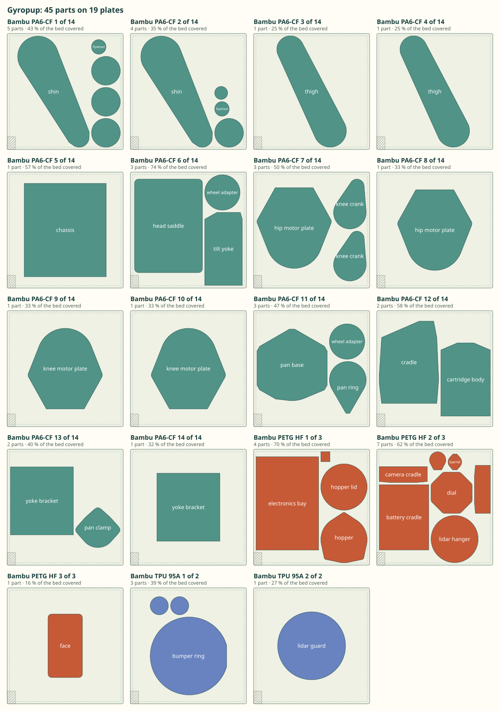
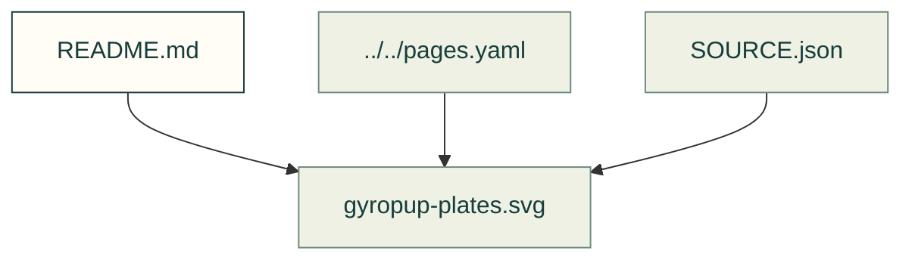

# Plate evidence

Existing figures for plate evidence. The caption/source index distinguishes illustrative diagrams from recorded outputs; these pictures do not prove current physical performance.

Files and sources

| File or folder | Purpose |
|---|---|
| [LICENSE.txt](LICENSE.txt) | Attribution and reuse terms for the imported pictures. |
| [SOURCE.json](SOURCE.json) | Source identities and generation notes for these recorded images. |
| [gyropup-plates.svg](gyropup-plates.svg) | Diagram: Gyropup's 45 printed parts on 19 Bambu Studio plates of 256 mm, grouped by filament: 14 plates of PA6-CF, 3 of PETG and 2 of TPU, with every plate's wiper corner kept clear |

[Figure index](../README.md) · [Captions and tool inputs](https://github.com/Valpatel/cad-agent/blob/dev/docs/pages.yaml) · [plates_figure.py](https://github.com/Valpatel/cad-agent/blob/dev/tools/plates_figure.py)
