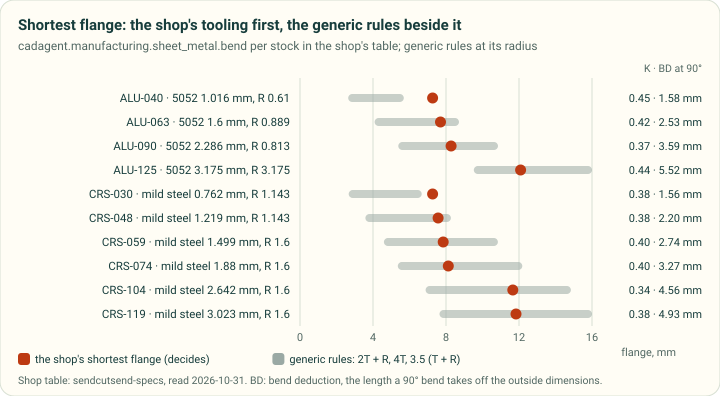
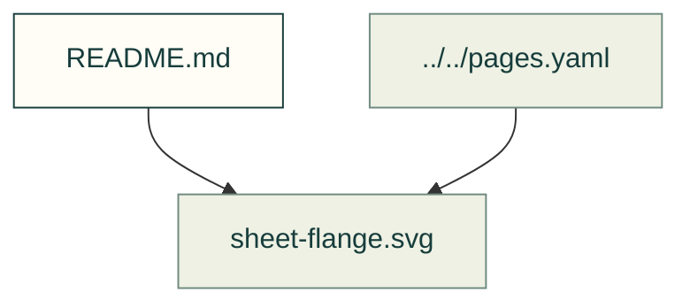

# Manufacturing processes

Existing figures for manufacturing processes. The caption/source index distinguishes illustrative diagrams from recorded outputs; these pictures do not prove current physical performance.

Files and sources

| File or folder | Purpose |
|---|---|
| [dfm-wall.svg](dfm-wall.svg) | SVG: dfm wall |
| [layer-factors.svg](layer-factors.svg) | SVG: layer factors |
| [sheet-flange.svg](sheet-flange.svg) | SVG: sheet flange |
| [sheet-hardware-prices.svg](sheet-hardware-prices.svg) | SVG: sheet hardware prices |

[Figure index](../README.md) · [Captions and tool inputs](https://github.com/Valpatel/cad-agent/blob/dev/docs/pages.yaml)
