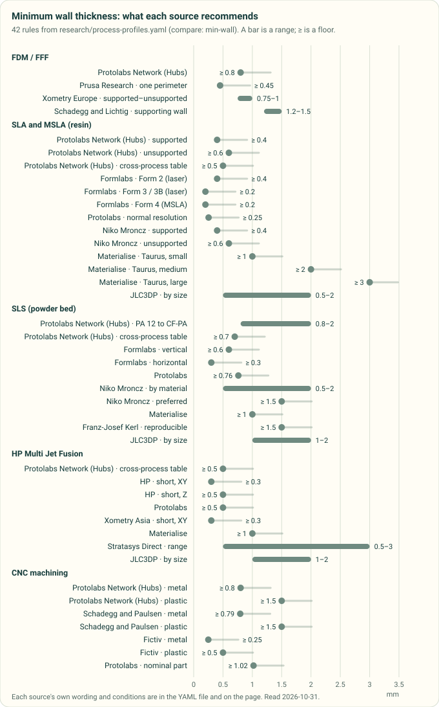
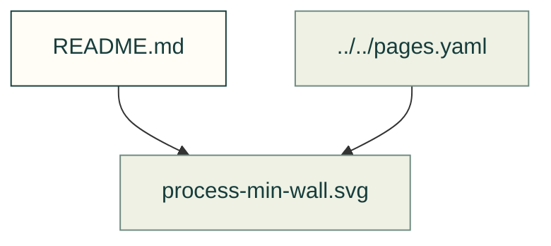

# Research figures

Existing figures for research figures. The caption/source index distinguishes illustrative diagrams from recorded outputs; these pictures do not prove current physical performance.

Files and sources

| File or folder | Purpose |
|---|---|
| [fdm-anisotropy.svg](fdm-anisotropy.svg) | SVG: fdm anisotropy |
| [landscape-stars.svg](landscape-stars.svg) | SVG: landscape stars |
| [moulded-strain.svg](moulded-strain.svg) | SVG: moulded strain |
| [printed-strain.svg](printed-strain.svg) | SVG: printed strain |
| [process-cnc-corners.svg](process-cnc-corners.svg) | SVG: process cnc corners |
| [process-cnc-depths.svg](process-cnc-depths.svg) | SVG: process cnc depths |
| [process-cnc-tolerance.svg](process-cnc-tolerance.svg) | SVG: process cnc tolerance |
| [process-cnc-walls.svg](process-cnc-walls.svg) | SVG: process cnc walls |
| [process-escape-holes.svg](process-escape-holes.svg) | SVG: process escape holes |
| [process-fdm-tolerance.svg](process-fdm-tolerance.svg) | SVG: process fdm tolerance |
| [process-fine-detail.svg](process-fine-detail.svg) | SVG: process fine detail |
| [process-fits.svg](process-fits.svg) | Diagram: Range chart of the clearance between mating printed parts each source recommends, by process: 0.1 to 0.76 mm, with powder parts printed together needing the most |
| [process-holes-pins.svg](process-holes-pins.svg) | SVG: process holes pins |
| [process-min-wall.svg](process-min-wall.svg) | SVG: process min wall |
| [process-moulding-bosses.svg](process-moulding-bosses.svg) | SVG: process moulding bosses |
| [process-moulding-corners.svg](process-moulding-corners.svg) | SVG: process moulding corners |
| [process-moulding-draft.svg](process-moulding-draft.svg) | SVG: process moulding draft |
| [process-moulding-ratios.svg](process-moulding-ratios.svg) | SVG: process moulding ratios |
| [process-moulding-wall.svg](process-moulding-wall.svg) | SVG: process moulding wall |
| [process-overhangs.svg](process-overhangs.svg) | SVG: process overhangs |
| [process-powder-tolerance.svg](process-powder-tolerance.svg) | SVG: process powder tolerance |
| [process-resin-overhangs.svg](process-resin-overhangs.svg) | SVG: process resin overhangs |
| [process-sheet-holes.svg](process-sheet-holes.svg) | SVG: process sheet holes |
| [process-sheet-metal.svg](process-sheet-metal.svg) | SVG: process sheet metal |
| [process-sheet-shop.svg](process-sheet-shop.svg) | SVG: process sheet shop |
| [thermal-limits.svg](thermal-limits.svg) | SVG: thermal limits |

[Figure index](../README.md) · [Captions and tool inputs](https://github.com/Valpatel/cad-agent/blob/dev/docs/pages.yaml) · [process_profile_figures.py](https://github.com/Valpatel/cad-agent/blob/dev/tools/figures/process_profile_figures.py)
