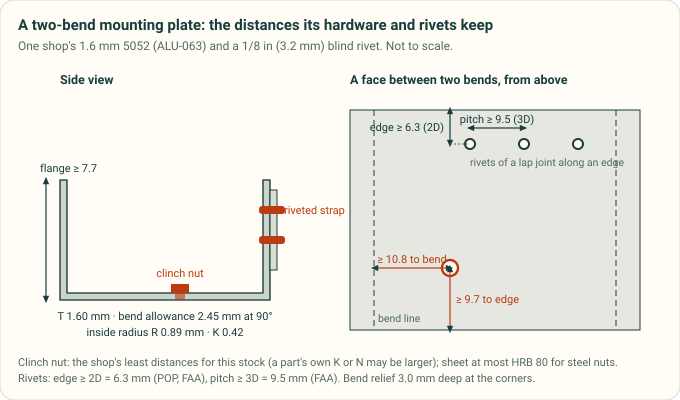
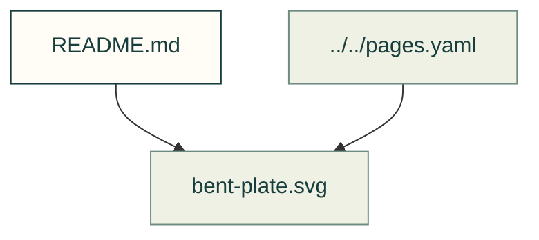

# Sheet-metal hardware

Existing figures for sheet-metal hardware. The caption/source index distinguishes illustrative diagrams from recorded outputs; these pictures do not prove current physical performance.

Files and sources

| File or folder | Purpose |
|---|---|
| [bent-plate.svg](bent-plate.svg) | SVG: bent plate |
| [clinch-hardness.svg](clinch-hardness.svg) | SVG: clinch hardness |
| [rivet-spacing.svg](rivet-spacing.svg) | SVG: rivet spacing |
| [shop-hardware.svg](shop-hardware.svg) | SVG: shop hardware |

[Figure index](../README.md) · [Captions and tool inputs](https://github.com/Valpatel/cad-agent/blob/dev/docs/pages.yaml)
