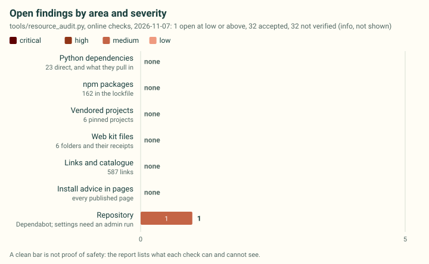
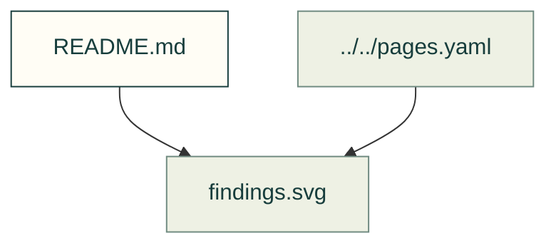

# Supply-chain findings

Existing figures for supply-chain findings. The caption/source index distinguishes illustrative diagrams from recorded outputs; these pictures do not prove current physical performance.

Files and sources

| File or folder | Purpose |
|---|---|
| [findings.svg](findings.svg) | SVG: Open supply-chain findings by area and severity |

[Figure index](../README.md) · [Captions and tool inputs](https://github.com/Valpatel/cad-agent/blob/dev/docs/pages.yaml)
