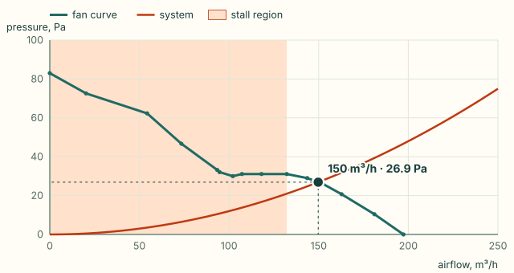
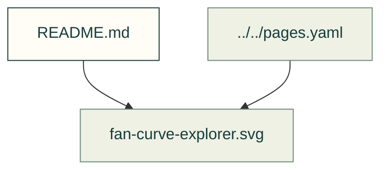

# Thermal explorers

Existing figures for thermal explorers. The caption/source index distinguishes illustrative diagrams from recorded outputs; these pictures do not prove current physical performance.

Files and sources

| File or folder | Purpose |
|---|---|
| [fan-curve-explorer.svg](fan-curve-explorer.svg) | Diagram: A fan's datasheet pressure-flow curve against a system curve: they cross at 150 cubic metres per hour and 26.9 Pa, clear of the shaded stall region below 132 |

[Figure index](../README.md) · [Captions and tool inputs](https://github.com/Valpatel/cad-agent/blob/dev/docs/pages.yaml) · [fan-curve-still.mjs](https://github.com/Valpatel/cad-agent/blob/dev/tools/site/figures/fan-curve-still.mjs)
