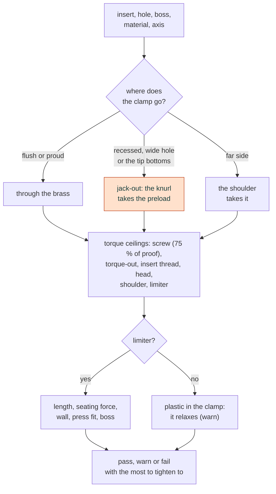

# Threaded inserts and compression limiters

A heat-set insert is a knurled brass sleeve melted into a hole in a printed part, so a machine screw has metal
threads to bite. A compression limiter is a metal tube through a clamped plastic part, so the screw's clamp goes
through metal and not through plastic that creeps. `cadagent.mechanical.inserts` designs the hole and the boss for
an insert, works out where the screw's clamp goes, holds it against the insert's pull-out, torque-out and thread, the
plastic under the head and the limiter, and says how much of the clamp the joint keeps. `cad-agent inserts` runs it
on every joint in a file. **The strengths are a shear model calibrated to published pull-out tests, so a result is a
starting point to test, not a rating. The coupon plan at the end says how to measure it.**


## Check a joint

Declare each joint in a file and run the check. A joint with an `insert` is a screw into a heat-set insert. A joint
with a `thread` and no insert is a screw into metal or a nut that clamps printed plastic.

```yaml
# joints.yaml
defaults: {material: pla-bambu-basic}
joints:
  - {name: lid, insert: mcmaster-94459A140, boss_outside_mm: 9.5, head_mm: 7.0, clearance_mm: 3.4,
     clamped: {thickness_mm: 4.0}}
  - {name: bracket, thread: M4, thickness_mm: 6.0, head_mm: 7.0, clearance_mm: 4.5}
```

```text
$ cad-agent inserts joints.yaml --output result.json
WARN  lid: M3 94459A140 in Bambu PLA Basic, through-insert; tighten to at most 0.20 N m (clamped on insert)
      warn: preload kept: the clamped plastic relaxes and takes the preload with it: ...
WARN  bracket: M4 clamping Bambu PLA Basic; tighten to at most 0.68 N m (head bearing)
      warn: preload kept: the clamped plastic relaxes and takes the preload with it: ...
```

The command exits 1 when a joint fails and 2 when the file is wrong. A warning does not fail it. The JSON holds every
row with its value, limit, verdict and reason, the insert's capacities, the torque ceilings and the limits.

From Python:

```python
from cadagent.mechanical import inserts

inserts.hole_design(inserts.insert("mcmaster-94459A140"))      # 4.2 mm in CAD (the maker's 4.0 + 0.2), 6.7 mm deep
r = inserts.check_joint("mcmaster-94459A140", "pla-bambu-basic", boss_outside_mm=9.5, head_mm=7.0,
                        clearance_mm=3.4, clamped={"thickness_mm": 4.0})
r["verdict"], r["torque"]["allowed_nm"], r["torque"]["governed_by"]   # 'warn', 0.20, 'clamped_on_insert'
r["capacity"]["pull_out"]                                         # low 811, mid 1152, high 1394 N
inserts.check_clamp("M10", "pa6-cf20-polymaker-wet", 40.0, head_mm=20.0, clearance_mm=12.0, torque_nm=20.0,
                    limiter={"outside_mm": 18.0, "bore_mm": 12.0}, limiter_length_mm=39.8)
inserts.coupon_plan()                                             # what to print and measure
```

## Where the clamp goes

The insert's height against the joint face decides what carries the screw's clamp. This is the first thing the
check works out, and it changes every limit after it.


- **Flush, or up to 0.13 mm proud** (PEM, SPIROL). The clamped part bears on the insert's end. The clamp goes through
  the brass, and the knurl carries only what pulls the parts apart. M3 in PLA Basic, clamping metal: tighten to at
  most **0.40 N·m**, set by the insert's end face: the ring round the clamped part's hole takes nearly all the clamp,
  held to brass's 124 MPa. A printed clamped part sits on that same ring, so its plastic sets a lower limit (the lid
  above: 0.20 N·m). That limit puts the whole clamp on the ring, the cautious bound: once the plastic yields, the
  boss face takes some, which the check does not size. A metal washer between the printed part and the insert (not
  under the head), or a limiter, spreads it.
- **Recessed, even by 0.05 mm.** The screw pulls the insert towards the head until the gap closes. The knurl
  carries the whole preload, so the same joint 0.2 mm recessed may take only **0.13 N·m**.
- **A clamped part whose hole is as wide as the insert** bears on the plastic round it. That jacks the insert out
  too, and the check says so.
- **Pressed in from the far side**, the insert is pulled into the boss in front of it, and that shoulder must not
  punch out.
- **The screw's tip.** Past the floor of a blind hole the screw bottoms and jacks the insert out. Past the insert's
  end it reaches the room left for the melt, which may have filled it. Give `screw_depth_mm` and the check reports
  both, and the thread length engaged.

## Compression limiters

A limiter only helps if the head lands on it. If it is longer than the plastic, the part is loose round it. If it is
shorter, the head must squeeze the plastic by the difference before it lands.


- **Some printed plastics take less squeeze than SPIROL allows.** SPIROL allows 3 to 5 % compression. A printed
  plastic reaches its compressive strength at **2.6 %** (PETG Basic) to **3.6 %** (PLA Basic), so the check warns
  past that.
- **The seating force.** SPIROL's formula 3 takes the plastic under the head as a column. A narrow ring of head on
  thick plastic spreads the load, and the far face sits on a broad face, so the check also takes Shigley's frustum
  through the whole thickness and uses the higher. An 18 mm steel sleeve 0.2 mm short of 40 ± 0.1 mm of wet PA6-CF,
  under a 20 mm washer, needs **550 N** as a column and **5055 N** as a cone. The ring then bears 85 MPa, so it warns.
- **A limiter on a straight-knurl insert.** The limiter must abut the insert. Its end then bears on the thin ring
  between its bore and the knurl, 10.00 mm² for M5. Brass's yield there caps the preload at 1240 N. Squeezing 6.1 mm
  of printed PETG by 4.9 % takes 3170 to 9146 N, so the limiter never seats and the check fails it. Make the limiter
  as long as the measured plastic, or use one with a proud knurl (Bulten), or a flanged insert.
- **Limiters of your own.** `check_clamp` takes a sleeve, a bushing or a spacer as `limiter` (its outside, bore,
  metal and, for the wall, its yield). Catalogue limiters are SPIROL's CL6000 (aluminium) and CL8000 (brass), M3 to
  M8, rated for 10.9 screws.



## What the numbers rest on

The pull-out force is the knurl's cylinder sheared, F = c τ π D L. τ is half the filament's tensile strength across
the layers, from the maker's data sheet, and c is fitted to published tests.


- **PLA: c from 0.62 to 1.06**, from 13 results in four publications by three groups (László 2026, CNC Kitchen 2019
  and 2026, SPIROL 2026). Medium confidence. SPIROL's two M6 results set the low end.
- **PETG: c from 0.51 to 0.73**, from three results: CNC Kitchen's M3 and SPIROL's two M6. Low confidence.
- **SPIROL's M6 values are read off its bar charts** (its 3D-printing paper, Figures 10 and 12), to about 20 N.
- **Other families** (ASA, nylon) have no printed test with a data sheet in the table. They take the lowest c of any
  family, and the check warns.
- **Torque-out** comes from pull-out through r = 2 T / (F D). The tests give r from 0.66 (SPIROL, printed
  glass-filled PA6) to 1.41 (PEM, M8 in ABS). CNC Kitchen's printed PETG gives 1.12. The low end is taken.
- **Other sizes** scale by the knurl's area. SPIROL's printed M6 results sit below the M3 ones, so area alone would
  overstate a larger insert. The low end is the M6's.

<details>
<summary>Every row the check reports, and its rule</summary>

| Row | Pass | Warn | Fail |
|---|---|---|---|
| hole diameter | the maker's hole +0.2 to +0.3 mm in CAD (CNC Kitchen) | outside that | at or over the knurl |
| hole depth | the deepest of the makers' rules (SPIROL: the insert plus two pitches; CNC Kitchen and ruthex: +1 mm; McMaster's least material thickness); from the far face, for a far-side insert, no deeper than the insert, so it lands on the shoulder | short of it; for a far-side insert, deeper | no deeper than the insert |
| melt volume | the plastic the insert displaces fits the pocket below it | it does not | |
| screw tip | above the floor and inside the insert | past the insert's end | at or past the floor |
| boss wall | 2 × the knurl (the makers' full performance; the tests behind the low end used about 1.5 ×) | the makers' least wall to 2 × | under the least wall or 1.5 × the knurl |
| insert axis | along the build direction | in the layer plane: no published number | |
| calibration, calibration size | a family with printed tests, an insert no larger than the fitted ones | no printed test in the family, or a larger insert | |
| clamp path | flush, proud to 0.13 mm, or a far-side shoulder | recessed or more proud | |
| tightening torque | at most the lowest ceiling, the screw's at 75 % of its proof load (SPIROL) | within the margin over it | past it |
| insert thread | the preload and load under its stripping force / 2 (ISO 68 area, brass at 124 MPa) | under the force | over it |
| pull-out, push-out, torque-out | the separating load under the low capacity / 2 | under the low capacity | over it |
| shoulder | the plug a far-side insert would punch, / 2 | under it | over it, or its hole wider than the insert |
| head bearing | the preload on the plastic under the head under its compressive strength / 2 | under the strength | over it |
| limiter length | squeeze at most 5 %, the limiter's own included | 5 to 7 %, past the plastic's compressive strength over its modulus, or proud | over 7 % |
| seating force | under the preload and 75 % of the proof load, the ring under its strength / 2 | the plastic crushes or creeps before the head lands | the head never lands |
| head over limiter | the head or washer reaches past it | it covers only the limiter | |
| limiter on insert | its bore smaller than the insert's face | | not abutting |
| insert face | the clamped part's or the limiter's end on the insert: the ring under brass's 124 MPa | up to 310 MPa | over it |
| clamped on insert | a printed clamped part on that ring under its compressive strength / 2 | under the strength | over it |
| limiter end (far-side insert) | its end on the shoulder's plastic under its compressive strength / 2 | under the strength | over it |
| limiter rating | the preload under 75 % of the proof load of the class it is rated for | under the proof load | over it |
| limiter wall (your own) | the stress in its wall under its yield / 2 | under the yield, or no yield given | over it |
| limiter press fit | the hoop stress its knurl raises in the hole under the strength along the layers / 2 | under the strength | over it |
| limiter boss | a wall of at least 0.5 d (Bulten) and the boss 2 × the limiter (SPIROL) | the boss under 2 × | the wall under 0.5 d |
| preload kept | at least 0.9 of it (an assumed level), the screw, limiter and plastic as springs | plastic in the clamp: it relaxes | |

The margin is 2.0 throughout (Covestro's least safety factor for plastic parts). Pass `margin` to change it.

</details>

## Worked example: a robot's inserts

[Gyropup](https://github.com/Valpatel/gyropup) has 151 heat-set inserts and many clamped plastic joints, listed in
its insert-joint audit (its PR #138, as merged). The checks ran on 41 of its 46 joint families and on 43 of the 47
printed clamps. Five joints fail:

- two screws reach 2.0 and 3.0 mm past the floor of a blind pilot, so they jack their inserts out;
- a 4 mm pilot is no deeper than its 5.7 mm insert;
- an M6 at 8 N·m puts 156 MPa on wet PA6-CF under its 10 mm head, against the 27 MPa allowed (114 MPa with an
  11 mm washer), and an M4 at 2.3 N·m puts 160 MPa on PETG under a socket head (6.53 mm bearing face) if what it clamps is
  printed.

The audit found the same problems on its own. The printed clamps pass at the torque the check gives them (0.23 to
1.24 N·m) and warn only because their plastic relaxes.

<details>
<summary>What the checks leave out, and where they and the audit differ</summary>

Outside these checks: a bearing stack with no plastic in it, pins with no screw, a lid with no receiver, an
adapter whose pattern is unpublished, four TPU isolators (no TPU data sheet in the table) and a nyloc whose bearing
face is not given.

- **A sleeve recessed 0.2 mm in a knee eye.** The audit puts the whole 10 kN on the 60 mm² of plastic under the
  washer's overhang (168 MPa). Here the plastic is a spring: with the eye's 40 ± 0.15 mm it takes about 5.8 kN,
  97 MPa, before the washer lands on the sleeve. Both say: press the sleeve proud.
- **Torque ceilings for plastic under the head.** The audit uses 25 MPa for sustained load. Here the limit is the
  compressive strength over the margin, 27 MPa for wet PA6-CF, so the ceilings are about 9 % higher.
- **Every pilot is drawn at the maker's hole**, which the audit also notes. CNC Kitchen measured printed holes about
  0.25 mm small, so each one warns.

</details>

## Test coupons

The plan prints each insert upright and lying, pulls it out, turns it out, and clamps it with and without a limiter.
The limiter stands proud of its plate, so that cell measures an all-metal clamp against the plastic one.
`python3 tools/insert_coupons.py --out exports/insert-coupons` writes each coupon's STEP and STL, in its print
orientation, and the plan as JSON.


Each cell is five specimens with the predicted value next to it, so a test can confirm or move the calibration.
Record the filament, the printer settings, the hole as printed, the iron, the insert's height afterwards, the room
and the failure mode. Pull at 2 mm/min with a reaction plate that clears the boss. Read a clamp's preload at 0, 1 h,
24 h and 168 h, then after 24 h at 50 °C.

## Limits

- **Not a rating.** The calibration is M3 × 5.7 and M6 × 12.7 in PLA and PETG. Other sizes scale by the knurl's
  area, from the M6's lower fit, and other families take the lowest fit.
- **Torque-out** comes from pull-out through the tests' ratio. **Push-out** and **an insert lying in the layer plane**
  have no published number, so they are flagged, not modelled.
- **Static, short-term, room temperature.** A held load creeps. PLA inserts kept 26 to 55 % of their pull-out after a
  year outdoors (Materials 2025).
- **Bosses as tested.** SPIROL printed 5 wall loops at 55 % infill, László a 1.3 to 1.9 mm solid sleeve in 40 %
  infill. Fewer walls hold less: one loop at 15 % infill held about a quarter of eleven (SPIROL, Figure 8).
- **Preload kept.** Printed PLA was measured for an hour and printed joints for a week. The long-term figure is
  moulded polycarbonate's, and PLA, nearer its glass transition, will keep less.
- **The seating force** takes the plastic as an elastic column or cone, with no edge or free face nearer than the cone.
- CAD and closed forms do not prove a joint holds. Print the coupons and measure.

## Sources and survey

<details>
<summary>What the survey of 2026-11-01 found, and every document the numbers come from</summary>

**Adopt or build.** bd_warehouse and cq_warehouse (Apache-2.0) hold heat-set insert dimensions and make a straight
hole as deep as the insert. FreeCAD's Fasteners workbench (GPL/LGPL) holds PEM's IUT table. NopSCADlib (GPL-3.0)
holds holes and a boss of two extrusion widths. BOSL2 has no insert module. None models a tapered or deeper hole, a
least wall, pull-out, torque-out, jack-out or a limiter, and no maker publishes a calculator (SABIC's boss calculator
is closed and for moulded parts). So the checks are built here. The 94459A120 row and the 94459A130 knurl come from bd_warehouse's
table (Apache-2.0); the rest is read from the makers' pages, documents and CAD below.

**Inserts and holes.** CNC Kitchen's *Heat-Set Insert Dimensions and Design Guidelines* (2025-06-30); ruthex's size
table; PennEngineering's *SI Threaded Inserts for Plastics* (2026-07-16), pp. SI-5, SI-6, SI-10, SI-25 and SI-26;
SPIROL's *Inserts for Plastics Design Guide* (05/26), printed pp. 5, 8, 9, 18, 20 and 21, and *How to Select a
Threaded Insert for Your 3D Printed Assembly* (04/26), pp. 2 to 5; CNC Kitchen's *Tips & Tricks for Heat-Set Inserts* (2021) and ruthex's tip set page for
the iron's temperature; McMaster-Carr's 94459A pages, read 2026-11-01. McMaster's M2.5 and M6 rows and the 93365A
family could not be read (a login was asked), so nothing is given for them.

**Tests.** K. László, B. F. Szivós and V. Nemes, *Engineering Proceedings* 157 (2026) 40; CNC Kitchen, 2019-12-07,
2020-05-30 and 2026-03-28; SPIROL's printed M6 tests (its 3D-printing paper, Figures 8 to 12, read off the charts);
SPIROL's INS 19 table and PEM's IUT table, both in the guides above; T. Kastner et al.
(2023) on infill and perimeters; *Materials* 18 (2025) 2591 on ageing.

**Limiters and clamps.** SPIROL's *Compression Limiters Design Guide*, 04/21 (pp. 3, 4, 6, 7, 14) and 05/26 (pp. 6,
15, 16); SPIROL's *How To Properly Mate Compression Limiters and Threaded Inserts* (2022); Bulten's *Compression
Limiters & Captive Bolt Assemblies* (2024); Covestro's *Part and Mold Design* (2015), p. 59 and Table 3-7, and
*Snap-Fit Joints*, Table 3; Bossard's *Screws property class 4.6 to 12.9*, *Surface pressure when mounted* and
*Friction and friction coefficients* (01-2025), after ISO 898-1 and VDI 2230; ISO 273 for clearance holes; C36000
brass's yield (Smiths Metal Centres, 2023).

**Plastics.** C. G. Amza et al., *Polymers* 13 (2021), Table 4 (printed PLA and PETG in compression, and a joint's
torque after 7 days); A. Liber-Kneć and S. Łagan, *Materials* 18 (2025) 3262 (printed PLA relaxing over an hour); the
filament makers' data sheets in [`allowables.py`](../src/cadagent/mechanical/compliant/allowables.py).

**Relations.** Shigley's *Mechanical Engineering Design*, 10th ed.: Section 8-2 and Eq. 8-27 (torque and clamp),
Section 8-5 (the frustum), Section 8-7 (load sharing), Section 8-9 (75 % of the proof load), Section 3-16 (press
fits), Section 5-5 (shear yield), Table A-5 (metals' moduli); ISO 68-1 (thread shear areas). Each one is in [Engineering formulas](formulas.md).

</details>

## Tests that keep it honest

`tests/test_inserts_formulas.py` checks each relation against a hand evaluation or a closed form it must reach.
`tests/test_mechanical_inserts.py` reproduces the published tests from the calibration, checks the makers' hole and
boss rules, each row's verdicts on built cases, the CLI's exit codes, and the coupons' CAD volumes.
`tests/test_insert_figures.py` redraws every figure on this page from the module and fails if one has gone stale.
