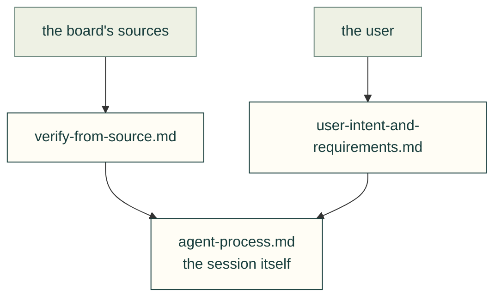

# Lessons — process

How the agent works with its sources, the user and a long session.

| File | Lessons on |
|---|---|
| [verify-from-source.md](verify-from-source.md) | Confirm board facts, release claims, credential selection, command references and moved local quickstart paths against their actual consumers |
| [user-intent-and-requirements.md](user-intent-and-requirements.md) | How the requirements evolved, and the user's corrections |
| [2026-11-05-recovery-audit.md](2026-11-05-recovery-audit.md) | Dated issue, PR, branch and worktree dispositions; reconcile checkpoints before resuming |
| [agent-process.md](agent-process.md) | Session practice, ownership, single-part tests, CI failure classification, and navigation timeout evidence |

Each lesson follows the [lesson format](../README.md#lesson-format): a rule, the incident, a check and its source. Back to [all lessons](../README.md).
