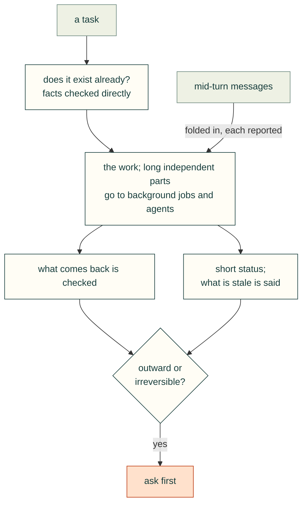

# Agent process

### Fold mid-turn messages into the current work and report on each
- **Rule:** Treat each mid-turn message as a requirement that joins the current plan. Acknowledge it, and account for it
  in the final report.
- **Incident:** Within five minutes the user sent several new requests in a row:
  - reset and flashing button cutouts;
  - RP-SMA positions "(2x each)", which are pigtails with nuts;
  - thumbnails;
  - STL and Bambu links;
  - fit-template standoffs.

  The report opened with "All four of your requests are now in Rev 0.5.2" and covered every item, including the open
  question.
- **Check:** The final report has one entry per user message since the last report, each with a status: done, partial
  or needs input.
- **Source:** 2026-10-24T16:34–16:39, 17:10.

### Give short status during long work, and say what is stale
- **Rule:** During long runs, post one-line status updates: what is running, what is waiting, and which outputs are
  out of date.
- **Incident:** The agent posted lines such as "The build is running in the background; I'll pick up when it finishes"
  and "Some images are still from earlier runs until the full rebuild finishes." The user still asked to see progress,
  which led to the on-page progress section (see [Review site UX](../review/review-site-ux.md)).
- **Check:** No silent gap longer than one pipeline stage. Every report says which artefacts are stale.
- **Source:** 2026-10-24T14:44, 16:46; 2026-10-25T00:36, 01:23.

### Ask before outward or irreversible actions
- **Rule:** Before committing, pushing, opening PRs, publishing repos or installing third-party plugins, ask and wait
  for a clear yes. Build locally first.
- **Incident:**
  - The first CAD report tooling stayed uncommitted in a separate worktree: "I'll ask before committing or opening a
    PR."
  - For the proposed public repo, the agent proposed building locally first and publishing only after review, because
    public content may be copied or indexed.
  - Installing text-to-cad or a KiCad MCP server "runs their code on your machine", so the agent asked for a go-ahead
    and had the survey install nothing.
  - The private repo was created only after the user asked for one.
- **Check:** A list of outward actions (git commit/push, repo create, PR, package or plugin install, public upload)
  that need explicit user approval in the current conversation.
- **Source:** 2026-10-25T00:36, 01:45, 02:18, 02:19, 02:20, 02:23.

### Check whether it already exists before building it
- **Rule:** Before scaffolding a new tool or framework, search for prior art. Record licence, activity and fit, and
  prefer adopting it and contributing the gaps.
- **Incident:** The agent had started planning a new cad-agent framework ("I'm starting Phase 0 now"). The user said:
  "I can almost 100% guarantee this already exists?" A search found text-to-cad (MIT, about 23,000 stars at the time),
  which already ships CAD and DFM skills for Claude Code, Codex and others, plus several KiCad MCP servers. The plan
  changed to: adopt the best tools, survey the field properly, test-drive them on this project, and contribute only the
  real gaps (designing an enclosure around a real board, cable bend radius, fastener stack length, evidence-backed
  review).
- **Check:** A landscape file (here `docs/research/agent-workflow/landscape.md`) exists before any new framework code. Each gap claimed is
  backed by a search result.
- **Source:** 2026-10-25T02:18, 02:19.

### Mine and handle only the data the user selects
- **Rule:** Limit history mining and data handling to the sources the user names. Write that scope down where future
  runs will see it.
- **Incident:** "You shouldn't mine -all- session histories, only this one", and "This one with J501 is important." The
  repo README and a saved standing preference record the scope. The extractor keeps only user and assistant prose and
  strips personal details.
- **Check:** The miner takes an explicit session ID, never a glob. Its output header names the single source.
- **Source:** 2026-10-25T02:22, 02:25.

### Diagnose desktop problems without disrupting the user's session
- **Rule:** For problems on the user's machine, diagnose first. Use the least disruptive fix, restore any setting you
  touch, and never log out, restart or kill the user's processes without asking.
- **Incident:** "my mouse cursor looks broken ... I can't click anything". A sub-agent was told to diagnose first and
  avoid anything that could log the user out. The X server's grab report showed that Bambu Studio held an active
  pointer grab from a stuck "Seam position" tooltip. Escape and clicking did not release it. The sub-agent briefly
  enabled the X keyboard grab-break option, sent the ungrab key, and then restored the keyboard options. No apps were
  closed, and the long-running CAD jobs were left alone. The user was told the project in Bambu was unsaved.
- **Check:** Before and after: grab report, keyboard options, pointer position. The final note lists every setting
  touched and confirms it was restored.
- **Source:** 2026-10-25T02:21, 02:23.

### Hand long, independent work to background jobs and agents, and check what comes back
- **Rule:** Run slow pipelines and separable sub-projects in the background or in isolated worktrees. Keep working on
  the main thread, resume agents after interruptions, and verify their claims before relaying them.
- **Incident:**
  - The roughly 15-minute build-and-check pipeline ran in the background while the agent edited docs and the site.
  - The user asked to standardize the report tooling for CAD designs inside an existing test repo. One sub-agent first
    mapped that repo's conventions read-only. A second built the CAD tooling in a separate worktree.
  - The second agent was cut off by a session restart before it wrote anything, and was restarted.
  - Its report included a fixed fallback-parser bug with a test that catches it, failing tests compared against a
    clean HEAD before being called pre-existing, and a tracked file the test suite had rewritten, which it restored.
- **Check:** Background agents work in a worktree or scratch copy, never the user's checkout with uncommitted changes.
  Their reports state what was not done. The parent re-runs at least the key check before reporting success.
- **Source:** 2026-10-24T17:35, 17:40, 17:58; 2026-10-25T00:36, 01:44.

### Check facts directly instead of answering from memory
- **Rule:** When the user asks a factual question about the current design or the outside world, inspect the artefact
  or primary source before answering.
- **Incident:** On "P1M and P! don't support stacking the drives right?" the agent said: "I'll check both parts directly
  rather than answer from memory." On prior art it said it was "checking the biggest one directly rather than relying on
  search snippets".
- **Check:** The answer cites the file, part or URL that was inspected.
- **Source:** 2026-10-25T01:30, 02:19.

### Never `pkill -f` or `pgrep -f` a pattern that is also in your own command line
- **Rule:** `pkill -f` and `pgrep -f` match the whole command line of every process, including the shell running
  the command. A pattern that appears in that command matches the agent's own shell, and the kill ends it. Match on
  the program's path with the bracket trick (`ps -eo pid,args | grep "[/]app/bin/..."`), or kill a PID you saved
  when you started the job.
- **Incident:** in the Cat 323 excavator session (2026-11-01, session `47707e1e-b3c1-4114-b10e-9fc722a426bd`), the
  agent ran `pkill -f "cad/build.py" ; ... sed -i ... cad/assembly.py` to stop a background build. The pattern was in
  its own command, so the shell died with exit code 144, and the agent had to check whether the `sed` had run. Later,
  `for p in $(pgrep -f "exports/slice/_gui/datadir"); do kill $p; done` to close a PrusaSlicer window killed the shell
  the same way (exit 144), with the relaunch in the same command.
- **Check:** before any `pkill -f`, `pgrep -f | kill` or `killall`, the pattern is not a substring of the command
  being run. A long-running job's PID is saved when it starts (`$!`), and that PID is what gets killed.
- **Source:** Cat 323 session 2026-11-01T20:30, 22:12, 22:36.

### When a check flags one part, test that part alone before rerunning the full pipeline
- **Rule:** a fix for one flagged part is tried on that part alone: build it, export it and slice or check it in
  seconds. Rerun the full pipeline once, when the local fixes pass. To find what a warning is about, slice the part in
  pieces.
- **Incident:** the excavator's full rebuild of 46 parts took about 13 minutes, and a round with the clearance sweep
  and slicing took up to about 40. When the track frame's roller-pocket arches were flagged, the agent built just the
  frame with the steeper arch, exported its sections and sliced those, "before doing a full rebuild". The track link's
  fix was tested by building and slicing one link. Slicing the frame in sections showed which one carried the
  warning. The project then cached the built parts as BREP under one hash of all its sources, so the clearance,
  render and slice steps share one build. Any source edit still rebuilds every part.
- **Check:** each fix's report names the single-part test that confirmed it, before the full run. Full runs are
  counted, and the final one is the run whose outputs are reported. A part cache (#250) keeps the full run short.
- **Source:** Cat 323 session 2026-11-01T19:54, 20:31, 21:17, 21:18, 22:36; the project's `cad/assembly.py`
  (`exports/.partcache/<source hash>/`).

### Publish live validation as comments while CI is in flight
- **Rule:** settle a PR description before the final push, then post live validation updates as comments while checks run. Before treating a cancelled run as a test failure, inspect its event and concurrency group.
- **Incident:** on 2026-11-05, PR #350 had CI runs at 22:16, 22:17 and 22:20 UTC cancelled at the same head `a6b61550` when its description was edited to report validation. The CI workflow listens to PR `edited` events and cancels a superseded run for the same ref. The browser workflow has a separate queue and lacked equivalent automatic cancellation.
- **Check:** inspect `.github/workflows/ci.yml` events and concurrency, then `gh run list --branch <branch> --json headSha,status,conclusion,event,createdAt`. Record a test failure only from its completed check output. Cancel only an owned branch's superseded runs after confirming a newer head exists; preserve its current run and other authors' runs.
- **Source:** 2026-11-05 integration audit in PR #350; coordinating agent's same-head run timestamps and `.github/workflows/ci.yml`. This explains cancellation in this workflow configuration; it does not prove that a rerun will pass or justify bypassing any required gate.
- **Classify from executed steps:** a provisioning timeout, superseded run and failed application assertion are
  different evidence. Read job steps, annotations and exact-attempt logs before retrying. Keep the source frozen
  when only provisioning is incomplete; a rerun must actually execute and pass every required check.

2026-11-06 UTC: measured provisioning and log-attribution evidence

- **#363, run 42135518581, attempt 1:** Chromium job 127622524277 exhausted its 15-minute job budget
  (00:15:42–00:30:51). Playwright dependency setup took 00:15:50–00:23:40; apt reported
  `Fetched 21.1 MB in 7min 31s (46.7 kB/s)` at 00:23:28. That setup consumed time available for tests;
  the timeout itself is not an assertion result.
- **#365, unchanged bcb2ddde:** WebKit's first attempt spent 01:31:33–01:46:37 in dependency setup and exhausted
  the same 15-minute limit. Build and test steps were all skipped. Its targeted rerun installed dependencies in
  38 seconds (01:48:37–01:49:15), then actually ran the suites and passed at 01:54:41.
  [Original provisioning receipt](https://github.com/Valpatel/cad-agent/pull/365#issuecomment-6674644989).
- **An ID is not proof of another execution:** GitHub associated the completed Chromium sibling with a new job ID
  in attempt 2 while retaining its original 01:31:23–01:38:02 timestamps. Count that as one execution.
- **Select the attempt, then verify timestamps:** `gh run view 42135518581 --job 127622524277 --log` returned the
  later rerun's 00:31 timestamps despite the old job argument. The explicit REST attempt-1 archive contained the
  actual 00:15 attempt. Fetch `gh api repos/<owner>/<repo>/actions/runs/<run>/attempts/<attempt>/logs > logs.zip`
  and confirm the job's timestamps inside it; do not attribute a latest-attempt log to the original job.
- **Keep receipts scoped:** fleet job 183 passed components at 9e108a4d but failed overall on fixture setup;
  job 185 checked only diagram widths at bcb2ddde. Neither is a full final-head suite receipt. The final bcb2ddde
  required full CI independently passed 3,340 tests (19 skipped), its real wheel smoke and dependency-floor checks,
  and both browser jobs passed before merge.

These measurements justify the interruption classification, not blanket timeout, mirror or cache-policy changes.
Preserve completed sibling checks and investigate any actual assertion failure. A successful rerun never supplies
physical qualification or coverage for a stage that did not run.

### A full-job cap needs an active test identity
- **Rule:** Keep the existing full test selection and job bound, but report each active test unbuffered and enable
  pytest's built-in thread dump for a test that exceeds 120 seconds. The dump observes the stall; it does not fail
  or skip that test or extend the 30-minute job cap.

2026-11-07: cancelled full CI stopped reporting at 97%

PR #465 source `6a5145f1` installed successfully, then job 128496027486 last reported 97% at 19:04:13 UTC and stayed silent
until 19:23:07 UTC. Its annotation explicitly identifies the 30-minute cap. The exact test and cause remain unknown.
Separate main `81b9fdc2` passed 3577 tests / 24 skips in 671.27s; that comparison is not a causal explanation. Preserve the
[original job](https://github.com/Valpatel/cad-agent/actions/runs/42403450255/job/128496027486) and require the new
whole full-suite head to pass; verbose progress or a later quiet run cannot replace missing historical evidence.
See [pytest's thread-dump contract](https://docs.pytest.org/en/stable/how-to/failures.html#fault-handler).

### Keep navigation evidence and close only the failed check's context
- **Rule:** A navigation timeout needs its route, viewport, theme, script mode and outstanding resources. Capture
  that evidence at failure without changing the navigation boundary; preserve the original error if collecting
  DOM evidence also fails. Cover page creation with the ownership `try`, close each owned context in `finally`,
  and retain both failures if cleanup also throws. Leave other test lanes running.
- **Check:** The existing diagram browser check records pending/failed requests, response status and bounded
  DOM/font/style/image evidence. A real held stylesheet must produce the expected timeout, report its actual
  pending request and missing sheet, and close its context while a neighboring page remains usable. Controls that
  remove diagnostics or owned-context cleanup are rejected in both Chromium and WebKit. Real-context setup and
  close faults also verify that single errors keep their identity and a dual failure preserves both errors.

2026-11-06 incident and limits (#369 / #371)

- **Observed:** #369 at `fd85c59d`, run 42158688838 attempt 1 / job 127698877186, completed setup/build and then
  failed during the browser suite at 03:51 UTC. The JavaScript-disabled navigation to `/docs/style-guide` exceeded
  its existing 30-second `load` timeout. The log omitted the iteration's viewport/theme and pending request.
  [Original failure receipt](https://github.com/Valpatel/cad-agent/pull/369#issuecomment-6676472949).
- **Reproduction scope:** fleet 200 built that exact source. All 20 isolated no-script loads passed; the unchanged
  diagram/theme functions then passed together in their original two lanes/shared WebKit browser: 148 navigations,
  20 no-script, no errors, maximum 2,952 ms; the five no-script style-guide loads took 454–512 ms. This did not
  identify the initial cause. The reviewer permitted one unchanged-head full-job rerun, preserving that failure.
- **Review refinement:** Independent #373 review reproduced a context leak when sentinel page creation failed
  before its `try`, and a cleanup error replacing the original action error. The corrected boundaries release
  the setup context and use `AggregateError` only for a dual failure, retaining the original as `cause` and both
  errors and messages. A control restoring the old error-masking helper is rejected in both engines.
- **Correction:** `navigateDiagram` in `tests/site/website-browser.mjs` keeps the ordinary 30-second boundary and
  records structured URLs without queries/fragments; the preserved original error may contain its native call
  log. Its DOM snapshot has a separate two-second diagnostic
  bound. `withDiagramPage` releases only the context it creates. The held-stylesheet control uses a three-second
  fixture timeout so it can test a real error and cleanup without adding 30 seconds to every browser job.
- **Limits:** This improves observability and ownership, not the unproven cause of the original timeout. The old
  delayed cleanup happened after the failure; it is not evidence that cleanup caused it. The local replay does
  not reproduce every property of the CI host. A repeated failure still requires investigation, and skipped or
  interrupted stages are never counted as passes.

## Correct a failing CI mirror before retrying the same provisioning path

The [2026-11-11 incident](../../../.agents/inbox/2026-11-11-ci-apt-timeouts-need-source-correction.md)
retains the failed full CI log, runner image contract, cause and controls. A
provisioning timeout before imports/tests cannot establish feature correctness.

**Rule:** classify the failed phase using the actual log and correct the source
path before collecting new normal CI evidence; never call a provisioning timeout
a passed feature test or bypass the required job. The narrow helper removes the
exact stalled Azure HTTP mirror entry, requires the runner's existing Canonical
HTTPS archive and preserves source/signature settings, dependencies and all
existing failure conditions. Unknown layouts fail closed.

This correction is specific to the hosted Ubuntu mirror-list layout. It does not
establish runner network health or promise that Canonical endpoints cannot fail.
The regression harness is `tests/repo/test_ci_apt_mirror.py`; full and browser CI
remain mandatory independently of its local fixture checks.
