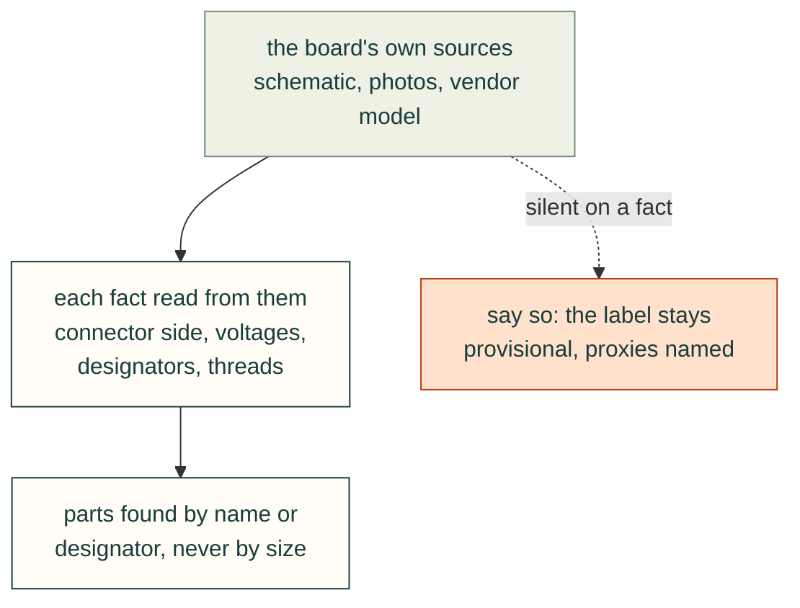

# Verify from source

Board facts that the design depends on (connector side, voltages, designators, threads, which button is which) must
come from a primary source: the schematic, datasheet photos or the vendor's 3D model. They should not come from the
user's recollection or from the agent's assumptions. In this session the user's assumptions and the agent's were each
wrong at least once.

### Confirm which side of the board a connector is on, from photos
- **Rule:** Before designing a cable route, confirm the board side and mating direction of each connector from datasheet
  photos or drawings. Treat generic-height bodies in a vendor STEP as placeholders.
- **Incident:** The user asked how to "connect the cables to the top side of the board where we see sata and sata power
  connectors". In the STEP, no single solid matched a SATA connector, and the SATA bodies found were "3.81 mm-tall
  generic placeholders". The agent rendered the datasheet's top and bottom board photos at high resolution. The result:
  both SATA ports and their power headers are *vertical connectors on the underside* and plug in from below. The whole
  storage design (floor opening, chimney, trays under the unit) follows from this.
- **Check:** Every connector entry in the parameters has a `basis` that names its evidence (photo, STEP solid IDs,
  schematic sheet), for example "Two vertical SATA 7-pin receptacles on the underside (5063/5064; datasheet photo)". Flag
  any body whose height is a library default (3.81 mm here) as non-authoritative. J26 is an example: its placeholder
  was replaced by a 13.85 mm envelope.
- **Source:** 2026-10-24T17:33, 17:36, 17:39; 2026-10-25T00:36; `cad/parameters.json` (`underside_envelopes`), `README.md`.

### Read supply voltages off the schematic image, pin by pin
- **Rule:** When a voltage matters, render the schematic sheet as an image and read the net name on each pin. Do not
  rely on text extraction, and do not take the user's word for it. Then trace the rail back through the power tree.
- **Incident:** The user said: "12V won't come from some external connector, the 12V connector is next to the sata
  connector, one for each sata port on the pcb, review the schematic." The agent rendered sheet 27. On J22 (and
  identically J23), pin 1 is not connected, pins 2–3 are ground and pin 4 is SATA_5V. SATA_5V is switched by Q59, with a
  2 A bead per port. The power tree on sheet 3 shows that VDD_12V feeds only the camera expansion connector. The first
  crop cut off the SATA_5V net label, so the agent widened it. The answer was "no 12 V on its SATA power connectors".
  The crops went on the website, and the agent offered to redesign if a photo showed a 12 V header that is missing from
  the v1.0 schematic (dated 2024-05-29).
- **Check:** For each power pin used, record the sheet, pin and net, plus the upstream rail. Publish the crop with the
  net label visible.
- **Source:** 2026-10-25T01:27, 01:28, 01:29, 01:30; `cad/parameters.json` (SATA power `basis`).

### Re-derive designators from the schematic; name by position when the model can't tell
- **Rule:** Check every reference designator in docs and BOMs against the schematic. If the 3D model does not say which
  physical part is which designator, write the instruction by position and list the designator mapping as unverified.
- **Incident:** The agent had J23 and J24 swapped. Per the schematic, data is J21 (port 0) and J24 (port 1), and power
  is J22 and J23. The STEP does not record which physical connector is J21, so the wiring rule now says "the 3.5 in
  drive takes the **front** SATA connector". The parameters tell the builder to check the SATA1/SATA2 silkscreen.
- **Check:** Search the docs, BOM and diagrams for each designator and compare against the schematic. Each
  designator-to-location mapping carries a field-verification note (silkscreen or photo).
- **Source:** 2026-10-25T01:29, 01:30; `cad/parameters.json` (`cables.wiring_rule`).

### Infer the thread from hole sizes when nobody can tell you
- **Rule:** If the thread of a mating part is unknown, infer it from the clearance holes in the vendor model, and state
  the inference.
- **Incident:** The user: "The screw thread you should get approximately from the screw hole size, but M3 sounds right."
  The NVIDIA module model has Ø3.5 holes through the module PCB and Ø3.7 holes through the thermal plate. Both are M3
  clearance holes, so M3 was adopted for the tie-down screws.
- **Check:** Measure the hole diameters in the STEP and compare them with a clearance-hole table for candidate threads.
  Record both diameters in the fastener's `basis` ("M3 from the module holes: D3.5 PCB, D3.7 thermal plate").
- **Source:** 2026-10-25T00:37, 00:38; `cad/parameters.json` (`heatsink_screw`).

### Say what the sources do not tell you, and keep the label provisional
- **Rule:** When the sources leave a fact open, say so, use a neutral label and ask the user one specific question. Do
  not guess.
- **Incident:** The schematic shows SW1 = FORCE_RECOVERY and SW2 = power/reset, both Alps SKQJLBA010 right-angle tact
  switches. The STEP does not record which actuator is SW1, and Seeed's docs did not say either. The rear plate was
  labelled "RST/REC", and the user was asked which one is closer to the board corner. The question was repeated later
  and is still unanswered in the transcript.
- **Check:** Keep an open-questions list on the progress page. Every feature that depends on an open question has a
  provisional marker.
- **Source:** 2026-10-24T16:35, 17:10; 2026-10-25T00:36; `cad/parameters.json` (button `basis`).

### Use vendor-model bodies as proxies for missing data, and say they are proxies
- **Rule:** When the board model lacks copper and drill data, look for bodies that stand in for it, such as mount-pad
  proxies. Use their size, label it an assumption, and ask for one measurement.
- **Incident:** The carrier STEP has no copper or drilled holes. It does have a body at each mounting hole that matches
  the pad: Ø6.9 at the four board holes and Ø7.14 at the four cooler holes (solids 5155–5162). The agent took those as
  the pad sizes, assumed the underside pads are the same, and asked the user to "measure one with calipers".
- **Check:** The parameter `landing_basis` names the solid IDs and the assumption. Physical measurement stays on the
  pre-print checklist.
- **Source:** 2026-10-24T16:39, 17:10; `cad/parameters.json` (`landing_basis`).

### Find parts by name or reference designator, never by size alone
- **Rule:** Locate a component in a vendor STEP by its product name or reference designator (XCAF labels), then confirm
  it against a photo or silkscreen. Matching bounding-box size finds look-alikes.
- **Incident:** The pin holes for the reset and recovery switches were first placed over two parts at PCB X 16.6 and 22.9,
  chosen because their size matched a right-angle tact switch. The user described the real layout ("REC button is
  closest to USB/IO headers, RST button is closest to the far board edge"). A name search then found the actual
  SWITCH4-8X7X7MM instances at X 137-158, between the USB-C ports and the right-hand corner. The holes, sleeves and
  labels were moved.
- **Check:** Every connector or switch used for a cut-out records its STEP product name or refdes and the
  solid/shell index in `parameters.json`. A test fails if a cut-out's basis names only a size.
- **Source:** 2026-10-25 (session record; `cad/parameters.json` `service_buttons.basis`).

### Preserve published release claims when moving files
- **Rule:** Dated CHANGELOG entries describe shipped commits. Keep their text, links and order intact; record a move
  or correction in a new fragment. Compare with `main` at one fixed commit, and fail closed if it cannot be read.
- **Evidence:** On 2026-11-05, `pytest -q tests/repo/test_ci_gates.py -k historical_changes_fail` against the old
  evaluator from `7ac3f5c1` failed all 11 new expectations: a valid review still allowed historical edits. The updated
  evaluator rejects those edits; the actual `cut_release.py` output remains accepted.
- **Cause and check:** The old branch gate checked branch names only. Existing gate tests now exercise the real
  evaluator with changed dates, text, order and unreadable API data. This protects release claims, not the accuracy of
  the engineering claims themselves. [Tracking and settings evidence](https://github.com/Valpatel/cad-agent/issues/112).

### Exercise moved consumers instead of checking path declarations
- **Rule:** When reorganizing sources, test their actual readers and emitted artifacts. Keep physical source paths
  separate from public identity; plant missing current sources beside stale old copies, and require a refusal.
- **Evidence:** On 2026-11-06 UTC, fleet job 181 on cpu-b at `3b3f63a1` built 84 pages, but the full diagnostics
  found old flat-guide reads, incorrect public reference/redirect/twin paths, and four diagrams too wide at laptop
  width. Subsequent phone inspection found two new overview diagrams clipped inside their own scrollers despite
  zero page overflow: 452 px and 468 px of drawing in 290 px of inner room. The extended existing browser width
  part fails against that actual artifact in both themes, before simplifying those two maps. A successful build and selector-unit tests alone did not establish correct consumers. Fleet job 180 at
  `d5fd6848` separately passed `python tests/cli/test_init.py --wheel-smoke`: a committed archive supplied both expected
  bytes and the wheel, its extracted build source was removed, and the installed CLI ran outside the checkout.
- **Cause and corrective check:** Declaration-only tests and source-path string checks can agree with each other
  while missing runtime selection or public routes. Existing image tests now resolve real references from each
  nested page; website checks consume actual output links, including absolute links in both agent indexes. Restoring
  the old tracked-path-only redirect guard makes the real redirect test fail with
  `Missing expected exception: docs/compliant.md`; an alias must not hide a live page. The wheel test deletes the
  installed starter configuration and requires exit 2 with no copied destination.
- **Limits:** These controls establish the tested checkout, website and Linux wheel behavior, not physical CAD
  qualification or untested platforms. Job 181 was a failed diagnostic, not a passing full-suite receipt.
  [Commands, receipts and recovery instructions](https://github.com/Valpatel/cad-agent/issues/362).

Preflight the control inputs before long work (2026-11-06 UTC)

- **Rule:** Before dependency setup or a long run, verify every candidate and comparison commit with
  `git cat-file -e <sha>^{commit}`; fetch the required history explicitly when absent. Inspect the exact input at
  that commit, assert the selected record exists, and match the intended consumer's specific failure. Freeze and
  review that command before submission. An unexpected setup exit is not the intended negative result.
- **Evidence:** Fleet 203 at `d8c4e363` completed npm/browser setup, then exited 128 on `fatal: invalid reference`
  while creating the prior-source worktree. No builder ran. Fleet 204 explicitly fetched history and checked
  `2c3aa608` before setup, then exercised the real old-anchor rejection and corrected build
  ([receipts](https://github.com/Valpatel/cad-agent/pull/377#issuecomment-6678058928)).
  Fleet 208 at `cc8288b5` passed 294 focused checks, then its recipe asserted a bearing `drawn_by` record absent
  from `docs/pages.yaml`. It stopped before any builder; the corrected control selects the actual motion record
  ([recipe correction](https://github.com/Valpatel/cad-agent/pull/383#issuecomment-6680283261)).
- **Cause and check:** Both recipes assumed a control input instead of verifying it first. Require commit and
  record availability before costly work, preserve the failed attempt, and reuse completed unchanged checks when
  retrying only unfinished stages. For a moved tool, put the stale old file beside the actual planted metadata and
  require the real consumer to reject it for the intended reason, not because a fixture input is missing.
- **Limits:** These are validation-recipe preconditions, not a new fleet harness or proof that the corrected run
  passed. A completed test slice does not turn an overall failed run into a pass; final-head coverage remains separate.

Deployment evidence is specific to its environment (2026-11-06 UTC)

- **Evidence:** Fleet job 199 at reviewed dev `f52795ee` passed the actual nested npm release entry in 13 seconds,
  including full-history checks and repository-root dist output. Without a build browser, its 132 diagrams used
  the existing client fallback. The actual Pages v0.21.0 log instead drew 254 themed SVGs in Chrome 156; v0.22.0
  drew 264. Raw public HTML and JavaScript-disabled phone/desktop checks in both themes confirmed visible SVGs.
- **Rule:** Record what the actual command and environment establish. A browserless entry-point pass does not
  establish prerendered publication. Verify the deployed revision, its own build log, emitted SVGs and script-free
  behavior before replacing a transitional deployment command or declaring publication complete.
- **Limits:** These are software build/publication controls, not physical evidence. The production detector stopped
  listing Node after root package metadata moved; a successful entry is not an observed binary-version report.
  [Actual production and steady readback](https://github.com/Valpatel/cad-agent/issues/362#issuecomment-6677025539).

### Exercise moved files through each entry point
- **Rule:** After a file move, run each caller's actual selection path. A direct test of the destination does not
  prove a wrapper, evaluator or alternate mode can find it.

2026-11-06 local quickstart dispatch evidence and limits

- **Incident:** At `a73198a7`, `tools/quickstart_eval.py install --local` still selected `web/install.sh` after
  the installer moved into `tools/site/assets/`. Executing that selected command with the real script's safe
  `--help` option exited 2: `cannot open .../web/install.sh: No such file` ([#378](https://github.com/Valpatel/cad-agent/issues/378)).
- **Cause:** Direct installer tests used the correct new path; the evaluator's separate local branch was not
  exercised by the existing public-command check.
- **Corrective check:** That existing check now enters the evaluator's actual CLI and local dispatch from outside
  the checkout, then executes the selected installer with `--help`. The immutable old-path implementation fails
  this check; the corrected path reaches the real option parser. The temporary home has no installed checkout.
- **Limits:** This proves dispatch, not downloads, real uv installation, repeat updates, authenticated agent runs,
  Windows execution or physical CAD quality. Those retain their separate acceptance evidence under #282.

### Follow the credential store selected by the actual CLI
- **Rule:** Before calling Cloudflare authentication blocked, inspect and reuse the existing user's pinned CLI so
  its normal refresh can run. For the inspected 4.86.0 cache, use `npx --offline --no-install wrangler@4.86.0 whoami`.
  A missing CLI/cache is a resolution failure, not evidence that authentication failed; inspect the existing runtime
  rather than install another package to diagnose credentials. If a subsequent read-only API probe disagrees, inspect that CLI's credential-path
  selection before requesting a new login. Never print tokens or change accounts to make a probe pass.
- **Evidence, 2026-11-06 UTC:** `npx --yes wrangler@4.86.0 whoami` succeeded. A helper that guessed the XDG
  credential location then received HTTP 401. Reading Wrangler 4.86.0's `getGlobalWranglerConfigPath()` showed it
  prefers an existing legacy `~/.wrangler` directory. The same read-only project GET using the refreshed store
  returned HTTP 200; no reauthentication or settings write was needed.
- **Cause and corrective check:** The helper read a different, expired store from the one the CLI refreshed. Resolve
  credential selection from the actual CLI implementation, keep credentials only in memory, and publish sanitized
  configuration fields and response status. A guessed config path is not evidence that normal authentication failed.
- **Limits:** This establishes that read-only Pages project and deployment-log access worked at that time. It does
  not establish write or DNS permissions, and credential-path precedence may change in another Wrangler version.
  [Sanitized readback and run receipts](https://github.com/Valpatel/cad-agent/issues/362#issuecomment-6675614833).

### Verify released asset bytes as well as the version marker
- **Rule:** Read the actual assets through each public domain and compare them with the released source. A current
  version marker or checksum receipt does not prove that a separately cached asset is current. Stable asset URLs
  must revalidate when reused; a source header change does not evict responses already stored elsewhere.
  Validate a provider setting against the actual zone's plan and read back its saved scope. Configuration success
  is separate from ordinary delivered-policy and browser acceptance; retain a rejected operation without silently
  broadening it. [Dated plan-limit incident](../../../.agents/inbox/publish/2026-11-07-cache-policy-needs-plan-and-delivery-evidence.md).

2026-11-06 stylesheet readback, cache policy and authorization limits

- **Incident:** Ordinary GETs at 06:55 UTC found v0.22.1 revision `8ee3093e` and its current font receipt on both
  custom domains, but their stylesheet was the prior 605-byte file (`bcaa41f3…`, `CF-Cache-Status: HIT`). The public
  Pages domain returned the expected 607-byte file (`8d4d4568…`). Only an owned source-path comment had changed;
  the font rules were identical. [Exact hashes and readback](https://github.com/Valpatel/cad-agent/issues/375#issuecomment-6679164089).
- **Cause and corrective check:** Stable `/kit/vendor/*` URLs received a day of freshness. The existing header
  check covered uniqueness and CSP, but not that freshness policy. It now consumes all actual emitted vendor
  paths and their matching rules, requiring revalidation for browser and shared caches while retaining CSP checks.
  This does not identify an unreadable zone rule as the cause of the observed custom-domain caching.
- **Validation:** Fleet job 207 on cpu-b at `cd6433f6` built both real policies. The previous check accepted the
  old emitted policy; the refined check rejected it, overlapping rules and duplicate directives. A real Chromium
  context retained old bytes under the day-long freshness policy and read changed origin bytes under revalidation.
  [Exact controls, complete artifacts and limits](https://github.com/Valpatel/cad-agent/issues/381#issuecomment-6679791951).
- **Follow-up, 09:07 UTC:** After v0.22.2, ordinary custom-domain font responses included a fresh `MISS` with
  `public, max-age=14400, must-revalidate`; the Pages domain still sent the source policy with `max-age=0`.
  Both custom stylesheets remained old cache hits. Waiting for expiry alone therefore cannot establish effective
  revalidation. The exact downstream setting remains unreadable (HTTP403/code10000 after normal Wrangler refresh).
  [Source, public responses and limits](https://github.com/Valpatel/cad-agent/issues/381#issuecomment-6681474506).
  Require an unqualified `no-cache` directive as well: in an ordinary Chromium 151 context, the observed positive
  TTL retained 607 bytes after the controlled origin changed to 639; adding `no-cache` read the new 639 bytes.
  That browser control tests response semantics, not Cloudflare behavior or eviction of an existing cached response.
- **Authorization evidence:** Normal existing-user Wrangler refresh and fresh Pages/zone reads succeeded. At
  07:00:53 UTC, the independently reviewed one-URL purge returned HTTP401/code10000 and stopped before the second
  domain. No purge was accepted; read access did not establish purge permission. [Action receipt](https://github.com/Valpatel/cad-agent/issues/375#issuecomment-6679209776).
- **Limits:** Local emitted-header checks do not prove CDN behavior, existing browser-cache eviction or global
  propagation. Preserve the first mismatch, verify ordinary public responses after release, and keep publication
  pending while bytes disagree. A cache-busting query is diagnostic evidence, not proof that the original URL is fixed.
- **Replay contract:** Preflight older publication readers against the current native manifest and built documents.
  Human folder maps and role frontmatter need their actual selection/content contracts, not an invented common
  heading. [Dated consumer failures and byte controls](../../../.agents/inbox/publish/2026-11-07-release-guards-need-current-boundaries.md#replay-publication-checks-against-current-document-types).

### Check documented commands in the forms people actually use
- **Rule:** A reference check must consume the actual inline and shell examples, with an invalid example proving it
  rejects each supported form. Passing the current documentation alone does not establish that the checker works.

2026-11-06 evidence, corrective check and limits

- **Evidence:** Running the actual `test_skill_commands_gates_and_names_exist` from commit `f52795ee` on temporary
  examples rejected inline `cad-agent not-a-real-command`, but accepted that same missing command in a fenced bash
  block, an indented example, after `&&`, and after a `CAD_AGENT_ACTOR=reviewer` assignment. No shell example was
  executed. [Dated reconciliation and control](https://github.com/Valpatel/cad-agent/issues/180#issuecomment-6676051312).
- **Cause:** The old collector required a backtick immediately before `cad-agent`, leaving real shell examples
  unchecked. Expanding collection also exposed an old unconditional future-announcement condition for
  `review-section`, which is already implemented in the CLI. That exception now applies only if the name is absent.
  A later control found lowercase/hyphen matching truncated `gates_typo` and ignored `GATES`; whole literal tokens
  must remain case-sensitive for the registry comparison.
- **Corrective check:** Existing skill validation now recognizes actual command positions, preserving quoted
  strings, comments, assignments and continuations. Paired controls call the real validator: missing inline,
  fenced, indented, chained and assignment-prefixed commands fail; valid flags/help/version and quoted echo/printf
  data pass. Both implemented and genuinely absent announced-command cases are checked. Shipped skill bytes stay
  unchanged. Restoring the old collector makes nine missing-command controls fail; scanning all shell text with a
  naive command regex makes five legitimate-example controls fail instead.
- **Limits:** This checks command-name existence, not argument validity, execution success, complete shell grammar
  (substitutions, functions and control flow), or a universal per-lesson enforcement ratchet. Flags and visibly
  nonliteral command placeholders remain outside name validation. The separate gate/API
  reference checks retain their existing behavior. It establishes no physical CAD qualification.

### Check motion in the actual embedding mode
- **Rule:** Test the rendered image a reader receives. A parent page's `matchMedia` value and a standalone SVG's
  zero-animation count do not prove that an external `` receives the same preference. Compare actual image
  frames under the browser preference and require a deliberately animated negative control to fail the still check.
- **Evidence:** During the cinematic header review on 2026-11-07, Chromium 151 page/context emulation stopped the
  standalone SVG but left the image moving. The browser-level preference stopped the same image bytes in Chromium; WebKit CI exposed the same embedding
  boundary. The README now selects a generated still explicitly through `picture`. The existing
  [website motion harness](../../../tests/site/site-motion.mjs) now covers the compiled README image as well as
  the standalone historical CAD figure. [Observed commands, corrective rule and limits](../../../.agents/inbox/publish/2026-11-07-image-motion-needs-the-image-consumer.md).
- **Include page composition:** A component proof must reach the compiler stages that can clone or move its
  pictures. The sharing badge initially passed the renderer/sanitizer proof but automatic section cards duplicated
  its fallback image at the top of the compiled README. The README now explicitly disables those cards; other
  pages retain them. Keep the actual-image uniqueness check and complete compiled-site acceptance.
  [Failure, cause and controls](../../../.agents/inbox/publish/2026-11-07-page-placement-can-duplicate-footer-art.md).

### Retain the geometry and visibility behind a browser failure
- **Rule:** A nonzero rectangle does not by itself prove that content paints. Check the element's display and
  ancestor visibility, preserve visible text and image bounds, and exercise both a hidden-geometry control and
  a genuinely escaped visible element. Keep the failed rectangles and screenshot rather than only a message.
- **After a viewport change:** retain pre-paint geometry and CSS/query state, capture the requested viewport's
  paint, then assert its strict geometry. Exercise the same capture step with genuinely broken controls; do not
  wait or retry until their bounds fit. A later fitting screenshot does not retrospectively clear an earlier failure.
- **Evidence and limits:** The actual 320-pixel WebKit header failures lacked those captures. Local successful
  resizes did not explain the failed frame. The existing header harness now retains the measurements and tests
  the visibility boundary; [the incident](../../../.agents/inbox/publish/2026-11-07-header-visibility-needs-paint-state.md)
  distinguishes its controlled regression from the still-unproven historical cause.

### Separate specimen labels from manufacturing limits

Render the original chart and distinguish nominal inputs, measured outputs, failed samples and recommendations.
A readable source can justify removing a rule. Keep unverified-data guards covered with controlled fixtures so
correcting research does not erase the rejection test. See the [EOS chart incident](../../../.agents/inbox/publish/2026-11-07-chart-labels-are-not-process-limits.md).

### Test the original input after a path migration

Keep a fixture of the original external input and feed it through the current importer. Updating both producer and
fixture to the new path can hide a regression that reappears on the next real import. Preserve external URLs,
historical observations and source bytes while checking the current destination paths. See the
[Reference Map incident](../../../.agents/inbox/2026-11-06-source-selection-must-not-pass-empty.md#keep-original-import-inputs-when-testing-repository-migrations).
