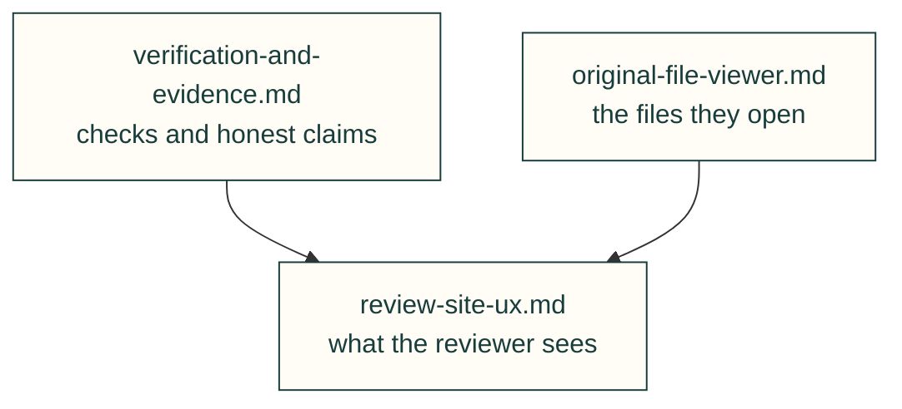

# Lessons — review

Evidence that holds up, and what reviewers need to see.

| File | Lessons on |
|---|---|
| [verification-and-evidence.md](verification-and-evidence.md) | Checks that caught bugs, false positives, honest claims, stale outputs; kernel-dependent shallow-crossing regressions and forced fallback checks (#318); a gate pass on a model that left out the parts that mattered (#722) |
| [review-site-ux.md](review-site-ux.md) | Review-site navigation and evidence; wheel zoom (2026-10-27); theme contrast and SVG media emulation (2026-11-05); header text overlaps despite zero page overflow (2026-11-06) |
| [original-file-viewer.md](original-file-viewer.md) | Original-file identity, parser units and frames, cancellable loading, dependency and wheel evidence |

Each lesson follows the [lesson format](../README.md#lesson-format): a rule, the incident, a check and its source. Back to [all lessons](../README.md).
