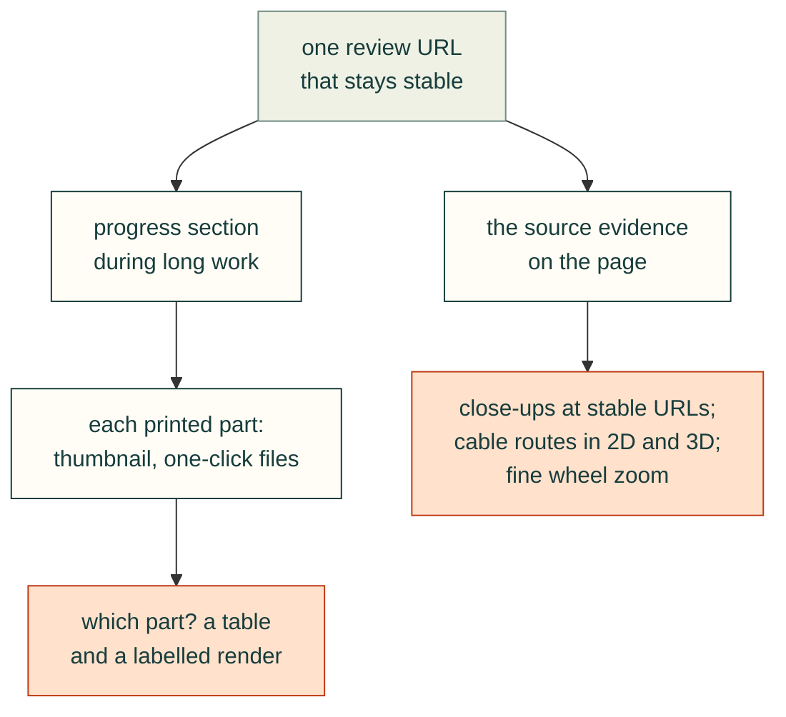

# Review site UX

The user reviewed the work almost entirely through a locally served preview page. Each request below came from
something they could not see or could not act on.

The theme-transition and SVG-media lessons also record later browser-gate/validation incidents (2026-11-05, #347 and #122).



### Check contrast during theme changes, not only at their endpoints
- **Rule:** Switch text and background colours together when changing a page theme. Two accessible endpoint
  palettes can pass through unreadable intermediate colours when both interpolate.
- **Check:** The existing website browser harness samples copy-button colour transitions at 0, 25, 50, 75 and
  100 percent and keeps its 4.5:1 contrast threshold for normal text. Border animation can remain.
<details><summary>Incident and source</summary>

- **Incident:** On 2026-11-05, #346's WebKit gate reported a catalogue “Copy call” label at 1.59:1 after a theme
  change. A focused Chromium probe of dev `04704a41` using the existing site CSS and copy component reproduced
  foreground `rgb(166, 170, 190)` on background `rgb(95, 93, 94)` during the 150 ms transition. A fixed wall-clock
  wait is not a guarantee that a busy browser has advanced its animation frames.
- **Cause and correction:** The component transitions both `color` and `background`. The site's override now
  transitions only the border; the browser check inspects intermediate colours as well as settled themes.
- **Source:** [issue #347](https://github.com/Valpatel/cad-agent/issues/347), `web/site.css`, and
  `tests/site/website-browser.mjs` (`themeProblems`). Probe: load both site stylesheets and `kit/copy.js`, set
  `data-theme="light"` under system dark, then read the button's computed colours and animation time.
- **Limits:** This checks the website's copy controls. Other components and consumer styles need their own
  foreground/background contrast checks; neither this incident nor a passing endpoint check proves them.

</details>

<details>
<summary>Responsive resize: rule and evidence</summary>

### Read responsive styles after the resize event
- **Rule:** A new viewport width does not prove its responsive styles are current inside the resize callback.
  Schedule style-dependent updates on a frame, preserving native controls and the reader's chosen state.
- **Check:** The navigation consumer resizes wide → narrow and verifies that an automatically opened fold closes;
  a fold opened by the reader must survive the round trip. Failed state and later paint are retained separately.

On 2026-11-07, WebKit's existing navigation check failed in [PR #445](https://github.com/Valpatel/cad-agent/pull/445). A traced
real callback read width 360 with the old `display: contents`; later style was `block`, but the fold stayed open.
Deferring its style read to an animation frame fixed the bounded component cases. A 24-case comparison rejected
three old-source cases; all sixteen corrected cases preserved both automatic and reader-owned behavior with the
same timeout. Instrumentation affects timing, so these counts are not a device failure rate. This observation
explains the tested navigation failure, not unrelated header failures or every browser's resize behavior.

</details>

### Verify the SVG still itself, not only its parent's reduced-motion preference
- **Rule:** A parent page's media query and animation list do not establish the state of an SVG loaded through an image. Inspect the rendered SVG document and its visible drawing, fills and marks.
- **Check:** `tests/site/site-motion.mjs` loads the actual hero as an SVG document with reduced motion, checks zero animations, visible assembled geometry and check marks, then rejects a hidden-drawing control that retains the valid media rule and zero animations. The existing browser suite calls this check; normal-motion tests keep their existing launch options.

<details>
<summary>2026-11-05 incident, command/output evidence and limits</summary>

- **Incident:** A phone screenshot of the README under Playwright's page-level `reducedMotion: 'reduce'` showed faint outline fragments. After 6.6 seconds the embedded image had advanced to the normal assembled frame, although the parent media query remained true. That was initially mistaken for a generator fallback defect.
- **Evidence:** Chrome 151.0.7922.71, Playwright 1.56.1, viewport 360×900. Loading the same SVG as a document under reduced motion returned:

  ```text
  reduced:true, animations:0, drawing:true,
  fills:57, visibleFills:57, marks:3, visibleMarks:3, exploded:0
  ```

  Launching Chromium with `args: ['--force-prefers-reduced-motion']` and a reduced-motion context produced the assembled embedded still, with identical image PNG bytes at the start and after 6.6 seconds, `matchMedia=true` and zero horizontal overflow. The generator and its geometry were unchanged.
- **Control:** A routed copy adds only `@media(prefers-reduced-motion:reduce){.draw{opacity:0!important}}`. It still reports `reduced:true, animations:0`, but `drawing:false, visibleFills:0`; the new rendered-state check rejects it. Merely counting animations would accept this blank result.
- **Reproduce:** Serve a built site with `node tools/preview-site.mjs --dir <built-site> --port <port>`. In a Node/Playwright session import `reducedHeroProblems` from `tests/site/site-motion.mjs`, launch the installed browser and call it with that browser and the preview URL. The normal browser suite runs the same function. The browser-wide flag above is for the separate embedded-image validation only.
- **Limits:** This establishes an emulation limitation in the observed configuration, not a generator bug or a guarantee about every engine/OS. A screenshot near the draw-in start is not evidence of a missing final still. Checks displayed in the figure are CAD/simulation evidence, not physical qualification.
- **Source:** 2026-11-05, #122; `docs/img/hero/gyropup-leg.svg` (SHA-256 `7f7eecd02551a1fa67a8e229526c8423cd15194968e7956715ea2949fee57358`), `src/cadagent/publish/anim/hero.py`, the real/control browser output above and fleet 162's unchanged generated hero.

</details>

### Measure visible header text, not only its flex box
- **Rule:** A zero-overflow page can still have overlapping navigation. Measure the text ranges and visible images
  along with each control's box, after fonts load, on both sides of responsive breakpoints.
- **Check:** The existing website browser suite's `headerProblems` checks 33 widths from 320 to 1366 px in both
  themes. Catalogue, GitHub, the brand and theme control remain visible, inside the viewport and separated by at
  least 4 px. Hidden and transparent-header controls must be rejected despite retaining all their geometry. The
  name stays readable at the narrowest width while its decorative icon yields room.

<details><summary>2026-11-06 incident, evidence and limits</summary>

- **Incident:** Public v0.21.0 (`bf93c1d8`) had zero document overflow at 381 and 390 px, but font-settled DOM
  text ranges put the brand's right edge at 161.359375 px and Catalogue's left edge at 149.515625 and 158.515625 px:
  gaps of **−11.84375** and **−2.84375** px. Parent flex boxes falsely suggested a positive gap. A wider sweep also
  found overlap at 320–345 and 431–440 px and at the full-navigation tablet breakpoint.
- **Cause:** Flex shrinking reduced the wordmark's box and icon without containing its unbroken text; secondary
  navigation returned before the complete row fit. The correction prevents wordmark shrinking and switches to
  compact navigation earlier, while retaining the existing one-line header heights and sticky offsets.
- **Review correction:** Independent GPT-6 review of #367 reproduced a false pass when the entire header had
  `visibility:hidden` but retained its dimensions. The guard now checks computed visibility and ancestor opacity,
  and its own hidden/transparent controls must report all four required controls missing in both themes.
- **Reproduction:** Serve the actual site from fleet 190 (`a901e134`, before the correction) with the repository's
  preview server. Run the new `headerProblems` function against that product, then route only `/web/site.css` to
  the candidate CSS. The old product must report the 381 px text collision and the 761 px tablet failure; the
  candidate must pass the same widths. The regular browser suite runs the guard on its freshly built HEAD.
- **Limits:** Range bounds describe text layout, not individual glyph ink. This guard covers the shared site
  header and its tested fonts/widths; it does not certify other components, arbitrary translated labels or physical
  device accessibility. The prior-product comparison is a CSS experiment, not a claim that fleet 190 built the fix.
- **Source:** [#104 measured evidence](https://github.com/Valpatel/cad-agent/issues/104#issuecomment-6675062625),
  `tools/site/assets/site.css` and `tests/site/website-browser.mjs`.

</details>

### Keep a progress section during long work
- **Rule:** During multi-hour work, keep a progress section at the top of the review page with three lists: done,
  running and needs your decision. Mark images that are stale until the rebuild finishes.
- **Incident:** "Launch the server again and show me how you are making progress." The agent added a "Rev 0.6 progress"
  section that listed the finished items, the background jobs and two open questions (screw seat, button identity). It
  said that some renders were from earlier runs.
- **Check:** The progress section is updated at each milestone, and each item links to its evidence.
- **Source:** 2026-10-25T00:31, 00:36, 01:45.

### Give every printed part a thumbnail and one-click files
- **Rule:** Each part row needs a thumbnail and STL, 3MF and STEP downloads. Add a slicer deep link where possible,
  verify the link format, and say whether it was tested.
- **Incident:** The user asked: "'CAD, print files and validation' section needs thumbnails" and "Each printed component
  section needs STL download links for printer, ideally bambu studio compatible links?" The agent confirmed the
  `bambustudio://open?file=<url>` handler in the installed binary and added it. It did not open the app to test it, and
  warned that the link may not accept a local non-https URL, with the 3MF download as the fallback. The 3MFs are in
  print orientation and centred on the 256 mm bed.
- **Check:** Every part in the build has a thumbnail, STL, 3MF, STEP and a deep link. The link checker passes.
  "Untested" is shown next to any unverified link type.
- **Source:** 2026-10-24T16:37, 16:43, 17:10.

### Draw cable routes explicitly, in 2D and 3D
- **Rule:** Show cable routing as a labelled 2D diagram and 3D cutaways, with colour-coded leads, numbered steps and a
  live check table. A render of the parts alone does not show the route.
- **Incident:** "cable routing between sata drives and the orin carrier is not at all clear in the preview page". The
  new "Cable routing" section has:
  - a labelled 2D side view of the whole route and a plan view of a tray;
  - two 3D cutaways with translucent plastic (red SATA data, yellow board 5 V, orange 12 V);
  - six routing steps;
  - a live table of required and available bend radius per route.
- **Check:** Each route in the checks JSON appears in the diagram and the table, with the same names.
- **Source:** 2026-10-25T00:46, 01:23; `README.md` (`preview/cable-route-diagram.png`).

### Put the source evidence on the page
- **Rule:** When a design decision rests on a datasheet or schematic, show the crop next to the decision, so the user
  can check it without opening the PDF.
- **Incident:** After the 12 V dispute, crops of schematic sheet 27 (SATA power pinout) and sheet 3 (power tree) were
  added to the Cable routing section, and the user was pointed to `#cables`.
- **Check:** Every "per the schematic" or "per the datasheet" claim on the page has an image or a link with the sheet or
  page number.
- **Source:** 2026-10-25T01:29, 01:30.

### Answer recurring "which part" questions with a table and a labelled render
- **Rule:** When the user is unsure which variant to use, add a decision table on the page, not just a chat answer.
- **Incident:** "P1M and P! don't support stacking the drives right?" and "Where's the base for stacking with drives?"
  The agent added a "Which base do I print?" section with a labelled underside render: desktop P1; wall or robot without
  storage P1M; any storage P1 + trays (+ P17 for wall or robot).
- **Check:** Each variant in the part list appears in exactly one row of the table.
- **Source:** 2026-10-25T01:30, 01:36.

### Provide close-ups of the feature under discussion, at stable URLs
- **Rule:** For each detailed feature, render a close-up or half-section and give it a stable file name, so the user can
  point at it.
- **Incident:** The agent made close-ups for each detailed feature:
  - `heatsink-tiedown.png`, a section through the tie-down;
  - `hex-inlet.png`, showing the cell chamfer;
  - `lid-column-detail.png`, showing the column buttress;
  - `support-detail.png`, a half-cut of both standoff types.

  The user used the URL of `lid-column-detail.png` to show exactly which fillet they meant.
- **Check:** Every feature changed in a revision has at least one close-up linked from its section.
- **Source:** 2026-10-24T07:18, 15:09; 2026-10-25T01:45, 02:04, 02:15.

### Keep the review URL stable
- **Rule:** When restarting the preview server, reuse the same address so the user's open tab keeps working, and save
  the URL to a file.
- **Incident:** "can you serve it again?" The agent checked that port 43871 was free, served on it again, and confirmed
  that the page and images load. `tools/serve_preview.py` writes the address to `preview/server-url.txt`.
- **Check:** After a restart, fetch the page and one image at the saved URL.
- **Source:** 2026-10-24T14:40.

### Make wheel zoom fine enough to inspect small features
- **Rule:** Use a moderate shared zoom sensitivity and preserve continuous wheel/trackpad deltas. Do not add a different zoom implementation to each project.
- **Incident:** During a later CAN-housing review on 2026-10-27, the user asked for more fine-grained wheel control in the standard viewer. The shared stage now uses OrbitControls `zoomSpeed: 0.25`; custom integrations can override it. This also affects dolly and pinch gestures.
- **Check:** In the browser at device pixel ratio 1, a 100-pixel wheel event changed camera distance by 1.29059%, versus 5.26316% at the prior sensitivity. Four fine increments matched one old increment; reversing the wheel restored distance. A 1-pixel delta moved only 0.012824%, with no JavaScript exceptions.
- **Source:** CAN breakout review, 2026-10-27; `src/cadagent/webkit/stage.js` and a browser check on the served project viewer. This is a later-project follow-up, not evidence from the original J501 transcript.
