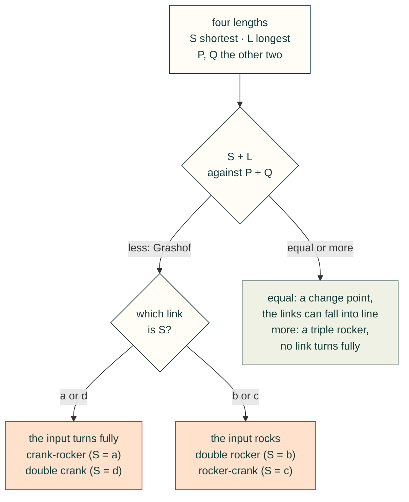

# Linkages

A four-bar is the simplest closed linkage: an input crank `a`, a coupler `b`, an output rocker `c` and the ground `d`
between the two fixed pivots. `cadagent.formulas` solves where it goes from the four lengths alone. It gives the
Grashof class, the coupler and output angles on either assembly, the transmission angle, and the input angles where the
linkage locks. Agents call it from Python. The animator below runs the browser port of the same functions, tested
against the Python on shared vectors, so it never shows a number an agent would not get.

## Try it: the four-bar animator

Set the four links. The crank turns, or rocks and stops where the linkage locks, and the coupler and rocker follow on
the assembly you pick. The other assembly of the same links is dashed. The dotted curve is the path of the dot on the
coupler plate (the coupler curve). The chart plots the transmission angle μ over a turn of the input, with the band
below 40° marked. The default is Norton's Example 4-1, a crank-rocker. Its crank turns fully, but μ falls to 26.4° at
0°, below the guideline.

<cad-fourbar crank="40" coupler="120" rocker="80" ground="100" branch="open" angle="40">

</cad-fourbar>

Try these:
- **Make the crank the longest link** (crank 100, coupler 80, rocker 70, ground 60). Now no link turns fully: it is a
  triple rocker. The input rocks and stops at ±137.9°, and the crank's circle turns rust where the links cannot close.
- **Make the coupler the shortest** (crank 80, coupler 40, rocker 120, ground 100). This is a double rocker. Its input
  locks at 51.3° and at 125.1°, and the same links fit a mirror-image range below the ground link. The coupler turns
  fully only by passing into the dashed assembly at each lock; the animator keeps the assembly you chose, so here the
  coupler swings back.
- **Switch the assembly.** Open and crossed are the two ways the same links fit together at one input angle. The
  transmission angle is the same for both.

## How to read it

The input locks where the coupler and rocker fall into one line. There the diagonal from the crank pin to the output
pivot equals `b + c` (stretched) or `|b - c|` (folded), and μ is 0. The input cannot drive past that point, and both
assemblies meet there. A real linkage can leave that point on either assembly; the animator stays on the one you chose.
A change-point linkage (S + L = P + Q) can lay all four links in one line at 0° or 180°, and its branches meet there too.



The transmission angle μ is the angle between the coupler and the rocker, folded to 0–90°. Near 90° the coupler pushes
the rocker round; near 0° it pushes along the rocker, and the joints bind. Norton gives 40° as the usual lowest value
for a linkage that must run smoothly. That is a guideline for a drive, not a force calculation.

## From Python

Any one length unit works; angles are radians, counter-clockwise from the ground link.

```python
import math
from cadagent import formulas as fx
fx.grashof(0.040, 0.120, 0.080, 0.100)                 # kind 'grashof', inversion 'crank-rocker', crank_rotates True
fx.fourbar_angles(0.040, 0.120, 0.080, 0.100, math.radians(40))         # (theta3, theta4): 20.3° and 57.3°
fx.transmission_angle(0.040, 0.120, 0.080, 0.100, 0.0)                 # 0.4605 rad, 26.4°: the lowest
fx.fourbar_input_limits(0.100, 0.080, 0.070, 0.060)    # stretched 2.406 rad: the input stops at ±137.9°
```

Each function states its units, limits and source in `fx.catalogue()`. They are listed with the other formulas on
[Engineering formulas](formulas.md#what-it-computes).

## Sweeping a closed loop: four-bars and five-bars

`cadagent.mechanical.linkages` drives a closed loop through a list of inputs and reports every step. It handles a
four-bar from its crank, and a five-bar (two cranks on the ground, two links meeting at a tip) from both cranks or
from a tip path. Each step gives the joint angles and pins and the transmission angle. It also gives two Jacobian
determinants. The direct one goes to 0 at a **lock**: the two links meeting at the tip fall into one line and the inputs
cannot drive it. The inverse one goes to 0 when a crank and its link fall **in line**: the edge of reach, or a rocker's
end of travel. Between samples, each event is bisected to 2⁻⁴⁸ of the step. A change of assembly is a **flip**.


*The five-bar in `tools/linkage_figures.py`, drawn from `sweep_fivebar_tip`, `sweep_fivebar` and `fivebar_workspace`.
The dash-dot links are the other assembly on the same cranks. `tests/test_linkages.py` checks that the committed SVG
matches the generator. It also checks the lock against its closed form, cos θ1 = (d − 2b) / 2a.*

```python
from cadagent.mechanical import linkages as L
r = L.sweep_fourbar(100, 80, 70, 60, range(-180, 181, 5), branch="open")   # the triple rocker above, mm
r["status"], r["summary"]["input_ranges"]      # 'fail' (18 steps cannot close), {'theta2': [-135.0, 135.0]}
[(e["kind"], e["at_deg"]) for e in r["events"]]  # lock at ±137.87°, the rocker's end of travel at -112.02°
leg = L.sweep_fivebar(100, 120, 100, 120, 80, [(90 + i, 90 - i) for i in range(0, 61, 5)], mode=1)
leg["events"][0]                               # {'kind': 'lock', 'at_deg': {'theta1': 143.13, 'theta2': 36.87}, ...}
stride = L.sweep_fivebar_tip(100, 120, 100, 120, 80, L.ellipse_path((40, 150), (50, 22), 180, 48))
stride["status"], stride["summary"]["min_transmission_deg"]                   # 'pass', 53.4
```

A report's `status` is `fail` when a step cannot close, or when the loop locks or flips. A tip path also fails when a
crank and its link fall in line. The status is `warn` when the transmission angle drops under the guideline (40°).
`track="hold"` keeps the declared assembly through a lock. `"nearest"` follows the pose nearest the last one and
flags the flip. `fivebar_workspace` maps a grid of crank angles, and `fivebar_reach` gives each arm's annulus.

**In a robot and in a rendered trace.** `cadagent.simulation.robot.write_mjcf(..., loops=[LoopClosure(...)])` closes a
loop in MuJoCo with an equality constraint, after checking that the pins meet at home. The tests settle a four-bar and
a five-bar there and get the solver's angles to 1e-4°. A [motion-trace](rendered-motion.md) contract declares a loop
under `loops`: its inputs are sampled together and its other joints solved, and a renderer that leaves the loop open
or assembles it the other way fails.

## Limits

- **Rigid links on ideal pins, planar, position only.** No velocity, acceleration, force, dynamics or joint clearance.
  A printed pin joint has play that the ideal linkage does not, so a printed linkage reaches its limits early or late
  and rattles near them.
- **The 40° guideline is not a load check.** For the joint forces, do a force analysis or a test. CAD and closed forms
  do not prove fit or strength.
- **Which assembly the links take at a limit is not modelled.** The animator and `track="hold"` keep the one you
  chose; `"nearest"` takes the nearest pose. A real linkage can leave a lock either way.
- **Sampled, not continuous.** A sweep finds an event where two samples straddle it. One that starts and ends between
  two samples is missed, so keep the steps small next to the travel.
- **No collisions between the links.** A sweep that passes can still have links that hit each other or the frame;
  the CAD [motion gate](gates.md) checks that.
- **Synthesis is out of scope.** Finding the lengths for a wanted motion is not done here; pylinkage does that.

<details>
<summary>What we looked at before building the animator, and the tests that keep it honest</summary>

- **[pylinkage](https://github.com/HugoFara/pylinkage)** (MIT, Python): synthesis, optimisation and matplotlib
  animations of planar linkages. Use it to find link lengths for a wanted motion. It cannot run in a web page under
  the site's security policy, and its numbers would not be the ones `cadagent.formulas` gives agents.
- **[PMKS](https://github.com/DesignEngrLab/PMKS)** (MIT, C#) and its web successor
  **[PMKSWeb](https://github.com/PMKS-Web/PMKSWeb)** (Worcester Polytechnic Institute, TypeScript; its repository
  states no licence, so it cannot be reused): full planar position, velocity and acceleration analysis for teaching.
  Use them when a linkage needs speeds.
- **So the animator is built**, on the port that the golden vectors tie to the Python. That is why it has no
  dependencies and needs no script beyond the site's own.
- **Tests:**
  - `tests/test_formulas.py` checks that every four-bar with links 1 to 6 (and a millimetre copy of each) turns fully
    exactly when `grashof` says so, and that `fourbar_angles` closes exactly inside `fourbar_input_limits`.
  - At each limit, both branches meet and μ is 0; 1e-7 rad further out the circle construction finds no position.
  - `tests/webkit-formulas.test.mjs` runs the port on the golden vectors: both branches every 15°, change points,
    and every limit with points just either side.
  - `tests/website-browser.mjs` runs the animator at 360 and 1366 px under the site's security policy, in Chromium
    and WebKit, with the same vectors run again in each browser engine.

</details>

<details>
<summary>What we looked at before building the closed-loop solver, and its tests</summary>

- **[pylinkage](https://github.com/HugoFara/pylinkage)** 1.3.0 (MIT): it solves each dyad by intersecting circles, and
  keeps the solution nearest the last pose. `track="nearest"` follows the same idea. It needs Python 3.11, and it has
  no way to choose an assembly. It reports no Jacobian and flags no flip, so we credit it rather than depend on it.
- **[SymPy](https://www.sympy.org/) `physics.mechanics`** (BSD): it builds the symbolic loop equations, but leaves
  the branch to a numerical root-finder. It is not installed with cad-agent.
- **[FreeCAD Assembly](https://wiki.freecad.org/Assembly_Workbench)** and its OndselSolver (LGPL-2.1+): a C++
  Newton-Raphson solver that runs inside FreeCAD. It reports no singularity and no assembly mode.
- **So the solver is built**, on closed forms. The five-bar is in `cadagent.formulas` (`fivebar_point`,
  `fivebar_inputs`, `fivebar_jacobians`). The four-bar uses the existing `fourbar_angles`.
- **Tests** (`tests/test_linkages.py`):
  - Norton's Example 4-1 on both assemblies, and Freudenstein's equation at every step.
  - The rocker's ends of travel against the law of cosines, and locks equal to `fourbar_input_limits` to 1e-9.
  - Five-bar direct and inverse kinematics against the closed forms of Gonçalves et al., Eqs. (3)–(15). The
    Jacobians are checked against finite differences, and the workspace edge is checked at √((a + b)² − (d/2)²).
  - `tests/test_robot.py` settles both loops in MuJoCo, an independent solver.

</details>

Sources: R. L. Norton, *Design of Machinery*, 5th ed., McGraw-Hill, 2012, Chapters 2 (the Grashof condition and its
inversions) and 4 (position analysis, the transmission angle and the toggle positions); F. Freudenstein, Approximate
synthesis of four-bar linkages, *Transactions of the ASME* 77 (1955) 853–861; C. Gosselin and J. Angeles, Singularity
analysis of closed-loop kinematic chains, *IEEE Transactions on Robotics and Automation* 6 (1990) 281–290 (the two
Jacobians); R. S. Gonçalves, J. C. M. Carvalho and R. R. Santos, A multi-objective optimization design for parallel
structures, *Proceedings of COBEM 2009*, Sections 2.1–2.2 (the five-bar's direct and inverse closed forms, after Liu,
Wang and Zheng, *Robotics and Autonomous Systems* 54 (2006) 221–233).
