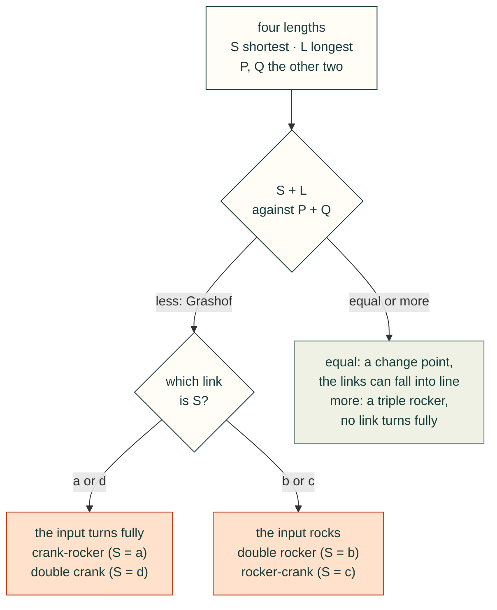

# Four-bar linkages

A four-bar is the simplest closed linkage: an input crank `a`, a coupler `b`, an output rocker `c` and the ground `d`
between the two fixed pivots. `cadagent.formulas` solves where it goes from the four lengths alone. It gives the
Grashof class, the coupler and output angles on either assembly, the transmission angle, and the input angles where the
linkage locks. Agents call it from Python. The animator below runs the browser port of the same functions, tested
against the Python on shared vectors, so it never shows a number an agent would not get.

## Try it: the four-bar animator

Set the four links. The crank turns, or rocks and stops where the linkage locks, and the coupler and rocker follow on
the assembly you pick. The other assembly of the same links is dashed. The dotted curve is the path of the dot on the
coupler plate (the coupler curve). The chart plots the transmission angle μ over a turn of the input, with the band
below 40° marked. The default is Norton's Example 4-1, a crank-rocker. Its crank turns fully, but μ falls to 26.4° at
0°, below the guideline.

<cad-fourbar crank="40" coupler="120" rocker="80" ground="100" branch="open" angle="40">

</cad-fourbar>

Try these:
- **Make the crank the longest link** (crank 100, coupler 80, rocker 70, ground 60). Now no link turns fully: it is a
  triple rocker. The input rocks and stops at ±137.9°, and the crank's circle turns rust where the links cannot close.
- **Make the coupler the shortest** (crank 80, coupler 40, rocker 120, ground 100). This is a double rocker. Its input
  locks at 51.3° and at 125.1°, and the same links fit a mirror-image range below the ground link.
- **Switch the assembly.** Open and crossed are the two ways the same links fit together at one input angle. The
  transmission angle is the same for both.

## How to read it

The input locks where the coupler and rocker fall into one line. There the diagonal from the crank pin to the output
pivot equals `b + c` (stretched) or `|b - c|` (folded), and μ is 0. The input cannot drive past that point, and both
assemblies meet there. A real linkage can leave that point on either assembly; the animator stays on the one you chose.
A change-point linkage (S + L = P + Q) can lay all four links in one line at 0° or 180°, and its branches meet there too.



The transmission angle μ is the angle between the coupler and the rocker, folded to 0–90°. Near 90° the coupler pushes
the rocker round; near 0° it pushes along the rocker, and the joints bind. Norton gives 40° as the usual lowest value
for a linkage that must run smoothly. That is a guideline for a drive, not a force calculation.

## From Python

Any one length unit works; angles are radians, counter-clockwise from the ground link.

```python
import math
from cadagent import formulas as fx
fx.grashof(0.040, 0.120, 0.080, 0.100)                 # kind 'grashof', inversion 'crank-rocker', crank_rotates True
fx.fourbar_angles(0.040, 0.120, 0.080, 0.100, math.radians(40))         # (theta3, theta4): 20.3° and 57.3°
fx.transmission_angle(0.040, 0.120, 0.080, 0.100, 0.0)                 # 0.4605 rad, 26.4°: the lowest
fx.fourbar_input_limits(0.100, 0.080, 0.070, 0.060)    # stretched 2.406 rad: the input stops at ±137.9°
```

Each function states its units, limits and source in `fx.catalogue()`. They are listed with the other formulas on
[Engineering formulas](formulas.md#what-it-computes).

## Limits

- **Rigid links on ideal pins, planar, position only.** No velocity, acceleration, force, dynamics or joint clearance.
  A printed pin joint has play that the ideal linkage does not, so a printed linkage reaches its limits early or late
  and rattles near them.
- **The 40° guideline is not a load check.** For the joint forces, do a force analysis or a test. CAD and closed forms
  do not prove fit or strength.
- **Which assembly the links take at a limit is not modelled.** The animator keeps the one you chose.
- **Synthesis is out of scope.** Finding the lengths for a wanted motion is not done here; pylinkage does that.

<details>
<summary>What we looked at before building the animator, and the tests that keep it honest</summary>

- **[pylinkage](https://github.com/HugoFara/pylinkage)** (MIT, Python): synthesis, optimisation and matplotlib
  animations of planar linkages. Use it to find link lengths for a wanted motion. It cannot run in a web page under
  the site's security policy, and its numbers would not be the ones `cadagent.formulas` gives agents.
- **[PMKS](https://github.com/DesignEngrLab/PMKS)** (MIT, C#) and its web successor
  **[PMKSWeb](https://github.com/PMKS-Web/PMKSWeb)** (Worcester Polytechnic Institute, TypeScript; its repository
  states no licence, so it cannot be reused): full planar position, velocity and acceleration analysis for teaching.
  Use them when a linkage needs speeds.
- **So the animator is built**, on the port that the golden vectors tie to the Python. That is why it has no
  dependencies and needs no script beyond the site's own.
- **Tests:**
  - `tests/test_formulas.py` checks that every four-bar with links 1 to 6 (and a millimetre copy of each) turns fully
    exactly when `grashof` says so, and that `fourbar_angles` closes exactly inside `fourbar_input_limits`.
  - At each limit, both branches meet and μ is 0; 1e-7 rad further out the circle construction finds no position.
  - `tests/webkit-formulas.test.mjs` runs the port on the golden vectors: both branches every 15°, change points,
    and every limit with points just either side.
  - `tests/website-browser.mjs` runs the animator at 360 and 1366 px under the site's security policy, in Chromium
    and WebKit, with the same vectors run again in each browser engine.

</details>

Sources: R. L. Norton, *Design of Machinery*, 5th ed., McGraw-Hill, 2012, Chapters 2 (the Grashof condition and its
inversions) and 4 (position analysis, the transmission angle and the toggle positions); F. Freudenstein, Approximate
synthesis of four-bar linkages, *Transactions of the ASME* 77 (1955) 853–861.
