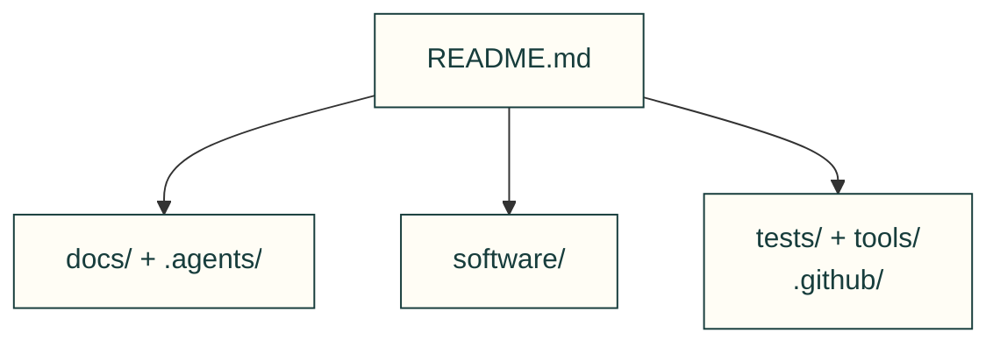

# Repository map

Choose a folder below, then follow its picture and file links. The full inventory stays folded until you need it. Maps describe where things belong; they do not prove engineering quality or physical performance.

| Owner | Use |
|---|---|
| [Project overview](../README.md) | Start here and choose an existing workflow. |
| [Toolkit packages](https://cad-agent.valpatel.com/repo/folders/d-software/README) | Reusable code and its domain owners. |
| [Guides and research](README.md) | Published explanations, source records and examples. |
| [Repository tools](https://cad-agent.valpatel.com/repo/folders/d-tools/README) | Build, release, audit and figure producers. |
| [Tests and fixtures](https://cad-agent.valpatel.com/repo/folders/d-tests/README) | Actual consumers, controls and recorded data. |
| [Agent kit](https://cad-agent.valpatel.com/repo/folders/d-.agents/README) | Installed skills, independent roles and source-only operations. |
| [Contribution policy](../.github/CONTRIBUTING.md) | Review, CI, integration and publication. |

Guides explain how to use the toolkit. Folder maps lead into its code, tests and working notes without adding them to the main catalogue. Each map also links its canonical source. Upstream and fixture descendants keep their named parent map.

## Full inventory

Repository root — 1 folders

<code>README.md</code> — 1 folders

[Published owner](../README.md)

- Owned folder map.

| Folder |
|---|
| `.` |

.agents — 19 folders

<code>.agents/README.md</code> — 1 folders

[Published folder map](https://cad-agent.valpatel.com/repo/folders/d-.agents/README) · [Canonical source owner](https://github.com/Valpatel/cad-agent/blob/dev/.agents/README.md)

- Owned folder map.

| Folder |
|---|
| `.agents` |

<code>.agents/agents/README.md</code> — 1 folders

[Published folder map](https://cad-agent.valpatel.com/repo/folders/d-.agents/d-agents/README) · [Canonical source owner](https://github.com/Valpatel/cad-agent/blob/dev/.agents/agents/README.md)

- Owned folder map.

| Folder |
|---|
| `.agents/agents` |

<code>.agents/domains/README.md</code> — 1 folders

[Published folder map](https://cad-agent.valpatel.com/repo/folders/d-.agents/d-domains/README) · [Canonical source owner](https://github.com/Valpatel/cad-agent/blob/dev/.agents/domains/README.md)

- Owned folder map.

| Folder |
|---|
| `.agents/domains` |

<code>.agents/inbox/README.md</code> — 1 folders

[Published folder map](https://cad-agent.valpatel.com/repo/folders/d-.agents/d-inbox/README) · [Canonical source owner](https://github.com/Valpatel/cad-agent/blob/dev/.agents/inbox/README.md)

- Owned folder map.

| Folder |
|---|
| `.agents/inbox` |

<code>.agents/inbox/agents/README.md</code> — 1 folders

[Published folder map](https://cad-agent.valpatel.com/repo/folders/d-.agents/d-inbox/d-agents/README) · [Canonical source owner](https://github.com/Valpatel/cad-agent/blob/dev/.agents/inbox/agents/README.md)

- Owned folder map.

| Folder |
|---|
| `.agents/inbox/agents` |

<code>.agents/inbox/publish/README.md</code> — 1 folders

[Published folder map](https://cad-agent.valpatel.com/repo/folders/d-.agents/d-inbox/d-publish/README) · [Canonical source owner](https://github.com/Valpatel/cad-agent/blob/dev/.agents/inbox/publish/README.md)

- Owned folder map.

| Folder |
|---|
| `.agents/inbox/publish` |

<code>.agents/inbox/review/README.md</code> — 1 folders

[Published folder map](https://cad-agent.valpatel.com/repo/folders/d-.agents/d-inbox/d-review/README) · [Canonical source owner](https://github.com/Valpatel/cad-agent/blob/dev/.agents/inbox/review/README.md)

- Owned folder map.

| Folder |
|---|
| `.agents/inbox/review` |

<code>.agents/playbooks/README.md</code> — 1 folders

[Published folder map](https://cad-agent.valpatel.com/repo/folders/d-.agents/d-playbooks/README) · [Canonical source owner](https://github.com/Valpatel/cad-agent/blob/dev/.agents/playbooks/README.md)

- Owned folder map.

| Folder |
|---|
| `.agents/playbooks` |

<code>.agents/skills/README.md</code> — 1 folders

[Published folder map](https://cad-agent.valpatel.com/repo/folders/d-.agents/d-skills/README) · [Canonical source owner](https://github.com/Valpatel/cad-agent/blob/dev/.agents/skills/README.md)

- Owned folder map.

| Folder |
|---|
| `.agents/skills` |

<code>.agents/skills/cad-motion-validation/README.md</code> — 1 folders

[Published folder map](https://cad-agent.valpatel.com/repo/folders/d-.agents/d-skills/d-cad-motion-validation/README) · [Canonical source owner](https://github.com/Valpatel/cad-agent/blob/dev/.agents/skills/cad-motion-validation/README.md)

- Owned folder map.

| Folder |
|---|
| `.agents/skills/cad-motion-validation` |

<code>.agents/skills/cad-motion-validation/references/README.md</code> — 1 folders

[Published folder map](https://cad-agent.valpatel.com/repo/folders/d-.agents/d-skills/d-cad-motion-validation/d-references/README) · [Canonical source owner](https://github.com/Valpatel/cad-agent/blob/dev/.agents/skills/cad-motion-validation/references/README.md)

- Owned folder map.

| Folder |
|---|
| `.agents/skills/cad-motion-validation/references` |

<code>.agents/skills/cad-pr-review/README.md</code> — 1 folders

[Published folder map](https://cad-agent.valpatel.com/repo/folders/d-.agents/d-skills/d-cad-pr-review/README) · [Canonical source owner](https://github.com/Valpatel/cad-agent/blob/dev/.agents/skills/cad-pr-review/README.md)

- Owned folder map.

| Folder |
|---|
| `.agents/skills/cad-pr-review` |

<code>.agents/skills/cad-remote-runs/README.md</code> — 1 folders

[Published folder map](https://cad-agent.valpatel.com/repo/folders/d-.agents/d-skills/d-cad-remote-runs/README) · [Canonical source owner](https://github.com/Valpatel/cad-agent/blob/dev/.agents/skills/cad-remote-runs/README.md)

- Owned folder map.

| Folder |
|---|
| `.agents/skills/cad-remote-runs` |

<code>.agents/skills/cad-supply-chain/README.md</code> — 1 folders

[Published folder map](https://cad-agent.valpatel.com/repo/folders/d-.agents/d-skills/d-cad-supply-chain/README) · [Canonical source owner](https://github.com/Valpatel/cad-agent/blob/dev/.agents/skills/cad-supply-chain/README.md)

- Owned folder map.

| Folder |
|---|
| `.agents/skills/cad-supply-chain` |

<code>.agents/skills/cad-work-tracking/README.md</code> — 1 folders

[Published folder map](https://cad-agent.valpatel.com/repo/folders/d-.agents/d-skills/d-cad-work-tracking/README) · [Canonical source owner](https://github.com/Valpatel/cad-agent/blob/dev/.agents/skills/cad-work-tracking/README.md)

- Owned folder map.

| Folder |
|---|
| `.agents/skills/cad-work-tracking` |

<code>.agents/skills/design-process/README.md</code> — 1 folders

[Published folder map](https://cad-agent.valpatel.com/repo/folders/d-.agents/d-skills/d-design-process/README) · [Canonical source owner](https://github.com/Valpatel/cad-agent/blob/dev/.agents/skills/design-process/README.md)

- Owned folder map.

| Folder |
|---|
| `.agents/skills/design-process` |

<code>.agents/skills/mcmaster-parts/README.md</code> — 1 folders

[Published folder map](https://cad-agent.valpatel.com/repo/folders/d-.agents/d-skills/d-mcmaster-parts/README) · [Canonical source owner](https://github.com/Valpatel/cad-agent/blob/dev/.agents/skills/mcmaster-parts/README.md)

- Owned folder map.

| Folder |
|---|
| `.agents/skills/mcmaster-parts` |

<code>.agents/skills/pem-fastener-selection/README.md</code> — 1 folders

[Published folder map](https://cad-agent.valpatel.com/repo/folders/d-.agents/d-skills/d-pem-fastener-selection/README) · [Canonical source owner](https://github.com/Valpatel/cad-agent/blob/dev/.agents/skills/pem-fastener-selection/README.md)

- Owned folder map.

| Folder |
|---|
| `.agents/skills/pem-fastener-selection` |

<code>.agents/skills/sheet-metal-hardware/README.md</code> — 1 folders

[Published folder map](https://cad-agent.valpatel.com/repo/folders/d-.agents/d-skills/d-sheet-metal-hardware/README) · [Canonical source owner](https://github.com/Valpatel/cad-agent/blob/dev/.agents/skills/sheet-metal-hardware/README.md)

- Owned folder map.

| Folder |
|---|
| `.agents/skills/sheet-metal-hardware` |

.claude-plugin — 1 folders

<code>.claude-plugin/README.md</code> — 1 folders

[Published folder map](https://cad-agent.valpatel.com/repo/folders/d-.claude-plugin/README) · [Canonical source owner](https://github.com/Valpatel/cad-agent/blob/dev/.claude-plugin/README.md)

- Owned folder map.

| Folder |
|---|
| `.claude-plugin` |

.github — 3 folders

<code>.github/CONTRIBUTING.md</code> — 3 folders

[Published owner](../.github/CONTRIBUTING.md)

- GitHub policy, templates and workflows are mapped by CONTRIBUTING rather than a front-page-changing README.

| Folder |
|---|
| `.github` |
| `.github/ISSUE_TEMPLATE` |
| `.github/workflows` |

docs — 51 folders

<code>docs/README.md</code> — 1 folders

[Published owner](README.md)

- Owned folder map.

| Folder |
|---|
| `docs` |

<code>docs/changelog.d/README.md</code> — 1 folders

[Published folder map](https://cad-agent.valpatel.com/repo/folders/d-docs/d-changelog.d/README) · [Canonical source owner](https://github.com/Valpatel/cad-agent/blob/dev/docs/changelog.d/README.md)

- Owned folder map.

| Folder |
|---|
| `docs/changelog.d` |

<code>docs/examples/README.md</code> — 1 folders

[Published owner](examples/README.md)

- Owned folder map.

| Folder |
|---|
| `docs/examples` |

<code>docs/examples/explore-two-wheel/README.md</code> — 1 folders

[Published folder map](https://cad-agent.valpatel.com/repo/folders/d-docs/d-examples/d-explore-two-wheel/README) · [Canonical source owner](https://github.com/Valpatel/cad-agent/blob/dev/docs/examples/explore-two-wheel/README.md)

- Owned folder map.

| Folder |
|---|
| `docs/examples/explore-two-wheel` |

<code>docs/examples/explore-two-wheel/catalogue/README.md</code> — 1 folders

[Published folder map](https://cad-agent.valpatel.com/repo/folders/d-docs/d-examples/d-explore-two-wheel/d-catalogue/README) · [Canonical source owner](https://github.com/Valpatel/cad-agent/blob/dev/docs/examples/explore-two-wheel/catalogue/README.md)

- Owned folder map.

| Folder |
|---|
| `docs/examples/explore-two-wheel/catalogue` |

<code>docs/examples/explore-two-wheel/designs/README.md</code> — 1 folders

[Published folder map](https://cad-agent.valpatel.com/repo/folders/d-docs/d-examples/d-explore-two-wheel/d-designs/README) · [Canonical source owner](https://github.com/Valpatel/cad-agent/blob/dev/docs/examples/explore-two-wheel/designs/README.md)

- Owned folder map.

| Folder |
|---|
| `docs/examples/explore-two-wheel/designs` |

<code>docs/examples/explore-two-wheel/tools/README.md</code> — 1 folders

[Published folder map](https://cad-agent.valpatel.com/repo/folders/d-docs/d-examples/d-explore-two-wheel/d-tools/README) · [Canonical source owner](https://github.com/Valpatel/cad-agent/blob/dev/docs/examples/explore-two-wheel/tools/README.md)

- Owned folder map.

| Folder |
|---|
| `docs/examples/explore-two-wheel/tools` |

<code>docs/examples/numbered-coupons/README.md</code> — 1 folders

[Published owner](examples/numbered-coupons/README.md)

- Owned folder map.

| Folder |
|---|
| `docs/examples/numbered-coupons` |

<code>docs/examples/starter-box/README.md</code> — 1 folders

[Published folder map](https://cad-agent.valpatel.com/repo/folders/d-docs/d-examples/d-starter-box/README) · [Canonical source owner](https://github.com/Valpatel/cad-agent/blob/dev/docs/examples/starter-box/README.md)

- Owned folder map.

| Folder |
|---|
| `docs/examples/starter-box` |

<code>docs/examples/starter-box/cad/README.md</code> — 1 folders

[Published folder map](https://cad-agent.valpatel.com/repo/folders/d-docs/d-examples/d-starter-box/d-cad/README) · [Canonical source owner](https://github.com/Valpatel/cad-agent/blob/dev/docs/examples/starter-box/cad/README.md)

- Owned folder map.

| Folder |
|---|
| `docs/examples/starter-box/cad` |

<code>docs/examples/starter-box/tools/README.md</code> — 1 folders

[Published folder map](https://cad-agent.valpatel.com/repo/folders/d-docs/d-examples/d-starter-box/d-tools/README) · [Canonical source owner](https://github.com/Valpatel/cad-agent/blob/dev/docs/examples/starter-box/tools/README.md)

- Owned folder map.

| Folder |
|---|
| `docs/examples/starter-box/tools` |

<code>docs/img/README.md</code> — 1 folders

[Published owner](img/README.md)

- Each folder has its own human map; recorded data retains its producer-owned layout and historical contents.

| Folder |
|---|
| `docs/img` |

<code>docs/img/bearings/README.md</code> — 1 folders

[Published folder map](https://cad-agent.valpatel.com/repo/folders/d-docs/d-img/d-bearings/README) · [Canonical source owner](https://github.com/Valpatel/cad-agent/blob/dev/docs/img/bearings/README.md)

- Each folder has its own human map; recorded data retains its producer-owned layout and historical contents.

| Folder |
|---|
| `docs/img/bearings` |

<code>docs/img/cfd/README.md</code> — 1 folders

[Published folder map](https://cad-agent.valpatel.com/repo/folders/d-docs/d-img/d-cfd/README) · [Canonical source owner](https://github.com/Valpatel/cad-agent/blob/dev/docs/img/cfd/README.md)

- Each folder has its own human map; recorded data retains its producer-owned layout and historical contents.

| Folder |
|---|
| `docs/img/cfd` |

<code>docs/img/compliant/README.md</code> — 1 folders

[Published folder map](https://cad-agent.valpatel.com/repo/folders/d-docs/d-img/d-compliant/README) · [Canonical source owner](https://github.com/Valpatel/cad-agent/blob/dev/docs/img/compliant/README.md)

- Each folder has its own human map; recorded data retains its producer-owned layout and historical contents.

| Folder |
|---|
| `docs/img/compliant` |

<code>docs/img/explore/README.md</code> — 1 folders

[Published folder map](https://cad-agent.valpatel.com/repo/folders/d-docs/d-img/d-explore/README) · [Canonical source owner](https://github.com/Valpatel/cad-agent/blob/dev/docs/img/explore/README.md)

- Each folder has its own human map; recorded data retains its producer-owned layout and historical contents.

| Folder |
|---|
| `docs/img/explore` |

<code>docs/img/fasteners/README.md</code> — 1 folders

[Published folder map](https://cad-agent.valpatel.com/repo/folders/d-docs/d-img/d-fasteners/README) · [Canonical source owner](https://github.com/Valpatel/cad-agent/blob/dev/docs/img/fasteners/README.md)

- Each folder has its own human map; recorded data retains its producer-owned layout and historical contents.

| Folder |
|---|
| `docs/img/fasteners` |

<code>docs/img/fea/README.md</code> — 1 folders

[Published folder map](https://cad-agent.valpatel.com/repo/folders/d-docs/d-img/d-fea/README) · [Canonical source owner](https://github.com/Valpatel/cad-agent/blob/dev/docs/img/fea/README.md)

- Each folder has its own human map; recorded data retains its producer-owned layout and historical contents.

| Folder |
|---|
| `docs/img/fea` |

<code>docs/img/formulas/README.md</code> — 1 folders

[Published folder map](https://cad-agent.valpatel.com/repo/folders/d-docs/d-img/d-formulas/README) · [Canonical source owner](https://github.com/Valpatel/cad-agent/blob/dev/docs/img/formulas/README.md)

- Each folder has its own human map; recorded data retains its producer-owned layout and historical contents.

| Folder |
|---|
| `docs/img/formulas` |

<code>docs/img/gates/README.md</code> — 1 folders

[Published folder map](https://cad-agent.valpatel.com/repo/folders/d-docs/d-img/d-gates/README) · [Canonical source owner](https://github.com/Valpatel/cad-agent/blob/dev/docs/img/gates/README.md)

- Each folder has its own human map; recorded data retains its producer-owned layout and historical contents.

| Folder |
|---|
| `docs/img/gates` |

<code>docs/img/gyropup/README.md</code> — 1 folders

[Published folder map](https://cad-agent.valpatel.com/repo/folders/d-docs/d-img/d-gyropup/README) · [Canonical source owner](https://github.com/Valpatel/cad-agent/blob/dev/docs/img/gyropup/README.md)

- Each folder has its own human map; recorded data retains its producer-owned layout and historical contents.

| Folder |
|---|
| `docs/img/gyropup` |

<code>docs/img/hero/README.md</code> — 1 folders

[Published folder map](https://cad-agent.valpatel.com/repo/folders/d-docs/d-img/d-hero/README) · [Canonical source owner](https://github.com/Valpatel/cad-agent/blob/dev/docs/img/hero/README.md)

- Each folder has its own human map; recorded data retains its producer-owned layout and historical contents.

| Folder |
|---|
| `docs/img/hero` |

<code>docs/img/hero/result-stills/README.md</code> — 1 folders

[Published folder map](https://cad-agent.valpatel.com/repo/folders/d-docs/d-img/d-hero/d-result-stills/README) · [Canonical source owner](https://github.com/Valpatel/cad-agent/blob/dev/docs/img/hero/result-stills/README.md)

- Each folder has its own human map; recorded data retains its producer-owned layout and historical contents.

| Folder |
|---|
| `docs/img/hero/result-stills` |

<code>docs/img/inserts/README.md</code> — 1 folders

[Published folder map](https://cad-agent.valpatel.com/repo/folders/d-docs/d-img/d-inserts/README) · [Canonical source owner](https://github.com/Valpatel/cad-agent/blob/dev/docs/img/inserts/README.md)

- Each folder has its own human map; recorded data retains its producer-owned layout and historical contents.

| Folder |
|---|
| `docs/img/inserts` |

<code>docs/img/joints/README.md</code> — 1 folders

[Published folder map](https://cad-agent.valpatel.com/repo/folders/d-docs/d-img/d-joints/README) · [Canonical source owner](https://github.com/Valpatel/cad-agent/blob/dev/docs/img/joints/README.md)

- Each folder has its own human map; recorded data retains its producer-owned layout and historical contents.

| Folder |
|---|
| `docs/img/joints` |

<code>docs/img/kit/README.md</code> — 1 folders

[Published folder map](https://cad-agent.valpatel.com/repo/folders/d-docs/d-img/d-kit/README) · [Canonical source owner](https://github.com/Valpatel/cad-agent/blob/dev/docs/img/kit/README.md)

- Each folder has its own human map; recorded data retains its producer-owned layout and historical contents.

| Folder |
|---|
| `docs/img/kit` |

<code>docs/img/linkages/README.md</code> — 1 folders

[Published folder map](https://cad-agent.valpatel.com/repo/folders/d-docs/d-img/d-linkages/README) · [Canonical source owner](https://github.com/Valpatel/cad-agent/blob/dev/docs/img/linkages/README.md)

- Each folder has its own human map; recorded data retains its producer-owned layout and historical contents.

| Folder |
|---|
| `docs/img/linkages` |

<code>docs/img/motion/README.md</code> — 1 folders

[Published folder map](https://cad-agent.valpatel.com/repo/folders/d-docs/d-img/d-motion/README) · [Canonical source owner](https://github.com/Valpatel/cad-agent/blob/dev/docs/img/motion/README.md)

- Each folder has its own human map; recorded data retains its producer-owned layout and historical contents.

| Folder |
|---|
| `docs/img/motion` |

<code>docs/img/packets/README.md</code> — 1 folders

[Published folder map](https://cad-agent.valpatel.com/repo/folders/d-docs/d-img/d-packets/README) · [Canonical source owner](https://github.com/Valpatel/cad-agent/blob/dev/docs/img/packets/README.md)

- Each folder has its own human map; recorded data retains its producer-owned layout and historical contents.

| Folder |
|---|
| `docs/img/packets` |

<code>docs/img/plates/README.md</code> — 1 folders

[Published folder map](https://cad-agent.valpatel.com/repo/folders/d-docs/d-img/d-plates/README) · [Canonical source owner](https://github.com/Valpatel/cad-agent/blob/dev/docs/img/plates/README.md)

- Each folder has its own human map; recorded data retains its producer-owned layout and historical contents.

| Folder |
|---|
| `docs/img/plates` |

<code>docs/img/process/README.md</code> — 1 folders

[Published folder map](https://cad-agent.valpatel.com/repo/folders/d-docs/d-img/d-process/README) · [Canonical source owner](https://github.com/Valpatel/cad-agent/blob/dev/docs/img/process/README.md)

- Each folder has its own human map; recorded data retains its producer-owned layout and historical contents.

| Folder |
|---|
| `docs/img/process` |

<code>docs/img/research/README.md</code> — 1 folders

[Published folder map](https://cad-agent.valpatel.com/repo/folders/d-docs/d-img/d-research/README) · [Canonical source owner](https://github.com/Valpatel/cad-agent/blob/dev/docs/img/research/README.md)

- Each folder has its own human map; recorded data retains its producer-owned layout and historical contents.

| Folder |
|---|
| `docs/img/research` |

<code>docs/img/sheet-metal/README.md</code> — 1 folders

[Published folder map](https://cad-agent.valpatel.com/repo/folders/d-docs/d-img/d-sheet-metal/README) · [Canonical source owner](https://github.com/Valpatel/cad-agent/blob/dev/docs/img/sheet-metal/README.md)

- Each folder has its own human map; recorded data retains its producer-owned layout and historical contents.

| Folder |
|---|
| `docs/img/sheet-metal` |

<code>docs/img/supply-chain/README.md</code> — 1 folders

[Published folder map](https://cad-agent.valpatel.com/repo/folders/d-docs/d-img/d-supply-chain/README) · [Canonical source owner](https://github.com/Valpatel/cad-agent/blob/dev/docs/img/supply-chain/README.md)

- Each folder has its own human map; recorded data retains its producer-owned layout and historical contents.

| Folder |
|---|
| `docs/img/supply-chain` |

<code>docs/img/thermal/README.md</code> — 1 folders

[Published folder map](https://cad-agent.valpatel.com/repo/folders/d-docs/d-img/d-thermal/README) · [Canonical source owner](https://github.com/Valpatel/cad-agent/blob/dev/docs/img/thermal/README.md)

- Each folder has its own human map; recorded data retains its producer-owned layout and historical contents.

| Folder |
|---|
| `docs/img/thermal` |

<code>docs/lessons/README.md</code> — 1 folders

[Published owner](lessons/README.md)

- Owned folder map.

| Folder |
|---|
| `docs/lessons` |

<code>docs/lessons/electronics/README.md</code> — 1 folders

[Published owner](lessons/electronics/README.md)

- Owned folder map.

| Folder |
|---|
| `docs/lessons/electronics` |

<code>docs/lessons/mechanical/README.md</code> — 1 folders

[Published owner](lessons/mechanical/README.md)

- Owned folder map.

| Folder |
|---|
| `docs/lessons/mechanical` |

<code>docs/lessons/process/README.md</code> — 1 folders

[Published owner](lessons/process/README.md)

- Owned folder map.

| Folder |
|---|
| `docs/lessons/process` |

<code>docs/lessons/review/README.md</code> — 1 folders

[Published owner](lessons/review/README.md)

- Owned folder map.

| Folder |
|---|
| `docs/lessons/review` |

<code>docs/lessons/simulation/README.md</code> — 1 folders

[Published owner](lessons/simulation/README.md)

- Owned folder map.

| Folder |
|---|
| `docs/lessons/simulation` |

<code>docs/lessons/wiring/README.md</code> — 1 folders

[Published owner](lessons/wiring/README.md)

- Owned folder map.

| Folder |
|---|
| `docs/lessons/wiring` |

<code>docs/mechanical/README.md</code> — 1 folders

[Published owner](mechanical/README.md)

- Owned folder map.

| Folder |
|---|
| `docs/mechanical` |

<code>docs/practice/README.md</code> — 1 folders

[Published owner](practice/README.md)

- Owned folder map.

| Folder |
|---|
| `docs/practice` |

<code>docs/research/README.md</code> — 1 folders

[Published owner](research/README.md)

- Owned folder map.

| Folder |
|---|
| `docs/research` |

<code>docs/research/agent-workflow/README.md</code> — 1 folders

[Published owner](research/agent-workflow/README.md)

- Owned folder map.

| Folder |
|---|
| `docs/research/agent-workflow` |

<code>docs/research/bench/README.md</code> — 1 folders

[Published folder map](https://cad-agent.valpatel.com/repo/folders/d-docs/d-research/d-bench/README) · [Canonical source owner](https://github.com/Valpatel/cad-agent/blob/dev/docs/research/bench/README.md)

- Owned folder map.

| Folder |
|---|
| `docs/research/bench` |

<code>docs/research/manufacturing/README.md</code> — 1 folders

[Published owner](research/manufacturing/README.md)

- Owned folder map.

| Folder |
|---|
| `docs/research/manufacturing` |

<code>docs/research/references/README.md</code> — 1 folders

[Published folder map](https://cad-agent.valpatel.com/repo/folders/d-docs/d-research/d-references/README) · [Canonical source owner](https://github.com/Valpatel/cad-agent/blob/dev/docs/research/references/README.md)

- Owned folder map.

| Folder |
|---|
| `docs/research/references` |

<code>docs/validation/README.md</code> — 1 folders

[Published owner](validation/README.md)

- Owned folder map.

| Folder |
|---|
| `docs/validation` |

<code>docs/validation/volume-2026-10-29/README.md</code> — 1 folders

[Published folder map](https://cad-agent.valpatel.com/repo/folders/d-docs/d-validation/d-volume-2026-10-29/README) · [Canonical source owner](https://github.com/Valpatel/cad-agent/blob/dev/docs/validation/volume-2026-10-29/README.md)

- Each folder has its own human map; recorded data retains its producer-owned layout and historical contents.

| Folder |
|---|
| `docs/validation/volume-2026-10-29` |

software — 612 folders

<code>software/README.md</code> — 1 folders

[Published folder map](https://cad-agent.valpatel.com/repo/folders/d-software/README) · [Canonical source owner](https://github.com/Valpatel/cad-agent/blob/dev/software/README.md)

- Owned folder map.

| Folder |
|---|
| `software` |

<code>software/cadagent/README.md</code> — 1 folders

[Published folder map](https://cad-agent.valpatel.com/repo/folders/d-software/d-cadagent/README) · [Canonical source owner](https://github.com/Valpatel/cad-agent/blob/dev/software/cadagent/README.md)

- Owned folder map.

| Folder |
|---|
| `software/cadagent` |

<code>software/cadagent/electrical/README.md</code> — 1 folders

[Published folder map](https://cad-agent.valpatel.com/repo/folders/d-software/d-cadagent/d-electrical/README) · [Canonical source owner](https://github.com/Valpatel/cad-agent/blob/dev/software/cadagent/electrical/README.md)

- Owned folder map.

| Folder |
|---|
| `software/cadagent/electrical` |

<code>software/cadagent/formulas/README.md</code> — 1 folders

[Published folder map](https://cad-agent.valpatel.com/repo/folders/d-software/d-cadagent/d-formulas/README) · [Canonical source owner](https://github.com/Valpatel/cad-agent/blob/dev/software/cadagent/formulas/README.md)

- Owned folder map.

| Folder |
|---|
| `software/cadagent/formulas` |

<code>software/cadagent/geometry/README.md</code> — 1 folders

[Published folder map](https://cad-agent.valpatel.com/repo/folders/d-software/d-cadagent/d-geometry/README) · [Canonical source owner](https://github.com/Valpatel/cad-agent/blob/dev/software/cadagent/geometry/README.md)

- Owned folder map.

| Folder |
|---|
| `software/cadagent/geometry` |

<code>software/cadagent/library/README.md</code> — 1 folders

[Published folder map](https://cad-agent.valpatel.com/repo/folders/d-software/d-cadagent/d-library/README) · [Canonical source owner](https://github.com/Valpatel/cad-agent/blob/dev/software/cadagent/library/README.md)

- Owned folder map.

| Folder |
|---|
| `software/cadagent/library` |

<code>software/cadagent/manufacturing/README.md</code> — 1 folders

[Published folder map](https://cad-agent.valpatel.com/repo/folders/d-software/d-cadagent/d-manufacturing/README) · [Canonical source owner](https://github.com/Valpatel/cad-agent/blob/dev/software/cadagent/manufacturing/README.md)

- Owned folder map.

| Folder |
|---|
| `software/cadagent/manufacturing` |

<code>software/cadagent/manufacturing/devices/README.md</code> — 1 folders

[Published folder map](https://cad-agent.valpatel.com/repo/folders/d-software/d-cadagent/d-manufacturing/d-devices/README) · [Canonical source owner](https://github.com/Valpatel/cad-agent/blob/dev/software/cadagent/manufacturing/devices/README.md)

- Owned folder map.

| Folder |
|---|
| `software/cadagent/manufacturing/devices` |

<code>software/cadagent/manufacturing/devices/bambu/README.md</code> — 1 folders

[Published folder map](https://cad-agent.valpatel.com/repo/folders/d-software/d-cadagent/d-manufacturing/d-devices/d-bambu/README) · [Canonical source owner](https://github.com/Valpatel/cad-agent/blob/dev/software/cadagent/manufacturing/devices/bambu/README.md)

- Owned folder map.

| Folder |
|---|
| `software/cadagent/manufacturing/devices/bambu` |

<code>software/cadagent/mechanical/README.md</code> — 1 folders

[Published folder map](https://cad-agent.valpatel.com/repo/folders/d-software/d-cadagent/d-mechanical/README) · [Canonical source owner](https://github.com/Valpatel/cad-agent/blob/dev/software/cadagent/mechanical/README.md)

- Owned folder map.

| Folder |
|---|
| `software/cadagent/mechanical` |

<code>software/cadagent/mechanical/compliant/README.md</code> — 1 folders

[Published folder map](https://cad-agent.valpatel.com/repo/folders/d-software/d-cadagent/d-mechanical/d-compliant/README) · [Canonical source owner](https://github.com/Valpatel/cad-agent/blob/dev/software/cadagent/mechanical/compliant/README.md)

- Owned folder map.

| Folder |
|---|
| `software/cadagent/mechanical/compliant` |

<code>software/cadagent/publish/README.md</code> — 1 folders

[Published folder map](https://cad-agent.valpatel.com/repo/folders/d-software/d-cadagent/d-publish/README) · [Canonical source owner](https://github.com/Valpatel/cad-agent/blob/dev/software/cadagent/publish/README.md)

- Owned folder map.

| Folder |
|---|
| `software/cadagent/publish` |

<code>software/cadagent/publish/anim/README.md</code> — 1 folders

[Published folder map](https://cad-agent.valpatel.com/repo/folders/d-software/d-cadagent/d-publish/d-anim/README) · [Canonical source owner](https://github.com/Valpatel/cad-agent/blob/dev/software/cadagent/publish/anim/README.md)

- Owned folder map.

| Folder |
|---|
| `software/cadagent/publish/anim` |

<code>software/cadagent/review/README.md</code> — 1 folders

[Published folder map](https://cad-agent.valpatel.com/repo/folders/d-software/d-cadagent/d-review/README) · [Canonical source owner](https://github.com/Valpatel/cad-agent/blob/dev/software/cadagent/review/README.md)

- Owned folder map.

| Folder |
|---|
| `software/cadagent/review` |

<code>software/cadagent/review/dossier/README.md</code> — 1 folders

[Published folder map](https://cad-agent.valpatel.com/repo/folders/d-software/d-cadagent/d-review/d-dossier/README) · [Canonical source owner](https://github.com/Valpatel/cad-agent/blob/dev/software/cadagent/review/dossier/README.md)

- Owned folder map.

| Folder |
|---|
| `software/cadagent/review/dossier` |

<code>software/cadagent/review/gates/README.md</code> — 1 folders

[Published folder map](https://cad-agent.valpatel.com/repo/folders/d-software/d-cadagent/d-review/d-gates/README) · [Canonical source owner](https://github.com/Valpatel/cad-agent/blob/dev/software/cadagent/review/gates/README.md)

- Owned folder map.

| Folder |
|---|
| `software/cadagent/review/gates` |

<code>software/cadagent/simulation/README.md</code> — 1 folders

[Published folder map](https://cad-agent.valpatel.com/repo/folders/d-software/d-cadagent/d-simulation/README) · [Canonical source owner](https://github.com/Valpatel/cad-agent/blob/dev/software/cadagent/simulation/README.md)

- Owned folder map.

| Folder |
|---|
| `software/cadagent/simulation` |

<code>software/cadagent/simulation/explore/README.md</code> — 1 folders

[Published folder map](https://cad-agent.valpatel.com/repo/folders/d-software/d-cadagent/d-simulation/d-explore/README) · [Canonical source owner](https://github.com/Valpatel/cad-agent/blob/dev/software/cadagent/simulation/explore/README.md)

- Owned folder map.

| Folder |
|---|
| `software/cadagent/simulation/explore` |

<code>software/cadagent/thermal/README.md</code> — 1 folders

[Published folder map](https://cad-agent.valpatel.com/repo/folders/d-software/d-cadagent/d-thermal/README) · [Canonical source owner](https://github.com/Valpatel/cad-agent/blob/dev/software/cadagent/thermal/README.md)

- Owned folder map.

| Folder |
|---|
| `software/cadagent/thermal` |

<code>software/cadagent/webkit/README.md</code> — 1 folders

[Published folder map](https://cad-agent.valpatel.com/repo/folders/d-software/d-cadagent/d-webkit/README) · [Canonical source owner](https://github.com/Valpatel/cad-agent/blob/dev/software/cadagent/webkit/README.md)

- Owned folder map.

| Folder |
|---|
| `software/cadagent/webkit` |

<code>software/cadagent/webkit/assembly/README.md</code> — 1 folders

[Published folder map](https://cad-agent.valpatel.com/repo/folders/d-software/d-cadagent/d-webkit/d-assembly/README) · [Canonical source owner](https://github.com/Valpatel/cad-agent/blob/dev/software/cadagent/webkit/assembly/README.md)

- Owned folder map.

| Folder |
|---|
| `software/cadagent/webkit/assembly` |

<code>software/cadagent/webkit/vendor/README.md</code> — 17 folders

[Published folder map](https://cad-agent.valpatel.com/repo/folders/d-software/d-cadagent/d-webkit/d-vendor/README) · [Canonical source owner](https://github.com/Valpatel/cad-agent/blob/dev/software/cadagent/webkit/vendor/README.md)

- Owned folder map.
- Pinned upstream parser bytes; file-viewer-sources and integrity checks own the components.
- Pinned fonts and owned wrapper; existing SOURCE hashes and style-pointer control own byte integrity.
- Pinned DOM helper; component source/licence records own upstream layout.
- Derived renderer with producer/input/licence records and repeat-build CI; no extra source maps inserted.
- Pinned STEP parser with source/licence records and worker controls; no upstream layout rewrite.
- Pinned renderer; component source/licence records own upstream layout.

| Folder |
|---|
| `software/cadagent/webkit/vendor` |
| `software/cadagent/webkit/vendor/file-parsers` |
| `software/cadagent/webkit/vendor/fonts` |
| `software/cadagent/webkit/vendor/linkedom` |
| `software/cadagent/webkit/vendor/mermaid` |
| `software/cadagent/webkit/vendor/occt-import-js` |
| `software/cadagent/webkit/vendor/occt-import-js/source` |
| `software/cadagent/webkit/vendor/occt-import-js/source/occt-import-js` |
| `software/cadagent/webkit/vendor/occt-import-js/source/occt-import-js/example` |
| `software/cadagent/webkit/vendor/occt-import-js/source/occt-import-js/src` |
| `software/cadagent/webkit/vendor/occt-import-js/source/tools` |
| `software/cadagent/webkit/vendor/three` |
| `software/cadagent/webkit/vendor/three/addons` |
| `software/cadagent/webkit/vendor/three/addons/controls` |
| `software/cadagent/webkit/vendor/three/addons/geometries` |
| `software/cadagent/webkit/vendor/three/addons/loaders` |
| `software/cadagent/webkit/vendor/three/addons/utils` |

<code>software/vendor/README.md</code> — 569 folders

[Published folder map](https://cad-agent.valpatel.com/repo/folders/d-software/d-vendor/README) · [Canonical source owner](https://github.com/Valpatel/cad-agent/blob/dev/software/vendor/README.md)

- Owned folder map.
- Imported upstream layout; manifest pins and vendor audit own contents.

| Folder |
|---|
| `software/vendor` |
| `software/vendor/agentcad` |
| `software/vendor/agentcad/docs` |
| `software/vendor/agentcad/docs/product-plans` |
| `software/vendor/agentcad/scripts` |
| `software/vendor/agentcad/src` |
| `software/vendor/agentcad/src/agentcad` |
| `software/vendor/agentcad/src/agentcad/commands` |
| `software/vendor/agentcad/src/agentcad/mcp` |
| `software/vendor/agentcad/src/agentcad/runners` |
| `software/vendor/agentcad/tests` |
| `software/vendor/agentcad/tests/fixtures` |
| `software/vendor/agentcad/tests/fixtures/comparison` |
| `software/vendor/agentcad/tests/fixtures/real_world` |
| `software/vendor/agentcad/tests/fixtures/validation` |
| `software/vendor/agentcad/tests_b3d` |
| `software/vendor/agentcad/tests_b3d/fixtures` |
| `software/vendor/bd_warehouse` |
| `software/vendor/bd_warehouse/docs` |
| `software/vendor/bd_warehouse/examples` |
| `software/vendor/bd_warehouse/src` |
| `software/vendor/bd_warehouse/src/bd_warehouse` |
| `software/vendor/bd_warehouse/src/bd_warehouse/data` |
| `software/vendor/bd_warehouse/src/bd_warehouse/data_flange` |
| `software/vendor/bd_warehouse/tests` |
| `software/vendor/build123d-mcp` |
| `software/vendor/build123d-mcp/.claude` |
| `software/vendor/build123d-mcp/.devcontainer` |
| `software/vendor/build123d-mcp/.vscode` |
| `software/vendor/build123d-mcp/docs` |
| `software/vendor/build123d-mcp/docs/adr` |
| `software/vendor/build123d-mcp/examples` |
| `software/vendor/build123d-mcp/scripts` |
| `software/vendor/build123d-mcp/src` |
| `software/vendor/build123d-mcp/src/build123d_mcp` |
| `software/vendor/build123d-mcp/src/build123d_mcp/skills` |
| `software/vendor/build123d-mcp/src/build123d_mcp/skills/b123d-drawing` |
| `software/vendor/build123d-mcp/src/build123d_mcp/skills/b123d-edit` |
| `software/vendor/build123d-mcp/src/build123d_mcp/skills/b123d-modeling` |
| `software/vendor/build123d-mcp/src/build123d_mcp/skills/b123d-repair` |
| `software/vendor/build123d-mcp/src/build123d_mcp/tools` |
| `software/vendor/build123d-mcp/src/build123d_mcp/tools/recognizers` |
| `software/vendor/build123d-mcp/tests` |
| `software/vendor/kicad-happy` |
| `software/vendor/kicad-happy/.agents` |
| `software/vendor/kicad-happy/.agents/plugins` |
| `software/vendor/kicad-happy/.claude-plugin` |
| `software/vendor/kicad-happy/.codex-plugin` |
| `software/vendor/kicad-happy/.cursor` |
| `software/vendor/kicad-happy/.cursor/rules` |
| `software/vendor/kicad-happy/.opencode` |
| `software/vendor/kicad-happy/skills` |
| `software/vendor/kicad-happy/skills/bom` |
| `software/vendor/kicad-happy/skills/bom/references` |
| `software/vendor/kicad-happy/skills/bom/scripts` |
| `software/vendor/kicad-happy/skills/datasheets` |
| `software/vendor/kicad-happy/skills/datasheets/datasheet_types` |
| `software/vendor/kicad-happy/skills/datasheets/examples` |
| `software/vendor/kicad-happy/skills/datasheets/prompts` |
| `software/vendor/kicad-happy/skills/datasheets/references` |
| `software/vendor/kicad-happy/skills/datasheets/schemas` |
| `software/vendor/kicad-happy/skills/datasheets/schemas/fixtures` |
| `software/vendor/kicad-happy/skills/datasheets/scripts` |
| `software/vendor/kicad-happy/skills/digikey` |
| `software/vendor/kicad-happy/skills/digikey/scripts` |
| `software/vendor/kicad-happy/skills/element14` |
| `software/vendor/kicad-happy/skills/element14/scripts` |
| `software/vendor/kicad-happy/skills/emc` |
| `software/vendor/kicad-happy/skills/emc/references` |
| `software/vendor/kicad-happy/skills/emc/scripts` |
| `software/vendor/kicad-happy/skills/jlcpcb` |
| `software/vendor/kicad-happy/skills/kicad` |
| `software/vendor/kicad-happy/skills/kicad/references` |
| `software/vendor/kicad-happy/skills/kicad/review` |
| `software/vendor/kicad-happy/skills/kicad/review/fixtures` |
| `software/vendor/kicad-happy/skills/kicad/review/prompts` |
| `software/vendor/kicad-happy/skills/kicad/review/schemas` |
| `software/vendor/kicad-happy/skills/kicad/review/scripts` |
| `software/vendor/kicad-happy/skills/kicad/scripts` |
| `software/vendor/kicad-happy/skills/kicad/scripts/envelopes` |
| `software/vendor/kicad-happy/skills/lcsc` |
| `software/vendor/kicad-happy/skills/lcsc/scripts` |
| `software/vendor/kicad-happy/skills/mouser` |
| `software/vendor/kicad-happy/skills/mouser/scripts` |
| `software/vendor/kicad-happy/skills/pcbway` |
| `software/vendor/kicad-happy/skills/spice` |
| `software/vendor/kicad-happy/skills/spice/references` |
| `software/vendor/kicad-happy/skills/spice/scripts` |
| `software/vendor/kicad-mcp-pro` |
| `software/vendor/kicad-mcp-pro/.agents` |
| `software/vendor/kicad-mcp-pro/.agents/skills` |
| `software/vendor/kicad-mcp-pro/.agents/skills/drc-check` |
| `software/vendor/kicad-mcp-pro/.agents/skills/fabrication-output` |
| `software/vendor/kicad-mcp-pro/.agents/skills/kicad-design-review` |
| `software/vendor/kicad-mcp-pro/.agents/skills/kicad-design-review/references` |
| `software/vendor/kicad-mcp-pro/.agents/skills/kicad-design-review/scripts` |
| `software/vendor/kicad-mcp-pro/.agents/skills/pcb-design` |
| `software/vendor/kicad-mcp-pro/.agents/skills/schematic-review` |
| `software/vendor/kicad-mcp-pro/.agents/skills/visual-excellence` |
| `software/vendor/kicad-mcp-pro/.agents/skills/visual-excellence/reference` |
| `software/vendor/kicad-mcp-pro/.agents/skills/wired-subcircuit-design` |
| `software/vendor/kicad-mcp-pro/.claude-plugin` |
| `software/vendor/kicad-mcp-pro/.codex` |
| `software/vendor/kicad-mcp-pro/.opencode` |
| `software/vendor/kicad-mcp-pro/.opencode/skills` |
| `software/vendor/kicad-mcp-pro/.opencode/skills/drc-check` |
| `software/vendor/kicad-mcp-pro/.opencode/skills/fabrication-output` |
| `software/vendor/kicad-mcp-pro/.opencode/skills/kicad-design-review` |
| `software/vendor/kicad-mcp-pro/.opencode/skills/kicad-design-review/references` |
| `software/vendor/kicad-mcp-pro/.opencode/skills/kicad-design-review/scripts` |
| `software/vendor/kicad-mcp-pro/.opencode/skills/pcb-design` |
| `software/vendor/kicad-mcp-pro/.opencode/skills/schematic-review` |
| `software/vendor/kicad-mcp-pro/.opencode/skills/visual-excellence` |
| `software/vendor/kicad-mcp-pro/.opencode/skills/visual-excellence/reference` |
| `software/vendor/kicad-mcp-pro/.opencode/skills/wired-subcircuit-design` |
| `software/vendor/kicad-mcp-pro/assets` |
| `software/vendor/kicad-mcp-pro/benchmarks` |
| `software/vendor/kicad-mcp-pro/contracts` |
| `software/vendor/kicad-mcp-pro/docs` |
| `software/vendor/kicad-mcp-pro/docs/adr` |
| `software/vendor/kicad-mcp-pro/docs/agents` |
| `software/vendor/kicad-mcp-pro/docs/assets` |
| `software/vendor/kicad-mcp-pro/docs/assets/screenshots` |
| `software/vendor/kicad-mcp-pro/docs/automation` |
| `software/vendor/kicad-mcp-pro/docs/compatibility` |
| `software/vendor/kicad-mcp-pro/docs/deployment` |
| `software/vendor/kicad-mcp-pro/docs/development` |
| `software/vendor/kicad-mcp-pro/docs/engineering` |
| `software/vendor/kicad-mcp-pro/docs/evidence` |
| `software/vendor/kicad-mcp-pro/docs/evidence/agent-host` |
| `software/vendor/kicad-mcp-pro/docs/evidence/kicad-10-0-4` |
| `software/vendor/kicad-mcp-pro/docs/evidence/kicad-10-0-4/2026-07-03` |
| `software/vendor/kicad-mcp-pro/docs/evidence/kicad-10-0-5` |
| `software/vendor/kicad-mcp-pro/docs/evidence/kicad-10-0-5/2026-07-27` |
| `software/vendor/kicad-mcp-pro/docs/evidence/kicad-10-0-5/2026-08-28` |
| `software/vendor/kicad-mcp-pro/docs/evidence/kicad-10-0-7` |
| `software/vendor/kicad-mcp-pro/docs/evidence/kicad-pcm` |
| `software/vendor/kicad-mcp-pro/docs/evidence/kicad-pcm/2026-08-29` |
| `software/vendor/kicad-mcp-pro/docs/evidence/native-board-readiness` |
| `software/vendor/kicad-mcp-pro/docs/evidence/reference-boards` |
| `software/vendor/kicad-mcp-pro/docs/evidence/reference-boards/esp32-c6-usbc` |
| `software/vendor/kicad-mcp-pro/docs/evidence/reference-boards/esp32-c6-usbc/v1` |
| `software/vendor/kicad-mcp-pro/docs/evidence/reference-boards/rp2350-usbc` |
| `software/vendor/kicad-mcp-pro/docs/evidence/reference-boards/rp2350-usbc/v1` |
| `software/vendor/kicad-mcp-pro/docs/evidence/reference-boards/stm32f072-usbc` |
| `software/vendor/kicad-mcp-pro/docs/evidence/reference-boards/stm32f072-usbc/v1` |
| `software/vendor/kicad-mcp-pro/docs/evidence/reference-boards/stm32f072-usbc/v1/attempts` |
| `software/vendor/kicad-mcp-pro/docs/evidence/reference-boards/stm32f072-usbc/v1/attempts/attempt-001` |
| `software/vendor/kicad-mcp-pro/docs/evidence/reference-boards/stm32f072-usbc/v1/attempts/attempt-002` |
| `software/vendor/kicad-mcp-pro/docs/evidence/reference-boards/stm32f072-usbc/v1/attempts/attempt-003` |
| `software/vendor/kicad-mcp-pro/docs/evidence/release-notes` |
| `software/vendor/kicad-mcp-pro/docs/evidence/task-outcomes` |
| `software/vendor/kicad-mcp-pro/docs/evidence/task-outcomes/2026-08-28-native-live-example` |
| `software/vendor/kicad-mcp-pro/docs/examples` |
| `software/vendor/kicad-mcp-pro/docs/examples/clients` |
| `software/vendor/kicad-mcp-pro/docs/explanation` |
| `software/vendor/kicad-mcp-pro/docs/how-to` |
| `software/vendor/kicad-mcp-pro/docs/install` |
| `software/vendor/kicad-mcp-pro/docs/integration` |
| `software/vendor/kicad-mcp-pro/docs/kicad10` |
| `software/vendor/kicad-mcp-pro/docs/legal` |
| `software/vendor/kicad-mcp-pro/docs/mcp` |
| `software/vendor/kicad-mcp-pro/docs/reference` |
| `software/vendor/kicad-mcp-pro/docs/rfcs` |
| `software/vendor/kicad-mcp-pro/docs/security` |
| `software/vendor/kicad-mcp-pro/docs/status` |
| `software/vendor/kicad-mcp-pro/docs/submission` |
| `software/vendor/kicad-mcp-pro/docs/tutorials` |
| `software/vendor/kicad-mcp-pro/docs/workflows` |
| `software/vendor/kicad-mcp-pro/evals` |
| `software/vendor/kicad-mcp-pro/evals/evidence_freshness` |
| `software/vendor/kicad-mcp-pro/evals/live` |
| `software/vendor/kicad-mcp-pro/evals/tool_selection` |
| `software/vendor/kicad-mcp-pro/examples` |
| `software/vendor/kicad-mcp-pro/examples/gallery` |
| `software/vendor/kicad-mcp-pro/examples/gallery/esp32-c3-wroom-02-breakout` |
| `software/vendor/kicad-mcp-pro/examples/mcp-docker` |
| `software/vendor/kicad-mcp-pro/fuzz` |
| `software/vendor/kicad-mcp-pro/integrations` |
| `software/vendor/kicad-mcp-pro/integrations/antigravity` |
| `software/vendor/kicad-mcp-pro/integrations/chatgpt-app` |
| `software/vendor/kicad-mcp-pro/integrations/chatgpt-app/apps-sdk` |
| `software/vendor/kicad-mcp-pro/integrations/chatgpt-app/apps-sdk/public` |
| `software/vendor/kicad-mcp-pro/integrations/chatgpt-app/apps-sdk/src` |
| `software/vendor/kicad-mcp-pro/integrations/chatgpt-app/apps-sdk/test` |
| `software/vendor/kicad-mcp-pro/integrations/claude-ai` |
| `software/vendor/kicad-mcp-pro/integrations/claude-ai/remote-connector` |
| `software/vendor/kicad-mcp-pro/integrations/claude-code` |
| `software/vendor/kicad-mcp-pro/integrations/claude-code/kicad-pcb-review-skill` |
| `software/vendor/kicad-mcp-pro/integrations/claude-code/kicad-pcb-review-skill/references` |
| `software/vendor/kicad-mcp-pro/integrations/claude-code/kicad-pcb-review-skill/scripts` |
| `software/vendor/kicad-mcp-pro/integrations/claude-desktop` |
| `software/vendor/kicad-mcp-pro/integrations/codex` |
| `software/vendor/kicad-mcp-pro/integrations/common` |
| `software/vendor/kicad-mcp-pro/integrations/cursor` |
| `software/vendor/kicad-mcp-pro/integrations/cursor/rules` |
| `software/vendor/kicad-mcp-pro/integrations/cursor/skills` |
| `software/vendor/kicad-mcp-pro/integrations/cursor/skills/kicad-pcb-review` |
| `software/vendor/kicad-mcp-pro/integrations/gemini-cli` |
| `software/vendor/kicad-mcp-pro/integrations/gemini-cli/kicad-mcp-pro` |
| `software/vendor/kicad-mcp-pro/integrations/gemini-cli/kicad-mcp-pro/skills` |
| `software/vendor/kicad-mcp-pro/integrations/gemini-cli/kicad-mcp-pro/skills/drc-check` |
| `software/vendor/kicad-mcp-pro/integrations/gemini-cli/kicad-mcp-pro/skills/fabrication-output` |
| `software/vendor/kicad-mcp-pro/integrations/gemini-cli/kicad-mcp-pro/skills/kicad-design-review` |
| `software/vendor/kicad-mcp-pro/integrations/gemini-cli/kicad-mcp-pro/skills/kicad-design-review/references` |
| `software/vendor/kicad-mcp-pro/integrations/gemini-cli/kicad-mcp-pro/skills/kicad-design-review/scripts` |
| `software/vendor/kicad-mcp-pro/integrations/gemini-cli/kicad-mcp-pro/skills/pcb-design` |
| `software/vendor/kicad-mcp-pro/integrations/gemini-cli/kicad-mcp-pro/skills/schematic-review` |
| `software/vendor/kicad-mcp-pro/integrations/gemini-cli/kicad-mcp-pro/skills/visual-excellence` |
| `software/vendor/kicad-mcp-pro/integrations/gemini-cli/kicad-mcp-pro/skills/visual-excellence/reference` |
| `software/vendor/kicad-mcp-pro/integrations/gemini-cli/kicad-mcp-pro/skills/wired-subcircuit-design` |
| `software/vendor/kicad-mcp-pro/integrations/opencode` |
| `software/vendor/kicad-mcp-pro/integrations/opencode/plugins` |
| `software/vendor/kicad-mcp-pro/integrations/opencode/plugins/kicad-mcp-plugin` |
| `software/vendor/kicad-mcp-pro/integrations/vscode` |
| `software/vendor/kicad-mcp-pro/packages` |
| `software/vendor/kicad-mcp-pro/packages/kicad-fixtures` |
| `software/vendor/kicad-mcp-pro/packages/kicad-fixtures/expected` |
| `software/vendor/kicad-mcp-pro/packages/kicad-fixtures/expected/clean-led-kicad10` |
| `software/vendor/kicad-mcp-pro/packages/kicad-fixtures/expected/drc-courtyard-error` |
| `software/vendor/kicad-mcp-pro/packages/kicad-fixtures/expected/empty-board` |
| `software/vendor/kicad-mcp-pro/packages/kicad-fixtures/expected/empty-project-kicad10` |
| `software/vendor/kicad-mcp-pro/packages/kicad-fixtures/expected/erc-power-pin-error` |
| `software/vendor/kicad-mcp-pro/packages/kicad-fixtures/expected/kicad-10-0-3-regressions` |
| `software/vendor/kicad-mcp-pro/packages/kicad-fixtures/expected/large-board` |
| `software/vendor/kicad-mcp-pro/packages/kicad-fixtures/expected/malformed-pcb` |
| `software/vendor/kicad-mcp-pro/packages/kicad-fixtures/expected/malformed-sch` |
| `software/vendor/kicad-mcp-pro/packages/kicad-fixtures/expected/missing-netlist` |
| `software/vendor/kicad-mcp-pro/packages/kicad-fixtures/expected/multi-sheet-schematic` |
| `software/vendor/kicad-mcp-pro/packages/kicad-fixtures/expected/no-dru-file` |
| `software/vendor/kicad-mcp-pro/packages/kicad-fixtures/expected/paths-with-spaces` |
| `software/vendor/kicad-mcp-pro/packages/kicad-fixtures/expected/stale-diagnostics-kicad10` |
| `software/vendor/kicad-mcp-pro/packages/kicad-fixtures/expected/unconnected-pcb` |
| `software/vendor/kicad-mcp-pro/packages/kicad-fixtures/expected/unicode-path-çöğü` |
| `software/vendor/kicad-mcp-pro/packages/kicad-fixtures/fixtures` |
| `software/vendor/kicad-mcp-pro/packages/kicad-fixtures/fixtures/clean-led-kicad10` |
| `software/vendor/kicad-mcp-pro/packages/kicad-fixtures/fixtures/drc-courtyard-error` |
| `software/vendor/kicad-mcp-pro/packages/kicad-fixtures/fixtures/empty-board` |
| `software/vendor/kicad-mcp-pro/packages/kicad-fixtures/fixtures/empty-project-kicad10` |
| `software/vendor/kicad-mcp-pro/packages/kicad-fixtures/fixtures/erc-power-pin-error` |
| `software/vendor/kicad-mcp-pro/packages/kicad-fixtures/fixtures/kicad-10-0-3-regressions` |
| `software/vendor/kicad-mcp-pro/packages/kicad-fixtures/fixtures/kicad-10-0-3-regressions/importers` |
| `software/vendor/kicad-mcp-pro/packages/kicad-fixtures/fixtures/large-board` |
| `software/vendor/kicad-mcp-pro/packages/kicad-fixtures/fixtures/malformed-pcb` |
| `software/vendor/kicad-mcp-pro/packages/kicad-fixtures/fixtures/malformed-sch` |
| `software/vendor/kicad-mcp-pro/packages/kicad-fixtures/fixtures/missing-netlist` |
| `software/vendor/kicad-mcp-pro/packages/kicad-fixtures/fixtures/multi-sheet-schematic` |
| `software/vendor/kicad-mcp-pro/packages/kicad-fixtures/fixtures/no-dru-file` |
| `software/vendor/kicad-mcp-pro/packages/kicad-fixtures/fixtures/paths-with-spaces` |
| `software/vendor/kicad-mcp-pro/packages/kicad-fixtures/fixtures/stale-diagnostics-kicad10` |
| `software/vendor/kicad-mcp-pro/packages/kicad-fixtures/fixtures/unconnected-pcb` |
| `software/vendor/kicad-mcp-pro/packages/kicad-fixtures/fixtures/unicode-path-çöğü` |
| `software/vendor/kicad-mcp-pro/packages/kicad-fixtures/src` |
| `software/vendor/kicad-mcp-pro/packages/kicad-fixtures/test` |
| `software/vendor/kicad-mcp-pro/packages/kicad-plugin` |
| `software/vendor/kicad-mcp-pro/packages/mcp-npm` |
| `software/vendor/kicad-mcp-pro/packages/mcp-npm/bin` |
| `software/vendor/kicad-mcp-pro/packages/mcp-npm/scripts` |
| `software/vendor/kicad-mcp-pro/packages/protocol-schemas` |
| `software/vendor/kicad-mcp-pro/packages/protocol-schemas/schemas` |
| `software/vendor/kicad-mcp-pro/packages/protocol-schemas/src` |
| `software/vendor/kicad-mcp-pro/packages/protocol-schemas/test` |
| `software/vendor/kicad-mcp-pro/packaging` |
| `software/vendor/kicad-mcp-pro/packaging/kicad-pcm` |
| `software/vendor/kicad-mcp-pro/packaging/mcpb` |
| `software/vendor/kicad-mcp-pro/performance` |
| `software/vendor/kicad-mcp-pro/scripts` |
| `software/vendor/kicad-mcp-pro/scripts/advanced_testing` |
| `software/vendor/kicad-mcp-pro/scripts/ci` |
| `software/vendor/kicad-mcp-pro/scripts/schemas` |
| `software/vendor/kicad-mcp-pro/skills` |
| `software/vendor/kicad-mcp-pro/skills/drc-check` |
| `software/vendor/kicad-mcp-pro/skills/fabrication-output` |
| `software/vendor/kicad-mcp-pro/skills/kicad-design-review` |
| `software/vendor/kicad-mcp-pro/skills/kicad-design-review/references` |
| `software/vendor/kicad-mcp-pro/skills/kicad-design-review/scripts` |
| `software/vendor/kicad-mcp-pro/skills/pcb-design` |
| `software/vendor/kicad-mcp-pro/skills/schematic-review` |
| `software/vendor/kicad-mcp-pro/skills/visual-excellence` |
| `software/vendor/kicad-mcp-pro/skills/visual-excellence/reference` |
| `software/vendor/kicad-mcp-pro/skills/wired-subcircuit-design` |
| `software/vendor/kicad-mcp-pro/src` |
| `software/vendor/kicad-mcp-pro/src/kicad_mcp` |
| `software/vendor/kicad-mcp-pro/src/kicad_mcp/companion` |
| `software/vendor/kicad-mcp-pro/src/kicad_mcp/dfm_profiles` |
| `software/vendor/kicad-mcp-pro/src/kicad_mcp/evals` |
| `software/vendor/kicad-mcp-pro/src/kicad_mcp/export` |
| `software/vendor/kicad-mcp-pro/src/kicad_mcp/ipc` |
| `software/vendor/kicad-mcp-pro/src/kicad_mcp/ir` |
| `software/vendor/kicad-mcp-pro/src/kicad_mcp/kicad` |
| `software/vendor/kicad-mcp-pro/src/kicad_mcp/library` |
| `software/vendor/kicad-mcp-pro/src/kicad_mcp/library/schemas` |
| `software/vendor/kicad-mcp-pro/src/kicad_mcp/manufacturing` |
| `software/vendor/kicad-mcp-pro/src/kicad_mcp/models` |
| `software/vendor/kicad-mcp-pro/src/kicad_mcp/pcb` |
| `software/vendor/kicad-mcp-pro/src/kicad_mcp/power_integrity` |
| `software/vendor/kicad-mcp-pro/src/kicad_mcp/project` |
| `software/vendor/kicad-mcp-pro/src/kicad_mcp/project/schemas` |
| `software/vendor/kicad-mcp-pro/src/kicad_mcp/prompts` |
| `software/vendor/kicad-mcp-pro/src/kicad_mcp/resources` |
| `software/vendor/kicad-mcp-pro/src/kicad_mcp/routing` |
| `software/vendor/kicad-mcp-pro/src/kicad_mcp/schematic` |
| `software/vendor/kicad-mcp-pro/src/kicad_mcp/signal_integrity` |
| `software/vendor/kicad-mcp-pro/src/kicad_mcp/templates` |
| `software/vendor/kicad-mcp-pro/src/kicad_mcp/templates/subcircuits` |
| `software/vendor/kicad-mcp-pro/src/kicad_mcp/tools` |
| `software/vendor/kicad-mcp-pro/src/kicad_mcp/tray_assets` |
| `software/vendor/kicad-mcp-pro/src/kicad_mcp/utils` |
| `software/vendor/kicad-mcp-pro/src/kicad_mcp/validation` |
| `software/vendor/kicad-mcp-pro/src/kicad_mcp/web` |
| `software/vendor/kicad-mcp-pro/test-fixtures` |
| `software/vendor/kicad-mcp-pro/tests` |
| `software/vendor/kicad-mcp-pro/tests/advanced` |
| `software/vendor/kicad-mcp-pro/tests/conformance` |
| `software/vendor/kicad-mcp-pro/tests/contracts` |
| `software/vendor/kicad-mcp-pro/tests/contracts/mcp` |
| `software/vendor/kicad-mcp-pro/tests/contracts/mcp/2026-07-28` |
| `software/vendor/kicad-mcp-pro/tests/e2e` |
| `software/vendor/kicad-mcp-pro/tests/fixtures` |
| `software/vendor/kicad-mcp-pro/tests/fixtures/benchmark_projects` |
| `software/vendor/kicad-mcp-pro/tests/fixtures/benchmark_projects/fail_bad_decoupling_placement` |
| `software/vendor/kicad-mcp-pro/tests/fixtures/benchmark_projects/fail_dfm_edge_clearance` |
| `software/vendor/kicad-mcp-pro/tests/fixtures/benchmark_projects/fail_dirty_transfer_wrong_pad_nets` |
| `software/vendor/kicad-mcp-pro/tests/fixtures/benchmark_projects/fail_footprint_overlap_board` |
| `software/vendor/kicad-mcp-pro/tests/fixtures/benchmark_projects/fail_label_only_schematic` |
| `software/vendor/kicad-mcp-pro/tests/fixtures/benchmark_projects/fail_sensor_cluster_spread` |
| `software/vendor/kicad-mcp-pro/tests/fixtures/benchmark_projects/fail_sismosmart_like_hierarchy` |
| `software/vendor/kicad-mcp-pro/tests/fixtures/benchmark_projects/fail_sismosmart_like_label_only` |
| `software/vendor/kicad-mcp-pro/tests/fixtures/benchmark_projects/kicad10_custom_drc` |
| `software/vendor/kicad-mcp-pro/tests/fixtures/benchmark_projects/kicad10_design_blocks` |
| `software/vendor/kicad-mcp-pro/tests/fixtures/benchmark_projects/kicad10_timedomain` |
| `software/vendor/kicad-mcp-pro/tests/fixtures/benchmark_projects/kicad10_variants` |
| `software/vendor/kicad-mcp-pro/tests/fixtures/benchmark_projects/pass_minimal_mcu_board` |
| `software/vendor/kicad-mcp-pro/tests/fixtures/benchmark_projects/pass_sensor_node` |
| `software/vendor/kicad-mcp-pro/tests/fixtures/engineering_graph` |
| `software/vendor/kicad-mcp-pro/tests/fixtures/kicad-10-0-7-drill-marks` |
| `software/vendor/kicad-mcp-pro/tests/fixtures/native_demo_manifests` |
| `software/vendor/kicad-mcp-pro/tests/gui` |
| `software/vendor/kicad-mcp-pro/tests/integration` |
| `software/vendor/kicad-mcp-pro/tests/integration/data` |
| `software/vendor/kicad-mcp-pro/tests/js` |
| `software/vendor/kicad-mcp-pro/tests/research` |
| `software/vendor/kicad-mcp-pro/tests/reviewer` |
| `software/vendor/kicad-mcp-pro/tests/unit` |
| `software/vendor/text-to-cad` |
| `software/vendor/text-to-cad/.claude-plugin` |
| `software/vendor/text-to-cad/.codex-plugin` |
| `software/vendor/text-to-cad/.cursor-plugin` |
| `software/vendor/text-to-cad/apps` |
| `software/vendor/text-to-cad/apps/api` |
| `software/vendor/text-to-cad/apps/api/api` |
| `software/vendor/text-to-cad/apps/api/public` |
| `software/vendor/text-to-cad/apps/api/scripts` |
| `software/vendor/text-to-cad/apps/api/src` |
| `software/vendor/text-to-cad/apps/docs` |
| `software/vendor/text-to-cad/apps/docs/public` |
| `software/vendor/text-to-cad/apps/docs/public/agents` |
| `software/vendor/text-to-cad/apps/docs/public/brand` |
| `software/vendor/text-to-cad/apps/docs/public/hero` |
| `software/vendor/text-to-cad/apps/docs/public/hero/planetary` |
| `software/vendor/text-to-cad/apps/docs/scripts` |
| `software/vendor/text-to-cad/apps/docs/scripts/icon` |
| `software/vendor/text-to-cad/apps/docs/src` |
| `software/vendor/text-to-cad/apps/docs/src/app` |
| `software/vendor/text-to-cad/apps/docs/src/app/icon` |
| `software/vendor/text-to-cad/apps/docs/src/app/llms.txt` |
| `software/vendor/text-to-cad/apps/docs/src/app/privacy-policy` |
| `software/vendor/text-to-cad/apps/docs/src/app/terms-of-service` |
| `software/vendor/text-to-cad/apps/docs/src/components` |
| `software/vendor/text-to-cad/apps/docs/src/components/ui` |
| `software/vendor/text-to-cad/apps/docs/src/lib` |
| `software/vendor/text-to-cad/apps/docs/src/lib/icon` |
| `software/vendor/text-to-cad/apps/mcp` |
| `software/vendor/text-to-cad/apps/mcp/scripts` |
| `software/vendor/text-to-cad/apps/mcp/src` |
| `software/vendor/text-to-cad/apps/mcp/src/host` |
| `software/vendor/text-to-cad/apps/web` |
| `software/vendor/text-to-cad/apps/web/docs` |
| `software/vendor/text-to-cad/apps/web/scripts` |
| `software/vendor/text-to-cad/apps/web/skills` |
| `software/vendor/text-to-cad/apps/web/skills/smui` |
| `software/vendor/text-to-cad/apps/web/src` |
| `software/vendor/text-to-cad/apps/web/src/client` |
| `software/vendor/text-to-cad/apps/web/src/client/assets` |
| `software/vendor/text-to-cad/apps/web/src/client/styles` |
| `software/vendor/text-to-cad/apps/web/src/client/ui` |
| `software/vendor/text-to-cad/apps/web/src/client/workbench` |
| `software/vendor/text-to-cad/apps/web/src/host` |
| `software/vendor/text-to-cad/apps/web/src/persistence` |
| `software/vendor/text-to-cad/apps/web/src/shared` |
| `software/vendor/text-to-cad/docs` |
| `software/vendor/text-to-cad/docs/migrations` |
| `software/vendor/text-to-cad/packages` |
| `software/vendor/text-to-cad/packages/cadgen` |
| `software/vendor/text-to-cad/packages/cadgen/native` |
| `software/vendor/text-to-cad/packages/cadgen/src` |
| `software/vendor/text-to-cad/packages/cadgen/src/cadgen` |
| `software/vendor/text-to-cad/packages/cadgen/src/cadgen/_internal` |
| `software/vendor/text-to-cad/packages/cadgen/src/cadgen/cli` |
| `software/vendor/text-to-cad/packages/cadgen/src/cadgen/cli/step_inspect` |
| `software/vendor/text-to-cad/packages/cadgen/src/cadgen/coordination` |
| `software/vendor/text-to-cad/packages/cadgen/src/cadgen/daemon` |
| `software/vendor/text-to-cad/packages/cadgen/src/cadgen/mcp` |
| `software/vendor/text-to-cad/packages/cadgen/src/cadgen/store` |
| `software/vendor/text-to-cad/packages/cadgen/src/cadgen/viewer` |
| `software/vendor/text-to-cad/packages/core` |
| `software/vendor/text-to-cad/packages/core/bench` |
| `software/vendor/text-to-cad/packages/core/bin` |
| `software/vendor/text-to-cad/packages/core/docs` |
| `software/vendor/text-to-cad/packages/core/scripts` |
| `software/vendor/text-to-cad/packages/core/src` |
| `software/vendor/text-to-cad/packages/core/src/client` |
| `software/vendor/text-to-cad/packages/core/src/common` |
| `software/vendor/text-to-cad/packages/core/src/lib` |
| `software/vendor/text-to-cad/packages/core/src/lib/annotation` |
| `software/vendor/text-to-cad/packages/core/src/lib/assembly` |
| `software/vendor/text-to-cad/packages/core/src/lib/async` |
| `software/vendor/text-to-cad/packages/core/src/lib/drawing2d` |
| `software/vendor/text-to-cad/packages/core/src/lib/export` |
| `software/vendor/text-to-cad/packages/core/src/lib/glb` |
| `software/vendor/text-to-cad/packages/core/src/lib/render` |
| `software/vendor/text-to-cad/packages/core/src/lib/render/__tests__` |
| `software/vendor/text-to-cad/packages/core/src/lib/selectors` |
| `software/vendor/text-to-cad/packages/core/src/lib/step` |
| `software/vendor/text-to-cad/packages/core/src/lib/surf` |
| `software/vendor/text-to-cad/packages/core/src/lib/surf/fixtures` |
| `software/vendor/text-to-cad/packages/core/src/lib/urdf` |
| `software/vendor/text-to-cad/packages/core/src/lib/urdf/__tests__` |
| `software/vendor/text-to-cad/packages/core/src/lib/viewer` |
| `software/vendor/text-to-cad/packages/core/src/prompt` |
| `software/vendor/text-to-cad/packages/ui` |
| `software/vendor/text-to-cad/packages/ui/docs` |
| `software/vendor/text-to-cad/packages/ui/scripts` |
| `software/vendor/text-to-cad/packages/ui/src` |
| `software/vendor/text-to-cad/packages/ui/src/annotation` |
| `software/vendor/text-to-cad/packages/ui/src/assets` |
| `software/vendor/text-to-cad/packages/ui/src/cad-viewer` |
| `software/vendor/text-to-cad/packages/ui/src/consent` |
| `software/vendor/text-to-cad/packages/ui/src/file-viewer` |
| `software/vendor/text-to-cad/packages/ui/src/file-viewer/harness` |
| `software/vendor/text-to-cad/packages/ui/src/file-viewer/hooks` |
| `software/vendor/text-to-cad/packages/ui/src/file-viewer/navigation` |
| `software/vendor/text-to-cad/packages/ui/src/host` |
| `software/vendor/text-to-cad/packages/ui/src/host/testing` |
| `software/vendor/text-to-cad/packages/ui/src/i18n` |
| `software/vendor/text-to-cad/packages/ui/src/i18n/locales` |
| `software/vendor/text-to-cad/packages/ui/src/lib` |
| `software/vendor/text-to-cad/packages/ui/src/library` |
| `software/vendor/text-to-cad/packages/ui/src/loading` |
| `software/vendor/text-to-cad/packages/ui/src/primitives` |
| `software/vendor/text-to-cad/packages/ui/src/renderers` |
| `software/vendor/text-to-cad/packages/ui/src/renderers/dxf` |
| `software/vendor/text-to-cad/packages/ui/src/renderers/dxf/__fixtures__` |
| `software/vendor/text-to-cad/packages/ui/src/renderers/glb` |
| `software/vendor/text-to-cad/packages/ui/src/renderers/harness` |
| `software/vendor/text-to-cad/packages/ui/src/renderers/kit` |
| `software/vendor/text-to-cad/packages/ui/src/renderers/kit/camera` |
| `software/vendor/text-to-cad/packages/ui/src/renderers/kit/inspector` |
| `software/vendor/text-to-cad/packages/ui/src/renderers/kit/look` |
| `software/vendor/text-to-cad/packages/ui/src/renderers/kit/shell` |
| `software/vendor/text-to-cad/packages/ui/src/renderers/kit/status` |
| `software/vendor/text-to-cad/packages/ui/src/renderers/kit/tools` |
| `software/vendor/text-to-cad/packages/ui/src/renderers/kit/tools/annotate` |
| `software/vendor/text-to-cad/packages/ui/src/renderers/kit/tools/measure` |
| `software/vendor/text-to-cad/packages/ui/src/renderers/kit/tools/model-effects` |
| `software/vendor/text-to-cad/packages/ui/src/renderers/kit/tools/playbar` |
| `software/vendor/text-to-cad/packages/ui/src/renderers/kit/tools/pose` |
| `software/vendor/text-to-cad/packages/ui/src/renderers/kit/tools/quick-edit` |
| `software/vendor/text-to-cad/packages/ui/src/renderers/kit/tools/select` |
| `software/vendor/text-to-cad/packages/ui/src/renderers/kit/view-settings` |
| `software/vendor/text-to-cad/packages/ui/src/renderers/kit/viewport` |
| `software/vendor/text-to-cad/packages/ui/src/renderers/mesh` |
| `software/vendor/text-to-cad/packages/ui/src/renderers/robot` |
| `software/vendor/text-to-cad/packages/ui/src/renderers/robot/__tests__` |
| `software/vendor/text-to-cad/packages/ui/src/renderers/shell-harness` |
| `software/vendor/text-to-cad/packages/ui/src/renderers/step` |
| `software/vendor/text-to-cad/packages/ui/src/renderers/step/__fixtures__` |
| `software/vendor/text-to-cad/packages/ui/src/renderers/step/__fixtures__/step` |
| `software/vendor/text-to-cad/packages/ui/src/renderers/step/__fixtures__/step/source` |
| `software/vendor/text-to-cad/packages/ui/src/renderers/step/components` |
| `software/vendor/text-to-cad/packages/ui/src/renderers/step/components/workbench` |
| `software/vendor/text-to-cad/packages/ui/src/renderers/step/components/workbench/hooks` |
| `software/vendor/text-to-cad/packages/ui/src/renderers/step/file-view` |
| `software/vendor/text-to-cad/packages/ui/src/renderers/step/render` |
| `software/vendor/text-to-cad/packages/ui/src/renderers/step/scene` |
| `software/vendor/text-to-cad/packages/ui/src/renderers/step/workbench` |
| `software/vendor/text-to-cad/packages/ui/src/renderers/step/workbench/__tests__` |
| `software/vendor/text-to-cad/packages/ui/src/renderers/step/workbench/__tests__/fixtures` |
| `software/vendor/text-to-cad/packages/ui/src/renderers/workspace` |
| `software/vendor/text-to-cad/packages/ui/src/styles` |
| `software/vendor/text-to-cad/packages/ui/src/tab-store` |
| `software/vendor/text-to-cad/packages/ui/src/update` |
| `software/vendor/text-to-cad/scripts` |
| `software/vendor/text-to-cad/scripts/bench` |
| `software/vendor/text-to-cad/scripts/bench/cadgen-performance` |
| `software/vendor/text-to-cad/scripts/bench/viewer-memory` |
| `software/vendor/text-to-cad/scripts/brand` |
| `software/vendor/text-to-cad/scripts/build` |
| `software/vendor/text-to-cad/scripts/bundle` |
| `software/vendor/text-to-cad/scripts/bundle/lib` |
| `software/vendor/text-to-cad/scripts/git-hooks` |
| `software/vendor/text-to-cad/scripts/install` |
| `software/vendor/text-to-cad/scripts/release` |
| `software/vendor/text-to-cad/scripts/test` |
| `software/vendor/text-to-cad/skills` |
| `software/vendor/text-to-cad/skills/bambu-labs` |
| `software/vendor/text-to-cad/skills/bambu-labs/agents` |
| `software/vendor/text-to-cad/skills/cad` |
| `software/vendor/text-to-cad/skills/cad/agents` |
| `software/vendor/text-to-cad/skills/cad/references` |
| `software/vendor/text-to-cad/skills/dfam-check` |
| `software/vendor/text-to-cad/skills/dfam-check/agents` |
| `software/vendor/text-to-cad/skills/dfam-check/references` |
| `software/vendor/text-to-cad/skills/dfam-check/scripts` |
| `software/vendor/text-to-cad/skills/dfm` |
| `software/vendor/text-to-cad/skills/dfm/agents` |
| `software/vendor/text-to-cad/skills/dfm/references` |
| `software/vendor/text-to-cad/skills/dfm/scripts` |
| `software/vendor/text-to-cad/skills/dxf` |
| `software/vendor/text-to-cad/skills/dxf/agents` |
| `software/vendor/text-to-cad/skills/dxf/references` |
| `software/vendor/text-to-cad/skills/engineering-drawing` |
| `software/vendor/text-to-cad/skills/engineering-drawing/agents` |
| `software/vendor/text-to-cad/skills/engineering-drawing/references` |
| `software/vendor/text-to-cad/skills/gcode` |
| `software/vendor/text-to-cad/skills/gcode/agents` |
| `software/vendor/text-to-cad/skills/gcode/scripts` |
| `software/vendor/text-to-cad/skills/sdf` |
| `software/vendor/text-to-cad/skills/sdf/agents` |
| `software/vendor/text-to-cad/skills/sdf/references` |
| `software/vendor/text-to-cad/skills/sendcutsend` |
| `software/vendor/text-to-cad/skills/sendcutsend/agents` |
| `software/vendor/text-to-cad/skills/sendcutsend/references` |
| `software/vendor/text-to-cad/skills/srdf` |
| `software/vendor/text-to-cad/skills/srdf/agents` |
| `software/vendor/text-to-cad/skills/srdf/references` |
| `software/vendor/text-to-cad/skills/step-parts` |
| `software/vendor/text-to-cad/skills/step-parts/agents` |
| `software/vendor/text-to-cad/skills/step-parts/references` |
| `software/vendor/text-to-cad/skills/step-parts/scripts` |
| `software/vendor/text-to-cad/skills/urdf` |
| `software/vendor/text-to-cad/skills/urdf/agents` |
| `software/vendor/text-to-cad/skills/urdf/references` |
| `software/vendor/text-to-cad/tests` |
| `software/vendor/text-to-cad/tests/browser` |
| `software/vendor/text-to-cad/tests/fixtures` |
| `software/vendor/text-to-cad/tests/fixtures/cad` |
| `software/vendor/text-to-cad/tests/python` |
| `software/vendor/text-to-cad/tests/python/global` |
| `software/vendor/text-to-cad/tests/python/packages` |
| `software/vendor/text-to-cad/tests/python/packages/cadgen` |
| `software/vendor/text-to-cad/tests/python/packages/cadgen/mcp` |
| `software/vendor/text-to-cad/tests/python/packages/cadgen/viewer` |
| `software/vendor/text-to-cad/tests/python/packages/cadgen/viewer/golden` |
| `software/vendor/text-to-cad/tests/python/skills` |
| `software/vendor/text-to-cad/tests/python/skills/cad` |
| `software/vendor/text-to-cad/tests/python/skills/cad/cadgen` |
| `software/vendor/text-to-cad/tests/python/skills/cad/cadgen_daemon` |
| `software/vendor/text-to-cad/tests/python/skills/cad/inspect` |
| `software/vendor/text-to-cad/tests/python/skills/cad/inspect_refs` |
| `software/vendor/text-to-cad/tests/python/skills/cad/run` |
| `software/vendor/text-to-cad/tests/python/skills/cad/snapshot` |
| `software/vendor/text-to-cad/tests/python/skills/dfam-check` |
| `software/vendor/text-to-cad/tests/python/skills/dfm` |
| `software/vendor/text-to-cad/tests/python/skills/dxf` |
| `software/vendor/text-to-cad/tests/python/skills/gcode` |
| `software/vendor/text-to-cad/tests/python/skills/sendcutsend` |
| `software/vendor/text-to-cad/tests/python/skills/step-parts` |
| `software/vendor/text-to-cad/tests/python/support` |

<code>software/vendor/baselines/README.md</code> — 1 folders

[Published folder map](https://cad-agent.valpatel.com/repo/folders/d-software/d-vendor/d-baselines/README) · [Canonical source owner](https://github.com/Valpatel/cad-agent/blob/dev/software/vendor/baselines/README.md)

- Each folder has its own human map; recorded data retains its producer-owned layout and historical contents.

| Folder |
|---|
| `software/vendor/baselines` |

<code>software/vendor/patches/README.md</code> — 1 folders

[Published folder map](https://cad-agent.valpatel.com/repo/folders/d-software/d-vendor/d-patches/README) · [Canonical source owner](https://github.com/Valpatel/cad-agent/blob/dev/software/vendor/patches/README.md)

- Each folder has its own human map; recorded data retains its producer-owned layout and historical contents.

| Folder |
|---|
| `software/vendor/patches` |

<code>software/vendor/patches/text-to-cad/README.md</code> — 1 folders

[Published folder map](https://cad-agent.valpatel.com/repo/folders/d-software/d-vendor/d-patches/d-text-to-cad/README) · [Canonical source owner](https://github.com/Valpatel/cad-agent/blob/dev/software/vendor/patches/text-to-cad/README.md)

- Each folder has its own human map; recorded data retains its producer-owned layout and historical contents.

| Folder |
|---|
| `software/vendor/patches/text-to-cad` |

<code>software/vendor/reports/README.md</code> — 1 folders

[Published folder map](https://cad-agent.valpatel.com/repo/folders/d-software/d-vendor/d-reports/README) · [Canonical source owner](https://github.com/Valpatel/cad-agent/blob/dev/software/vendor/reports/README.md)

- Each folder has its own human map; recorded data retains its producer-owned layout and historical contents.

| Folder |
|---|
| `software/vendor/reports` |

<code>software/vendor/upstreams/README.md</code> — 1 folders

[Published folder map](https://cad-agent.valpatel.com/repo/folders/d-software/d-vendor/d-upstreams/README) · [Canonical source owner](https://github.com/Valpatel/cad-agent/blob/dev/software/vendor/upstreams/README.md)

- Owned folder map.

| Folder |
|---|
| `software/vendor/upstreams` |

tests — 352 folders

<code>tests/README.md</code> — 1 folders

[Published folder map](https://cad-agent.valpatel.com/repo/folders/d-tests/README) · [Canonical source owner](https://github.com/Valpatel/cad-agent/blob/dev/tests/README.md)

- Owned folder map.

| Folder |
|---|
| `tests` |

<code>tests/cli/README.md</code> — 1 folders

[Published folder map](https://cad-agent.valpatel.com/repo/folders/d-tests/d-cli/README) · [Canonical source owner](https://github.com/Valpatel/cad-agent/blob/dev/tests/cli/README.md)

- Owned folder map.

| Folder |
|---|
| `tests/cli` |

<code>tests/electrical/README.md</code> — 1 folders

[Published folder map](https://cad-agent.valpatel.com/repo/folders/d-tests/d-electrical/README) · [Canonical source owner](https://github.com/Valpatel/cad-agent/blob/dev/tests/electrical/README.md)

- Owned folder map.

| Folder |
|---|
| `tests/electrical` |

<code>tests/fixtures/README.md</code> — 335 folders

[Published folder map](https://cad-agent.valpatel.com/repo/folders/d-tests/d-fixtures/README) · [Canonical source owner](https://github.com/Valpatel/cad-agent/blob/dev/tests/fixtures/README.md)

- Shared fixture descendants are data owned by the named fixture set and its generator/tests; not new package folders.

| Folder |
|---|
| `tests/fixtures` |
| `tests/fixtures/assembly-guide` |
| `tests/fixtures/assembly-plan` |
| `tests/fixtures/bambu_templates` |
| `tests/fixtures/cards` |
| `tests/fixtures/cfd_runs` |
| `tests/fixtures/cfd_runs/exhaust-ducted` |
| `tests/fixtures/cfd_runs/exhaust-ducted/postProcessing` |
| `tests/fixtures/cfd_runs/exhaust-ducted/postProcessing/domain0` |
| `tests/fixtures/cfd_runs/exhaust-ducted/postProcessing/domain0/T_inlet_fan` |
| `tests/fixtures/cfd_runs/exhaust-ducted/postProcessing/domain0/T_inlet_fan/0` |
| `tests/fixtures/cfd_runs/exhaust-ducted/postProcessing/domain0/T_max_domain0` |
| `tests/fixtures/cfd_runs/exhaust-ducted/postProcessing/domain0/T_max_domain0/0` |
| `tests/fixtures/cfd_runs/exhaust-ducted/postProcessing/domain0/T_outlet_fan` |
| `tests/fixtures/cfd_runs/exhaust-ducted/postProcessing/domain0/T_outlet_fan/0` |
| `tests/fixtures/cfd_runs/exhaust-ducted/postProcessing/domain0/flux_T` |
| `tests/fixtures/cfd_runs/exhaust-ducted/postProcessing/domain0/flux_T/0` |
| `tests/fixtures/cfd_runs/exhaust-ducted/postProcessing/domain0/flux_mass` |
| `tests/fixtures/cfd_runs/exhaust-ducted/postProcessing/domain0/flux_mass/0` |
| `tests/fixtures/cfd_runs/exhaust-ducted/postProcessing/domain0/massGross_inlet_fan` |
| `tests/fixtures/cfd_runs/exhaust-ducted/postProcessing/domain0/massGross_inlet_fan/0` |
| `tests/fixtures/cfd_runs/exhaust-ducted/postProcessing/domain0/massGross_outlet_fan` |
| `tests/fixtures/cfd_runs/exhaust-ducted/postProcessing/domain0/massGross_outlet_fan/0` |
| `tests/fixtures/cfd_runs/exhaust-ducted/postProcessing/domain0/mass_inlet_fan` |
| `tests/fixtures/cfd_runs/exhaust-ducted/postProcessing/domain0/mass_inlet_fan/0` |
| `tests/fixtures/cfd_runs/exhaust-ducted/postProcessing/domain0/mass_outlet_fan` |
| `tests/fixtures/cfd_runs/exhaust-ducted/postProcessing/domain0/mass_outlet_fan/0` |
| `tests/fixtures/cfd_runs/exhaust-ducted/postProcessing/domain0/zone_fan` |
| `tests/fixtures/cfd_runs/exhaust-ducted/postProcessing/domain0/zone_fan/0` |
| `tests/fixtures/cfd_runs/exhaust-ducted/postProcessing/domain0/zone_heater` |
| `tests/fixtures/cfd_runs/exhaust-ducted/postProcessing/domain0/zone_heater/0` |
| `tests/fixtures/cfd_runs/exhaust-under-opening` |
| `tests/fixtures/cfd_runs/exhaust-under-opening/postProcessing` |
| `tests/fixtures/cfd_runs/exhaust-under-opening/postProcessing/domain0` |
| `tests/fixtures/cfd_runs/exhaust-under-opening/postProcessing/domain0/T_inlet_fan` |
| `tests/fixtures/cfd_runs/exhaust-under-opening/postProcessing/domain0/T_inlet_fan/0` |
| `tests/fixtures/cfd_runs/exhaust-under-opening/postProcessing/domain0/T_max_domain0` |
| `tests/fixtures/cfd_runs/exhaust-under-opening/postProcessing/domain0/T_max_domain0/0` |
| `tests/fixtures/cfd_runs/exhaust-under-opening/postProcessing/domain0/T_outlet_fan` |
| `tests/fixtures/cfd_runs/exhaust-under-opening/postProcessing/domain0/T_outlet_fan/0` |
| `tests/fixtures/cfd_runs/exhaust-under-opening/postProcessing/domain0/flux_T` |
| `tests/fixtures/cfd_runs/exhaust-under-opening/postProcessing/domain0/flux_T/0` |
| `tests/fixtures/cfd_runs/exhaust-under-opening/postProcessing/domain0/flux_mass` |
| `tests/fixtures/cfd_runs/exhaust-under-opening/postProcessing/domain0/flux_mass/0` |
| `tests/fixtures/cfd_runs/exhaust-under-opening/postProcessing/domain0/massGross_inlet_fan` |
| `tests/fixtures/cfd_runs/exhaust-under-opening/postProcessing/domain0/massGross_inlet_fan/0` |
| `tests/fixtures/cfd_runs/exhaust-under-opening/postProcessing/domain0/massGross_outlet_fan` |
| `tests/fixtures/cfd_runs/exhaust-under-opening/postProcessing/domain0/massGross_outlet_fan/0` |
| `tests/fixtures/cfd_runs/exhaust-under-opening/postProcessing/domain0/mass_inlet_fan` |
| `tests/fixtures/cfd_runs/exhaust-under-opening/postProcessing/domain0/mass_inlet_fan/0` |
| `tests/fixtures/cfd_runs/exhaust-under-opening/postProcessing/domain0/mass_outlet_fan` |
| `tests/fixtures/cfd_runs/exhaust-under-opening/postProcessing/domain0/mass_outlet_fan/0` |
| `tests/fixtures/cfd_runs/exhaust-under-opening/postProcessing/domain0/zone_fan` |
| `tests/fixtures/cfd_runs/exhaust-under-opening/postProcessing/domain0/zone_fan/0` |
| `tests/fixtures/cfd_runs/exhaust-under-opening/postProcessing/domain0/zone_heater` |
| `tests/fixtures/cfd_runs/exhaust-under-opening/postProcessing/domain0/zone_heater/0` |
| `tests/fixtures/cfd_runs/fan-faces-known-profile` |
| `tests/fixtures/cfd_runs/fan-faces-known-profile/postProcessing` |
| `tests/fixtures/cfd_runs/fan-faces-known-profile/postProcessing/domain0` |
| `tests/fixtures/cfd_runs/fan-faces-known-profile/postProcessing/domain0/T_inlet_fan` |
| `tests/fixtures/cfd_runs/fan-faces-known-profile/postProcessing/domain0/T_inlet_fan/0` |
| `tests/fixtures/cfd_runs/fan-faces-known-profile/postProcessing/domain0/T_max_domain0` |
| `tests/fixtures/cfd_runs/fan-faces-known-profile/postProcessing/domain0/T_max_domain0/0` |
| `tests/fixtures/cfd_runs/fan-faces-known-profile/postProcessing/domain0/T_outlet_fan` |
| `tests/fixtures/cfd_runs/fan-faces-known-profile/postProcessing/domain0/T_outlet_fan/0` |
| `tests/fixtures/cfd_runs/fan-faces-known-profile/postProcessing/domain0/flux_T` |
| `tests/fixtures/cfd_runs/fan-faces-known-profile/postProcessing/domain0/flux_T/0` |
| `tests/fixtures/cfd_runs/fan-faces-known-profile/postProcessing/domain0/flux_mass` |
| `tests/fixtures/cfd_runs/fan-faces-known-profile/postProcessing/domain0/flux_mass/0` |
| `tests/fixtures/cfd_runs/fan-faces-known-profile/postProcessing/domain0/massGross_inlet_fan` |
| `tests/fixtures/cfd_runs/fan-faces-known-profile/postProcessing/domain0/massGross_inlet_fan/0` |
| `tests/fixtures/cfd_runs/fan-faces-known-profile/postProcessing/domain0/massGross_outlet_fan` |
| `tests/fixtures/cfd_runs/fan-faces-known-profile/postProcessing/domain0/massGross_outlet_fan/0` |
| `tests/fixtures/cfd_runs/fan-faces-known-profile/postProcessing/domain0/mass_inlet_fan` |
| `tests/fixtures/cfd_runs/fan-faces-known-profile/postProcessing/domain0/mass_inlet_fan/0` |
| `tests/fixtures/cfd_runs/fan-faces-known-profile/postProcessing/domain0/mass_outlet_fan` |
| `tests/fixtures/cfd_runs/fan-faces-known-profile/postProcessing/domain0/mass_outlet_fan/0` |
| `tests/fixtures/cfd_runs/fan-faces-known-profile/postProcessing/domain0/residuals` |
| `tests/fixtures/cfd_runs/fan-faces-known-profile/postProcessing/domain0/residuals/0` |
| `tests/fixtures/cfd_runs/fan-faces-known-profile/postProcessing/domain0/zone_fan` |
| `tests/fixtures/cfd_runs/fan-faces-known-profile/postProcessing/domain0/zone_fan/0` |
| `tests/fixtures/cfd_runs/fan-faces-known-profile/postProcessing/domain0/zone_heater` |
| `tests/fixtures/cfd_runs/fan-faces-known-profile/postProcessing/domain0/zone_heater/0` |
| `tests/fixtures/cfd_runs/fins-block-drifting` |
| `tests/fixtures/cfd_runs/fins-block-drifting/postProcessing` |
| `tests/fixtures/cfd_runs/fins-block-drifting/postProcessing/domain0` |
| `tests/fixtures/cfd_runs/fins-block-drifting/postProcessing/domain0/T_max_domain0` |
| `tests/fixtures/cfd_runs/fins-block-drifting/postProcessing/domain0/T_max_domain0/0` |
| `tests/fixtures/cfd_runs/fins-block-drifting/postProcessing/domain0/flux_T` |
| `tests/fixtures/cfd_runs/fins-block-drifting/postProcessing/domain0/flux_T/0` |
| `tests/fixtures/cfd_runs/fins-block-drifting/postProcessing/domain0/flux_mass` |
| `tests/fixtures/cfd_runs/fins-block-drifting/postProcessing/domain0/flux_mass/0` |
| `tests/fixtures/cfd_runs/fins-block-drifting/postProcessing/domain0/residuals` |
| `tests/fixtures/cfd_runs/fins-block-drifting/postProcessing/domain0/residuals/0` |
| `tests/fixtures/cfd_runs/fins-block-drifting/postProcessing/domain0/zone_fan` |
| `tests/fixtures/cfd_runs/fins-block-drifting/postProcessing/domain0/zone_fan/0` |
| `tests/fixtures/cfd_runs/fins-block-drifting/postProcessing/domain0/zone_fins` |
| `tests/fixtures/cfd_runs/fins-block-drifting/postProcessing/domain0/zone_fins/0` |
| `tests/fixtures/cfd_runs/fins-no-solids` |
| `tests/fixtures/cfd_runs/fins-no-solids/postProcessing` |
| `tests/fixtures/cfd_runs/fins-no-solids/postProcessing/domain0` |
| `tests/fixtures/cfd_runs/fins-no-solids/postProcessing/domain0/T_max_domain0` |
| `tests/fixtures/cfd_runs/fins-no-solids/postProcessing/domain0/T_max_domain0/0` |
| `tests/fixtures/cfd_runs/fins-no-solids/postProcessing/domain0/T_max_domain0/200` |
| `tests/fixtures/cfd_runs/fins-no-solids/postProcessing/domain0/T_max_domain0/260` |
| `tests/fixtures/cfd_runs/fins-no-solids/postProcessing/domain0/flux_T` |
| `tests/fixtures/cfd_runs/fins-no-solids/postProcessing/domain0/flux_T/0` |
| `tests/fixtures/cfd_runs/fins-no-solids/postProcessing/domain0/flux_T/200` |
| `tests/fixtures/cfd_runs/fins-no-solids/postProcessing/domain0/flux_T/260` |
| `tests/fixtures/cfd_runs/fins-no-solids/postProcessing/domain0/flux_mass` |
| `tests/fixtures/cfd_runs/fins-no-solids/postProcessing/domain0/flux_mass/0` |
| `tests/fixtures/cfd_runs/fins-no-solids/postProcessing/domain0/flux_mass/200` |
| `tests/fixtures/cfd_runs/fins-no-solids/postProcessing/domain0/flux_mass/260` |
| `tests/fixtures/cfd_runs/fins-no-solids/postProcessing/domain0/residuals` |
| `tests/fixtures/cfd_runs/fins-no-solids/postProcessing/domain0/residuals/0` |
| `tests/fixtures/cfd_runs/fins-no-solids/postProcessing/domain0/residuals/200` |
| `tests/fixtures/cfd_runs/fins-no-solids/postProcessing/domain0/residuals/260` |
| `tests/fixtures/cfd_runs/fins-no-solids/postProcessing/domain0/zone_fan` |
| `tests/fixtures/cfd_runs/fins-no-solids/postProcessing/domain0/zone_fan/0` |
| `tests/fixtures/cfd_runs/fins-no-solids/postProcessing/domain0/zone_fan/200` |
| `tests/fixtures/cfd_runs/fins-no-solids/postProcessing/domain0/zone_fan/260` |
| `tests/fixtures/cfd_runs/fins-no-solids/postProcessing/domain0/zone_fins` |
| `tests/fixtures/cfd_runs/fins-no-solids/postProcessing/domain0/zone_fins/0` |
| `tests/fixtures/cfd_runs/fins-no-solids/postProcessing/domain0/zone_fins/200` |
| `tests/fixtures/cfd_runs/fins-no-solids/postProcessing/domain0/zone_fins/260` |
| `tests/fixtures/cfd_runs/solids-continued-again` |
| `tests/fixtures/cfd_runs/solids-continued-again/postProcessing` |
| `tests/fixtures/cfd_runs/solids-continued-again/postProcessing/chip` |
| `tests/fixtures/cfd_runs/solids-continued-again/postProcessing/chip/T_max_chip` |
| `tests/fixtures/cfd_runs/solids-continued-again/postProcessing/chip/T_max_chip/0` |
| `tests/fixtures/cfd_runs/solids-continued-again/postProcessing/chip/T_max_chip/100` |
| `tests/fixtures/cfd_runs/solids-continued-again/postProcessing/chip/T_max_chip/200` |
| `tests/fixtures/cfd_runs/solids-continued-again/postProcessing/chip/T_volAverage_chip` |
| `tests/fixtures/cfd_runs/solids-continued-again/postProcessing/chip/T_volAverage_chip/0` |
| `tests/fixtures/cfd_runs/solids-continued-again/postProcessing/chip/T_volAverage_chip/100` |
| `tests/fixtures/cfd_runs/solids-continued-again/postProcessing/chip/T_volAverage_chip/200` |
| `tests/fixtures/cfd_runs/solids-continued-again/postProcessing/domain0` |
| `tests/fixtures/cfd_runs/solids-continued-again/postProcessing/domain0/T_max_domain0` |
| `tests/fixtures/cfd_runs/solids-continued-again/postProcessing/domain0/T_max_domain0/0` |
| `tests/fixtures/cfd_runs/solids-continued-again/postProcessing/domain0/T_max_domain0/100` |
| `tests/fixtures/cfd_runs/solids-continued-again/postProcessing/domain0/T_max_domain0/200` |
| `tests/fixtures/cfd_runs/solids-continued-again/postProcessing/domain0/flux_T` |
| `tests/fixtures/cfd_runs/solids-continued-again/postProcessing/domain0/flux_T/0` |
| `tests/fixtures/cfd_runs/solids-continued-again/postProcessing/domain0/flux_T/100` |
| `tests/fixtures/cfd_runs/solids-continued-again/postProcessing/domain0/flux_T/200` |
| `tests/fixtures/cfd_runs/solids-continued-again/postProcessing/domain0/flux_mass` |
| `tests/fixtures/cfd_runs/solids-continued-again/postProcessing/domain0/flux_mass/0` |
| `tests/fixtures/cfd_runs/solids-continued-again/postProcessing/domain0/flux_mass/100` |
| `tests/fixtures/cfd_runs/solids-continued-again/postProcessing/domain0/flux_mass/200` |
| `tests/fixtures/cfd_runs/solids-continued-again/postProcessing/domain0/residuals` |
| `tests/fixtures/cfd_runs/solids-continued-again/postProcessing/domain0/residuals/0` |
| `tests/fixtures/cfd_runs/solids-continued-again/postProcessing/domain0/residuals/100` |
| `tests/fixtures/cfd_runs/solids-continued-again/postProcessing/domain0/residuals/200` |
| `tests/fixtures/cfd_runs/solids-continued-again/postProcessing/plate` |
| `tests/fixtures/cfd_runs/solids-continued-again/postProcessing/plate/T_max_plate` |
| `tests/fixtures/cfd_runs/solids-continued-again/postProcessing/plate/T_max_plate/0` |
| `tests/fixtures/cfd_runs/solids-continued-again/postProcessing/plate/T_max_plate/100` |
| `tests/fixtures/cfd_runs/solids-continued-again/postProcessing/plate/T_max_plate/200` |
| `tests/fixtures/cfd_runs/solids-continued-again/postProcessing/plate/T_volAverage_plate` |
| `tests/fixtures/cfd_runs/solids-continued-again/postProcessing/plate/T_volAverage_plate/0` |
| `tests/fixtures/cfd_runs/solids-continued-again/postProcessing/plate/T_volAverage_plate/100` |
| `tests/fixtures/cfd_runs/solids-continued-again/postProcessing/plate/T_volAverage_plate/200` |
| `tests/fixtures/cfd_runs/solids-crashed-restart` |
| `tests/fixtures/cfd_runs/solids-crashed-restart/postProcessing` |
| `tests/fixtures/cfd_runs/solids-crashed-restart/postProcessing/chip` |
| `tests/fixtures/cfd_runs/solids-crashed-restart/postProcessing/chip/T_max_chip` |
| `tests/fixtures/cfd_runs/solids-crashed-restart/postProcessing/chip/T_max_chip/0` |
| `tests/fixtures/cfd_runs/solids-crashed-restart/postProcessing/chip/T_max_chip/100` |
| `tests/fixtures/cfd_runs/solids-crashed-restart/postProcessing/chip/T_volAverage_chip` |
| `tests/fixtures/cfd_runs/solids-crashed-restart/postProcessing/chip/T_volAverage_chip/0` |
| `tests/fixtures/cfd_runs/solids-crashed-restart/postProcessing/chip/T_volAverage_chip/100` |
| `tests/fixtures/cfd_runs/solids-crashed-restart/postProcessing/domain0` |
| `tests/fixtures/cfd_runs/solids-crashed-restart/postProcessing/domain0/T_max_domain0` |
| `tests/fixtures/cfd_runs/solids-crashed-restart/postProcessing/domain0/T_max_domain0/0` |
| `tests/fixtures/cfd_runs/solids-crashed-restart/postProcessing/domain0/T_max_domain0/100` |
| `tests/fixtures/cfd_runs/solids-crashed-restart/postProcessing/domain0/flux_T` |
| `tests/fixtures/cfd_runs/solids-crashed-restart/postProcessing/domain0/flux_T/0` |
| `tests/fixtures/cfd_runs/solids-crashed-restart/postProcessing/domain0/flux_T/100` |
| `tests/fixtures/cfd_runs/solids-crashed-restart/postProcessing/domain0/flux_mass` |
| `tests/fixtures/cfd_runs/solids-crashed-restart/postProcessing/domain0/flux_mass/0` |
| `tests/fixtures/cfd_runs/solids-crashed-restart/postProcessing/domain0/flux_mass/100` |
| `tests/fixtures/cfd_runs/solids-crashed-restart/postProcessing/domain0/residuals` |
| `tests/fixtures/cfd_runs/solids-crashed-restart/postProcessing/domain0/residuals/0` |
| `tests/fixtures/cfd_runs/solids-crashed-restart/postProcessing/domain0/residuals/100` |
| `tests/fixtures/cfd_runs/solids-crashed-restart/postProcessing/plate` |
| `tests/fixtures/cfd_runs/solids-crashed-restart/postProcessing/plate/T_max_plate` |
| `tests/fixtures/cfd_runs/solids-crashed-restart/postProcessing/plate/T_max_plate/0` |
| `tests/fixtures/cfd_runs/solids-crashed-restart/postProcessing/plate/T_max_plate/100` |
| `tests/fixtures/cfd_runs/solids-crashed-restart/postProcessing/plate/T_volAverage_plate` |
| `tests/fixtures/cfd_runs/solids-crashed-restart/postProcessing/plate/T_volAverage_plate/0` |
| `tests/fixtures/cfd_runs/solids-crashed-restart/postProcessing/plate/T_volAverage_plate/100` |
| `tests/fixtures/cfd_runs/solids-ended-early` |
| `tests/fixtures/cfd_runs/solids-ended-early/postProcessing` |
| `tests/fixtures/cfd_runs/solids-ended-early/postProcessing/chip` |
| `tests/fixtures/cfd_runs/solids-ended-early/postProcessing/chip/T_max_chip` |
| `tests/fixtures/cfd_runs/solids-ended-early/postProcessing/chip/T_max_chip/0` |
| `tests/fixtures/cfd_runs/solids-ended-early/postProcessing/chip/T_max_chip/100` |
| `tests/fixtures/cfd_runs/solids-ended-early/postProcessing/chip/T_max_chip/200` |
| `tests/fixtures/cfd_runs/solids-ended-early/postProcessing/chip/T_volAverage_chip` |
| `tests/fixtures/cfd_runs/solids-ended-early/postProcessing/chip/T_volAverage_chip/0` |
| `tests/fixtures/cfd_runs/solids-ended-early/postProcessing/chip/T_volAverage_chip/100` |
| `tests/fixtures/cfd_runs/solids-ended-early/postProcessing/chip/T_volAverage_chip/200` |
| `tests/fixtures/cfd_runs/solids-ended-early/postProcessing/domain0` |
| `tests/fixtures/cfd_runs/solids-ended-early/postProcessing/domain0/T_max_domain0` |
| `tests/fixtures/cfd_runs/solids-ended-early/postProcessing/domain0/T_max_domain0/0` |
| `tests/fixtures/cfd_runs/solids-ended-early/postProcessing/domain0/T_max_domain0/100` |
| `tests/fixtures/cfd_runs/solids-ended-early/postProcessing/domain0/T_max_domain0/200` |
| `tests/fixtures/cfd_runs/solids-ended-early/postProcessing/domain0/flux_T` |
| `tests/fixtures/cfd_runs/solids-ended-early/postProcessing/domain0/flux_T/0` |
| `tests/fixtures/cfd_runs/solids-ended-early/postProcessing/domain0/flux_T/100` |
| `tests/fixtures/cfd_runs/solids-ended-early/postProcessing/domain0/flux_T/200` |
| `tests/fixtures/cfd_runs/solids-ended-early/postProcessing/domain0/flux_mass` |
| `tests/fixtures/cfd_runs/solids-ended-early/postProcessing/domain0/flux_mass/0` |
| `tests/fixtures/cfd_runs/solids-ended-early/postProcessing/domain0/flux_mass/100` |
| `tests/fixtures/cfd_runs/solids-ended-early/postProcessing/domain0/flux_mass/200` |
| `tests/fixtures/cfd_runs/solids-ended-early/postProcessing/domain0/residuals` |
| `tests/fixtures/cfd_runs/solids-ended-early/postProcessing/domain0/residuals/0` |
| `tests/fixtures/cfd_runs/solids-ended-early/postProcessing/domain0/residuals/100` |
| `tests/fixtures/cfd_runs/solids-ended-early/postProcessing/domain0/residuals/200` |
| `tests/fixtures/cfd_runs/solids-ended-early/postProcessing/plate` |
| `tests/fixtures/cfd_runs/solids-ended-early/postProcessing/plate/T_max_plate` |
| `tests/fixtures/cfd_runs/solids-ended-early/postProcessing/plate/T_max_plate/0` |
| `tests/fixtures/cfd_runs/solids-ended-early/postProcessing/plate/T_max_plate/100` |
| `tests/fixtures/cfd_runs/solids-ended-early/postProcessing/plate/T_max_plate/200` |
| `tests/fixtures/cfd_runs/solids-ended-early/postProcessing/plate/T_volAverage_plate` |
| `tests/fixtures/cfd_runs/solids-ended-early/postProcessing/plate/T_volAverage_plate/0` |
| `tests/fixtures/cfd_runs/solids-ended-early/postProcessing/plate/T_volAverage_plate/100` |
| `tests/fixtures/cfd_runs/solids-ended-early/postProcessing/plate/T_volAverage_plate/200` |
| `tests/fixtures/cfd_runs/solids-one-step-continuation` |
| `tests/fixtures/cfd_runs/solids-one-step-continuation/postProcessing` |
| `tests/fixtures/cfd_runs/solids-one-step-continuation/postProcessing/chip` |
| `tests/fixtures/cfd_runs/solids-one-step-continuation/postProcessing/chip/T_max_chip` |
| `tests/fixtures/cfd_runs/solids-one-step-continuation/postProcessing/chip/T_max_chip/0` |
| `tests/fixtures/cfd_runs/solids-one-step-continuation/postProcessing/chip/T_max_chip/100` |
| `tests/fixtures/cfd_runs/solids-one-step-continuation/postProcessing/chip/T_volAverage_chip` |
| `tests/fixtures/cfd_runs/solids-one-step-continuation/postProcessing/chip/T_volAverage_chip/0` |
| `tests/fixtures/cfd_runs/solids-one-step-continuation/postProcessing/chip/T_volAverage_chip/100` |
| `tests/fixtures/cfd_runs/solids-one-step-continuation/postProcessing/domain0` |
| `tests/fixtures/cfd_runs/solids-one-step-continuation/postProcessing/domain0/T_max_domain0` |
| `tests/fixtures/cfd_runs/solids-one-step-continuation/postProcessing/domain0/T_max_domain0/0` |
| `tests/fixtures/cfd_runs/solids-one-step-continuation/postProcessing/domain0/T_max_domain0/100` |
| `tests/fixtures/cfd_runs/solids-one-step-continuation/postProcessing/domain0/flux_T` |
| `tests/fixtures/cfd_runs/solids-one-step-continuation/postProcessing/domain0/flux_T/0` |
| `tests/fixtures/cfd_runs/solids-one-step-continuation/postProcessing/domain0/flux_T/100` |
| `tests/fixtures/cfd_runs/solids-one-step-continuation/postProcessing/domain0/flux_mass` |
| `tests/fixtures/cfd_runs/solids-one-step-continuation/postProcessing/domain0/flux_mass/0` |
| `tests/fixtures/cfd_runs/solids-one-step-continuation/postProcessing/domain0/flux_mass/100` |
| `tests/fixtures/cfd_runs/solids-one-step-continuation/postProcessing/domain0/residuals` |
| `tests/fixtures/cfd_runs/solids-one-step-continuation/postProcessing/domain0/residuals/0` |
| `tests/fixtures/cfd_runs/solids-one-step-continuation/postProcessing/domain0/residuals/100` |
| `tests/fixtures/cfd_runs/solids-one-step-continuation/postProcessing/plate` |
| `tests/fixtures/cfd_runs/solids-one-step-continuation/postProcessing/plate/T_max_plate` |
| `tests/fixtures/cfd_runs/solids-one-step-continuation/postProcessing/plate/T_max_plate/0` |
| `tests/fixtures/cfd_runs/solids-one-step-continuation/postProcessing/plate/T_max_plate/100` |
| `tests/fixtures/cfd_runs/solids-one-step-continuation/postProcessing/plate/T_volAverage_plate` |
| `tests/fixtures/cfd_runs/solids-one-step-continuation/postProcessing/plate/T_volAverage_plate/0` |
| `tests/fixtures/cfd_runs/solids-one-step-continuation/postProcessing/plate/T_volAverage_plate/100` |
| `tests/fixtures/cfd_runs/solids-short-continuation` |
| `tests/fixtures/cfd_runs/solids-short-continuation/postProcessing` |
| `tests/fixtures/cfd_runs/solids-short-continuation/postProcessing/chip` |
| `tests/fixtures/cfd_runs/solids-short-continuation/postProcessing/chip/T_max_chip` |
| `tests/fixtures/cfd_runs/solids-short-continuation/postProcessing/chip/T_max_chip/0` |
| `tests/fixtures/cfd_runs/solids-short-continuation/postProcessing/chip/T_max_chip/100` |
| `tests/fixtures/cfd_runs/solids-short-continuation/postProcessing/chip/T_volAverage_chip` |
| `tests/fixtures/cfd_runs/solids-short-continuation/postProcessing/chip/T_volAverage_chip/0` |
| `tests/fixtures/cfd_runs/solids-short-continuation/postProcessing/chip/T_volAverage_chip/100` |
| `tests/fixtures/cfd_runs/solids-short-continuation/postProcessing/domain0` |
| `tests/fixtures/cfd_runs/solids-short-continuation/postProcessing/domain0/T_max_domain0` |
| `tests/fixtures/cfd_runs/solids-short-continuation/postProcessing/domain0/T_max_domain0/0` |
| `tests/fixtures/cfd_runs/solids-short-continuation/postProcessing/domain0/T_max_domain0/100` |
| `tests/fixtures/cfd_runs/solids-short-continuation/postProcessing/domain0/flux_T` |
| `tests/fixtures/cfd_runs/solids-short-continuation/postProcessing/domain0/flux_T/0` |
| `tests/fixtures/cfd_runs/solids-short-continuation/postProcessing/domain0/flux_T/100` |
| `tests/fixtures/cfd_runs/solids-short-continuation/postProcessing/domain0/flux_mass` |
| `tests/fixtures/cfd_runs/solids-short-continuation/postProcessing/domain0/flux_mass/0` |
| `tests/fixtures/cfd_runs/solids-short-continuation/postProcessing/domain0/flux_mass/100` |
| `tests/fixtures/cfd_runs/solids-short-continuation/postProcessing/domain0/residuals` |
| `tests/fixtures/cfd_runs/solids-short-continuation/postProcessing/domain0/residuals/0` |
| `tests/fixtures/cfd_runs/solids-short-continuation/postProcessing/domain0/residuals/100` |
| `tests/fixtures/cfd_runs/solids-short-continuation/postProcessing/plate` |
| `tests/fixtures/cfd_runs/solids-short-continuation/postProcessing/plate/T_max_plate` |
| `tests/fixtures/cfd_runs/solids-short-continuation/postProcessing/plate/T_max_plate/0` |
| `tests/fixtures/cfd_runs/solids-short-continuation/postProcessing/plate/T_max_plate/100` |
| `tests/fixtures/cfd_runs/solids-short-continuation/postProcessing/plate/T_volAverage_plate` |
| `tests/fixtures/cfd_runs/solids-short-continuation/postProcessing/plate/T_volAverage_plate/0` |
| `tests/fixtures/cfd_runs/solids-short-continuation/postProcessing/plate/T_volAverage_plate/100` |
| `tests/fixtures/cfd_runs/solids-short-then-full-continuation` |
| `tests/fixtures/cfd_runs/solids-short-then-full-continuation/postProcessing` |
| `tests/fixtures/cfd_runs/solids-short-then-full-continuation/postProcessing/chip` |
| `tests/fixtures/cfd_runs/solids-short-then-full-continuation/postProcessing/chip/T_max_chip` |
| `tests/fixtures/cfd_runs/solids-short-then-full-continuation/postProcessing/chip/T_max_chip/0` |
| `tests/fixtures/cfd_runs/solids-short-then-full-continuation/postProcessing/chip/T_max_chip/100` |
| `tests/fixtures/cfd_runs/solids-short-then-full-continuation/postProcessing/chip/T_volAverage_chip` |
| `tests/fixtures/cfd_runs/solids-short-then-full-continuation/postProcessing/chip/T_volAverage_chip/0` |
| `tests/fixtures/cfd_runs/solids-short-then-full-continuation/postProcessing/chip/T_volAverage_chip/100` |
| `tests/fixtures/cfd_runs/solids-short-then-full-continuation/postProcessing/domain0` |
| `tests/fixtures/cfd_runs/solids-short-then-full-continuation/postProcessing/domain0/T_max_domain0` |
| `tests/fixtures/cfd_runs/solids-short-then-full-continuation/postProcessing/domain0/T_max_domain0/0` |
| `tests/fixtures/cfd_runs/solids-short-then-full-continuation/postProcessing/domain0/T_max_domain0/100` |
| `tests/fixtures/cfd_runs/solids-short-then-full-continuation/postProcessing/domain0/flux_T` |
| `tests/fixtures/cfd_runs/solids-short-then-full-continuation/postProcessing/domain0/flux_T/0` |
| `tests/fixtures/cfd_runs/solids-short-then-full-continuation/postProcessing/domain0/flux_T/100` |
| `tests/fixtures/cfd_runs/solids-short-then-full-continuation/postProcessing/domain0/flux_mass` |
| `tests/fixtures/cfd_runs/solids-short-then-full-continuation/postProcessing/domain0/flux_mass/0` |
| `tests/fixtures/cfd_runs/solids-short-then-full-continuation/postProcessing/domain0/flux_mass/100` |
| `tests/fixtures/cfd_runs/solids-short-then-full-continuation/postProcessing/domain0/residuals` |
| `tests/fixtures/cfd_runs/solids-short-then-full-continuation/postProcessing/domain0/residuals/0` |
| `tests/fixtures/cfd_runs/solids-short-then-full-continuation/postProcessing/domain0/residuals/100` |
| `tests/fixtures/cfd_runs/solids-short-then-full-continuation/postProcessing/plate` |
| `tests/fixtures/cfd_runs/solids-short-then-full-continuation/postProcessing/plate/T_max_plate` |
| `tests/fixtures/cfd_runs/solids-short-then-full-continuation/postProcessing/plate/T_max_plate/0` |
| `tests/fixtures/cfd_runs/solids-short-then-full-continuation/postProcessing/plate/T_max_plate/100` |
| `tests/fixtures/cfd_runs/solids-short-then-full-continuation/postProcessing/plate/T_volAverage_plate` |
| `tests/fixtures/cfd_runs/solids-short-then-full-continuation/postProcessing/plate/T_volAverage_plate/0` |
| `tests/fixtures/cfd_runs/solids-short-then-full-continuation/postProcessing/plate/T_volAverage_plate/100` |
| `tests/fixtures/evaluation` |
| `tests/fixtures/evaluation/jobs` |
| `tests/fixtures/evaluation/jobs/connector-breakout` |
| `tests/fixtures/evaluation/jobs/lid-rib-clearance` |
| `tests/fixtures/evaluation/jobs/snapfit-sizing` |
| `tests/fixtures/file-viewer` |
| `tests/fixtures/gate_bench` |
| `tests/fixtures/gate_bench/project` |
| `tests/fixtures/gate_bench/project/cad` |
| `tests/fixtures/gate_bench/project/dossier` |
| `tests/fixtures/gate_bench/project/dossier/sections` |
| `tests/fixtures/gate_bench/site_snapshot` |
| `tests/fixtures/gate_bench/site_snapshot/gates` |
| `tests/fixtures/gcode` |
| `tests/fixtures/mcmaster` |
| `tests/fixtures/model` |
| `tests/fixtures/prusa_config` |
| `tests/fixtures/prusa_config/printer` |
| `tests/fixtures/prusa_config/vendor` |
| `tests/fixtures/prusa_logs` |

<code>tests/formulas/README.md</code> — 1 folders

[Published folder map](https://cad-agent.valpatel.com/repo/folders/d-tests/d-formulas/README) · [Canonical source owner](https://github.com/Valpatel/cad-agent/blob/dev/tests/formulas/README.md)

- Owned folder map.

| Folder |
|---|
| `tests/formulas` |

<code>tests/geometry/README.md</code> — 1 folders

[Published folder map](https://cad-agent.valpatel.com/repo/folders/d-tests/d-geometry/README) · [Canonical source owner](https://github.com/Valpatel/cad-agent/blob/dev/tests/geometry/README.md)

- Owned folder map.

| Folder |
|---|
| `tests/geometry` |

<code>tests/library/README.md</code> — 1 folders

[Published folder map](https://cad-agent.valpatel.com/repo/folders/d-tests/d-library/README) · [Canonical source owner](https://github.com/Valpatel/cad-agent/blob/dev/tests/library/README.md)

- Owned folder map.

| Folder |
|---|
| `tests/library` |

<code>tests/manufacturing/README.md</code> — 1 folders

[Published folder map](https://cad-agent.valpatel.com/repo/folders/d-tests/d-manufacturing/README) · [Canonical source owner](https://github.com/Valpatel/cad-agent/blob/dev/tests/manufacturing/README.md)

- Owned folder map.

| Folder |
|---|
| `tests/manufacturing` |

<code>tests/mechanical/README.md</code> — 1 folders

[Published folder map](https://cad-agent.valpatel.com/repo/folders/d-tests/d-mechanical/README) · [Canonical source owner](https://github.com/Valpatel/cad-agent/blob/dev/tests/mechanical/README.md)

- Owned folder map.

| Folder |
|---|
| `tests/mechanical` |

<code>tests/publish/README.md</code> — 1 folders

[Published folder map](https://cad-agent.valpatel.com/repo/folders/d-tests/d-publish/README) · [Canonical source owner](https://github.com/Valpatel/cad-agent/blob/dev/tests/publish/README.md)

- Owned folder map.

| Folder |
|---|
| `tests/publish` |

<code>tests/repo/README.md</code> — 1 folders

[Published folder map](https://cad-agent.valpatel.com/repo/folders/d-tests/d-repo/README) · [Canonical source owner](https://github.com/Valpatel/cad-agent/blob/dev/tests/repo/README.md)

- Owned folder map.

| Folder |
|---|
| `tests/repo` |

<code>tests/review/README.md</code> — 1 folders

[Published folder map](https://cad-agent.valpatel.com/repo/folders/d-tests/d-review/README) · [Canonical source owner](https://github.com/Valpatel/cad-agent/blob/dev/tests/review/README.md)

- Owned folder map.

| Folder |
|---|
| `tests/review` |

<code>tests/simulation/README.md</code> — 1 folders

[Published folder map](https://cad-agent.valpatel.com/repo/folders/d-tests/d-simulation/README) · [Canonical source owner](https://github.com/Valpatel/cad-agent/blob/dev/tests/simulation/README.md)

- Owned folder map.

| Folder |
|---|
| `tests/simulation` |

<code>tests/simulation/explore/README.md</code> — 1 folders

[Published folder map](https://cad-agent.valpatel.com/repo/folders/d-tests/d-simulation/d-explore/README) · [Canonical source owner](https://github.com/Valpatel/cad-agent/blob/dev/tests/simulation/explore/README.md)

- Owned folder map.

| Folder |
|---|
| `tests/simulation/explore` |

<code>tests/site/README.md</code> — 1 folders

[Published folder map](https://cad-agent.valpatel.com/repo/folders/d-tests/d-site/README) · [Canonical source owner](https://github.com/Valpatel/cad-agent/blob/dev/tests/site/README.md)

- Owned folder map.

| Folder |
|---|
| `tests/site` |

<code>tests/thermal/README.md</code> — 1 folders

[Published folder map](https://cad-agent.valpatel.com/repo/folders/d-tests/d-thermal/README) · [Canonical source owner](https://github.com/Valpatel/cad-agent/blob/dev/tests/thermal/README.md)

- Owned folder map.

| Folder |
|---|
| `tests/thermal` |

<code>tests/webkit/README.md</code> — 1 folders

[Published folder map](https://cad-agent.valpatel.com/repo/folders/d-tests/d-webkit/README) · [Canonical source owner](https://github.com/Valpatel/cad-agent/blob/dev/tests/webkit/README.md)

- Owned folder map.

| Folder |
|---|
| `tests/webkit` |

<code>tests/webkit/assembly/README.md</code> — 1 folders

[Published folder map](https://cad-agent.valpatel.com/repo/folders/d-tests/d-webkit/d-assembly/README) · [Canonical source owner](https://github.com/Valpatel/cad-agent/blob/dev/tests/webkit/assembly/README.md)

- Owned folder map.

| Folder |
|---|
| `tests/webkit/assembly` |

tools — 12 folders

<code>tools/README.md</code> — 1 folders

[Published folder map](https://cad-agent.valpatel.com/repo/folders/d-tools/README) · [Canonical source owner](https://github.com/Valpatel/cad-agent/blob/dev/tools/README.md)

- Owned folder map.

| Folder |
|---|
| `tools` |

<code>tools/anim/README.md</code> — 1 folders

[Published folder map](https://cad-agent.valpatel.com/repo/folders/d-tools/d-anim/README) · [Canonical source owner](https://github.com/Valpatel/cad-agent/blob/dev/tools/anim/README.md)

- Owned folder map.

| Folder |
|---|
| `tools/anim` |

<code>tools/ci/README.md</code> — 1 folders

[Published folder map](https://cad-agent.valpatel.com/repo/folders/d-tools/d-ci/README) · [Canonical source owner](https://github.com/Valpatel/cad-agent/blob/dev/tools/ci/README.md)

- Owned folder map.

| Folder |
|---|
| `tools/ci` |

<code>tools/evaluation/README.md</code> — 1 folders

[Published folder map](https://cad-agent.valpatel.com/repo/folders/d-tools/d-evaluation/README) · [Canonical source owner](https://github.com/Valpatel/cad-agent/blob/dev/tools/evaluation/README.md)

- Owned folder map.

| Folder |
|---|
| `tools/evaluation` |

<code>tools/figures/README.md</code> — 1 folders

[Published folder map](https://cad-agent.valpatel.com/repo/folders/d-tools/d-figures/README) · [Canonical source owner](https://github.com/Valpatel/cad-agent/blob/dev/tools/figures/README.md)

- Owned folder map.

| Folder |
|---|
| `tools/figures` |

<code>tools/mermaid/README.md</code> — 1 folders

[Published folder map](https://cad-agent.valpatel.com/repo/folders/d-tools/d-mermaid/README) · [Canonical source owner](https://github.com/Valpatel/cad-agent/blob/dev/tools/mermaid/README.md)

- Owned folder map.

| Folder |
|---|
| `tools/mermaid` |

<code>tools/mining/README.md</code> — 1 folders

[Published folder map](https://cad-agent.valpatel.com/repo/folders/d-tools/d-mining/README) · [Canonical source owner](https://github.com/Valpatel/cad-agent/blob/dev/tools/mining/README.md)

- Owned folder map.

| Folder |
|---|
| `tools/mining` |

<code>tools/site/README.md</code> — 1 folders

[Published folder map](https://cad-agent.valpatel.com/repo/folders/d-tools/d-site/README) · [Canonical source owner](https://github.com/Valpatel/cad-agent/blob/dev/tools/site/README.md)

- Owned folder map.

| Folder |
|---|
| `tools/site` |

<code>tools/site/assets/README.md</code> — 1 folders

[Published folder map](https://cad-agent.valpatel.com/repo/folders/d-tools/d-site/d-assets/README) · [Canonical source owner](https://github.com/Valpatel/cad-agent/blob/dev/tools/site/assets/README.md)

- Owned folder map.

| Folder |
|---|
| `tools/site/assets` |

<code>tools/site/assets/models/README.md</code> — 1 folders

[Published folder map](https://cad-agent.valpatel.com/repo/folders/d-tools/d-site/d-assets/d-models/README) · [Canonical source owner](https://github.com/Valpatel/cad-agent/blob/dev/tools/site/assets/models/README.md)

- Owned folder map.

| Folder |
|---|
| `tools/site/assets/models` |

<code>tools/site/compiler/README.md</code> — 1 folders

[Published folder map](https://cad-agent.valpatel.com/repo/folders/d-tools/d-site/d-compiler/README) · [Canonical source owner](https://github.com/Valpatel/cad-agent/blob/dev/tools/site/compiler/README.md)

- Owned folder map.

| Folder |
|---|
| `tools/site/compiler` |

<code>tools/site/figures/README.md</code> — 1 folders

[Published folder map](https://cad-agent.valpatel.com/repo/folders/d-tools/d-site/d-figures/README) · [Canonical source owner](https://github.com/Valpatel/cad-agent/blob/dev/tools/site/figures/README.md)

- Owned folder map.

| Folder |
|---|
| `tools/site/figures` |

Generated by `node tools/site/compiler/site-repo-map.mjs --write`; `--check` verifies freshness. Sources and file tables stay authored by their owners.

[Guides](README.md) · [Style guide](practice/style-guide.md) · [Contributor workflow](../.github/CONTRIBUTING.md)
