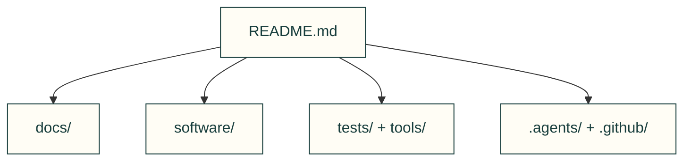

# Repository map

Every tracked folder has an owner below. Published owner pages have a separate public link; source-only software, tooling and operational maps retain their canonical GitHub source, with no new catalogue routes. Upstream, fixture and generated-data descendants retain their layouts; the named parent explains the collection. This is an ownership inventory, not a quality percentage or proof of physical performance.

Generated by `node tools/site/compiler/site-repo-map.mjs --write`; use `--check` in review. Sources and file tables remain authored by their owners. Public routes and fragments are checked by the existing site build; the map checker validates relative file/directory destinations (not remote availability or Markdown anchors).

| Folder | Canonical source owner | Published owner | Coverage |
|---|---|---|---|
| `.` | [README.md](https://github.com/Valpatel/cad-agent/blob/dev/README.md) | [Page](/README) | Owned folder map. |
| `.agents` | [.agents/README.md](https://github.com/Valpatel/cad-agent/blob/dev/.agents/README.md) | Source only | Owned folder map. |
| `.agents/agents` | [.agents/README.md](https://github.com/Valpatel/cad-agent/blob/dev/.agents/README.md) | Source only | Installer discovers every role Markdown file; parent links the two manifest-listed prompts, not a README in the prompt namespace. |
| `.agents/domains` | [.agents/domains/README.md](https://github.com/Valpatel/cad-agent/blob/dev/.agents/domains/README.md) | Source only | Owned folder map. |
| `.agents/inbox` | [.agents/inbox/README.md](https://github.com/Valpatel/cad-agent/blob/dev/.agents/inbox/README.md) | Source only | Owned folder map. |
| `.agents/inbox/publish` | [.agents/inbox/publish/README.md](https://github.com/Valpatel/cad-agent/blob/dev/.agents/inbox/publish/README.md) | Source only | Owned folder map. |
| `.agents/playbooks` | [.agents/playbooks/README.md](https://github.com/Valpatel/cad-agent/blob/dev/.agents/playbooks/README.md) | Source only | Owned folder map. |
| `.agents/skills` | [.agents/skills/README.md](https://github.com/Valpatel/cad-agent/blob/dev/.agents/skills/README.md) | Source only | Owned folder map. |
| `.agents/skills/cad-motion-validation` | [.agents/skills/cad-motion-validation/SKILL.md](https://github.com/Valpatel/cad-agent/blob/dev/.agents/skills/cad-motion-validation/SKILL.md) | [Page](/skills/cad-motion-validation/SKILL) | Installed skill entry; resource links stay relative to SKILL.md. |
| `.agents/skills/cad-motion-validation/references` | [.agents/skills/cad-motion-validation/SKILL.md](https://github.com/Valpatel/cad-agent/blob/dev/.agents/skills/cad-motion-validation/SKILL.md) | [Page](/skills/cad-motion-validation/SKILL) | Bundled reference resources are linked from the installed skill; no extra discovered skill entry. |
| `.agents/skills/cad-pr-review` | [.agents/skills/cad-pr-review/SKILL.md](https://github.com/Valpatel/cad-agent/blob/dev/.agents/skills/cad-pr-review/SKILL.md) | [Page](/skills/cad-pr-review/SKILL) | Installed skill entry; resource links stay relative to SKILL.md. |
| `.agents/skills/cad-remote-runs` | [.agents/skills/cad-remote-runs/SKILL.md](https://github.com/Valpatel/cad-agent/blob/dev/.agents/skills/cad-remote-runs/SKILL.md) | [Page](/skills/cad-remote-runs/SKILL) | Installed skill entry; resource links stay relative to SKILL.md. |
| `.agents/skills/cad-supply-chain` | [.agents/skills/cad-supply-chain/SKILL.md](https://github.com/Valpatel/cad-agent/blob/dev/.agents/skills/cad-supply-chain/SKILL.md) | [Page](/skills/cad-supply-chain/SKILL) | Installed skill entry; resource links stay relative to SKILL.md. |
| `.agents/skills/cad-work-tracking` | [.agents/skills/cad-work-tracking/SKILL.md](https://github.com/Valpatel/cad-agent/blob/dev/.agents/skills/cad-work-tracking/SKILL.md) | [Page](/skills/cad-work-tracking/SKILL) | Installed skill entry; resource links stay relative to SKILL.md. |
| `.agents/skills/design-process` | [.agents/skills/design-process/SKILL.md](https://github.com/Valpatel/cad-agent/blob/dev/.agents/skills/design-process/SKILL.md) | [Page](/skills/design-process/SKILL) | Installed skill entry; resource links stay relative to SKILL.md. |
| `.agents/skills/mcmaster-parts` | [.agents/skills/mcmaster-parts/SKILL.md](https://github.com/Valpatel/cad-agent/blob/dev/.agents/skills/mcmaster-parts/SKILL.md) | [Page](/skills/mcmaster-parts/SKILL) | Installed skill entry; resource links stay relative to SKILL.md. |
| `.agents/skills/sheet-metal-hardware` | [.agents/skills/sheet-metal-hardware/SKILL.md](https://github.com/Valpatel/cad-agent/blob/dev/.agents/skills/sheet-metal-hardware/SKILL.md) | [Page](/skills/sheet-metal-hardware/SKILL) | Installed skill entry; resource links stay relative to SKILL.md. |
| `.claude-plugin` | [.agents/README.md](https://github.com/Valpatel/cad-agent/blob/dev/.agents/README.md) | Source only | Plugin wiring uses the canonical kit; its manifest is mapped by the kit owner. |
| `.github` | [.github/CONTRIBUTING.md](https://github.com/Valpatel/cad-agent/blob/dev/.github/CONTRIBUTING.md) | [Page](/CONTRIBUTING) | GitHub policy, templates and workflows are mapped by CONTRIBUTING rather than a front-page-changing README. |
| `.github/ISSUE_TEMPLATE` | [.github/CONTRIBUTING.md](https://github.com/Valpatel/cad-agent/blob/dev/.github/CONTRIBUTING.md) | [Page](/CONTRIBUTING) | GitHub policy, templates and workflows are mapped by CONTRIBUTING rather than a front-page-changing README. |
| `.github/workflows` | [.github/CONTRIBUTING.md](https://github.com/Valpatel/cad-agent/blob/dev/.github/CONTRIBUTING.md) | [Page](/CONTRIBUTING) | GitHub policy, templates and workflows are mapped by CONTRIBUTING rather than a front-page-changing README. |
| `docs` | [docs/README.md](https://github.com/Valpatel/cad-agent/blob/dev/docs/README.md) | [Page](/docs/README) | Owned folder map. |
| `docs/changelog.d` | [docs/changelog.d/README.md](https://github.com/Valpatel/cad-agent/blob/dev/docs/changelog.d/README.md) | Source only | Owned folder map. |
| `docs/examples` | [docs/examples/README.md](https://github.com/Valpatel/cad-agent/blob/dev/docs/examples/README.md) | [Page](/docs/examples/README) | Owned folder map. |
| `docs/examples/explore-two-wheel` | [docs/examples/explore-two-wheel/README.md](https://github.com/Valpatel/cad-agent/blob/dev/docs/examples/explore-two-wheel/README.md) | Source only | Owned folder map. |
| `docs/examples/explore-two-wheel/catalogue` | [docs/examples/explore-two-wheel/catalogue/README.md](https://github.com/Valpatel/cad-agent/blob/dev/docs/examples/explore-two-wheel/catalogue/README.md) | Source only | Owned folder map. |
| `docs/examples/explore-two-wheel/designs` | [docs/examples/explore-two-wheel/designs/README.md](https://github.com/Valpatel/cad-agent/blob/dev/docs/examples/explore-two-wheel/designs/README.md) | Source only | Owned folder map. |
| `docs/examples/explore-two-wheel/tools` | [docs/examples/explore-two-wheel/tools/README.md](https://github.com/Valpatel/cad-agent/blob/dev/docs/examples/explore-two-wheel/tools/README.md) | Source only | Owned folder map. |
| `docs/examples/numbered-coupons` | [docs/examples/numbered-coupons/README.md](https://github.com/Valpatel/cad-agent/blob/dev/docs/examples/numbered-coupons/README.md) | [Page](/docs/numbered-coupons) | Owned folder map. |
| `docs/examples/starter-box` | [docs/examples/starter-box/README.md](https://github.com/Valpatel/cad-agent/blob/dev/docs/examples/starter-box/README.md) | Source only | Owned folder map. |
| `docs/examples/starter-box/cad` | [docs/examples/starter-box/cad/README.md](https://github.com/Valpatel/cad-agent/blob/dev/docs/examples/starter-box/cad/README.md) | Source only | Owned folder map. |
| `docs/examples/starter-box/tools` | [docs/examples/starter-box/tools/README.md](https://github.com/Valpatel/cad-agent/blob/dev/docs/examples/starter-box/tools/README.md) | Source only | Owned folder map. |
| `docs/img` | [docs/img/README.md](https://github.com/Valpatel/cad-agent/blob/dev/docs/img/README.md) | [Page](/docs/img/README) | Committed generated figures retain their topic output layout and recorded producers; parent maps each topic. |
| `docs/img/bearings` | [docs/img/README.md](https://github.com/Valpatel/cad-agent/blob/dev/docs/img/README.md) | [Page](/docs/img/README) | Committed generated figures retain their topic output layout and recorded producers; parent maps each topic. |
| `docs/img/cfd` | [docs/img/README.md](https://github.com/Valpatel/cad-agent/blob/dev/docs/img/README.md) | [Page](/docs/img/README) | Committed generated figures retain their topic output layout and recorded producers; parent maps each topic. |
| `docs/img/compliant` | [docs/img/README.md](https://github.com/Valpatel/cad-agent/blob/dev/docs/img/README.md) | [Page](/docs/img/README) | Committed generated figures retain their topic output layout and recorded producers; parent maps each topic. |
| `docs/img/explore` | [docs/img/README.md](https://github.com/Valpatel/cad-agent/blob/dev/docs/img/README.md) | [Page](/docs/img/README) | Committed generated figures retain their topic output layout and recorded producers; parent maps each topic. |
| `docs/img/fasteners` | [docs/img/README.md](https://github.com/Valpatel/cad-agent/blob/dev/docs/img/README.md) | [Page](/docs/img/README) | Committed generated figures retain their topic output layout and recorded producers; parent maps each topic. |
| `docs/img/fea` | [docs/img/README.md](https://github.com/Valpatel/cad-agent/blob/dev/docs/img/README.md) | [Page](/docs/img/README) | Committed generated figures retain their topic output layout and recorded producers; parent maps each topic. |
| `docs/img/formulas` | [docs/img/README.md](https://github.com/Valpatel/cad-agent/blob/dev/docs/img/README.md) | [Page](/docs/img/README) | Committed generated figures retain their topic output layout and recorded producers; parent maps each topic. |
| `docs/img/gates` | [docs/img/README.md](https://github.com/Valpatel/cad-agent/blob/dev/docs/img/README.md) | [Page](/docs/img/README) | Committed generated figures retain their topic output layout and recorded producers; parent maps each topic. |
| `docs/img/gyropup` | [docs/img/README.md](https://github.com/Valpatel/cad-agent/blob/dev/docs/img/README.md) | [Page](/docs/img/README) | Committed generated figures retain their topic output layout and recorded producers; parent maps each topic. |
| `docs/img/hero` | [docs/img/README.md](https://github.com/Valpatel/cad-agent/blob/dev/docs/img/README.md) | [Page](/docs/img/README) | Committed generated figures retain their topic output layout and recorded producers; parent maps each topic. |
| `docs/img/inserts` | [docs/img/README.md](https://github.com/Valpatel/cad-agent/blob/dev/docs/img/README.md) | [Page](/docs/img/README) | Committed generated figures retain their topic output layout and recorded producers; parent maps each topic. |
| `docs/img/joints` | [docs/img/README.md](https://github.com/Valpatel/cad-agent/blob/dev/docs/img/README.md) | [Page](/docs/img/README) | Committed generated figures retain their topic output layout and recorded producers; parent maps each topic. |
| `docs/img/kit` | [docs/img/README.md](https://github.com/Valpatel/cad-agent/blob/dev/docs/img/README.md) | [Page](/docs/img/README) | Committed generated figures retain their topic output layout and recorded producers; parent maps each topic. |
| `docs/img/linkages` | [docs/img/README.md](https://github.com/Valpatel/cad-agent/blob/dev/docs/img/README.md) | [Page](/docs/img/README) | Committed generated figures retain their topic output layout and recorded producers; parent maps each topic. |
| `docs/img/motion` | [docs/img/README.md](https://github.com/Valpatel/cad-agent/blob/dev/docs/img/README.md) | [Page](/docs/img/README) | Committed generated figures retain their topic output layout and recorded producers; parent maps each topic. |
| `docs/img/packets` | [docs/img/README.md](https://github.com/Valpatel/cad-agent/blob/dev/docs/img/README.md) | [Page](/docs/img/README) | Committed generated figures retain their topic output layout and recorded producers; parent maps each topic. |
| `docs/img/plates` | [docs/img/README.md](https://github.com/Valpatel/cad-agent/blob/dev/docs/img/README.md) | [Page](/docs/img/README) | Committed generated figures retain their topic output layout and recorded producers; parent maps each topic. |
| `docs/img/process` | [docs/img/README.md](https://github.com/Valpatel/cad-agent/blob/dev/docs/img/README.md) | [Page](/docs/img/README) | Committed generated figures retain their topic output layout and recorded producers; parent maps each topic. |
| `docs/img/research` | [docs/img/README.md](https://github.com/Valpatel/cad-agent/blob/dev/docs/img/README.md) | [Page](/docs/img/README) | Committed generated figures retain their topic output layout and recorded producers; parent maps each topic. |
| `docs/img/sheet-metal` | [docs/img/README.md](https://github.com/Valpatel/cad-agent/blob/dev/docs/img/README.md) | [Page](/docs/img/README) | Committed generated figures retain their topic output layout and recorded producers; parent maps each topic. |
| `docs/img/supply-chain` | [docs/img/README.md](https://github.com/Valpatel/cad-agent/blob/dev/docs/img/README.md) | [Page](/docs/img/README) | Committed generated figures retain their topic output layout and recorded producers; parent maps each topic. |
| `docs/img/thermal` | [docs/img/README.md](https://github.com/Valpatel/cad-agent/blob/dev/docs/img/README.md) | [Page](/docs/img/README) | Committed generated figures retain their topic output layout and recorded producers; parent maps each topic. |
| `docs/lessons` | [docs/lessons/README.md](https://github.com/Valpatel/cad-agent/blob/dev/docs/lessons/README.md) | [Page](/lessons/README) | Owned folder map. |
| `docs/lessons/electronics` | [docs/lessons/electronics/README.md](https://github.com/Valpatel/cad-agent/blob/dev/docs/lessons/electronics/README.md) | [Page](/lessons/electronics/README) | Owned folder map. |
| `docs/lessons/mechanical` | [docs/lessons/mechanical/README.md](https://github.com/Valpatel/cad-agent/blob/dev/docs/lessons/mechanical/README.md) | [Page](/lessons/mechanical/README) | Owned folder map. |
| `docs/lessons/process` | [docs/lessons/process/README.md](https://github.com/Valpatel/cad-agent/blob/dev/docs/lessons/process/README.md) | [Page](/lessons/process/README) | Owned folder map. |
| `docs/lessons/review` | [docs/lessons/review/README.md](https://github.com/Valpatel/cad-agent/blob/dev/docs/lessons/review/README.md) | [Page](/lessons/review/README) | Owned folder map. |
| `docs/lessons/simulation` | [docs/lessons/simulation/README.md](https://github.com/Valpatel/cad-agent/blob/dev/docs/lessons/simulation/README.md) | [Page](/lessons/simulation/README) | Owned folder map. |
| `docs/lessons/wiring` | [docs/lessons/wiring/README.md](https://github.com/Valpatel/cad-agent/blob/dev/docs/lessons/wiring/README.md) | [Page](/lessons/wiring/README) | Owned folder map. |
| `docs/mechanical` | [docs/mechanical/README.md](https://github.com/Valpatel/cad-agent/blob/dev/docs/mechanical/README.md) | [Page](/docs/mechanical/README) | Owned folder map. |
| `docs/practice` | [docs/practice/README.md](https://github.com/Valpatel/cad-agent/blob/dev/docs/practice/README.md) | [Page](/docs/practice/README) | Owned folder map. |
| `docs/research` | [docs/research/README.md](https://github.com/Valpatel/cad-agent/blob/dev/docs/research/README.md) | [Page](/research/README) | Owned folder map. |
| `docs/research/agent-workflow` | [docs/research/agent-workflow/README.md](https://github.com/Valpatel/cad-agent/blob/dev/docs/research/agent-workflow/README.md) | [Page](/research/agent-workflow/README) | Owned folder map. |
| `docs/research/bench` | [docs/research/bench/README.md](https://github.com/Valpatel/cad-agent/blob/dev/docs/research/bench/README.md) | Source only | Owned folder map. |
| `docs/research/manufacturing` | [docs/research/manufacturing/README.md](https://github.com/Valpatel/cad-agent/blob/dev/docs/research/manufacturing/README.md) | [Page](/research/manufacturing/README) | Owned folder map. |
| `docs/research/references` | [docs/research/references/README.md](https://github.com/Valpatel/cad-agent/blob/dev/docs/research/references/README.md) | Source only | Owned folder map. |
| `docs/validation` | [docs/validation/README.md](https://github.com/Valpatel/cad-agent/blob/dev/docs/validation/README.md) | [Page](/docs/validation/README) | Owned folder map. |
| `docs/validation/volume-2026-10-29` | [docs/validation/README.md](https://github.com/Valpatel/cad-agent/blob/dev/docs/validation/README.md) | [Page](/docs/validation/README) | Dated numerical receipts retain their evidence layout; parent maps the immutable run. |
| `software` | [software/README.md](https://github.com/Valpatel/cad-agent/blob/dev/software/README.md) | Source only | Owned folder map. |
| `software/cadagent` | [software/cadagent/README.md](https://github.com/Valpatel/cad-agent/blob/dev/software/cadagent/README.md) | Source only | Owned folder map. |
| `software/cadagent/electrical` | [software/cadagent/electrical/README.md](https://github.com/Valpatel/cad-agent/blob/dev/software/cadagent/electrical/README.md) | Source only | Owned folder map. |
| `software/cadagent/formulas` | [software/cadagent/formulas/README.md](https://github.com/Valpatel/cad-agent/blob/dev/software/cadagent/formulas/README.md) | Source only | Owned folder map. |
| `software/cadagent/geometry` | [software/cadagent/geometry/README.md](https://github.com/Valpatel/cad-agent/blob/dev/software/cadagent/geometry/README.md) | Source only | Owned folder map. |
| `software/cadagent/library` | [software/cadagent/library/README.md](https://github.com/Valpatel/cad-agent/blob/dev/software/cadagent/library/README.md) | Source only | Owned folder map. |
| `software/cadagent/manufacturing` | [software/cadagent/manufacturing/README.md](https://github.com/Valpatel/cad-agent/blob/dev/software/cadagent/manufacturing/README.md) | Source only | Owned folder map. |
| `software/cadagent/mechanical` | [software/cadagent/mechanical/README.md](https://github.com/Valpatel/cad-agent/blob/dev/software/cadagent/mechanical/README.md) | Source only | Owned folder map. |
| `software/cadagent/mechanical/compliant` | [software/cadagent/mechanical/compliant/README.md](https://github.com/Valpatel/cad-agent/blob/dev/software/cadagent/mechanical/compliant/README.md) | Source only | Owned folder map. |
| `software/cadagent/publish` | [software/cadagent/publish/README.md](https://github.com/Valpatel/cad-agent/blob/dev/software/cadagent/publish/README.md) | Source only | Owned folder map. |
| `software/cadagent/publish/anim` | [software/cadagent/publish/anim/README.md](https://github.com/Valpatel/cad-agent/blob/dev/software/cadagent/publish/anim/README.md) | Source only | Owned folder map. |
| `software/cadagent/review` | [software/cadagent/review/README.md](https://github.com/Valpatel/cad-agent/blob/dev/software/cadagent/review/README.md) | Source only | Owned folder map. |
| `software/cadagent/review/dossier` | [software/cadagent/review/dossier/README.md](https://github.com/Valpatel/cad-agent/blob/dev/software/cadagent/review/dossier/README.md) | Source only | Owned folder map. |
| `software/cadagent/review/gates` | [software/cadagent/review/gates/README.md](https://github.com/Valpatel/cad-agent/blob/dev/software/cadagent/review/gates/README.md) | Source only | Owned folder map. |
| `software/cadagent/simulation` | [software/cadagent/simulation/README.md](https://github.com/Valpatel/cad-agent/blob/dev/software/cadagent/simulation/README.md) | Source only | Owned folder map. |
| `software/cadagent/simulation/explore` | [software/cadagent/simulation/explore/README.md](https://github.com/Valpatel/cad-agent/blob/dev/software/cadagent/simulation/explore/README.md) | Source only | Owned folder map. |
| `software/cadagent/thermal` | [software/cadagent/thermal/README.md](https://github.com/Valpatel/cad-agent/blob/dev/software/cadagent/thermal/README.md) | Source only | Owned folder map. |
| `software/cadagent/webkit` | [software/cadagent/webkit/README.md](https://github.com/Valpatel/cad-agent/blob/dev/software/cadagent/webkit/README.md) | Source only | Owned folder map. |
| `software/cadagent/webkit/vendor` | [software/cadagent/webkit/vendor/README.md](https://github.com/Valpatel/cad-agent/blob/dev/software/cadagent/webkit/vendor/README.md) | Source only | Owned folder map. |
| `software/cadagent/webkit/vendor/file-parsers` | [software/cadagent/webkit/vendor/README.md](https://github.com/Valpatel/cad-agent/blob/dev/software/cadagent/webkit/vendor/README.md) | Source only | Pinned upstream parser bytes; file-viewer-sources and integrity checks own the components. |
| `software/cadagent/webkit/vendor/fonts` | [software/cadagent/webkit/vendor/README.md](https://github.com/Valpatel/cad-agent/blob/dev/software/cadagent/webkit/vendor/README.md) | Source only | Pinned fonts and owned wrapper; existing SOURCE hashes and style-pointer control own byte integrity. |
| `software/cadagent/webkit/vendor/linkedom` | [software/cadagent/webkit/vendor/README.md](https://github.com/Valpatel/cad-agent/blob/dev/software/cadagent/webkit/vendor/README.md) | Source only | Pinned DOM helper; component source/licence records own upstream layout. |
| `software/cadagent/webkit/vendor/mermaid` | [software/cadagent/webkit/vendor/README.md](https://github.com/Valpatel/cad-agent/blob/dev/software/cadagent/webkit/vendor/README.md) | Source only | Derived renderer with producer/input/licence records and repeat-build CI; no extra source maps inserted. |
| `software/cadagent/webkit/vendor/occt-import-js` | [software/cadagent/webkit/vendor/README.md](https://github.com/Valpatel/cad-agent/blob/dev/software/cadagent/webkit/vendor/README.md) | Source only | Pinned STEP parser with source/licence records and worker controls; no upstream layout rewrite. |
| `software/cadagent/webkit/vendor/occt-import-js/source` | [software/cadagent/webkit/vendor/README.md](https://github.com/Valpatel/cad-agent/blob/dev/software/cadagent/webkit/vendor/README.md) | Source only | Pinned STEP parser with source/licence records and worker controls; no upstream layout rewrite. |
| `software/cadagent/webkit/vendor/occt-import-js/source/occt-import-js` | [software/cadagent/webkit/vendor/README.md](https://github.com/Valpatel/cad-agent/blob/dev/software/cadagent/webkit/vendor/README.md) | Source only | Pinned STEP parser with source/licence records and worker controls; no upstream layout rewrite. |
| `software/cadagent/webkit/vendor/occt-import-js/source/occt-import-js/example` | [software/cadagent/webkit/vendor/README.md](https://github.com/Valpatel/cad-agent/blob/dev/software/cadagent/webkit/vendor/README.md) | Source only | Pinned STEP parser with source/licence records and worker controls; no upstream layout rewrite. |
| `software/cadagent/webkit/vendor/occt-import-js/source/occt-import-js/src` | [software/cadagent/webkit/vendor/README.md](https://github.com/Valpatel/cad-agent/blob/dev/software/cadagent/webkit/vendor/README.md) | Source only | Pinned STEP parser with source/licence records and worker controls; no upstream layout rewrite. |
| `software/cadagent/webkit/vendor/occt-import-js/source/tools` | [software/cadagent/webkit/vendor/README.md](https://github.com/Valpatel/cad-agent/blob/dev/software/cadagent/webkit/vendor/README.md) | Source only | Pinned STEP parser with source/licence records and worker controls; no upstream layout rewrite. |
| `software/cadagent/webkit/vendor/three` | [software/cadagent/webkit/vendor/README.md](https://github.com/Valpatel/cad-agent/blob/dev/software/cadagent/webkit/vendor/README.md) | Source only | Pinned renderer; component source/licence records own upstream layout. |
| `software/cadagent/webkit/vendor/three/addons` | [software/cadagent/webkit/vendor/README.md](https://github.com/Valpatel/cad-agent/blob/dev/software/cadagent/webkit/vendor/README.md) | Source only | Pinned renderer; component source/licence records own upstream layout. |
| `software/cadagent/webkit/vendor/three/addons/controls` | [software/cadagent/webkit/vendor/README.md](https://github.com/Valpatel/cad-agent/blob/dev/software/cadagent/webkit/vendor/README.md) | Source only | Pinned renderer; component source/licence records own upstream layout. |
| `software/cadagent/webkit/vendor/three/addons/geometries` | [software/cadagent/webkit/vendor/README.md](https://github.com/Valpatel/cad-agent/blob/dev/software/cadagent/webkit/vendor/README.md) | Source only | Pinned renderer; component source/licence records own upstream layout. |
| `software/cadagent/webkit/vendor/three/addons/loaders` | [software/cadagent/webkit/vendor/README.md](https://github.com/Valpatel/cad-agent/blob/dev/software/cadagent/webkit/vendor/README.md) | Source only | Pinned renderer; component source/licence records own upstream layout. |
| `software/cadagent/webkit/vendor/three/addons/utils` | [software/cadagent/webkit/vendor/README.md](https://github.com/Valpatel/cad-agent/blob/dev/software/cadagent/webkit/vendor/README.md) | Source only | Pinned renderer; component source/licence records own upstream layout. |
| `software/vendor` | [software/vendor/README.md](https://github.com/Valpatel/cad-agent/blob/dev/software/vendor/README.md) | Source only | Owned folder map. |
| `software/vendor/agentcad` | [software/vendor/README.md](https://github.com/Valpatel/cad-agent/blob/dev/software/vendor/README.md) | Source only | Imported upstream layout; manifest pins and vendor audit own contents. |
| `software/vendor/agentcad/docs` | [software/vendor/README.md](https://github.com/Valpatel/cad-agent/blob/dev/software/vendor/README.md) | Source only | Imported upstream layout; manifest pins and vendor audit own contents. |
| `software/vendor/agentcad/docs/product-plans` | [software/vendor/README.md](https://github.com/Valpatel/cad-agent/blob/dev/software/vendor/README.md) | Source only | Imported upstream layout; manifest pins and vendor audit own contents. |
| `software/vendor/agentcad/scripts` | [software/vendor/README.md](https://github.com/Valpatel/cad-agent/blob/dev/software/vendor/README.md) | Source only | Imported upstream layout; manifest pins and vendor audit own contents. |
| `software/vendor/agentcad/src` | [software/vendor/README.md](https://github.com/Valpatel/cad-agent/blob/dev/software/vendor/README.md) | Source only | Imported upstream layout; manifest pins and vendor audit own contents. |
| `software/vendor/agentcad/src/agentcad` | [software/vendor/README.md](https://github.com/Valpatel/cad-agent/blob/dev/software/vendor/README.md) | Source only | Imported upstream layout; manifest pins and vendor audit own contents. |
| `software/vendor/agentcad/src/agentcad/commands` | [software/vendor/README.md](https://github.com/Valpatel/cad-agent/blob/dev/software/vendor/README.md) | Source only | Imported upstream layout; manifest pins and vendor audit own contents. |
| `software/vendor/agentcad/src/agentcad/mcp` | [software/vendor/README.md](https://github.com/Valpatel/cad-agent/blob/dev/software/vendor/README.md) | Source only | Imported upstream layout; manifest pins and vendor audit own contents. |
| `software/vendor/agentcad/src/agentcad/runners` | [software/vendor/README.md](https://github.com/Valpatel/cad-agent/blob/dev/software/vendor/README.md) | Source only | Imported upstream layout; manifest pins and vendor audit own contents. |
| `software/vendor/agentcad/tests` | [software/vendor/README.md](https://github.com/Valpatel/cad-agent/blob/dev/software/vendor/README.md) | Source only | Imported upstream layout; manifest pins and vendor audit own contents. |
| `software/vendor/agentcad/tests/fixtures` | [software/vendor/README.md](https://github.com/Valpatel/cad-agent/blob/dev/software/vendor/README.md) | Source only | Imported upstream layout; manifest pins and vendor audit own contents. |
| `software/vendor/agentcad/tests/fixtures/comparison` | [software/vendor/README.md](https://github.com/Valpatel/cad-agent/blob/dev/software/vendor/README.md) | Source only | Imported upstream layout; manifest pins and vendor audit own contents. |
| `software/vendor/agentcad/tests/fixtures/real_world` | [software/vendor/README.md](https://github.com/Valpatel/cad-agent/blob/dev/software/vendor/README.md) | Source only | Imported upstream layout; manifest pins and vendor audit own contents. |
| `software/vendor/agentcad/tests/fixtures/validation` | [software/vendor/README.md](https://github.com/Valpatel/cad-agent/blob/dev/software/vendor/README.md) | Source only | Imported upstream layout; manifest pins and vendor audit own contents. |
| `software/vendor/agentcad/tests_b3d` | [software/vendor/README.md](https://github.com/Valpatel/cad-agent/blob/dev/software/vendor/README.md) | Source only | Imported upstream layout; manifest pins and vendor audit own contents. |
| `software/vendor/agentcad/tests_b3d/fixtures` | [software/vendor/README.md](https://github.com/Valpatel/cad-agent/blob/dev/software/vendor/README.md) | Source only | Imported upstream layout; manifest pins and vendor audit own contents. |
| `software/vendor/baselines` | [software/vendor/README.md](https://github.com/Valpatel/cad-agent/blob/dev/software/vendor/README.md) | Source only | Exact vendor scan fingerprints; parent owns metadata, vendor audit validates unexpected files. |
| `software/vendor/bd_warehouse` | [software/vendor/README.md](https://github.com/Valpatel/cad-agent/blob/dev/software/vendor/README.md) | Source only | Imported upstream layout; manifest pins and vendor audit own contents. |
| `software/vendor/bd_warehouse/docs` | [software/vendor/README.md](https://github.com/Valpatel/cad-agent/blob/dev/software/vendor/README.md) | Source only | Imported upstream layout; manifest pins and vendor audit own contents. |
| `software/vendor/bd_warehouse/examples` | [software/vendor/README.md](https://github.com/Valpatel/cad-agent/blob/dev/software/vendor/README.md) | Source only | Imported upstream layout; manifest pins and vendor audit own contents. |
| `software/vendor/bd_warehouse/src` | [software/vendor/README.md](https://github.com/Valpatel/cad-agent/blob/dev/software/vendor/README.md) | Source only | Imported upstream layout; manifest pins and vendor audit own contents. |
| `software/vendor/bd_warehouse/src/bd_warehouse` | [software/vendor/README.md](https://github.com/Valpatel/cad-agent/blob/dev/software/vendor/README.md) | Source only | Imported upstream layout; manifest pins and vendor audit own contents. |
| `software/vendor/bd_warehouse/src/bd_warehouse/data` | [software/vendor/README.md](https://github.com/Valpatel/cad-agent/blob/dev/software/vendor/README.md) | Source only | Imported upstream layout; manifest pins and vendor audit own contents. |
| `software/vendor/bd_warehouse/src/bd_warehouse/data_flange` | [software/vendor/README.md](https://github.com/Valpatel/cad-agent/blob/dev/software/vendor/README.md) | Source only | Imported upstream layout; manifest pins and vendor audit own contents. |
| `software/vendor/bd_warehouse/tests` | [software/vendor/README.md](https://github.com/Valpatel/cad-agent/blob/dev/software/vendor/README.md) | Source only | Imported upstream layout; manifest pins and vendor audit own contents. |
| `software/vendor/build123d-mcp` | [software/vendor/README.md](https://github.com/Valpatel/cad-agent/blob/dev/software/vendor/README.md) | Source only | Imported upstream layout; manifest pins and vendor audit own contents. |
| `software/vendor/build123d-mcp/.claude` | [software/vendor/README.md](https://github.com/Valpatel/cad-agent/blob/dev/software/vendor/README.md) | Source only | Imported upstream layout; manifest pins and vendor audit own contents. |
| `software/vendor/build123d-mcp/.devcontainer` | [software/vendor/README.md](https://github.com/Valpatel/cad-agent/blob/dev/software/vendor/README.md) | Source only | Imported upstream layout; manifest pins and vendor audit own contents. |
| `software/vendor/build123d-mcp/.vscode` | [software/vendor/README.md](https://github.com/Valpatel/cad-agent/blob/dev/software/vendor/README.md) | Source only | Imported upstream layout; manifest pins and vendor audit own contents. |
| `software/vendor/build123d-mcp/docs` | [software/vendor/README.md](https://github.com/Valpatel/cad-agent/blob/dev/software/vendor/README.md) | Source only | Imported upstream layout; manifest pins and vendor audit own contents. |
| `software/vendor/build123d-mcp/docs/adr` | [software/vendor/README.md](https://github.com/Valpatel/cad-agent/blob/dev/software/vendor/README.md) | Source only | Imported upstream layout; manifest pins and vendor audit own contents. |
| `software/vendor/build123d-mcp/examples` | [software/vendor/README.md](https://github.com/Valpatel/cad-agent/blob/dev/software/vendor/README.md) | Source only | Imported upstream layout; manifest pins and vendor audit own contents. |
| `software/vendor/build123d-mcp/scripts` | [software/vendor/README.md](https://github.com/Valpatel/cad-agent/blob/dev/software/vendor/README.md) | Source only | Imported upstream layout; manifest pins and vendor audit own contents. |
| `software/vendor/build123d-mcp/src` | [software/vendor/README.md](https://github.com/Valpatel/cad-agent/blob/dev/software/vendor/README.md) | Source only | Imported upstream layout; manifest pins and vendor audit own contents. |
| `software/vendor/build123d-mcp/src/build123d_mcp` | [software/vendor/README.md](https://github.com/Valpatel/cad-agent/blob/dev/software/vendor/README.md) | Source only | Imported upstream layout; manifest pins and vendor audit own contents. |
| `software/vendor/build123d-mcp/src/build123d_mcp/skills` | [software/vendor/README.md](https://github.com/Valpatel/cad-agent/blob/dev/software/vendor/README.md) | Source only | Imported upstream layout; manifest pins and vendor audit own contents. |
| `software/vendor/build123d-mcp/src/build123d_mcp/skills/b123d-drawing` | [software/vendor/README.md](https://github.com/Valpatel/cad-agent/blob/dev/software/vendor/README.md) | Source only | Imported upstream layout; manifest pins and vendor audit own contents. |
| `software/vendor/build123d-mcp/src/build123d_mcp/skills/b123d-edit` | [software/vendor/README.md](https://github.com/Valpatel/cad-agent/blob/dev/software/vendor/README.md) | Source only | Imported upstream layout; manifest pins and vendor audit own contents. |
| `software/vendor/build123d-mcp/src/build123d_mcp/skills/b123d-modeling` | [software/vendor/README.md](https://github.com/Valpatel/cad-agent/blob/dev/software/vendor/README.md) | Source only | Imported upstream layout; manifest pins and vendor audit own contents. |
| `software/vendor/build123d-mcp/src/build123d_mcp/skills/b123d-repair` | [software/vendor/README.md](https://github.com/Valpatel/cad-agent/blob/dev/software/vendor/README.md) | Source only | Imported upstream layout; manifest pins and vendor audit own contents. |
| `software/vendor/build123d-mcp/src/build123d_mcp/tools` | [software/vendor/README.md](https://github.com/Valpatel/cad-agent/blob/dev/software/vendor/README.md) | Source only | Imported upstream layout; manifest pins and vendor audit own contents. |
| `software/vendor/build123d-mcp/src/build123d_mcp/tools/recognizers` | [software/vendor/README.md](https://github.com/Valpatel/cad-agent/blob/dev/software/vendor/README.md) | Source only | Imported upstream layout; manifest pins and vendor audit own contents. |
| `software/vendor/build123d-mcp/tests` | [software/vendor/README.md](https://github.com/Valpatel/cad-agent/blob/dev/software/vendor/README.md) | Source only | Imported upstream layout; manifest pins and vendor audit own contents. |
| `software/vendor/kicad-happy` | [software/vendor/README.md](https://github.com/Valpatel/cad-agent/blob/dev/software/vendor/README.md) | Source only | Imported upstream layout; manifest pins and vendor audit own contents. |
| `software/vendor/kicad-happy/.agents` | [software/vendor/README.md](https://github.com/Valpatel/cad-agent/blob/dev/software/vendor/README.md) | Source only | Imported upstream layout; manifest pins and vendor audit own contents. |
| `software/vendor/kicad-happy/.agents/plugins` | [software/vendor/README.md](https://github.com/Valpatel/cad-agent/blob/dev/software/vendor/README.md) | Source only | Imported upstream layout; manifest pins and vendor audit own contents. |
| `software/vendor/kicad-happy/.claude-plugin` | [software/vendor/README.md](https://github.com/Valpatel/cad-agent/blob/dev/software/vendor/README.md) | Source only | Imported upstream layout; manifest pins and vendor audit own contents. |
| `software/vendor/kicad-happy/.codex-plugin` | [software/vendor/README.md](https://github.com/Valpatel/cad-agent/blob/dev/software/vendor/README.md) | Source only | Imported upstream layout; manifest pins and vendor audit own contents. |
| `software/vendor/kicad-happy/.cursor` | [software/vendor/README.md](https://github.com/Valpatel/cad-agent/blob/dev/software/vendor/README.md) | Source only | Imported upstream layout; manifest pins and vendor audit own contents. |
| `software/vendor/kicad-happy/.cursor/rules` | [software/vendor/README.md](https://github.com/Valpatel/cad-agent/blob/dev/software/vendor/README.md) | Source only | Imported upstream layout; manifest pins and vendor audit own contents. |
| `software/vendor/kicad-happy/.opencode` | [software/vendor/README.md](https://github.com/Valpatel/cad-agent/blob/dev/software/vendor/README.md) | Source only | Imported upstream layout; manifest pins and vendor audit own contents. |
| `software/vendor/kicad-happy/skills` | [software/vendor/README.md](https://github.com/Valpatel/cad-agent/blob/dev/software/vendor/README.md) | Source only | Imported upstream layout; manifest pins and vendor audit own contents. |
| `software/vendor/kicad-happy/skills/bom` | [software/vendor/README.md](https://github.com/Valpatel/cad-agent/blob/dev/software/vendor/README.md) | Source only | Imported upstream layout; manifest pins and vendor audit own contents. |
| `software/vendor/kicad-happy/skills/bom/references` | [software/vendor/README.md](https://github.com/Valpatel/cad-agent/blob/dev/software/vendor/README.md) | Source only | Imported upstream layout; manifest pins and vendor audit own contents. |
| `software/vendor/kicad-happy/skills/bom/scripts` | [software/vendor/README.md](https://github.com/Valpatel/cad-agent/blob/dev/software/vendor/README.md) | Source only | Imported upstream layout; manifest pins and vendor audit own contents. |
| `software/vendor/kicad-happy/skills/datasheets` | [software/vendor/README.md](https://github.com/Valpatel/cad-agent/blob/dev/software/vendor/README.md) | Source only | Imported upstream layout; manifest pins and vendor audit own contents. |
| `software/vendor/kicad-happy/skills/datasheets/datasheet_types` | [software/vendor/README.md](https://github.com/Valpatel/cad-agent/blob/dev/software/vendor/README.md) | Source only | Imported upstream layout; manifest pins and vendor audit own contents. |
| `software/vendor/kicad-happy/skills/datasheets/examples` | [software/vendor/README.md](https://github.com/Valpatel/cad-agent/blob/dev/software/vendor/README.md) | Source only | Imported upstream layout; manifest pins and vendor audit own contents. |
| `software/vendor/kicad-happy/skills/datasheets/prompts` | [software/vendor/README.md](https://github.com/Valpatel/cad-agent/blob/dev/software/vendor/README.md) | Source only | Imported upstream layout; manifest pins and vendor audit own contents. |
| `software/vendor/kicad-happy/skills/datasheets/references` | [software/vendor/README.md](https://github.com/Valpatel/cad-agent/blob/dev/software/vendor/README.md) | Source only | Imported upstream layout; manifest pins and vendor audit own contents. |
| `software/vendor/kicad-happy/skills/datasheets/schemas` | [software/vendor/README.md](https://github.com/Valpatel/cad-agent/blob/dev/software/vendor/README.md) | Source only | Imported upstream layout; manifest pins and vendor audit own contents. |
| `software/vendor/kicad-happy/skills/datasheets/schemas/fixtures` | [software/vendor/README.md](https://github.com/Valpatel/cad-agent/blob/dev/software/vendor/README.md) | Source only | Imported upstream layout; manifest pins and vendor audit own contents. |
| `software/vendor/kicad-happy/skills/datasheets/scripts` | [software/vendor/README.md](https://github.com/Valpatel/cad-agent/blob/dev/software/vendor/README.md) | Source only | Imported upstream layout; manifest pins and vendor audit own contents. |
| `software/vendor/kicad-happy/skills/digikey` | [software/vendor/README.md](https://github.com/Valpatel/cad-agent/blob/dev/software/vendor/README.md) | Source only | Imported upstream layout; manifest pins and vendor audit own contents. |
| `software/vendor/kicad-happy/skills/digikey/scripts` | [software/vendor/README.md](https://github.com/Valpatel/cad-agent/blob/dev/software/vendor/README.md) | Source only | Imported upstream layout; manifest pins and vendor audit own contents. |
| `software/vendor/kicad-happy/skills/element14` | [software/vendor/README.md](https://github.com/Valpatel/cad-agent/blob/dev/software/vendor/README.md) | Source only | Imported upstream layout; manifest pins and vendor audit own contents. |
| `software/vendor/kicad-happy/skills/element14/scripts` | [software/vendor/README.md](https://github.com/Valpatel/cad-agent/blob/dev/software/vendor/README.md) | Source only | Imported upstream layout; manifest pins and vendor audit own contents. |
| `software/vendor/kicad-happy/skills/emc` | [software/vendor/README.md](https://github.com/Valpatel/cad-agent/blob/dev/software/vendor/README.md) | Source only | Imported upstream layout; manifest pins and vendor audit own contents. |
| `software/vendor/kicad-happy/skills/emc/references` | [software/vendor/README.md](https://github.com/Valpatel/cad-agent/blob/dev/software/vendor/README.md) | Source only | Imported upstream layout; manifest pins and vendor audit own contents. |
| `software/vendor/kicad-happy/skills/emc/scripts` | [software/vendor/README.md](https://github.com/Valpatel/cad-agent/blob/dev/software/vendor/README.md) | Source only | Imported upstream layout; manifest pins and vendor audit own contents. |
| `software/vendor/kicad-happy/skills/jlcpcb` | [software/vendor/README.md](https://github.com/Valpatel/cad-agent/blob/dev/software/vendor/README.md) | Source only | Imported upstream layout; manifest pins and vendor audit own contents. |
| `software/vendor/kicad-happy/skills/kicad` | [software/vendor/README.md](https://github.com/Valpatel/cad-agent/blob/dev/software/vendor/README.md) | Source only | Imported upstream layout; manifest pins and vendor audit own contents. |
| `software/vendor/kicad-happy/skills/kicad/references` | [software/vendor/README.md](https://github.com/Valpatel/cad-agent/blob/dev/software/vendor/README.md) | Source only | Imported upstream layout; manifest pins and vendor audit own contents. |
| `software/vendor/kicad-happy/skills/kicad/review` | [software/vendor/README.md](https://github.com/Valpatel/cad-agent/blob/dev/software/vendor/README.md) | Source only | Imported upstream layout; manifest pins and vendor audit own contents. |
| `software/vendor/kicad-happy/skills/kicad/review/fixtures` | [software/vendor/README.md](https://github.com/Valpatel/cad-agent/blob/dev/software/vendor/README.md) | Source only | Imported upstream layout; manifest pins and vendor audit own contents. |
| `software/vendor/kicad-happy/skills/kicad/review/prompts` | [software/vendor/README.md](https://github.com/Valpatel/cad-agent/blob/dev/software/vendor/README.md) | Source only | Imported upstream layout; manifest pins and vendor audit own contents. |
| `software/vendor/kicad-happy/skills/kicad/review/schemas` | [software/vendor/README.md](https://github.com/Valpatel/cad-agent/blob/dev/software/vendor/README.md) | Source only | Imported upstream layout; manifest pins and vendor audit own contents. |
| `software/vendor/kicad-happy/skills/kicad/review/scripts` | [software/vendor/README.md](https://github.com/Valpatel/cad-agent/blob/dev/software/vendor/README.md) | Source only | Imported upstream layout; manifest pins and vendor audit own contents. |
| `software/vendor/kicad-happy/skills/kicad/scripts` | [software/vendor/README.md](https://github.com/Valpatel/cad-agent/blob/dev/software/vendor/README.md) | Source only | Imported upstream layout; manifest pins and vendor audit own contents. |
| `software/vendor/kicad-happy/skills/kicad/scripts/envelopes` | [software/vendor/README.md](https://github.com/Valpatel/cad-agent/blob/dev/software/vendor/README.md) | Source only | Imported upstream layout; manifest pins and vendor audit own contents. |
| `software/vendor/kicad-happy/skills/lcsc` | [software/vendor/README.md](https://github.com/Valpatel/cad-agent/blob/dev/software/vendor/README.md) | Source only | Imported upstream layout; manifest pins and vendor audit own contents. |
| `software/vendor/kicad-happy/skills/lcsc/scripts` | [software/vendor/README.md](https://github.com/Valpatel/cad-agent/blob/dev/software/vendor/README.md) | Source only | Imported upstream layout; manifest pins and vendor audit own contents. |
| `software/vendor/kicad-happy/skills/mouser` | [software/vendor/README.md](https://github.com/Valpatel/cad-agent/blob/dev/software/vendor/README.md) | Source only | Imported upstream layout; manifest pins and vendor audit own contents. |
| `software/vendor/kicad-happy/skills/mouser/scripts` | [software/vendor/README.md](https://github.com/Valpatel/cad-agent/blob/dev/software/vendor/README.md) | Source only | Imported upstream layout; manifest pins and vendor audit own contents. |
| `software/vendor/kicad-happy/skills/pcbway` | [software/vendor/README.md](https://github.com/Valpatel/cad-agent/blob/dev/software/vendor/README.md) | Source only | Imported upstream layout; manifest pins and vendor audit own contents. |
| `software/vendor/kicad-happy/skills/spice` | [software/vendor/README.md](https://github.com/Valpatel/cad-agent/blob/dev/software/vendor/README.md) | Source only | Imported upstream layout; manifest pins and vendor audit own contents. |
| `software/vendor/kicad-happy/skills/spice/references` | [software/vendor/README.md](https://github.com/Valpatel/cad-agent/blob/dev/software/vendor/README.md) | Source only | Imported upstream layout; manifest pins and vendor audit own contents. |
| `software/vendor/kicad-happy/skills/spice/scripts` | [software/vendor/README.md](https://github.com/Valpatel/cad-agent/blob/dev/software/vendor/README.md) | Source only | Imported upstream layout; manifest pins and vendor audit own contents. |
| `software/vendor/kicad-mcp-pro` | [software/vendor/README.md](https://github.com/Valpatel/cad-agent/blob/dev/software/vendor/README.md) | Source only | Imported upstream layout; manifest pins and vendor audit own contents. |
| `software/vendor/kicad-mcp-pro/.agents` | [software/vendor/README.md](https://github.com/Valpatel/cad-agent/blob/dev/software/vendor/README.md) | Source only | Imported upstream layout; manifest pins and vendor audit own contents. |
| `software/vendor/kicad-mcp-pro/.agents/skills` | [software/vendor/README.md](https://github.com/Valpatel/cad-agent/blob/dev/software/vendor/README.md) | Source only | Imported upstream layout; manifest pins and vendor audit own contents. |
| `software/vendor/kicad-mcp-pro/.agents/skills/drc-check` | [software/vendor/README.md](https://github.com/Valpatel/cad-agent/blob/dev/software/vendor/README.md) | Source only | Imported upstream layout; manifest pins and vendor audit own contents. |
| `software/vendor/kicad-mcp-pro/.agents/skills/fabrication-output` | [software/vendor/README.md](https://github.com/Valpatel/cad-agent/blob/dev/software/vendor/README.md) | Source only | Imported upstream layout; manifest pins and vendor audit own contents. |
| `software/vendor/kicad-mcp-pro/.agents/skills/kicad-design-review` | [software/vendor/README.md](https://github.com/Valpatel/cad-agent/blob/dev/software/vendor/README.md) | Source only | Imported upstream layout; manifest pins and vendor audit own contents. |
| `software/vendor/kicad-mcp-pro/.agents/skills/kicad-design-review/references` | [software/vendor/README.md](https://github.com/Valpatel/cad-agent/blob/dev/software/vendor/README.md) | Source only | Imported upstream layout; manifest pins and vendor audit own contents. |
| `software/vendor/kicad-mcp-pro/.agents/skills/kicad-design-review/scripts` | [software/vendor/README.md](https://github.com/Valpatel/cad-agent/blob/dev/software/vendor/README.md) | Source only | Imported upstream layout; manifest pins and vendor audit own contents. |
| `software/vendor/kicad-mcp-pro/.agents/skills/pcb-design` | [software/vendor/README.md](https://github.com/Valpatel/cad-agent/blob/dev/software/vendor/README.md) | Source only | Imported upstream layout; manifest pins and vendor audit own contents. |
| `software/vendor/kicad-mcp-pro/.agents/skills/schematic-review` | [software/vendor/README.md](https://github.com/Valpatel/cad-agent/blob/dev/software/vendor/README.md) | Source only | Imported upstream layout; manifest pins and vendor audit own contents. |
| `software/vendor/kicad-mcp-pro/.agents/skills/visual-excellence` | [software/vendor/README.md](https://github.com/Valpatel/cad-agent/blob/dev/software/vendor/README.md) | Source only | Imported upstream layout; manifest pins and vendor audit own contents. |
| `software/vendor/kicad-mcp-pro/.agents/skills/visual-excellence/reference` | [software/vendor/README.md](https://github.com/Valpatel/cad-agent/blob/dev/software/vendor/README.md) | Source only | Imported upstream layout; manifest pins and vendor audit own contents. |
| `software/vendor/kicad-mcp-pro/.agents/skills/wired-subcircuit-design` | [software/vendor/README.md](https://github.com/Valpatel/cad-agent/blob/dev/software/vendor/README.md) | Source only | Imported upstream layout; manifest pins and vendor audit own contents. |
| `software/vendor/kicad-mcp-pro/.claude-plugin` | [software/vendor/README.md](https://github.com/Valpatel/cad-agent/blob/dev/software/vendor/README.md) | Source only | Imported upstream layout; manifest pins and vendor audit own contents. |
| `software/vendor/kicad-mcp-pro/.codex` | [software/vendor/README.md](https://github.com/Valpatel/cad-agent/blob/dev/software/vendor/README.md) | Source only | Imported upstream layout; manifest pins and vendor audit own contents. |
| `software/vendor/kicad-mcp-pro/.opencode` | [software/vendor/README.md](https://github.com/Valpatel/cad-agent/blob/dev/software/vendor/README.md) | Source only | Imported upstream layout; manifest pins and vendor audit own contents. |
| `software/vendor/kicad-mcp-pro/.opencode/skills` | [software/vendor/README.md](https://github.com/Valpatel/cad-agent/blob/dev/software/vendor/README.md) | Source only | Imported upstream layout; manifest pins and vendor audit own contents. |
| `software/vendor/kicad-mcp-pro/.opencode/skills/drc-check` | [software/vendor/README.md](https://github.com/Valpatel/cad-agent/blob/dev/software/vendor/README.md) | Source only | Imported upstream layout; manifest pins and vendor audit own contents. |
| `software/vendor/kicad-mcp-pro/.opencode/skills/fabrication-output` | [software/vendor/README.md](https://github.com/Valpatel/cad-agent/blob/dev/software/vendor/README.md) | Source only | Imported upstream layout; manifest pins and vendor audit own contents. |
| `software/vendor/kicad-mcp-pro/.opencode/skills/kicad-design-review` | [software/vendor/README.md](https://github.com/Valpatel/cad-agent/blob/dev/software/vendor/README.md) | Source only | Imported upstream layout; manifest pins and vendor audit own contents. |
| `software/vendor/kicad-mcp-pro/.opencode/skills/kicad-design-review/references` | [software/vendor/README.md](https://github.com/Valpatel/cad-agent/blob/dev/software/vendor/README.md) | Source only | Imported upstream layout; manifest pins and vendor audit own contents. |
| `software/vendor/kicad-mcp-pro/.opencode/skills/kicad-design-review/scripts` | [software/vendor/README.md](https://github.com/Valpatel/cad-agent/blob/dev/software/vendor/README.md) | Source only | Imported upstream layout; manifest pins and vendor audit own contents. |
| `software/vendor/kicad-mcp-pro/.opencode/skills/pcb-design` | [software/vendor/README.md](https://github.com/Valpatel/cad-agent/blob/dev/software/vendor/README.md) | Source only | Imported upstream layout; manifest pins and vendor audit own contents. |
| `software/vendor/kicad-mcp-pro/.opencode/skills/schematic-review` | [software/vendor/README.md](https://github.com/Valpatel/cad-agent/blob/dev/software/vendor/README.md) | Source only | Imported upstream layout; manifest pins and vendor audit own contents. |
| `software/vendor/kicad-mcp-pro/.opencode/skills/visual-excellence` | [software/vendor/README.md](https://github.com/Valpatel/cad-agent/blob/dev/software/vendor/README.md) | Source only | Imported upstream layout; manifest pins and vendor audit own contents. |
| `software/vendor/kicad-mcp-pro/.opencode/skills/visual-excellence/reference` | [software/vendor/README.md](https://github.com/Valpatel/cad-agent/blob/dev/software/vendor/README.md) | Source only | Imported upstream layout; manifest pins and vendor audit own contents. |
| `software/vendor/kicad-mcp-pro/.opencode/skills/wired-subcircuit-design` | [software/vendor/README.md](https://github.com/Valpatel/cad-agent/blob/dev/software/vendor/README.md) | Source only | Imported upstream layout; manifest pins and vendor audit own contents. |
| `software/vendor/kicad-mcp-pro/assets` | [software/vendor/README.md](https://github.com/Valpatel/cad-agent/blob/dev/software/vendor/README.md) | Source only | Imported upstream layout; manifest pins and vendor audit own contents. |
| `software/vendor/kicad-mcp-pro/benchmarks` | [software/vendor/README.md](https://github.com/Valpatel/cad-agent/blob/dev/software/vendor/README.md) | Source only | Imported upstream layout; manifest pins and vendor audit own contents. |
| `software/vendor/kicad-mcp-pro/contracts` | [software/vendor/README.md](https://github.com/Valpatel/cad-agent/blob/dev/software/vendor/README.md) | Source only | Imported upstream layout; manifest pins and vendor audit own contents. |
| `software/vendor/kicad-mcp-pro/docs` | [software/vendor/README.md](https://github.com/Valpatel/cad-agent/blob/dev/software/vendor/README.md) | Source only | Imported upstream layout; manifest pins and vendor audit own contents. |
| `software/vendor/kicad-mcp-pro/docs/adr` | [software/vendor/README.md](https://github.com/Valpatel/cad-agent/blob/dev/software/vendor/README.md) | Source only | Imported upstream layout; manifest pins and vendor audit own contents. |
| `software/vendor/kicad-mcp-pro/docs/agents` | [software/vendor/README.md](https://github.com/Valpatel/cad-agent/blob/dev/software/vendor/README.md) | Source only | Imported upstream layout; manifest pins and vendor audit own contents. |
| `software/vendor/kicad-mcp-pro/docs/assets` | [software/vendor/README.md](https://github.com/Valpatel/cad-agent/blob/dev/software/vendor/README.md) | Source only | Imported upstream layout; manifest pins and vendor audit own contents. |
| `software/vendor/kicad-mcp-pro/docs/assets/screenshots` | [software/vendor/README.md](https://github.com/Valpatel/cad-agent/blob/dev/software/vendor/README.md) | Source only | Imported upstream layout; manifest pins and vendor audit own contents. |
| `software/vendor/kicad-mcp-pro/docs/automation` | [software/vendor/README.md](https://github.com/Valpatel/cad-agent/blob/dev/software/vendor/README.md) | Source only | Imported upstream layout; manifest pins and vendor audit own contents. |
| `software/vendor/kicad-mcp-pro/docs/compatibility` | [software/vendor/README.md](https://github.com/Valpatel/cad-agent/blob/dev/software/vendor/README.md) | Source only | Imported upstream layout; manifest pins and vendor audit own contents. |
| `software/vendor/kicad-mcp-pro/docs/deployment` | [software/vendor/README.md](https://github.com/Valpatel/cad-agent/blob/dev/software/vendor/README.md) | Source only | Imported upstream layout; manifest pins and vendor audit own contents. |
| `software/vendor/kicad-mcp-pro/docs/development` | [software/vendor/README.md](https://github.com/Valpatel/cad-agent/blob/dev/software/vendor/README.md) | Source only | Imported upstream layout; manifest pins and vendor audit own contents. |
| `software/vendor/kicad-mcp-pro/docs/engineering` | [software/vendor/README.md](https://github.com/Valpatel/cad-agent/blob/dev/software/vendor/README.md) | Source only | Imported upstream layout; manifest pins and vendor audit own contents. |
| `software/vendor/kicad-mcp-pro/docs/evidence` | [software/vendor/README.md](https://github.com/Valpatel/cad-agent/blob/dev/software/vendor/README.md) | Source only | Imported upstream layout; manifest pins and vendor audit own contents. |
| `software/vendor/kicad-mcp-pro/docs/evidence/agent-host` | [software/vendor/README.md](https://github.com/Valpatel/cad-agent/blob/dev/software/vendor/README.md) | Source only | Imported upstream layout; manifest pins and vendor audit own contents. |
| `software/vendor/kicad-mcp-pro/docs/evidence/kicad-10-0-4` | [software/vendor/README.md](https://github.com/Valpatel/cad-agent/blob/dev/software/vendor/README.md) | Source only | Imported upstream layout; manifest pins and vendor audit own contents. |
| `software/vendor/kicad-mcp-pro/docs/evidence/kicad-10-0-4/2026-07-03` | [software/vendor/README.md](https://github.com/Valpatel/cad-agent/blob/dev/software/vendor/README.md) | Source only | Imported upstream layout; manifest pins and vendor audit own contents. |
| `software/vendor/kicad-mcp-pro/docs/evidence/kicad-10-0-5` | [software/vendor/README.md](https://github.com/Valpatel/cad-agent/blob/dev/software/vendor/README.md) | Source only | Imported upstream layout; manifest pins and vendor audit own contents. |
| `software/vendor/kicad-mcp-pro/docs/evidence/kicad-10-0-5/2026-07-27` | [software/vendor/README.md](https://github.com/Valpatel/cad-agent/blob/dev/software/vendor/README.md) | Source only | Imported upstream layout; manifest pins and vendor audit own contents. |
| `software/vendor/kicad-mcp-pro/docs/evidence/kicad-10-0-5/2026-08-28` | [software/vendor/README.md](https://github.com/Valpatel/cad-agent/blob/dev/software/vendor/README.md) | Source only | Imported upstream layout; manifest pins and vendor audit own contents. |
| `software/vendor/kicad-mcp-pro/docs/evidence/kicad-10-0-7` | [software/vendor/README.md](https://github.com/Valpatel/cad-agent/blob/dev/software/vendor/README.md) | Source only | Imported upstream layout; manifest pins and vendor audit own contents. |
| `software/vendor/kicad-mcp-pro/docs/evidence/kicad-pcm` | [software/vendor/README.md](https://github.com/Valpatel/cad-agent/blob/dev/software/vendor/README.md) | Source only | Imported upstream layout; manifest pins and vendor audit own contents. |
| `software/vendor/kicad-mcp-pro/docs/evidence/kicad-pcm/2026-08-29` | [software/vendor/README.md](https://github.com/Valpatel/cad-agent/blob/dev/software/vendor/README.md) | Source only | Imported upstream layout; manifest pins and vendor audit own contents. |
| `software/vendor/kicad-mcp-pro/docs/evidence/native-board-readiness` | [software/vendor/README.md](https://github.com/Valpatel/cad-agent/blob/dev/software/vendor/README.md) | Source only | Imported upstream layout; manifest pins and vendor audit own contents. |
| `software/vendor/kicad-mcp-pro/docs/evidence/reference-boards` | [software/vendor/README.md](https://github.com/Valpatel/cad-agent/blob/dev/software/vendor/README.md) | Source only | Imported upstream layout; manifest pins and vendor audit own contents. |
| `software/vendor/kicad-mcp-pro/docs/evidence/reference-boards/esp32-c6-usbc` | [software/vendor/README.md](https://github.com/Valpatel/cad-agent/blob/dev/software/vendor/README.md) | Source only | Imported upstream layout; manifest pins and vendor audit own contents. |
| `software/vendor/kicad-mcp-pro/docs/evidence/reference-boards/esp32-c6-usbc/v1` | [software/vendor/README.md](https://github.com/Valpatel/cad-agent/blob/dev/software/vendor/README.md) | Source only | Imported upstream layout; manifest pins and vendor audit own contents. |
| `software/vendor/kicad-mcp-pro/docs/evidence/reference-boards/rp2350-usbc` | [software/vendor/README.md](https://github.com/Valpatel/cad-agent/blob/dev/software/vendor/README.md) | Source only | Imported upstream layout; manifest pins and vendor audit own contents. |
| `software/vendor/kicad-mcp-pro/docs/evidence/reference-boards/rp2350-usbc/v1` | [software/vendor/README.md](https://github.com/Valpatel/cad-agent/blob/dev/software/vendor/README.md) | Source only | Imported upstream layout; manifest pins and vendor audit own contents. |
| `software/vendor/kicad-mcp-pro/docs/evidence/reference-boards/stm32f072-usbc` | [software/vendor/README.md](https://github.com/Valpatel/cad-agent/blob/dev/software/vendor/README.md) | Source only | Imported upstream layout; manifest pins and vendor audit own contents. |
| `software/vendor/kicad-mcp-pro/docs/evidence/reference-boards/stm32f072-usbc/v1` | [software/vendor/README.md](https://github.com/Valpatel/cad-agent/blob/dev/software/vendor/README.md) | Source only | Imported upstream layout; manifest pins and vendor audit own contents. |
| `software/vendor/kicad-mcp-pro/docs/evidence/reference-boards/stm32f072-usbc/v1/attempts` | [software/vendor/README.md](https://github.com/Valpatel/cad-agent/blob/dev/software/vendor/README.md) | Source only | Imported upstream layout; manifest pins and vendor audit own contents. |
| `software/vendor/kicad-mcp-pro/docs/evidence/reference-boards/stm32f072-usbc/v1/attempts/attempt-001` | [software/vendor/README.md](https://github.com/Valpatel/cad-agent/blob/dev/software/vendor/README.md) | Source only | Imported upstream layout; manifest pins and vendor audit own contents. |
| `software/vendor/kicad-mcp-pro/docs/evidence/reference-boards/stm32f072-usbc/v1/attempts/attempt-002` | [software/vendor/README.md](https://github.com/Valpatel/cad-agent/blob/dev/software/vendor/README.md) | Source only | Imported upstream layout; manifest pins and vendor audit own contents. |
| `software/vendor/kicad-mcp-pro/docs/evidence/reference-boards/stm32f072-usbc/v1/attempts/attempt-003` | [software/vendor/README.md](https://github.com/Valpatel/cad-agent/blob/dev/software/vendor/README.md) | Source only | Imported upstream layout; manifest pins and vendor audit own contents. |
| `software/vendor/kicad-mcp-pro/docs/evidence/release-notes` | [software/vendor/README.md](https://github.com/Valpatel/cad-agent/blob/dev/software/vendor/README.md) | Source only | Imported upstream layout; manifest pins and vendor audit own contents. |
| `software/vendor/kicad-mcp-pro/docs/evidence/task-outcomes` | [software/vendor/README.md](https://github.com/Valpatel/cad-agent/blob/dev/software/vendor/README.md) | Source only | Imported upstream layout; manifest pins and vendor audit own contents. |
| `software/vendor/kicad-mcp-pro/docs/evidence/task-outcomes/2026-08-28-native-live-example` | [software/vendor/README.md](https://github.com/Valpatel/cad-agent/blob/dev/software/vendor/README.md) | Source only | Imported upstream layout; manifest pins and vendor audit own contents. |
| `software/vendor/kicad-mcp-pro/docs/examples` | [software/vendor/README.md](https://github.com/Valpatel/cad-agent/blob/dev/software/vendor/README.md) | Source only | Imported upstream layout; manifest pins and vendor audit own contents. |
| `software/vendor/kicad-mcp-pro/docs/examples/clients` | [software/vendor/README.md](https://github.com/Valpatel/cad-agent/blob/dev/software/vendor/README.md) | Source only | Imported upstream layout; manifest pins and vendor audit own contents. |
| `software/vendor/kicad-mcp-pro/docs/explanation` | [software/vendor/README.md](https://github.com/Valpatel/cad-agent/blob/dev/software/vendor/README.md) | Source only | Imported upstream layout; manifest pins and vendor audit own contents. |
| `software/vendor/kicad-mcp-pro/docs/how-to` | [software/vendor/README.md](https://github.com/Valpatel/cad-agent/blob/dev/software/vendor/README.md) | Source only | Imported upstream layout; manifest pins and vendor audit own contents. |
| `software/vendor/kicad-mcp-pro/docs/install` | [software/vendor/README.md](https://github.com/Valpatel/cad-agent/blob/dev/software/vendor/README.md) | Source only | Imported upstream layout; manifest pins and vendor audit own contents. |
| `software/vendor/kicad-mcp-pro/docs/integration` | [software/vendor/README.md](https://github.com/Valpatel/cad-agent/blob/dev/software/vendor/README.md) | Source only | Imported upstream layout; manifest pins and vendor audit own contents. |
| `software/vendor/kicad-mcp-pro/docs/kicad10` | [software/vendor/README.md](https://github.com/Valpatel/cad-agent/blob/dev/software/vendor/README.md) | Source only | Imported upstream layout; manifest pins and vendor audit own contents. |
| `software/vendor/kicad-mcp-pro/docs/legal` | [software/vendor/README.md](https://github.com/Valpatel/cad-agent/blob/dev/software/vendor/README.md) | Source only | Imported upstream layout; manifest pins and vendor audit own contents. |
| `software/vendor/kicad-mcp-pro/docs/mcp` | [software/vendor/README.md](https://github.com/Valpatel/cad-agent/blob/dev/software/vendor/README.md) | Source only | Imported upstream layout; manifest pins and vendor audit own contents. |
| `software/vendor/kicad-mcp-pro/docs/reference` | [software/vendor/README.md](https://github.com/Valpatel/cad-agent/blob/dev/software/vendor/README.md) | Source only | Imported upstream layout; manifest pins and vendor audit own contents. |
| `software/vendor/kicad-mcp-pro/docs/rfcs` | [software/vendor/README.md](https://github.com/Valpatel/cad-agent/blob/dev/software/vendor/README.md) | Source only | Imported upstream layout; manifest pins and vendor audit own contents. |
| `software/vendor/kicad-mcp-pro/docs/security` | [software/vendor/README.md](https://github.com/Valpatel/cad-agent/blob/dev/software/vendor/README.md) | Source only | Imported upstream layout; manifest pins and vendor audit own contents. |
| `software/vendor/kicad-mcp-pro/docs/status` | [software/vendor/README.md](https://github.com/Valpatel/cad-agent/blob/dev/software/vendor/README.md) | Source only | Imported upstream layout; manifest pins and vendor audit own contents. |
| `software/vendor/kicad-mcp-pro/docs/submission` | [software/vendor/README.md](https://github.com/Valpatel/cad-agent/blob/dev/software/vendor/README.md) | Source only | Imported upstream layout; manifest pins and vendor audit own contents. |
| `software/vendor/kicad-mcp-pro/docs/tutorials` | [software/vendor/README.md](https://github.com/Valpatel/cad-agent/blob/dev/software/vendor/README.md) | Source only | Imported upstream layout; manifest pins and vendor audit own contents. |
| `software/vendor/kicad-mcp-pro/docs/workflows` | [software/vendor/README.md](https://github.com/Valpatel/cad-agent/blob/dev/software/vendor/README.md) | Source only | Imported upstream layout; manifest pins and vendor audit own contents. |
| `software/vendor/kicad-mcp-pro/evals` | [software/vendor/README.md](https://github.com/Valpatel/cad-agent/blob/dev/software/vendor/README.md) | Source only | Imported upstream layout; manifest pins and vendor audit own contents. |
| `software/vendor/kicad-mcp-pro/evals/evidence_freshness` | [software/vendor/README.md](https://github.com/Valpatel/cad-agent/blob/dev/software/vendor/README.md) | Source only | Imported upstream layout; manifest pins and vendor audit own contents. |
| `software/vendor/kicad-mcp-pro/evals/live` | [software/vendor/README.md](https://github.com/Valpatel/cad-agent/blob/dev/software/vendor/README.md) | Source only | Imported upstream layout; manifest pins and vendor audit own contents. |
| `software/vendor/kicad-mcp-pro/evals/tool_selection` | [software/vendor/README.md](https://github.com/Valpatel/cad-agent/blob/dev/software/vendor/README.md) | Source only | Imported upstream layout; manifest pins and vendor audit own contents. |
| `software/vendor/kicad-mcp-pro/examples` | [software/vendor/README.md](https://github.com/Valpatel/cad-agent/blob/dev/software/vendor/README.md) | Source only | Imported upstream layout; manifest pins and vendor audit own contents. |
| `software/vendor/kicad-mcp-pro/examples/gallery` | [software/vendor/README.md](https://github.com/Valpatel/cad-agent/blob/dev/software/vendor/README.md) | Source only | Imported upstream layout; manifest pins and vendor audit own contents. |
| `software/vendor/kicad-mcp-pro/examples/gallery/esp32-c3-wroom-02-breakout` | [software/vendor/README.md](https://github.com/Valpatel/cad-agent/blob/dev/software/vendor/README.md) | Source only | Imported upstream layout; manifest pins and vendor audit own contents. |
| `software/vendor/kicad-mcp-pro/examples/mcp-docker` | [software/vendor/README.md](https://github.com/Valpatel/cad-agent/blob/dev/software/vendor/README.md) | Source only | Imported upstream layout; manifest pins and vendor audit own contents. |
| `software/vendor/kicad-mcp-pro/fuzz` | [software/vendor/README.md](https://github.com/Valpatel/cad-agent/blob/dev/software/vendor/README.md) | Source only | Imported upstream layout; manifest pins and vendor audit own contents. |
| `software/vendor/kicad-mcp-pro/integrations` | [software/vendor/README.md](https://github.com/Valpatel/cad-agent/blob/dev/software/vendor/README.md) | Source only | Imported upstream layout; manifest pins and vendor audit own contents. |
| `software/vendor/kicad-mcp-pro/integrations/antigravity` | [software/vendor/README.md](https://github.com/Valpatel/cad-agent/blob/dev/software/vendor/README.md) | Source only | Imported upstream layout; manifest pins and vendor audit own contents. |
| `software/vendor/kicad-mcp-pro/integrations/chatgpt-app` | [software/vendor/README.md](https://github.com/Valpatel/cad-agent/blob/dev/software/vendor/README.md) | Source only | Imported upstream layout; manifest pins and vendor audit own contents. |
| `software/vendor/kicad-mcp-pro/integrations/chatgpt-app/apps-sdk` | [software/vendor/README.md](https://github.com/Valpatel/cad-agent/blob/dev/software/vendor/README.md) | Source only | Imported upstream layout; manifest pins and vendor audit own contents. |
| `software/vendor/kicad-mcp-pro/integrations/chatgpt-app/apps-sdk/public` | [software/vendor/README.md](https://github.com/Valpatel/cad-agent/blob/dev/software/vendor/README.md) | Source only | Imported upstream layout; manifest pins and vendor audit own contents. |
| `software/vendor/kicad-mcp-pro/integrations/chatgpt-app/apps-sdk/src` | [software/vendor/README.md](https://github.com/Valpatel/cad-agent/blob/dev/software/vendor/README.md) | Source only | Imported upstream layout; manifest pins and vendor audit own contents. |
| `software/vendor/kicad-mcp-pro/integrations/chatgpt-app/apps-sdk/test` | [software/vendor/README.md](https://github.com/Valpatel/cad-agent/blob/dev/software/vendor/README.md) | Source only | Imported upstream layout; manifest pins and vendor audit own contents. |
| `software/vendor/kicad-mcp-pro/integrations/claude-ai` | [software/vendor/README.md](https://github.com/Valpatel/cad-agent/blob/dev/software/vendor/README.md) | Source only | Imported upstream layout; manifest pins and vendor audit own contents. |
| `software/vendor/kicad-mcp-pro/integrations/claude-ai/remote-connector` | [software/vendor/README.md](https://github.com/Valpatel/cad-agent/blob/dev/software/vendor/README.md) | Source only | Imported upstream layout; manifest pins and vendor audit own contents. |
| `software/vendor/kicad-mcp-pro/integrations/claude-code` | [software/vendor/README.md](https://github.com/Valpatel/cad-agent/blob/dev/software/vendor/README.md) | Source only | Imported upstream layout; manifest pins and vendor audit own contents. |
| `software/vendor/kicad-mcp-pro/integrations/claude-code/kicad-pcb-review-skill` | [software/vendor/README.md](https://github.com/Valpatel/cad-agent/blob/dev/software/vendor/README.md) | Source only | Imported upstream layout; manifest pins and vendor audit own contents. |
| `software/vendor/kicad-mcp-pro/integrations/claude-code/kicad-pcb-review-skill/references` | [software/vendor/README.md](https://github.com/Valpatel/cad-agent/blob/dev/software/vendor/README.md) | Source only | Imported upstream layout; manifest pins and vendor audit own contents. |
| `software/vendor/kicad-mcp-pro/integrations/claude-code/kicad-pcb-review-skill/scripts` | [software/vendor/README.md](https://github.com/Valpatel/cad-agent/blob/dev/software/vendor/README.md) | Source only | Imported upstream layout; manifest pins and vendor audit own contents. |
| `software/vendor/kicad-mcp-pro/integrations/claude-desktop` | [software/vendor/README.md](https://github.com/Valpatel/cad-agent/blob/dev/software/vendor/README.md) | Source only | Imported upstream layout; manifest pins and vendor audit own contents. |
| `software/vendor/kicad-mcp-pro/integrations/codex` | [software/vendor/README.md](https://github.com/Valpatel/cad-agent/blob/dev/software/vendor/README.md) | Source only | Imported upstream layout; manifest pins and vendor audit own contents. |
| `software/vendor/kicad-mcp-pro/integrations/common` | [software/vendor/README.md](https://github.com/Valpatel/cad-agent/blob/dev/software/vendor/README.md) | Source only | Imported upstream layout; manifest pins and vendor audit own contents. |
| `software/vendor/kicad-mcp-pro/integrations/cursor` | [software/vendor/README.md](https://github.com/Valpatel/cad-agent/blob/dev/software/vendor/README.md) | Source only | Imported upstream layout; manifest pins and vendor audit own contents. |
| `software/vendor/kicad-mcp-pro/integrations/cursor/rules` | [software/vendor/README.md](https://github.com/Valpatel/cad-agent/blob/dev/software/vendor/README.md) | Source only | Imported upstream layout; manifest pins and vendor audit own contents. |
| `software/vendor/kicad-mcp-pro/integrations/cursor/skills` | [software/vendor/README.md](https://github.com/Valpatel/cad-agent/blob/dev/software/vendor/README.md) | Source only | Imported upstream layout; manifest pins and vendor audit own contents. |
| `software/vendor/kicad-mcp-pro/integrations/cursor/skills/kicad-pcb-review` | [software/vendor/README.md](https://github.com/Valpatel/cad-agent/blob/dev/software/vendor/README.md) | Source only | Imported upstream layout; manifest pins and vendor audit own contents. |
| `software/vendor/kicad-mcp-pro/integrations/gemini-cli` | [software/vendor/README.md](https://github.com/Valpatel/cad-agent/blob/dev/software/vendor/README.md) | Source only | Imported upstream layout; manifest pins and vendor audit own contents. |
| `software/vendor/kicad-mcp-pro/integrations/gemini-cli/kicad-mcp-pro` | [software/vendor/README.md](https://github.com/Valpatel/cad-agent/blob/dev/software/vendor/README.md) | Source only | Imported upstream layout; manifest pins and vendor audit own contents. |
| `software/vendor/kicad-mcp-pro/integrations/gemini-cli/kicad-mcp-pro/skills` | [software/vendor/README.md](https://github.com/Valpatel/cad-agent/blob/dev/software/vendor/README.md) | Source only | Imported upstream layout; manifest pins and vendor audit own contents. |
| `software/vendor/kicad-mcp-pro/integrations/gemini-cli/kicad-mcp-pro/skills/drc-check` | [software/vendor/README.md](https://github.com/Valpatel/cad-agent/blob/dev/software/vendor/README.md) | Source only | Imported upstream layout; manifest pins and vendor audit own contents. |
| `software/vendor/kicad-mcp-pro/integrations/gemini-cli/kicad-mcp-pro/skills/fabrication-output` | [software/vendor/README.md](https://github.com/Valpatel/cad-agent/blob/dev/software/vendor/README.md) | Source only | Imported upstream layout; manifest pins and vendor audit own contents. |
| `software/vendor/kicad-mcp-pro/integrations/gemini-cli/kicad-mcp-pro/skills/kicad-design-review` | [software/vendor/README.md](https://github.com/Valpatel/cad-agent/blob/dev/software/vendor/README.md) | Source only | Imported upstream layout; manifest pins and vendor audit own contents. |
| `software/vendor/kicad-mcp-pro/integrations/gemini-cli/kicad-mcp-pro/skills/kicad-design-review/references` | [software/vendor/README.md](https://github.com/Valpatel/cad-agent/blob/dev/software/vendor/README.md) | Source only | Imported upstream layout; manifest pins and vendor audit own contents. |
| `software/vendor/kicad-mcp-pro/integrations/gemini-cli/kicad-mcp-pro/skills/kicad-design-review/scripts` | [software/vendor/README.md](https://github.com/Valpatel/cad-agent/blob/dev/software/vendor/README.md) | Source only | Imported upstream layout; manifest pins and vendor audit own contents. |
| `software/vendor/kicad-mcp-pro/integrations/gemini-cli/kicad-mcp-pro/skills/pcb-design` | [software/vendor/README.md](https://github.com/Valpatel/cad-agent/blob/dev/software/vendor/README.md) | Source only | Imported upstream layout; manifest pins and vendor audit own contents. |
| `software/vendor/kicad-mcp-pro/integrations/gemini-cli/kicad-mcp-pro/skills/schematic-review` | [software/vendor/README.md](https://github.com/Valpatel/cad-agent/blob/dev/software/vendor/README.md) | Source only | Imported upstream layout; manifest pins and vendor audit own contents. |
| `software/vendor/kicad-mcp-pro/integrations/gemini-cli/kicad-mcp-pro/skills/visual-excellence` | [software/vendor/README.md](https://github.com/Valpatel/cad-agent/blob/dev/software/vendor/README.md) | Source only | Imported upstream layout; manifest pins and vendor audit own contents. |
| `software/vendor/kicad-mcp-pro/integrations/gemini-cli/kicad-mcp-pro/skills/visual-excellence/reference` | [software/vendor/README.md](https://github.com/Valpatel/cad-agent/blob/dev/software/vendor/README.md) | Source only | Imported upstream layout; manifest pins and vendor audit own contents. |
| `software/vendor/kicad-mcp-pro/integrations/gemini-cli/kicad-mcp-pro/skills/wired-subcircuit-design` | [software/vendor/README.md](https://github.com/Valpatel/cad-agent/blob/dev/software/vendor/README.md) | Source only | Imported upstream layout; manifest pins and vendor audit own contents. |
| `software/vendor/kicad-mcp-pro/integrations/opencode` | [software/vendor/README.md](https://github.com/Valpatel/cad-agent/blob/dev/software/vendor/README.md) | Source only | Imported upstream layout; manifest pins and vendor audit own contents. |
| `software/vendor/kicad-mcp-pro/integrations/opencode/plugins` | [software/vendor/README.md](https://github.com/Valpatel/cad-agent/blob/dev/software/vendor/README.md) | Source only | Imported upstream layout; manifest pins and vendor audit own contents. |
| `software/vendor/kicad-mcp-pro/integrations/opencode/plugins/kicad-mcp-plugin` | [software/vendor/README.md](https://github.com/Valpatel/cad-agent/blob/dev/software/vendor/README.md) | Source only | Imported upstream layout; manifest pins and vendor audit own contents. |
| `software/vendor/kicad-mcp-pro/integrations/vscode` | [software/vendor/README.md](https://github.com/Valpatel/cad-agent/blob/dev/software/vendor/README.md) | Source only | Imported upstream layout; manifest pins and vendor audit own contents. |
| `software/vendor/kicad-mcp-pro/packages` | [software/vendor/README.md](https://github.com/Valpatel/cad-agent/blob/dev/software/vendor/README.md) | Source only | Imported upstream layout; manifest pins and vendor audit own contents. |
| `software/vendor/kicad-mcp-pro/packages/kicad-fixtures` | [software/vendor/README.md](https://github.com/Valpatel/cad-agent/blob/dev/software/vendor/README.md) | Source only | Imported upstream layout; manifest pins and vendor audit own contents. |
| `software/vendor/kicad-mcp-pro/packages/kicad-fixtures/expected` | [software/vendor/README.md](https://github.com/Valpatel/cad-agent/blob/dev/software/vendor/README.md) | Source only | Imported upstream layout; manifest pins and vendor audit own contents. |
| `software/vendor/kicad-mcp-pro/packages/kicad-fixtures/expected/clean-led-kicad10` | [software/vendor/README.md](https://github.com/Valpatel/cad-agent/blob/dev/software/vendor/README.md) | Source only | Imported upstream layout; manifest pins and vendor audit own contents. |
| `software/vendor/kicad-mcp-pro/packages/kicad-fixtures/expected/drc-courtyard-error` | [software/vendor/README.md](https://github.com/Valpatel/cad-agent/blob/dev/software/vendor/README.md) | Source only | Imported upstream layout; manifest pins and vendor audit own contents. |
| `software/vendor/kicad-mcp-pro/packages/kicad-fixtures/expected/empty-board` | [software/vendor/README.md](https://github.com/Valpatel/cad-agent/blob/dev/software/vendor/README.md) | Source only | Imported upstream layout; manifest pins and vendor audit own contents. |
| `software/vendor/kicad-mcp-pro/packages/kicad-fixtures/expected/empty-project-kicad10` | [software/vendor/README.md](https://github.com/Valpatel/cad-agent/blob/dev/software/vendor/README.md) | Source only | Imported upstream layout; manifest pins and vendor audit own contents. |
| `software/vendor/kicad-mcp-pro/packages/kicad-fixtures/expected/erc-power-pin-error` | [software/vendor/README.md](https://github.com/Valpatel/cad-agent/blob/dev/software/vendor/README.md) | Source only | Imported upstream layout; manifest pins and vendor audit own contents. |
| `software/vendor/kicad-mcp-pro/packages/kicad-fixtures/expected/kicad-10-0-3-regressions` | [software/vendor/README.md](https://github.com/Valpatel/cad-agent/blob/dev/software/vendor/README.md) | Source only | Imported upstream layout; manifest pins and vendor audit own contents. |
| `software/vendor/kicad-mcp-pro/packages/kicad-fixtures/expected/large-board` | [software/vendor/README.md](https://github.com/Valpatel/cad-agent/blob/dev/software/vendor/README.md) | Source only | Imported upstream layout; manifest pins and vendor audit own contents. |
| `software/vendor/kicad-mcp-pro/packages/kicad-fixtures/expected/malformed-pcb` | [software/vendor/README.md](https://github.com/Valpatel/cad-agent/blob/dev/software/vendor/README.md) | Source only | Imported upstream layout; manifest pins and vendor audit own contents. |
| `software/vendor/kicad-mcp-pro/packages/kicad-fixtures/expected/malformed-sch` | [software/vendor/README.md](https://github.com/Valpatel/cad-agent/blob/dev/software/vendor/README.md) | Source only | Imported upstream layout; manifest pins and vendor audit own contents. |
| `software/vendor/kicad-mcp-pro/packages/kicad-fixtures/expected/missing-netlist` | [software/vendor/README.md](https://github.com/Valpatel/cad-agent/blob/dev/software/vendor/README.md) | Source only | Imported upstream layout; manifest pins and vendor audit own contents. |
| `software/vendor/kicad-mcp-pro/packages/kicad-fixtures/expected/multi-sheet-schematic` | [software/vendor/README.md](https://github.com/Valpatel/cad-agent/blob/dev/software/vendor/README.md) | Source only | Imported upstream layout; manifest pins and vendor audit own contents. |
| `software/vendor/kicad-mcp-pro/packages/kicad-fixtures/expected/no-dru-file` | [software/vendor/README.md](https://github.com/Valpatel/cad-agent/blob/dev/software/vendor/README.md) | Source only | Imported upstream layout; manifest pins and vendor audit own contents. |
| `software/vendor/kicad-mcp-pro/packages/kicad-fixtures/expected/paths-with-spaces` | [software/vendor/README.md](https://github.com/Valpatel/cad-agent/blob/dev/software/vendor/README.md) | Source only | Imported upstream layout; manifest pins and vendor audit own contents. |
| `software/vendor/kicad-mcp-pro/packages/kicad-fixtures/expected/stale-diagnostics-kicad10` | [software/vendor/README.md](https://github.com/Valpatel/cad-agent/blob/dev/software/vendor/README.md) | Source only | Imported upstream layout; manifest pins and vendor audit own contents. |
| `software/vendor/kicad-mcp-pro/packages/kicad-fixtures/expected/unconnected-pcb` | [software/vendor/README.md](https://github.com/Valpatel/cad-agent/blob/dev/software/vendor/README.md) | Source only | Imported upstream layout; manifest pins and vendor audit own contents. |
| `software/vendor/kicad-mcp-pro/packages/kicad-fixtures/expected/unicode-path-çöğü` | [software/vendor/README.md](https://github.com/Valpatel/cad-agent/blob/dev/software/vendor/README.md) | Source only | Imported upstream layout; manifest pins and vendor audit own contents. |
| `software/vendor/kicad-mcp-pro/packages/kicad-fixtures/fixtures` | [software/vendor/README.md](https://github.com/Valpatel/cad-agent/blob/dev/software/vendor/README.md) | Source only | Imported upstream layout; manifest pins and vendor audit own contents. |
| `software/vendor/kicad-mcp-pro/packages/kicad-fixtures/fixtures/clean-led-kicad10` | [software/vendor/README.md](https://github.com/Valpatel/cad-agent/blob/dev/software/vendor/README.md) | Source only | Imported upstream layout; manifest pins and vendor audit own contents. |
| `software/vendor/kicad-mcp-pro/packages/kicad-fixtures/fixtures/drc-courtyard-error` | [software/vendor/README.md](https://github.com/Valpatel/cad-agent/blob/dev/software/vendor/README.md) | Source only | Imported upstream layout; manifest pins and vendor audit own contents. |
| `software/vendor/kicad-mcp-pro/packages/kicad-fixtures/fixtures/empty-board` | [software/vendor/README.md](https://github.com/Valpatel/cad-agent/blob/dev/software/vendor/README.md) | Source only | Imported upstream layout; manifest pins and vendor audit own contents. |
| `software/vendor/kicad-mcp-pro/packages/kicad-fixtures/fixtures/empty-project-kicad10` | [software/vendor/README.md](https://github.com/Valpatel/cad-agent/blob/dev/software/vendor/README.md) | Source only | Imported upstream layout; manifest pins and vendor audit own contents. |
| `software/vendor/kicad-mcp-pro/packages/kicad-fixtures/fixtures/erc-power-pin-error` | [software/vendor/README.md](https://github.com/Valpatel/cad-agent/blob/dev/software/vendor/README.md) | Source only | Imported upstream layout; manifest pins and vendor audit own contents. |
| `software/vendor/kicad-mcp-pro/packages/kicad-fixtures/fixtures/kicad-10-0-3-regressions` | [software/vendor/README.md](https://github.com/Valpatel/cad-agent/blob/dev/software/vendor/README.md) | Source only | Imported upstream layout; manifest pins and vendor audit own contents. |
| `software/vendor/kicad-mcp-pro/packages/kicad-fixtures/fixtures/kicad-10-0-3-regressions/importers` | [software/vendor/README.md](https://github.com/Valpatel/cad-agent/blob/dev/software/vendor/README.md) | Source only | Imported upstream layout; manifest pins and vendor audit own contents. |
| `software/vendor/kicad-mcp-pro/packages/kicad-fixtures/fixtures/large-board` | [software/vendor/README.md](https://github.com/Valpatel/cad-agent/blob/dev/software/vendor/README.md) | Source only | Imported upstream layout; manifest pins and vendor audit own contents. |
| `software/vendor/kicad-mcp-pro/packages/kicad-fixtures/fixtures/malformed-pcb` | [software/vendor/README.md](https://github.com/Valpatel/cad-agent/blob/dev/software/vendor/README.md) | Source only | Imported upstream layout; manifest pins and vendor audit own contents. |
| `software/vendor/kicad-mcp-pro/packages/kicad-fixtures/fixtures/malformed-sch` | [software/vendor/README.md](https://github.com/Valpatel/cad-agent/blob/dev/software/vendor/README.md) | Source only | Imported upstream layout; manifest pins and vendor audit own contents. |
| `software/vendor/kicad-mcp-pro/packages/kicad-fixtures/fixtures/missing-netlist` | [software/vendor/README.md](https://github.com/Valpatel/cad-agent/blob/dev/software/vendor/README.md) | Source only | Imported upstream layout; manifest pins and vendor audit own contents. |
| `software/vendor/kicad-mcp-pro/packages/kicad-fixtures/fixtures/multi-sheet-schematic` | [software/vendor/README.md](https://github.com/Valpatel/cad-agent/blob/dev/software/vendor/README.md) | Source only | Imported upstream layout; manifest pins and vendor audit own contents. |
| `software/vendor/kicad-mcp-pro/packages/kicad-fixtures/fixtures/no-dru-file` | [software/vendor/README.md](https://github.com/Valpatel/cad-agent/blob/dev/software/vendor/README.md) | Source only | Imported upstream layout; manifest pins and vendor audit own contents. |
| `software/vendor/kicad-mcp-pro/packages/kicad-fixtures/fixtures/paths-with-spaces` | [software/vendor/README.md](https://github.com/Valpatel/cad-agent/blob/dev/software/vendor/README.md) | Source only | Imported upstream layout; manifest pins and vendor audit own contents. |
| `software/vendor/kicad-mcp-pro/packages/kicad-fixtures/fixtures/stale-diagnostics-kicad10` | [software/vendor/README.md](https://github.com/Valpatel/cad-agent/blob/dev/software/vendor/README.md) | Source only | Imported upstream layout; manifest pins and vendor audit own contents. |
| `software/vendor/kicad-mcp-pro/packages/kicad-fixtures/fixtures/unconnected-pcb` | [software/vendor/README.md](https://github.com/Valpatel/cad-agent/blob/dev/software/vendor/README.md) | Source only | Imported upstream layout; manifest pins and vendor audit own contents. |
| `software/vendor/kicad-mcp-pro/packages/kicad-fixtures/fixtures/unicode-path-çöğü` | [software/vendor/README.md](https://github.com/Valpatel/cad-agent/blob/dev/software/vendor/README.md) | Source only | Imported upstream layout; manifest pins and vendor audit own contents. |
| `software/vendor/kicad-mcp-pro/packages/kicad-fixtures/src` | [software/vendor/README.md](https://github.com/Valpatel/cad-agent/blob/dev/software/vendor/README.md) | Source only | Imported upstream layout; manifest pins and vendor audit own contents. |
| `software/vendor/kicad-mcp-pro/packages/kicad-fixtures/test` | [software/vendor/README.md](https://github.com/Valpatel/cad-agent/blob/dev/software/vendor/README.md) | Source only | Imported upstream layout; manifest pins and vendor audit own contents. |
| `software/vendor/kicad-mcp-pro/packages/kicad-plugin` | [software/vendor/README.md](https://github.com/Valpatel/cad-agent/blob/dev/software/vendor/README.md) | Source only | Imported upstream layout; manifest pins and vendor audit own contents. |
| `software/vendor/kicad-mcp-pro/packages/mcp-npm` | [software/vendor/README.md](https://github.com/Valpatel/cad-agent/blob/dev/software/vendor/README.md) | Source only | Imported upstream layout; manifest pins and vendor audit own contents. |
| `software/vendor/kicad-mcp-pro/packages/mcp-npm/bin` | [software/vendor/README.md](https://github.com/Valpatel/cad-agent/blob/dev/software/vendor/README.md) | Source only | Imported upstream layout; manifest pins and vendor audit own contents. |
| `software/vendor/kicad-mcp-pro/packages/mcp-npm/scripts` | [software/vendor/README.md](https://github.com/Valpatel/cad-agent/blob/dev/software/vendor/README.md) | Source only | Imported upstream layout; manifest pins and vendor audit own contents. |
| `software/vendor/kicad-mcp-pro/packages/protocol-schemas` | [software/vendor/README.md](https://github.com/Valpatel/cad-agent/blob/dev/software/vendor/README.md) | Source only | Imported upstream layout; manifest pins and vendor audit own contents. |
| `software/vendor/kicad-mcp-pro/packages/protocol-schemas/schemas` | [software/vendor/README.md](https://github.com/Valpatel/cad-agent/blob/dev/software/vendor/README.md) | Source only | Imported upstream layout; manifest pins and vendor audit own contents. |
| `software/vendor/kicad-mcp-pro/packages/protocol-schemas/src` | [software/vendor/README.md](https://github.com/Valpatel/cad-agent/blob/dev/software/vendor/README.md) | Source only | Imported upstream layout; manifest pins and vendor audit own contents. |
| `software/vendor/kicad-mcp-pro/packages/protocol-schemas/test` | [software/vendor/README.md](https://github.com/Valpatel/cad-agent/blob/dev/software/vendor/README.md) | Source only | Imported upstream layout; manifest pins and vendor audit own contents. |
| `software/vendor/kicad-mcp-pro/packaging` | [software/vendor/README.md](https://github.com/Valpatel/cad-agent/blob/dev/software/vendor/README.md) | Source only | Imported upstream layout; manifest pins and vendor audit own contents. |
| `software/vendor/kicad-mcp-pro/packaging/kicad-pcm` | [software/vendor/README.md](https://github.com/Valpatel/cad-agent/blob/dev/software/vendor/README.md) | Source only | Imported upstream layout; manifest pins and vendor audit own contents. |
| `software/vendor/kicad-mcp-pro/packaging/mcpb` | [software/vendor/README.md](https://github.com/Valpatel/cad-agent/blob/dev/software/vendor/README.md) | Source only | Imported upstream layout; manifest pins and vendor audit own contents. |
| `software/vendor/kicad-mcp-pro/performance` | [software/vendor/README.md](https://github.com/Valpatel/cad-agent/blob/dev/software/vendor/README.md) | Source only | Imported upstream layout; manifest pins and vendor audit own contents. |
| `software/vendor/kicad-mcp-pro/scripts` | [software/vendor/README.md](https://github.com/Valpatel/cad-agent/blob/dev/software/vendor/README.md) | Source only | Imported upstream layout; manifest pins and vendor audit own contents. |
| `software/vendor/kicad-mcp-pro/scripts/advanced_testing` | [software/vendor/README.md](https://github.com/Valpatel/cad-agent/blob/dev/software/vendor/README.md) | Source only | Imported upstream layout; manifest pins and vendor audit own contents. |
| `software/vendor/kicad-mcp-pro/scripts/ci` | [software/vendor/README.md](https://github.com/Valpatel/cad-agent/blob/dev/software/vendor/README.md) | Source only | Imported upstream layout; manifest pins and vendor audit own contents. |
| `software/vendor/kicad-mcp-pro/scripts/schemas` | [software/vendor/README.md](https://github.com/Valpatel/cad-agent/blob/dev/software/vendor/README.md) | Source only | Imported upstream layout; manifest pins and vendor audit own contents. |
| `software/vendor/kicad-mcp-pro/skills` | [software/vendor/README.md](https://github.com/Valpatel/cad-agent/blob/dev/software/vendor/README.md) | Source only | Imported upstream layout; manifest pins and vendor audit own contents. |
| `software/vendor/kicad-mcp-pro/skills/drc-check` | [software/vendor/README.md](https://github.com/Valpatel/cad-agent/blob/dev/software/vendor/README.md) | Source only | Imported upstream layout; manifest pins and vendor audit own contents. |
| `software/vendor/kicad-mcp-pro/skills/fabrication-output` | [software/vendor/README.md](https://github.com/Valpatel/cad-agent/blob/dev/software/vendor/README.md) | Source only | Imported upstream layout; manifest pins and vendor audit own contents. |
| `software/vendor/kicad-mcp-pro/skills/kicad-design-review` | [software/vendor/README.md](https://github.com/Valpatel/cad-agent/blob/dev/software/vendor/README.md) | Source only | Imported upstream layout; manifest pins and vendor audit own contents. |
| `software/vendor/kicad-mcp-pro/skills/kicad-design-review/references` | [software/vendor/README.md](https://github.com/Valpatel/cad-agent/blob/dev/software/vendor/README.md) | Source only | Imported upstream layout; manifest pins and vendor audit own contents. |
| `software/vendor/kicad-mcp-pro/skills/kicad-design-review/scripts` | [software/vendor/README.md](https://github.com/Valpatel/cad-agent/blob/dev/software/vendor/README.md) | Source only | Imported upstream layout; manifest pins and vendor audit own contents. |
| `software/vendor/kicad-mcp-pro/skills/pcb-design` | [software/vendor/README.md](https://github.com/Valpatel/cad-agent/blob/dev/software/vendor/README.md) | Source only | Imported upstream layout; manifest pins and vendor audit own contents. |
| `software/vendor/kicad-mcp-pro/skills/schematic-review` | [software/vendor/README.md](https://github.com/Valpatel/cad-agent/blob/dev/software/vendor/README.md) | Source only | Imported upstream layout; manifest pins and vendor audit own contents. |
| `software/vendor/kicad-mcp-pro/skills/visual-excellence` | [software/vendor/README.md](https://github.com/Valpatel/cad-agent/blob/dev/software/vendor/README.md) | Source only | Imported upstream layout; manifest pins and vendor audit own contents. |
| `software/vendor/kicad-mcp-pro/skills/visual-excellence/reference` | [software/vendor/README.md](https://github.com/Valpatel/cad-agent/blob/dev/software/vendor/README.md) | Source only | Imported upstream layout; manifest pins and vendor audit own contents. |
| `software/vendor/kicad-mcp-pro/skills/wired-subcircuit-design` | [software/vendor/README.md](https://github.com/Valpatel/cad-agent/blob/dev/software/vendor/README.md) | Source only | Imported upstream layout; manifest pins and vendor audit own contents. |
| `software/vendor/kicad-mcp-pro/src` | [software/vendor/README.md](https://github.com/Valpatel/cad-agent/blob/dev/software/vendor/README.md) | Source only | Imported upstream layout; manifest pins and vendor audit own contents. |
| `software/vendor/kicad-mcp-pro/src/kicad_mcp` | [software/vendor/README.md](https://github.com/Valpatel/cad-agent/blob/dev/software/vendor/README.md) | Source only | Imported upstream layout; manifest pins and vendor audit own contents. |
| `software/vendor/kicad-mcp-pro/src/kicad_mcp/companion` | [software/vendor/README.md](https://github.com/Valpatel/cad-agent/blob/dev/software/vendor/README.md) | Source only | Imported upstream layout; manifest pins and vendor audit own contents. |
| `software/vendor/kicad-mcp-pro/src/kicad_mcp/dfm_profiles` | [software/vendor/README.md](https://github.com/Valpatel/cad-agent/blob/dev/software/vendor/README.md) | Source only | Imported upstream layout; manifest pins and vendor audit own contents. |
| `software/vendor/kicad-mcp-pro/src/kicad_mcp/evals` | [software/vendor/README.md](https://github.com/Valpatel/cad-agent/blob/dev/software/vendor/README.md) | Source only | Imported upstream layout; manifest pins and vendor audit own contents. |
| `software/vendor/kicad-mcp-pro/src/kicad_mcp/export` | [software/vendor/README.md](https://github.com/Valpatel/cad-agent/blob/dev/software/vendor/README.md) | Source only | Imported upstream layout; manifest pins and vendor audit own contents. |
| `software/vendor/kicad-mcp-pro/src/kicad_mcp/ipc` | [software/vendor/README.md](https://github.com/Valpatel/cad-agent/blob/dev/software/vendor/README.md) | Source only | Imported upstream layout; manifest pins and vendor audit own contents. |
| `software/vendor/kicad-mcp-pro/src/kicad_mcp/ir` | [software/vendor/README.md](https://github.com/Valpatel/cad-agent/blob/dev/software/vendor/README.md) | Source only | Imported upstream layout; manifest pins and vendor audit own contents. |
| `software/vendor/kicad-mcp-pro/src/kicad_mcp/kicad` | [software/vendor/README.md](https://github.com/Valpatel/cad-agent/blob/dev/software/vendor/README.md) | Source only | Imported upstream layout; manifest pins and vendor audit own contents. |
| `software/vendor/kicad-mcp-pro/src/kicad_mcp/library` | [software/vendor/README.md](https://github.com/Valpatel/cad-agent/blob/dev/software/vendor/README.md) | Source only | Imported upstream layout; manifest pins and vendor audit own contents. |
| `software/vendor/kicad-mcp-pro/src/kicad_mcp/library/schemas` | [software/vendor/README.md](https://github.com/Valpatel/cad-agent/blob/dev/software/vendor/README.md) | Source only | Imported upstream layout; manifest pins and vendor audit own contents. |
| `software/vendor/kicad-mcp-pro/src/kicad_mcp/manufacturing` | [software/vendor/README.md](https://github.com/Valpatel/cad-agent/blob/dev/software/vendor/README.md) | Source only | Imported upstream layout; manifest pins and vendor audit own contents. |
| `software/vendor/kicad-mcp-pro/src/kicad_mcp/models` | [software/vendor/README.md](https://github.com/Valpatel/cad-agent/blob/dev/software/vendor/README.md) | Source only | Imported upstream layout; manifest pins and vendor audit own contents. |
| `software/vendor/kicad-mcp-pro/src/kicad_mcp/pcb` | [software/vendor/README.md](https://github.com/Valpatel/cad-agent/blob/dev/software/vendor/README.md) | Source only | Imported upstream layout; manifest pins and vendor audit own contents. |
| `software/vendor/kicad-mcp-pro/src/kicad_mcp/power_integrity` | [software/vendor/README.md](https://github.com/Valpatel/cad-agent/blob/dev/software/vendor/README.md) | Source only | Imported upstream layout; manifest pins and vendor audit own contents. |
| `software/vendor/kicad-mcp-pro/src/kicad_mcp/project` | [software/vendor/README.md](https://github.com/Valpatel/cad-agent/blob/dev/software/vendor/README.md) | Source only | Imported upstream layout; manifest pins and vendor audit own contents. |
| `software/vendor/kicad-mcp-pro/src/kicad_mcp/project/schemas` | [software/vendor/README.md](https://github.com/Valpatel/cad-agent/blob/dev/software/vendor/README.md) | Source only | Imported upstream layout; manifest pins and vendor audit own contents. |
| `software/vendor/kicad-mcp-pro/src/kicad_mcp/prompts` | [software/vendor/README.md](https://github.com/Valpatel/cad-agent/blob/dev/software/vendor/README.md) | Source only | Imported upstream layout; manifest pins and vendor audit own contents. |
| `software/vendor/kicad-mcp-pro/src/kicad_mcp/resources` | [software/vendor/README.md](https://github.com/Valpatel/cad-agent/blob/dev/software/vendor/README.md) | Source only | Imported upstream layout; manifest pins and vendor audit own contents. |
| `software/vendor/kicad-mcp-pro/src/kicad_mcp/routing` | [software/vendor/README.md](https://github.com/Valpatel/cad-agent/blob/dev/software/vendor/README.md) | Source only | Imported upstream layout; manifest pins and vendor audit own contents. |
| `software/vendor/kicad-mcp-pro/src/kicad_mcp/schematic` | [software/vendor/README.md](https://github.com/Valpatel/cad-agent/blob/dev/software/vendor/README.md) | Source only | Imported upstream layout; manifest pins and vendor audit own contents. |
| `software/vendor/kicad-mcp-pro/src/kicad_mcp/signal_integrity` | [software/vendor/README.md](https://github.com/Valpatel/cad-agent/blob/dev/software/vendor/README.md) | Source only | Imported upstream layout; manifest pins and vendor audit own contents. |
| `software/vendor/kicad-mcp-pro/src/kicad_mcp/templates` | [software/vendor/README.md](https://github.com/Valpatel/cad-agent/blob/dev/software/vendor/README.md) | Source only | Imported upstream layout; manifest pins and vendor audit own contents. |
| `software/vendor/kicad-mcp-pro/src/kicad_mcp/templates/subcircuits` | [software/vendor/README.md](https://github.com/Valpatel/cad-agent/blob/dev/software/vendor/README.md) | Source only | Imported upstream layout; manifest pins and vendor audit own contents. |
| `software/vendor/kicad-mcp-pro/src/kicad_mcp/tools` | [software/vendor/README.md](https://github.com/Valpatel/cad-agent/blob/dev/software/vendor/README.md) | Source only | Imported upstream layout; manifest pins and vendor audit own contents. |
| `software/vendor/kicad-mcp-pro/src/kicad_mcp/tray_assets` | [software/vendor/README.md](https://github.com/Valpatel/cad-agent/blob/dev/software/vendor/README.md) | Source only | Imported upstream layout; manifest pins and vendor audit own contents. |
| `software/vendor/kicad-mcp-pro/src/kicad_mcp/utils` | [software/vendor/README.md](https://github.com/Valpatel/cad-agent/blob/dev/software/vendor/README.md) | Source only | Imported upstream layout; manifest pins and vendor audit own contents. |
| `software/vendor/kicad-mcp-pro/src/kicad_mcp/validation` | [software/vendor/README.md](https://github.com/Valpatel/cad-agent/blob/dev/software/vendor/README.md) | Source only | Imported upstream layout; manifest pins and vendor audit own contents. |
| `software/vendor/kicad-mcp-pro/src/kicad_mcp/web` | [software/vendor/README.md](https://github.com/Valpatel/cad-agent/blob/dev/software/vendor/README.md) | Source only | Imported upstream layout; manifest pins and vendor audit own contents. |
| `software/vendor/kicad-mcp-pro/test-fixtures` | [software/vendor/README.md](https://github.com/Valpatel/cad-agent/blob/dev/software/vendor/README.md) | Source only | Imported upstream layout; manifest pins and vendor audit own contents. |
| `software/vendor/kicad-mcp-pro/tests` | [software/vendor/README.md](https://github.com/Valpatel/cad-agent/blob/dev/software/vendor/README.md) | Source only | Imported upstream layout; manifest pins and vendor audit own contents. |
| `software/vendor/kicad-mcp-pro/tests/advanced` | [software/vendor/README.md](https://github.com/Valpatel/cad-agent/blob/dev/software/vendor/README.md) | Source only | Imported upstream layout; manifest pins and vendor audit own contents. |
| `software/vendor/kicad-mcp-pro/tests/conformance` | [software/vendor/README.md](https://github.com/Valpatel/cad-agent/blob/dev/software/vendor/README.md) | Source only | Imported upstream layout; manifest pins and vendor audit own contents. |
| `software/vendor/kicad-mcp-pro/tests/contracts` | [software/vendor/README.md](https://github.com/Valpatel/cad-agent/blob/dev/software/vendor/README.md) | Source only | Imported upstream layout; manifest pins and vendor audit own contents. |
| `software/vendor/kicad-mcp-pro/tests/contracts/mcp` | [software/vendor/README.md](https://github.com/Valpatel/cad-agent/blob/dev/software/vendor/README.md) | Source only | Imported upstream layout; manifest pins and vendor audit own contents. |
| `software/vendor/kicad-mcp-pro/tests/contracts/mcp/2026-07-28` | [software/vendor/README.md](https://github.com/Valpatel/cad-agent/blob/dev/software/vendor/README.md) | Source only | Imported upstream layout; manifest pins and vendor audit own contents. |
| `software/vendor/kicad-mcp-pro/tests/e2e` | [software/vendor/README.md](https://github.com/Valpatel/cad-agent/blob/dev/software/vendor/README.md) | Source only | Imported upstream layout; manifest pins and vendor audit own contents. |
| `software/vendor/kicad-mcp-pro/tests/fixtures` | [software/vendor/README.md](https://github.com/Valpatel/cad-agent/blob/dev/software/vendor/README.md) | Source only | Imported upstream layout; manifest pins and vendor audit own contents. |
| `software/vendor/kicad-mcp-pro/tests/fixtures/benchmark_projects` | [software/vendor/README.md](https://github.com/Valpatel/cad-agent/blob/dev/software/vendor/README.md) | Source only | Imported upstream layout; manifest pins and vendor audit own contents. |
| `software/vendor/kicad-mcp-pro/tests/fixtures/benchmark_projects/fail_bad_decoupling_placement` | [software/vendor/README.md](https://github.com/Valpatel/cad-agent/blob/dev/software/vendor/README.md) | Source only | Imported upstream layout; manifest pins and vendor audit own contents. |
| `software/vendor/kicad-mcp-pro/tests/fixtures/benchmark_projects/fail_dfm_edge_clearance` | [software/vendor/README.md](https://github.com/Valpatel/cad-agent/blob/dev/software/vendor/README.md) | Source only | Imported upstream layout; manifest pins and vendor audit own contents. |
| `software/vendor/kicad-mcp-pro/tests/fixtures/benchmark_projects/fail_dirty_transfer_wrong_pad_nets` | [software/vendor/README.md](https://github.com/Valpatel/cad-agent/blob/dev/software/vendor/README.md) | Source only | Imported upstream layout; manifest pins and vendor audit own contents. |
| `software/vendor/kicad-mcp-pro/tests/fixtures/benchmark_projects/fail_footprint_overlap_board` | [software/vendor/README.md](https://github.com/Valpatel/cad-agent/blob/dev/software/vendor/README.md) | Source only | Imported upstream layout; manifest pins and vendor audit own contents. |
| `software/vendor/kicad-mcp-pro/tests/fixtures/benchmark_projects/fail_label_only_schematic` | [software/vendor/README.md](https://github.com/Valpatel/cad-agent/blob/dev/software/vendor/README.md) | Source only | Imported upstream layout; manifest pins and vendor audit own contents. |
| `software/vendor/kicad-mcp-pro/tests/fixtures/benchmark_projects/fail_sensor_cluster_spread` | [software/vendor/README.md](https://github.com/Valpatel/cad-agent/blob/dev/software/vendor/README.md) | Source only | Imported upstream layout; manifest pins and vendor audit own contents. |
| `software/vendor/kicad-mcp-pro/tests/fixtures/benchmark_projects/fail_sismosmart_like_hierarchy` | [software/vendor/README.md](https://github.com/Valpatel/cad-agent/blob/dev/software/vendor/README.md) | Source only | Imported upstream layout; manifest pins and vendor audit own contents. |
| `software/vendor/kicad-mcp-pro/tests/fixtures/benchmark_projects/fail_sismosmart_like_label_only` | [software/vendor/README.md](https://github.com/Valpatel/cad-agent/blob/dev/software/vendor/README.md) | Source only | Imported upstream layout; manifest pins and vendor audit own contents. |
| `software/vendor/kicad-mcp-pro/tests/fixtures/benchmark_projects/kicad10_custom_drc` | [software/vendor/README.md](https://github.com/Valpatel/cad-agent/blob/dev/software/vendor/README.md) | Source only | Imported upstream layout; manifest pins and vendor audit own contents. |
| `software/vendor/kicad-mcp-pro/tests/fixtures/benchmark_projects/kicad10_design_blocks` | [software/vendor/README.md](https://github.com/Valpatel/cad-agent/blob/dev/software/vendor/README.md) | Source only | Imported upstream layout; manifest pins and vendor audit own contents. |
| `software/vendor/kicad-mcp-pro/tests/fixtures/benchmark_projects/kicad10_timedomain` | [software/vendor/README.md](https://github.com/Valpatel/cad-agent/blob/dev/software/vendor/README.md) | Source only | Imported upstream layout; manifest pins and vendor audit own contents. |
| `software/vendor/kicad-mcp-pro/tests/fixtures/benchmark_projects/kicad10_variants` | [software/vendor/README.md](https://github.com/Valpatel/cad-agent/blob/dev/software/vendor/README.md) | Source only | Imported upstream layout; manifest pins and vendor audit own contents. |
| `software/vendor/kicad-mcp-pro/tests/fixtures/benchmark_projects/pass_minimal_mcu_board` | [software/vendor/README.md](https://github.com/Valpatel/cad-agent/blob/dev/software/vendor/README.md) | Source only | Imported upstream layout; manifest pins and vendor audit own contents. |
| `software/vendor/kicad-mcp-pro/tests/fixtures/benchmark_projects/pass_sensor_node` | [software/vendor/README.md](https://github.com/Valpatel/cad-agent/blob/dev/software/vendor/README.md) | Source only | Imported upstream layout; manifest pins and vendor audit own contents. |
| `software/vendor/kicad-mcp-pro/tests/fixtures/engineering_graph` | [software/vendor/README.md](https://github.com/Valpatel/cad-agent/blob/dev/software/vendor/README.md) | Source only | Imported upstream layout; manifest pins and vendor audit own contents. |
| `software/vendor/kicad-mcp-pro/tests/fixtures/kicad-10-0-7-drill-marks` | [software/vendor/README.md](https://github.com/Valpatel/cad-agent/blob/dev/software/vendor/README.md) | Source only | Imported upstream layout; manifest pins and vendor audit own contents. |
| `software/vendor/kicad-mcp-pro/tests/fixtures/native_demo_manifests` | [software/vendor/README.md](https://github.com/Valpatel/cad-agent/blob/dev/software/vendor/README.md) | Source only | Imported upstream layout; manifest pins and vendor audit own contents. |
| `software/vendor/kicad-mcp-pro/tests/gui` | [software/vendor/README.md](https://github.com/Valpatel/cad-agent/blob/dev/software/vendor/README.md) | Source only | Imported upstream layout; manifest pins and vendor audit own contents. |
| `software/vendor/kicad-mcp-pro/tests/integration` | [software/vendor/README.md](https://github.com/Valpatel/cad-agent/blob/dev/software/vendor/README.md) | Source only | Imported upstream layout; manifest pins and vendor audit own contents. |
| `software/vendor/kicad-mcp-pro/tests/integration/data` | [software/vendor/README.md](https://github.com/Valpatel/cad-agent/blob/dev/software/vendor/README.md) | Source only | Imported upstream layout; manifest pins and vendor audit own contents. |
| `software/vendor/kicad-mcp-pro/tests/js` | [software/vendor/README.md](https://github.com/Valpatel/cad-agent/blob/dev/software/vendor/README.md) | Source only | Imported upstream layout; manifest pins and vendor audit own contents. |
| `software/vendor/kicad-mcp-pro/tests/research` | [software/vendor/README.md](https://github.com/Valpatel/cad-agent/blob/dev/software/vendor/README.md) | Source only | Imported upstream layout; manifest pins and vendor audit own contents. |
| `software/vendor/kicad-mcp-pro/tests/reviewer` | [software/vendor/README.md](https://github.com/Valpatel/cad-agent/blob/dev/software/vendor/README.md) | Source only | Imported upstream layout; manifest pins and vendor audit own contents. |
| `software/vendor/kicad-mcp-pro/tests/unit` | [software/vendor/README.md](https://github.com/Valpatel/cad-agent/blob/dev/software/vendor/README.md) | Source only | Imported upstream layout; manifest pins and vendor audit own contents. |
| `software/vendor/patches` | [software/vendor/README.md](https://github.com/Valpatel/cad-agent/blob/dev/software/vendor/README.md) | Source only | Recorded vendor patches; parent owns metadata, vendor audit validates unexpected files. |
| `software/vendor/patches/text-to-cad` | [software/vendor/README.md](https://github.com/Valpatel/cad-agent/blob/dev/software/vendor/README.md) | Source only | Recorded vendor patches; parent owns metadata, vendor audit validates unexpected files. |
| `software/vendor/reports` | [software/vendor/README.md](https://github.com/Valpatel/cad-agent/blob/dev/software/vendor/README.md) | Source only | Recorded vendor scans; parent owns metadata, vendor audit validates unexpected files. |
| `software/vendor/text-to-cad` | [software/vendor/README.md](https://github.com/Valpatel/cad-agent/blob/dev/software/vendor/README.md) | Source only | Imported upstream layout; manifest pins and vendor audit own contents. |
| `software/vendor/text-to-cad/.claude-plugin` | [software/vendor/README.md](https://github.com/Valpatel/cad-agent/blob/dev/software/vendor/README.md) | Source only | Imported upstream layout; manifest pins and vendor audit own contents. |
| `software/vendor/text-to-cad/.codex-plugin` | [software/vendor/README.md](https://github.com/Valpatel/cad-agent/blob/dev/software/vendor/README.md) | Source only | Imported upstream layout; manifest pins and vendor audit own contents. |
| `software/vendor/text-to-cad/.cursor-plugin` | [software/vendor/README.md](https://github.com/Valpatel/cad-agent/blob/dev/software/vendor/README.md) | Source only | Imported upstream layout; manifest pins and vendor audit own contents. |
| `software/vendor/text-to-cad/apps` | [software/vendor/README.md](https://github.com/Valpatel/cad-agent/blob/dev/software/vendor/README.md) | Source only | Imported upstream layout; manifest pins and vendor audit own contents. |
| `software/vendor/text-to-cad/apps/api` | [software/vendor/README.md](https://github.com/Valpatel/cad-agent/blob/dev/software/vendor/README.md) | Source only | Imported upstream layout; manifest pins and vendor audit own contents. |
| `software/vendor/text-to-cad/apps/api/api` | [software/vendor/README.md](https://github.com/Valpatel/cad-agent/blob/dev/software/vendor/README.md) | Source only | Imported upstream layout; manifest pins and vendor audit own contents. |
| `software/vendor/text-to-cad/apps/api/public` | [software/vendor/README.md](https://github.com/Valpatel/cad-agent/blob/dev/software/vendor/README.md) | Source only | Imported upstream layout; manifest pins and vendor audit own contents. |
| `software/vendor/text-to-cad/apps/api/scripts` | [software/vendor/README.md](https://github.com/Valpatel/cad-agent/blob/dev/software/vendor/README.md) | Source only | Imported upstream layout; manifest pins and vendor audit own contents. |
| `software/vendor/text-to-cad/apps/api/src` | [software/vendor/README.md](https://github.com/Valpatel/cad-agent/blob/dev/software/vendor/README.md) | Source only | Imported upstream layout; manifest pins and vendor audit own contents. |
| `software/vendor/text-to-cad/apps/docs` | [software/vendor/README.md](https://github.com/Valpatel/cad-agent/blob/dev/software/vendor/README.md) | Source only | Imported upstream layout; manifest pins and vendor audit own contents. |
| `software/vendor/text-to-cad/apps/docs/public` | [software/vendor/README.md](https://github.com/Valpatel/cad-agent/blob/dev/software/vendor/README.md) | Source only | Imported upstream layout; manifest pins and vendor audit own contents. |
| `software/vendor/text-to-cad/apps/docs/public/agents` | [software/vendor/README.md](https://github.com/Valpatel/cad-agent/blob/dev/software/vendor/README.md) | Source only | Imported upstream layout; manifest pins and vendor audit own contents. |
| `software/vendor/text-to-cad/apps/docs/public/brand` | [software/vendor/README.md](https://github.com/Valpatel/cad-agent/blob/dev/software/vendor/README.md) | Source only | Imported upstream layout; manifest pins and vendor audit own contents. |
| `software/vendor/text-to-cad/apps/docs/public/hero` | [software/vendor/README.md](https://github.com/Valpatel/cad-agent/blob/dev/software/vendor/README.md) | Source only | Imported upstream layout; manifest pins and vendor audit own contents. |
| `software/vendor/text-to-cad/apps/docs/public/hero/planetary` | [software/vendor/README.md](https://github.com/Valpatel/cad-agent/blob/dev/software/vendor/README.md) | Source only | Imported upstream layout; manifest pins and vendor audit own contents. |
| `software/vendor/text-to-cad/apps/docs/scripts` | [software/vendor/README.md](https://github.com/Valpatel/cad-agent/blob/dev/software/vendor/README.md) | Source only | Imported upstream layout; manifest pins and vendor audit own contents. |
| `software/vendor/text-to-cad/apps/docs/scripts/icon` | [software/vendor/README.md](https://github.com/Valpatel/cad-agent/blob/dev/software/vendor/README.md) | Source only | Imported upstream layout; manifest pins and vendor audit own contents. |
| `software/vendor/text-to-cad/apps/docs/src` | [software/vendor/README.md](https://github.com/Valpatel/cad-agent/blob/dev/software/vendor/README.md) | Source only | Imported upstream layout; manifest pins and vendor audit own contents. |
| `software/vendor/text-to-cad/apps/docs/src/app` | [software/vendor/README.md](https://github.com/Valpatel/cad-agent/blob/dev/software/vendor/README.md) | Source only | Imported upstream layout; manifest pins and vendor audit own contents. |
| `software/vendor/text-to-cad/apps/docs/src/app/icon` | [software/vendor/README.md](https://github.com/Valpatel/cad-agent/blob/dev/software/vendor/README.md) | Source only | Imported upstream layout; manifest pins and vendor audit own contents. |
| `software/vendor/text-to-cad/apps/docs/src/app/llms.txt` | [software/vendor/README.md](https://github.com/Valpatel/cad-agent/blob/dev/software/vendor/README.md) | Source only | Imported upstream layout; manifest pins and vendor audit own contents. |
| `software/vendor/text-to-cad/apps/docs/src/app/privacy-policy` | [software/vendor/README.md](https://github.com/Valpatel/cad-agent/blob/dev/software/vendor/README.md) | Source only | Imported upstream layout; manifest pins and vendor audit own contents. |
| `software/vendor/text-to-cad/apps/docs/src/app/terms-of-service` | [software/vendor/README.md](https://github.com/Valpatel/cad-agent/blob/dev/software/vendor/README.md) | Source only | Imported upstream layout; manifest pins and vendor audit own contents. |
| `software/vendor/text-to-cad/apps/docs/src/components` | [software/vendor/README.md](https://github.com/Valpatel/cad-agent/blob/dev/software/vendor/README.md) | Source only | Imported upstream layout; manifest pins and vendor audit own contents. |
| `software/vendor/text-to-cad/apps/docs/src/components/ui` | [software/vendor/README.md](https://github.com/Valpatel/cad-agent/blob/dev/software/vendor/README.md) | Source only | Imported upstream layout; manifest pins and vendor audit own contents. |
| `software/vendor/text-to-cad/apps/docs/src/lib` | [software/vendor/README.md](https://github.com/Valpatel/cad-agent/blob/dev/software/vendor/README.md) | Source only | Imported upstream layout; manifest pins and vendor audit own contents. |
| `software/vendor/text-to-cad/apps/docs/src/lib/icon` | [software/vendor/README.md](https://github.com/Valpatel/cad-agent/blob/dev/software/vendor/README.md) | Source only | Imported upstream layout; manifest pins and vendor audit own contents. |
| `software/vendor/text-to-cad/apps/mcp` | [software/vendor/README.md](https://github.com/Valpatel/cad-agent/blob/dev/software/vendor/README.md) | Source only | Imported upstream layout; manifest pins and vendor audit own contents. |
| `software/vendor/text-to-cad/apps/mcp/scripts` | [software/vendor/README.md](https://github.com/Valpatel/cad-agent/blob/dev/software/vendor/README.md) | Source only | Imported upstream layout; manifest pins and vendor audit own contents. |
| `software/vendor/text-to-cad/apps/mcp/src` | [software/vendor/README.md](https://github.com/Valpatel/cad-agent/blob/dev/software/vendor/README.md) | Source only | Imported upstream layout; manifest pins and vendor audit own contents. |
| `software/vendor/text-to-cad/apps/mcp/src/host` | [software/vendor/README.md](https://github.com/Valpatel/cad-agent/blob/dev/software/vendor/README.md) | Source only | Imported upstream layout; manifest pins and vendor audit own contents. |
| `software/vendor/text-to-cad/apps/web` | [software/vendor/README.md](https://github.com/Valpatel/cad-agent/blob/dev/software/vendor/README.md) | Source only | Imported upstream layout; manifest pins and vendor audit own contents. |
| `software/vendor/text-to-cad/apps/web/docs` | [software/vendor/README.md](https://github.com/Valpatel/cad-agent/blob/dev/software/vendor/README.md) | Source only | Imported upstream layout; manifest pins and vendor audit own contents. |
| `software/vendor/text-to-cad/apps/web/scripts` | [software/vendor/README.md](https://github.com/Valpatel/cad-agent/blob/dev/software/vendor/README.md) | Source only | Imported upstream layout; manifest pins and vendor audit own contents. |
| `software/vendor/text-to-cad/apps/web/skills` | [software/vendor/README.md](https://github.com/Valpatel/cad-agent/blob/dev/software/vendor/README.md) | Source only | Imported upstream layout; manifest pins and vendor audit own contents. |
| `software/vendor/text-to-cad/apps/web/skills/smui` | [software/vendor/README.md](https://github.com/Valpatel/cad-agent/blob/dev/software/vendor/README.md) | Source only | Imported upstream layout; manifest pins and vendor audit own contents. |
| `software/vendor/text-to-cad/apps/web/src` | [software/vendor/README.md](https://github.com/Valpatel/cad-agent/blob/dev/software/vendor/README.md) | Source only | Imported upstream layout; manifest pins and vendor audit own contents. |
| `software/vendor/text-to-cad/apps/web/src/client` | [software/vendor/README.md](https://github.com/Valpatel/cad-agent/blob/dev/software/vendor/README.md) | Source only | Imported upstream layout; manifest pins and vendor audit own contents. |
| `software/vendor/text-to-cad/apps/web/src/client/assets` | [software/vendor/README.md](https://github.com/Valpatel/cad-agent/blob/dev/software/vendor/README.md) | Source only | Imported upstream layout; manifest pins and vendor audit own contents. |
| `software/vendor/text-to-cad/apps/web/src/client/styles` | [software/vendor/README.md](https://github.com/Valpatel/cad-agent/blob/dev/software/vendor/README.md) | Source only | Imported upstream layout; manifest pins and vendor audit own contents. |
| `software/vendor/text-to-cad/apps/web/src/client/ui` | [software/vendor/README.md](https://github.com/Valpatel/cad-agent/blob/dev/software/vendor/README.md) | Source only | Imported upstream layout; manifest pins and vendor audit own contents. |
| `software/vendor/text-to-cad/apps/web/src/client/workbench` | [software/vendor/README.md](https://github.com/Valpatel/cad-agent/blob/dev/software/vendor/README.md) | Source only | Imported upstream layout; manifest pins and vendor audit own contents. |
| `software/vendor/text-to-cad/apps/web/src/host` | [software/vendor/README.md](https://github.com/Valpatel/cad-agent/blob/dev/software/vendor/README.md) | Source only | Imported upstream layout; manifest pins and vendor audit own contents. |
| `software/vendor/text-to-cad/apps/web/src/persistence` | [software/vendor/README.md](https://github.com/Valpatel/cad-agent/blob/dev/software/vendor/README.md) | Source only | Imported upstream layout; manifest pins and vendor audit own contents. |
| `software/vendor/text-to-cad/apps/web/src/shared` | [software/vendor/README.md](https://github.com/Valpatel/cad-agent/blob/dev/software/vendor/README.md) | Source only | Imported upstream layout; manifest pins and vendor audit own contents. |
| `software/vendor/text-to-cad/docs` | [software/vendor/README.md](https://github.com/Valpatel/cad-agent/blob/dev/software/vendor/README.md) | Source only | Imported upstream layout; manifest pins and vendor audit own contents. |
| `software/vendor/text-to-cad/docs/migrations` | [software/vendor/README.md](https://github.com/Valpatel/cad-agent/blob/dev/software/vendor/README.md) | Source only | Imported upstream layout; manifest pins and vendor audit own contents. |
| `software/vendor/text-to-cad/packages` | [software/vendor/README.md](https://github.com/Valpatel/cad-agent/blob/dev/software/vendor/README.md) | Source only | Imported upstream layout; manifest pins and vendor audit own contents. |
| `software/vendor/text-to-cad/packages/cadgen` | [software/vendor/README.md](https://github.com/Valpatel/cad-agent/blob/dev/software/vendor/README.md) | Source only | Imported upstream layout; manifest pins and vendor audit own contents. |
| `software/vendor/text-to-cad/packages/cadgen/native` | [software/vendor/README.md](https://github.com/Valpatel/cad-agent/blob/dev/software/vendor/README.md) | Source only | Imported upstream layout; manifest pins and vendor audit own contents. |
| `software/vendor/text-to-cad/packages/cadgen/src` | [software/vendor/README.md](https://github.com/Valpatel/cad-agent/blob/dev/software/vendor/README.md) | Source only | Imported upstream layout; manifest pins and vendor audit own contents. |
| `software/vendor/text-to-cad/packages/cadgen/src/cadgen` | [software/vendor/README.md](https://github.com/Valpatel/cad-agent/blob/dev/software/vendor/README.md) | Source only | Imported upstream layout; manifest pins and vendor audit own contents. |
| `software/vendor/text-to-cad/packages/cadgen/src/cadgen/_internal` | [software/vendor/README.md](https://github.com/Valpatel/cad-agent/blob/dev/software/vendor/README.md) | Source only | Imported upstream layout; manifest pins and vendor audit own contents. |
| `software/vendor/text-to-cad/packages/cadgen/src/cadgen/cli` | [software/vendor/README.md](https://github.com/Valpatel/cad-agent/blob/dev/software/vendor/README.md) | Source only | Imported upstream layout; manifest pins and vendor audit own contents. |
| `software/vendor/text-to-cad/packages/cadgen/src/cadgen/cli/step_inspect` | [software/vendor/README.md](https://github.com/Valpatel/cad-agent/blob/dev/software/vendor/README.md) | Source only | Imported upstream layout; manifest pins and vendor audit own contents. |
| `software/vendor/text-to-cad/packages/cadgen/src/cadgen/coordination` | [software/vendor/README.md](https://github.com/Valpatel/cad-agent/blob/dev/software/vendor/README.md) | Source only | Imported upstream layout; manifest pins and vendor audit own contents. |
| `software/vendor/text-to-cad/packages/cadgen/src/cadgen/daemon` | [software/vendor/README.md](https://github.com/Valpatel/cad-agent/blob/dev/software/vendor/README.md) | Source only | Imported upstream layout; manifest pins and vendor audit own contents. |
| `software/vendor/text-to-cad/packages/cadgen/src/cadgen/mcp` | [software/vendor/README.md](https://github.com/Valpatel/cad-agent/blob/dev/software/vendor/README.md) | Source only | Imported upstream layout; manifest pins and vendor audit own contents. |
| `software/vendor/text-to-cad/packages/cadgen/src/cadgen/store` | [software/vendor/README.md](https://github.com/Valpatel/cad-agent/blob/dev/software/vendor/README.md) | Source only | Imported upstream layout; manifest pins and vendor audit own contents. |
| `software/vendor/text-to-cad/packages/cadgen/src/cadgen/viewer` | [software/vendor/README.md](https://github.com/Valpatel/cad-agent/blob/dev/software/vendor/README.md) | Source only | Imported upstream layout; manifest pins and vendor audit own contents. |
| `software/vendor/text-to-cad/packages/core` | [software/vendor/README.md](https://github.com/Valpatel/cad-agent/blob/dev/software/vendor/README.md) | Source only | Imported upstream layout; manifest pins and vendor audit own contents. |
| `software/vendor/text-to-cad/packages/core/bench` | [software/vendor/README.md](https://github.com/Valpatel/cad-agent/blob/dev/software/vendor/README.md) | Source only | Imported upstream layout; manifest pins and vendor audit own contents. |
| `software/vendor/text-to-cad/packages/core/bin` | [software/vendor/README.md](https://github.com/Valpatel/cad-agent/blob/dev/software/vendor/README.md) | Source only | Imported upstream layout; manifest pins and vendor audit own contents. |
| `software/vendor/text-to-cad/packages/core/docs` | [software/vendor/README.md](https://github.com/Valpatel/cad-agent/blob/dev/software/vendor/README.md) | Source only | Imported upstream layout; manifest pins and vendor audit own contents. |
| `software/vendor/text-to-cad/packages/core/scripts` | [software/vendor/README.md](https://github.com/Valpatel/cad-agent/blob/dev/software/vendor/README.md) | Source only | Imported upstream layout; manifest pins and vendor audit own contents. |
| `software/vendor/text-to-cad/packages/core/src` | [software/vendor/README.md](https://github.com/Valpatel/cad-agent/blob/dev/software/vendor/README.md) | Source only | Imported upstream layout; manifest pins and vendor audit own contents. |
| `software/vendor/text-to-cad/packages/core/src/client` | [software/vendor/README.md](https://github.com/Valpatel/cad-agent/blob/dev/software/vendor/README.md) | Source only | Imported upstream layout; manifest pins and vendor audit own contents. |
| `software/vendor/text-to-cad/packages/core/src/common` | [software/vendor/README.md](https://github.com/Valpatel/cad-agent/blob/dev/software/vendor/README.md) | Source only | Imported upstream layout; manifest pins and vendor audit own contents. |
| `software/vendor/text-to-cad/packages/core/src/lib` | [software/vendor/README.md](https://github.com/Valpatel/cad-agent/blob/dev/software/vendor/README.md) | Source only | Imported upstream layout; manifest pins and vendor audit own contents. |
| `software/vendor/text-to-cad/packages/core/src/lib/annotation` | [software/vendor/README.md](https://github.com/Valpatel/cad-agent/blob/dev/software/vendor/README.md) | Source only | Imported upstream layout; manifest pins and vendor audit own contents. |
| `software/vendor/text-to-cad/packages/core/src/lib/assembly` | [software/vendor/README.md](https://github.com/Valpatel/cad-agent/blob/dev/software/vendor/README.md) | Source only | Imported upstream layout; manifest pins and vendor audit own contents. |
| `software/vendor/text-to-cad/packages/core/src/lib/async` | [software/vendor/README.md](https://github.com/Valpatel/cad-agent/blob/dev/software/vendor/README.md) | Source only | Imported upstream layout; manifest pins and vendor audit own contents. |
| `software/vendor/text-to-cad/packages/core/src/lib/drawing2d` | [software/vendor/README.md](https://github.com/Valpatel/cad-agent/blob/dev/software/vendor/README.md) | Source only | Imported upstream layout; manifest pins and vendor audit own contents. |
| `software/vendor/text-to-cad/packages/core/src/lib/export` | [software/vendor/README.md](https://github.com/Valpatel/cad-agent/blob/dev/software/vendor/README.md) | Source only | Imported upstream layout; manifest pins and vendor audit own contents. |
| `software/vendor/text-to-cad/packages/core/src/lib/glb` | [software/vendor/README.md](https://github.com/Valpatel/cad-agent/blob/dev/software/vendor/README.md) | Source only | Imported upstream layout; manifest pins and vendor audit own contents. |
| `software/vendor/text-to-cad/packages/core/src/lib/render` | [software/vendor/README.md](https://github.com/Valpatel/cad-agent/blob/dev/software/vendor/README.md) | Source only | Imported upstream layout; manifest pins and vendor audit own contents. |
| `software/vendor/text-to-cad/packages/core/src/lib/render/__tests__` | [software/vendor/README.md](https://github.com/Valpatel/cad-agent/blob/dev/software/vendor/README.md) | Source only | Imported upstream layout; manifest pins and vendor audit own contents. |
| `software/vendor/text-to-cad/packages/core/src/lib/selectors` | [software/vendor/README.md](https://github.com/Valpatel/cad-agent/blob/dev/software/vendor/README.md) | Source only | Imported upstream layout; manifest pins and vendor audit own contents. |
| `software/vendor/text-to-cad/packages/core/src/lib/step` | [software/vendor/README.md](https://github.com/Valpatel/cad-agent/blob/dev/software/vendor/README.md) | Source only | Imported upstream layout; manifest pins and vendor audit own contents. |
| `software/vendor/text-to-cad/packages/core/src/lib/surf` | [software/vendor/README.md](https://github.com/Valpatel/cad-agent/blob/dev/software/vendor/README.md) | Source only | Imported upstream layout; manifest pins and vendor audit own contents. |
| `software/vendor/text-to-cad/packages/core/src/lib/surf/fixtures` | [software/vendor/README.md](https://github.com/Valpatel/cad-agent/blob/dev/software/vendor/README.md) | Source only | Imported upstream layout; manifest pins and vendor audit own contents. |
| `software/vendor/text-to-cad/packages/core/src/lib/urdf` | [software/vendor/README.md](https://github.com/Valpatel/cad-agent/blob/dev/software/vendor/README.md) | Source only | Imported upstream layout; manifest pins and vendor audit own contents. |
| `software/vendor/text-to-cad/packages/core/src/lib/urdf/__tests__` | [software/vendor/README.md](https://github.com/Valpatel/cad-agent/blob/dev/software/vendor/README.md) | Source only | Imported upstream layout; manifest pins and vendor audit own contents. |
| `software/vendor/text-to-cad/packages/core/src/lib/viewer` | [software/vendor/README.md](https://github.com/Valpatel/cad-agent/blob/dev/software/vendor/README.md) | Source only | Imported upstream layout; manifest pins and vendor audit own contents. |
| `software/vendor/text-to-cad/packages/core/src/prompt` | [software/vendor/README.md](https://github.com/Valpatel/cad-agent/blob/dev/software/vendor/README.md) | Source only | Imported upstream layout; manifest pins and vendor audit own contents. |
| `software/vendor/text-to-cad/packages/ui` | [software/vendor/README.md](https://github.com/Valpatel/cad-agent/blob/dev/software/vendor/README.md) | Source only | Imported upstream layout; manifest pins and vendor audit own contents. |
| `software/vendor/text-to-cad/packages/ui/docs` | [software/vendor/README.md](https://github.com/Valpatel/cad-agent/blob/dev/software/vendor/README.md) | Source only | Imported upstream layout; manifest pins and vendor audit own contents. |
| `software/vendor/text-to-cad/packages/ui/scripts` | [software/vendor/README.md](https://github.com/Valpatel/cad-agent/blob/dev/software/vendor/README.md) | Source only | Imported upstream layout; manifest pins and vendor audit own contents. |
| `software/vendor/text-to-cad/packages/ui/src` | [software/vendor/README.md](https://github.com/Valpatel/cad-agent/blob/dev/software/vendor/README.md) | Source only | Imported upstream layout; manifest pins and vendor audit own contents. |
| `software/vendor/text-to-cad/packages/ui/src/annotation` | [software/vendor/README.md](https://github.com/Valpatel/cad-agent/blob/dev/software/vendor/README.md) | Source only | Imported upstream layout; manifest pins and vendor audit own contents. |
| `software/vendor/text-to-cad/packages/ui/src/assets` | [software/vendor/README.md](https://github.com/Valpatel/cad-agent/blob/dev/software/vendor/README.md) | Source only | Imported upstream layout; manifest pins and vendor audit own contents. |
| `software/vendor/text-to-cad/packages/ui/src/cad-viewer` | [software/vendor/README.md](https://github.com/Valpatel/cad-agent/blob/dev/software/vendor/README.md) | Source only | Imported upstream layout; manifest pins and vendor audit own contents. |
| `software/vendor/text-to-cad/packages/ui/src/consent` | [software/vendor/README.md](https://github.com/Valpatel/cad-agent/blob/dev/software/vendor/README.md) | Source only | Imported upstream layout; manifest pins and vendor audit own contents. |
| `software/vendor/text-to-cad/packages/ui/src/file-viewer` | [software/vendor/README.md](https://github.com/Valpatel/cad-agent/blob/dev/software/vendor/README.md) | Source only | Imported upstream layout; manifest pins and vendor audit own contents. |
| `software/vendor/text-to-cad/packages/ui/src/file-viewer/harness` | [software/vendor/README.md](https://github.com/Valpatel/cad-agent/blob/dev/software/vendor/README.md) | Source only | Imported upstream layout; manifest pins and vendor audit own contents. |
| `software/vendor/text-to-cad/packages/ui/src/file-viewer/hooks` | [software/vendor/README.md](https://github.com/Valpatel/cad-agent/blob/dev/software/vendor/README.md) | Source only | Imported upstream layout; manifest pins and vendor audit own contents. |
| `software/vendor/text-to-cad/packages/ui/src/file-viewer/navigation` | [software/vendor/README.md](https://github.com/Valpatel/cad-agent/blob/dev/software/vendor/README.md) | Source only | Imported upstream layout; manifest pins and vendor audit own contents. |
| `software/vendor/text-to-cad/packages/ui/src/host` | [software/vendor/README.md](https://github.com/Valpatel/cad-agent/blob/dev/software/vendor/README.md) | Source only | Imported upstream layout; manifest pins and vendor audit own contents. |
| `software/vendor/text-to-cad/packages/ui/src/host/testing` | [software/vendor/README.md](https://github.com/Valpatel/cad-agent/blob/dev/software/vendor/README.md) | Source only | Imported upstream layout; manifest pins and vendor audit own contents. |
| `software/vendor/text-to-cad/packages/ui/src/i18n` | [software/vendor/README.md](https://github.com/Valpatel/cad-agent/blob/dev/software/vendor/README.md) | Source only | Imported upstream layout; manifest pins and vendor audit own contents. |
| `software/vendor/text-to-cad/packages/ui/src/i18n/locales` | [software/vendor/README.md](https://github.com/Valpatel/cad-agent/blob/dev/software/vendor/README.md) | Source only | Imported upstream layout; manifest pins and vendor audit own contents. |
| `software/vendor/text-to-cad/packages/ui/src/lib` | [software/vendor/README.md](https://github.com/Valpatel/cad-agent/blob/dev/software/vendor/README.md) | Source only | Imported upstream layout; manifest pins and vendor audit own contents. |
| `software/vendor/text-to-cad/packages/ui/src/library` | [software/vendor/README.md](https://github.com/Valpatel/cad-agent/blob/dev/software/vendor/README.md) | Source only | Imported upstream layout; manifest pins and vendor audit own contents. |
| `software/vendor/text-to-cad/packages/ui/src/loading` | [software/vendor/README.md](https://github.com/Valpatel/cad-agent/blob/dev/software/vendor/README.md) | Source only | Imported upstream layout; manifest pins and vendor audit own contents. |
| `software/vendor/text-to-cad/packages/ui/src/primitives` | [software/vendor/README.md](https://github.com/Valpatel/cad-agent/blob/dev/software/vendor/README.md) | Source only | Imported upstream layout; manifest pins and vendor audit own contents. |
| `software/vendor/text-to-cad/packages/ui/src/renderers` | [software/vendor/README.md](https://github.com/Valpatel/cad-agent/blob/dev/software/vendor/README.md) | Source only | Imported upstream layout; manifest pins and vendor audit own contents. |
| `software/vendor/text-to-cad/packages/ui/src/renderers/dxf` | [software/vendor/README.md](https://github.com/Valpatel/cad-agent/blob/dev/software/vendor/README.md) | Source only | Imported upstream layout; manifest pins and vendor audit own contents. |
| `software/vendor/text-to-cad/packages/ui/src/renderers/dxf/__fixtures__` | [software/vendor/README.md](https://github.com/Valpatel/cad-agent/blob/dev/software/vendor/README.md) | Source only | Imported upstream layout; manifest pins and vendor audit own contents. |
| `software/vendor/text-to-cad/packages/ui/src/renderers/glb` | [software/vendor/README.md](https://github.com/Valpatel/cad-agent/blob/dev/software/vendor/README.md) | Source only | Imported upstream layout; manifest pins and vendor audit own contents. |
| `software/vendor/text-to-cad/packages/ui/src/renderers/harness` | [software/vendor/README.md](https://github.com/Valpatel/cad-agent/blob/dev/software/vendor/README.md) | Source only | Imported upstream layout; manifest pins and vendor audit own contents. |
| `software/vendor/text-to-cad/packages/ui/src/renderers/kit` | [software/vendor/README.md](https://github.com/Valpatel/cad-agent/blob/dev/software/vendor/README.md) | Source only | Imported upstream layout; manifest pins and vendor audit own contents. |
| `software/vendor/text-to-cad/packages/ui/src/renderers/kit/camera` | [software/vendor/README.md](https://github.com/Valpatel/cad-agent/blob/dev/software/vendor/README.md) | Source only | Imported upstream layout; manifest pins and vendor audit own contents. |
| `software/vendor/text-to-cad/packages/ui/src/renderers/kit/inspector` | [software/vendor/README.md](https://github.com/Valpatel/cad-agent/blob/dev/software/vendor/README.md) | Source only | Imported upstream layout; manifest pins and vendor audit own contents. |
| `software/vendor/text-to-cad/packages/ui/src/renderers/kit/look` | [software/vendor/README.md](https://github.com/Valpatel/cad-agent/blob/dev/software/vendor/README.md) | Source only | Imported upstream layout; manifest pins and vendor audit own contents. |
| `software/vendor/text-to-cad/packages/ui/src/renderers/kit/shell` | [software/vendor/README.md](https://github.com/Valpatel/cad-agent/blob/dev/software/vendor/README.md) | Source only | Imported upstream layout; manifest pins and vendor audit own contents. |
| `software/vendor/text-to-cad/packages/ui/src/renderers/kit/status` | [software/vendor/README.md](https://github.com/Valpatel/cad-agent/blob/dev/software/vendor/README.md) | Source only | Imported upstream layout; manifest pins and vendor audit own contents. |
| `software/vendor/text-to-cad/packages/ui/src/renderers/kit/tools` | [software/vendor/README.md](https://github.com/Valpatel/cad-agent/blob/dev/software/vendor/README.md) | Source only | Imported upstream layout; manifest pins and vendor audit own contents. |
| `software/vendor/text-to-cad/packages/ui/src/renderers/kit/tools/annotate` | [software/vendor/README.md](https://github.com/Valpatel/cad-agent/blob/dev/software/vendor/README.md) | Source only | Imported upstream layout; manifest pins and vendor audit own contents. |
| `software/vendor/text-to-cad/packages/ui/src/renderers/kit/tools/measure` | [software/vendor/README.md](https://github.com/Valpatel/cad-agent/blob/dev/software/vendor/README.md) | Source only | Imported upstream layout; manifest pins and vendor audit own contents. |
| `software/vendor/text-to-cad/packages/ui/src/renderers/kit/tools/model-effects` | [software/vendor/README.md](https://github.com/Valpatel/cad-agent/blob/dev/software/vendor/README.md) | Source only | Imported upstream layout; manifest pins and vendor audit own contents. |
| `software/vendor/text-to-cad/packages/ui/src/renderers/kit/tools/playbar` | [software/vendor/README.md](https://github.com/Valpatel/cad-agent/blob/dev/software/vendor/README.md) | Source only | Imported upstream layout; manifest pins and vendor audit own contents. |
| `software/vendor/text-to-cad/packages/ui/src/renderers/kit/tools/pose` | [software/vendor/README.md](https://github.com/Valpatel/cad-agent/blob/dev/software/vendor/README.md) | Source only | Imported upstream layout; manifest pins and vendor audit own contents. |
| `software/vendor/text-to-cad/packages/ui/src/renderers/kit/tools/quick-edit` | [software/vendor/README.md](https://github.com/Valpatel/cad-agent/blob/dev/software/vendor/README.md) | Source only | Imported upstream layout; manifest pins and vendor audit own contents. |
| `software/vendor/text-to-cad/packages/ui/src/renderers/kit/tools/select` | [software/vendor/README.md](https://github.com/Valpatel/cad-agent/blob/dev/software/vendor/README.md) | Source only | Imported upstream layout; manifest pins and vendor audit own contents. |
| `software/vendor/text-to-cad/packages/ui/src/renderers/kit/view-settings` | [software/vendor/README.md](https://github.com/Valpatel/cad-agent/blob/dev/software/vendor/README.md) | Source only | Imported upstream layout; manifest pins and vendor audit own contents. |
| `software/vendor/text-to-cad/packages/ui/src/renderers/kit/viewport` | [software/vendor/README.md](https://github.com/Valpatel/cad-agent/blob/dev/software/vendor/README.md) | Source only | Imported upstream layout; manifest pins and vendor audit own contents. |
| `software/vendor/text-to-cad/packages/ui/src/renderers/mesh` | [software/vendor/README.md](https://github.com/Valpatel/cad-agent/blob/dev/software/vendor/README.md) | Source only | Imported upstream layout; manifest pins and vendor audit own contents. |
| `software/vendor/text-to-cad/packages/ui/src/renderers/robot` | [software/vendor/README.md](https://github.com/Valpatel/cad-agent/blob/dev/software/vendor/README.md) | Source only | Imported upstream layout; manifest pins and vendor audit own contents. |
| `software/vendor/text-to-cad/packages/ui/src/renderers/robot/__tests__` | [software/vendor/README.md](https://github.com/Valpatel/cad-agent/blob/dev/software/vendor/README.md) | Source only | Imported upstream layout; manifest pins and vendor audit own contents. |
| `software/vendor/text-to-cad/packages/ui/src/renderers/shell-harness` | [software/vendor/README.md](https://github.com/Valpatel/cad-agent/blob/dev/software/vendor/README.md) | Source only | Imported upstream layout; manifest pins and vendor audit own contents. |
| `software/vendor/text-to-cad/packages/ui/src/renderers/step` | [software/vendor/README.md](https://github.com/Valpatel/cad-agent/blob/dev/software/vendor/README.md) | Source only | Imported upstream layout; manifest pins and vendor audit own contents. |
| `software/vendor/text-to-cad/packages/ui/src/renderers/step/__fixtures__` | [software/vendor/README.md](https://github.com/Valpatel/cad-agent/blob/dev/software/vendor/README.md) | Source only | Imported upstream layout; manifest pins and vendor audit own contents. |
| `software/vendor/text-to-cad/packages/ui/src/renderers/step/__fixtures__/step` | [software/vendor/README.md](https://github.com/Valpatel/cad-agent/blob/dev/software/vendor/README.md) | Source only | Imported upstream layout; manifest pins and vendor audit own contents. |
| `software/vendor/text-to-cad/packages/ui/src/renderers/step/__fixtures__/step/source` | [software/vendor/README.md](https://github.com/Valpatel/cad-agent/blob/dev/software/vendor/README.md) | Source only | Imported upstream layout; manifest pins and vendor audit own contents. |
| `software/vendor/text-to-cad/packages/ui/src/renderers/step/components` | [software/vendor/README.md](https://github.com/Valpatel/cad-agent/blob/dev/software/vendor/README.md) | Source only | Imported upstream layout; manifest pins and vendor audit own contents. |
| `software/vendor/text-to-cad/packages/ui/src/renderers/step/components/workbench` | [software/vendor/README.md](https://github.com/Valpatel/cad-agent/blob/dev/software/vendor/README.md) | Source only | Imported upstream layout; manifest pins and vendor audit own contents. |
| `software/vendor/text-to-cad/packages/ui/src/renderers/step/components/workbench/hooks` | [software/vendor/README.md](https://github.com/Valpatel/cad-agent/blob/dev/software/vendor/README.md) | Source only | Imported upstream layout; manifest pins and vendor audit own contents. |
| `software/vendor/text-to-cad/packages/ui/src/renderers/step/file-view` | [software/vendor/README.md](https://github.com/Valpatel/cad-agent/blob/dev/software/vendor/README.md) | Source only | Imported upstream layout; manifest pins and vendor audit own contents. |
| `software/vendor/text-to-cad/packages/ui/src/renderers/step/render` | [software/vendor/README.md](https://github.com/Valpatel/cad-agent/blob/dev/software/vendor/README.md) | Source only | Imported upstream layout; manifest pins and vendor audit own contents. |
| `software/vendor/text-to-cad/packages/ui/src/renderers/step/scene` | [software/vendor/README.md](https://github.com/Valpatel/cad-agent/blob/dev/software/vendor/README.md) | Source only | Imported upstream layout; manifest pins and vendor audit own contents. |
| `software/vendor/text-to-cad/packages/ui/src/renderers/step/workbench` | [software/vendor/README.md](https://github.com/Valpatel/cad-agent/blob/dev/software/vendor/README.md) | Source only | Imported upstream layout; manifest pins and vendor audit own contents. |
| `software/vendor/text-to-cad/packages/ui/src/renderers/step/workbench/__tests__` | [software/vendor/README.md](https://github.com/Valpatel/cad-agent/blob/dev/software/vendor/README.md) | Source only | Imported upstream layout; manifest pins and vendor audit own contents. |
| `software/vendor/text-to-cad/packages/ui/src/renderers/step/workbench/__tests__/fixtures` | [software/vendor/README.md](https://github.com/Valpatel/cad-agent/blob/dev/software/vendor/README.md) | Source only | Imported upstream layout; manifest pins and vendor audit own contents. |
| `software/vendor/text-to-cad/packages/ui/src/renderers/workspace` | [software/vendor/README.md](https://github.com/Valpatel/cad-agent/blob/dev/software/vendor/README.md) | Source only | Imported upstream layout; manifest pins and vendor audit own contents. |
| `software/vendor/text-to-cad/packages/ui/src/styles` | [software/vendor/README.md](https://github.com/Valpatel/cad-agent/blob/dev/software/vendor/README.md) | Source only | Imported upstream layout; manifest pins and vendor audit own contents. |
| `software/vendor/text-to-cad/packages/ui/src/tab-store` | [software/vendor/README.md](https://github.com/Valpatel/cad-agent/blob/dev/software/vendor/README.md) | Source only | Imported upstream layout; manifest pins and vendor audit own contents. |
| `software/vendor/text-to-cad/packages/ui/src/update` | [software/vendor/README.md](https://github.com/Valpatel/cad-agent/blob/dev/software/vendor/README.md) | Source only | Imported upstream layout; manifest pins and vendor audit own contents. |
| `software/vendor/text-to-cad/scripts` | [software/vendor/README.md](https://github.com/Valpatel/cad-agent/blob/dev/software/vendor/README.md) | Source only | Imported upstream layout; manifest pins and vendor audit own contents. |
| `software/vendor/text-to-cad/scripts/bench` | [software/vendor/README.md](https://github.com/Valpatel/cad-agent/blob/dev/software/vendor/README.md) | Source only | Imported upstream layout; manifest pins and vendor audit own contents. |
| `software/vendor/text-to-cad/scripts/bench/cadgen-performance` | [software/vendor/README.md](https://github.com/Valpatel/cad-agent/blob/dev/software/vendor/README.md) | Source only | Imported upstream layout; manifest pins and vendor audit own contents. |
| `software/vendor/text-to-cad/scripts/bench/viewer-memory` | [software/vendor/README.md](https://github.com/Valpatel/cad-agent/blob/dev/software/vendor/README.md) | Source only | Imported upstream layout; manifest pins and vendor audit own contents. |
| `software/vendor/text-to-cad/scripts/brand` | [software/vendor/README.md](https://github.com/Valpatel/cad-agent/blob/dev/software/vendor/README.md) | Source only | Imported upstream layout; manifest pins and vendor audit own contents. |
| `software/vendor/text-to-cad/scripts/build` | [software/vendor/README.md](https://github.com/Valpatel/cad-agent/blob/dev/software/vendor/README.md) | Source only | Imported upstream layout; manifest pins and vendor audit own contents. |
| `software/vendor/text-to-cad/scripts/bundle` | [software/vendor/README.md](https://github.com/Valpatel/cad-agent/blob/dev/software/vendor/README.md) | Source only | Imported upstream layout; manifest pins and vendor audit own contents. |
| `software/vendor/text-to-cad/scripts/bundle/lib` | [software/vendor/README.md](https://github.com/Valpatel/cad-agent/blob/dev/software/vendor/README.md) | Source only | Imported upstream layout; manifest pins and vendor audit own contents. |
| `software/vendor/text-to-cad/scripts/git-hooks` | [software/vendor/README.md](https://github.com/Valpatel/cad-agent/blob/dev/software/vendor/README.md) | Source only | Imported upstream layout; manifest pins and vendor audit own contents. |
| `software/vendor/text-to-cad/scripts/install` | [software/vendor/README.md](https://github.com/Valpatel/cad-agent/blob/dev/software/vendor/README.md) | Source only | Imported upstream layout; manifest pins and vendor audit own contents. |
| `software/vendor/text-to-cad/scripts/release` | [software/vendor/README.md](https://github.com/Valpatel/cad-agent/blob/dev/software/vendor/README.md) | Source only | Imported upstream layout; manifest pins and vendor audit own contents. |
| `software/vendor/text-to-cad/scripts/test` | [software/vendor/README.md](https://github.com/Valpatel/cad-agent/blob/dev/software/vendor/README.md) | Source only | Imported upstream layout; manifest pins and vendor audit own contents. |
| `software/vendor/text-to-cad/skills` | [software/vendor/README.md](https://github.com/Valpatel/cad-agent/blob/dev/software/vendor/README.md) | Source only | Imported upstream layout; manifest pins and vendor audit own contents. |
| `software/vendor/text-to-cad/skills/bambu-labs` | [software/vendor/README.md](https://github.com/Valpatel/cad-agent/blob/dev/software/vendor/README.md) | Source only | Imported upstream layout; manifest pins and vendor audit own contents. |
| `software/vendor/text-to-cad/skills/bambu-labs/agents` | [software/vendor/README.md](https://github.com/Valpatel/cad-agent/blob/dev/software/vendor/README.md) | Source only | Imported upstream layout; manifest pins and vendor audit own contents. |
| `software/vendor/text-to-cad/skills/cad` | [software/vendor/README.md](https://github.com/Valpatel/cad-agent/blob/dev/software/vendor/README.md) | Source only | Imported upstream layout; manifest pins and vendor audit own contents. |
| `software/vendor/text-to-cad/skills/cad/agents` | [software/vendor/README.md](https://github.com/Valpatel/cad-agent/blob/dev/software/vendor/README.md) | Source only | Imported upstream layout; manifest pins and vendor audit own contents. |
| `software/vendor/text-to-cad/skills/cad/references` | [software/vendor/README.md](https://github.com/Valpatel/cad-agent/blob/dev/software/vendor/README.md) | Source only | Imported upstream layout; manifest pins and vendor audit own contents. |
| `software/vendor/text-to-cad/skills/dfam-check` | [software/vendor/README.md](https://github.com/Valpatel/cad-agent/blob/dev/software/vendor/README.md) | Source only | Imported upstream layout; manifest pins and vendor audit own contents. |
| `software/vendor/text-to-cad/skills/dfam-check/agents` | [software/vendor/README.md](https://github.com/Valpatel/cad-agent/blob/dev/software/vendor/README.md) | Source only | Imported upstream layout; manifest pins and vendor audit own contents. |
| `software/vendor/text-to-cad/skills/dfam-check/references` | [software/vendor/README.md](https://github.com/Valpatel/cad-agent/blob/dev/software/vendor/README.md) | Source only | Imported upstream layout; manifest pins and vendor audit own contents. |
| `software/vendor/text-to-cad/skills/dfam-check/scripts` | [software/vendor/README.md](https://github.com/Valpatel/cad-agent/blob/dev/software/vendor/README.md) | Source only | Imported upstream layout; manifest pins and vendor audit own contents. |
| `software/vendor/text-to-cad/skills/dfm` | [software/vendor/README.md](https://github.com/Valpatel/cad-agent/blob/dev/software/vendor/README.md) | Source only | Imported upstream layout; manifest pins and vendor audit own contents. |
| `software/vendor/text-to-cad/skills/dfm/agents` | [software/vendor/README.md](https://github.com/Valpatel/cad-agent/blob/dev/software/vendor/README.md) | Source only | Imported upstream layout; manifest pins and vendor audit own contents. |
| `software/vendor/text-to-cad/skills/dfm/references` | [software/vendor/README.md](https://github.com/Valpatel/cad-agent/blob/dev/software/vendor/README.md) | Source only | Imported upstream layout; manifest pins and vendor audit own contents. |
| `software/vendor/text-to-cad/skills/dfm/scripts` | [software/vendor/README.md](https://github.com/Valpatel/cad-agent/blob/dev/software/vendor/README.md) | Source only | Imported upstream layout; manifest pins and vendor audit own contents. |
| `software/vendor/text-to-cad/skills/dxf` | [software/vendor/README.md](https://github.com/Valpatel/cad-agent/blob/dev/software/vendor/README.md) | Source only | Imported upstream layout; manifest pins and vendor audit own contents. |
| `software/vendor/text-to-cad/skills/dxf/agents` | [software/vendor/README.md](https://github.com/Valpatel/cad-agent/blob/dev/software/vendor/README.md) | Source only | Imported upstream layout; manifest pins and vendor audit own contents. |
| `software/vendor/text-to-cad/skills/dxf/references` | [software/vendor/README.md](https://github.com/Valpatel/cad-agent/blob/dev/software/vendor/README.md) | Source only | Imported upstream layout; manifest pins and vendor audit own contents. |
| `software/vendor/text-to-cad/skills/engineering-drawing` | [software/vendor/README.md](https://github.com/Valpatel/cad-agent/blob/dev/software/vendor/README.md) | Source only | Imported upstream layout; manifest pins and vendor audit own contents. |
| `software/vendor/text-to-cad/skills/engineering-drawing/agents` | [software/vendor/README.md](https://github.com/Valpatel/cad-agent/blob/dev/software/vendor/README.md) | Source only | Imported upstream layout; manifest pins and vendor audit own contents. |
| `software/vendor/text-to-cad/skills/engineering-drawing/references` | [software/vendor/README.md](https://github.com/Valpatel/cad-agent/blob/dev/software/vendor/README.md) | Source only | Imported upstream layout; manifest pins and vendor audit own contents. |
| `software/vendor/text-to-cad/skills/gcode` | [software/vendor/README.md](https://github.com/Valpatel/cad-agent/blob/dev/software/vendor/README.md) | Source only | Imported upstream layout; manifest pins and vendor audit own contents. |
| `software/vendor/text-to-cad/skills/gcode/agents` | [software/vendor/README.md](https://github.com/Valpatel/cad-agent/blob/dev/software/vendor/README.md) | Source only | Imported upstream layout; manifest pins and vendor audit own contents. |
| `software/vendor/text-to-cad/skills/gcode/scripts` | [software/vendor/README.md](https://github.com/Valpatel/cad-agent/blob/dev/software/vendor/README.md) | Source only | Imported upstream layout; manifest pins and vendor audit own contents. |
| `software/vendor/text-to-cad/skills/sdf` | [software/vendor/README.md](https://github.com/Valpatel/cad-agent/blob/dev/software/vendor/README.md) | Source only | Imported upstream layout; manifest pins and vendor audit own contents. |
| `software/vendor/text-to-cad/skills/sdf/agents` | [software/vendor/README.md](https://github.com/Valpatel/cad-agent/blob/dev/software/vendor/README.md) | Source only | Imported upstream layout; manifest pins and vendor audit own contents. |
| `software/vendor/text-to-cad/skills/sdf/references` | [software/vendor/README.md](https://github.com/Valpatel/cad-agent/blob/dev/software/vendor/README.md) | Source only | Imported upstream layout; manifest pins and vendor audit own contents. |
| `software/vendor/text-to-cad/skills/sendcutsend` | [software/vendor/README.md](https://github.com/Valpatel/cad-agent/blob/dev/software/vendor/README.md) | Source only | Imported upstream layout; manifest pins and vendor audit own contents. |
| `software/vendor/text-to-cad/skills/sendcutsend/agents` | [software/vendor/README.md](https://github.com/Valpatel/cad-agent/blob/dev/software/vendor/README.md) | Source only | Imported upstream layout; manifest pins and vendor audit own contents. |
| `software/vendor/text-to-cad/skills/sendcutsend/references` | [software/vendor/README.md](https://github.com/Valpatel/cad-agent/blob/dev/software/vendor/README.md) | Source only | Imported upstream layout; manifest pins and vendor audit own contents. |
| `software/vendor/text-to-cad/skills/srdf` | [software/vendor/README.md](https://github.com/Valpatel/cad-agent/blob/dev/software/vendor/README.md) | Source only | Imported upstream layout; manifest pins and vendor audit own contents. |
| `software/vendor/text-to-cad/skills/srdf/agents` | [software/vendor/README.md](https://github.com/Valpatel/cad-agent/blob/dev/software/vendor/README.md) | Source only | Imported upstream layout; manifest pins and vendor audit own contents. |
| `software/vendor/text-to-cad/skills/srdf/references` | [software/vendor/README.md](https://github.com/Valpatel/cad-agent/blob/dev/software/vendor/README.md) | Source only | Imported upstream layout; manifest pins and vendor audit own contents. |
| `software/vendor/text-to-cad/skills/step-parts` | [software/vendor/README.md](https://github.com/Valpatel/cad-agent/blob/dev/software/vendor/README.md) | Source only | Imported upstream layout; manifest pins and vendor audit own contents. |
| `software/vendor/text-to-cad/skills/step-parts/agents` | [software/vendor/README.md](https://github.com/Valpatel/cad-agent/blob/dev/software/vendor/README.md) | Source only | Imported upstream layout; manifest pins and vendor audit own contents. |
| `software/vendor/text-to-cad/skills/step-parts/references` | [software/vendor/README.md](https://github.com/Valpatel/cad-agent/blob/dev/software/vendor/README.md) | Source only | Imported upstream layout; manifest pins and vendor audit own contents. |
| `software/vendor/text-to-cad/skills/step-parts/scripts` | [software/vendor/README.md](https://github.com/Valpatel/cad-agent/blob/dev/software/vendor/README.md) | Source only | Imported upstream layout; manifest pins and vendor audit own contents. |
| `software/vendor/text-to-cad/skills/urdf` | [software/vendor/README.md](https://github.com/Valpatel/cad-agent/blob/dev/software/vendor/README.md) | Source only | Imported upstream layout; manifest pins and vendor audit own contents. |
| `software/vendor/text-to-cad/skills/urdf/agents` | [software/vendor/README.md](https://github.com/Valpatel/cad-agent/blob/dev/software/vendor/README.md) | Source only | Imported upstream layout; manifest pins and vendor audit own contents. |
| `software/vendor/text-to-cad/skills/urdf/references` | [software/vendor/README.md](https://github.com/Valpatel/cad-agent/blob/dev/software/vendor/README.md) | Source only | Imported upstream layout; manifest pins and vendor audit own contents. |
| `software/vendor/text-to-cad/tests` | [software/vendor/README.md](https://github.com/Valpatel/cad-agent/blob/dev/software/vendor/README.md) | Source only | Imported upstream layout; manifest pins and vendor audit own contents. |
| `software/vendor/text-to-cad/tests/browser` | [software/vendor/README.md](https://github.com/Valpatel/cad-agent/blob/dev/software/vendor/README.md) | Source only | Imported upstream layout; manifest pins and vendor audit own contents. |
| `software/vendor/text-to-cad/tests/fixtures` | [software/vendor/README.md](https://github.com/Valpatel/cad-agent/blob/dev/software/vendor/README.md) | Source only | Imported upstream layout; manifest pins and vendor audit own contents. |
| `software/vendor/text-to-cad/tests/fixtures/cad` | [software/vendor/README.md](https://github.com/Valpatel/cad-agent/blob/dev/software/vendor/README.md) | Source only | Imported upstream layout; manifest pins and vendor audit own contents. |
| `software/vendor/text-to-cad/tests/python` | [software/vendor/README.md](https://github.com/Valpatel/cad-agent/blob/dev/software/vendor/README.md) | Source only | Imported upstream layout; manifest pins and vendor audit own contents. |
| `software/vendor/text-to-cad/tests/python/global` | [software/vendor/README.md](https://github.com/Valpatel/cad-agent/blob/dev/software/vendor/README.md) | Source only | Imported upstream layout; manifest pins and vendor audit own contents. |
| `software/vendor/text-to-cad/tests/python/packages` | [software/vendor/README.md](https://github.com/Valpatel/cad-agent/blob/dev/software/vendor/README.md) | Source only | Imported upstream layout; manifest pins and vendor audit own contents. |
| `software/vendor/text-to-cad/tests/python/packages/cadgen` | [software/vendor/README.md](https://github.com/Valpatel/cad-agent/blob/dev/software/vendor/README.md) | Source only | Imported upstream layout; manifest pins and vendor audit own contents. |
| `software/vendor/text-to-cad/tests/python/packages/cadgen/mcp` | [software/vendor/README.md](https://github.com/Valpatel/cad-agent/blob/dev/software/vendor/README.md) | Source only | Imported upstream layout; manifest pins and vendor audit own contents. |
| `software/vendor/text-to-cad/tests/python/packages/cadgen/viewer` | [software/vendor/README.md](https://github.com/Valpatel/cad-agent/blob/dev/software/vendor/README.md) | Source only | Imported upstream layout; manifest pins and vendor audit own contents. |
| `software/vendor/text-to-cad/tests/python/packages/cadgen/viewer/golden` | [software/vendor/README.md](https://github.com/Valpatel/cad-agent/blob/dev/software/vendor/README.md) | Source only | Imported upstream layout; manifest pins and vendor audit own contents. |
| `software/vendor/text-to-cad/tests/python/skills` | [software/vendor/README.md](https://github.com/Valpatel/cad-agent/blob/dev/software/vendor/README.md) | Source only | Imported upstream layout; manifest pins and vendor audit own contents. |
| `software/vendor/text-to-cad/tests/python/skills/cad` | [software/vendor/README.md](https://github.com/Valpatel/cad-agent/blob/dev/software/vendor/README.md) | Source only | Imported upstream layout; manifest pins and vendor audit own contents. |
| `software/vendor/text-to-cad/tests/python/skills/cad/cadgen` | [software/vendor/README.md](https://github.com/Valpatel/cad-agent/blob/dev/software/vendor/README.md) | Source only | Imported upstream layout; manifest pins and vendor audit own contents. |
| `software/vendor/text-to-cad/tests/python/skills/cad/cadgen_daemon` | [software/vendor/README.md](https://github.com/Valpatel/cad-agent/blob/dev/software/vendor/README.md) | Source only | Imported upstream layout; manifest pins and vendor audit own contents. |
| `software/vendor/text-to-cad/tests/python/skills/cad/inspect` | [software/vendor/README.md](https://github.com/Valpatel/cad-agent/blob/dev/software/vendor/README.md) | Source only | Imported upstream layout; manifest pins and vendor audit own contents. |
| `software/vendor/text-to-cad/tests/python/skills/cad/inspect_refs` | [software/vendor/README.md](https://github.com/Valpatel/cad-agent/blob/dev/software/vendor/README.md) | Source only | Imported upstream layout; manifest pins and vendor audit own contents. |
| `software/vendor/text-to-cad/tests/python/skills/cad/run` | [software/vendor/README.md](https://github.com/Valpatel/cad-agent/blob/dev/software/vendor/README.md) | Source only | Imported upstream layout; manifest pins and vendor audit own contents. |
| `software/vendor/text-to-cad/tests/python/skills/cad/snapshot` | [software/vendor/README.md](https://github.com/Valpatel/cad-agent/blob/dev/software/vendor/README.md) | Source only | Imported upstream layout; manifest pins and vendor audit own contents. |
| `software/vendor/text-to-cad/tests/python/skills/dfam-check` | [software/vendor/README.md](https://github.com/Valpatel/cad-agent/blob/dev/software/vendor/README.md) | Source only | Imported upstream layout; manifest pins and vendor audit own contents. |
| `software/vendor/text-to-cad/tests/python/skills/dfm` | [software/vendor/README.md](https://github.com/Valpatel/cad-agent/blob/dev/software/vendor/README.md) | Source only | Imported upstream layout; manifest pins and vendor audit own contents. |
| `software/vendor/text-to-cad/tests/python/skills/dxf` | [software/vendor/README.md](https://github.com/Valpatel/cad-agent/blob/dev/software/vendor/README.md) | Source only | Imported upstream layout; manifest pins and vendor audit own contents. |
| `software/vendor/text-to-cad/tests/python/skills/gcode` | [software/vendor/README.md](https://github.com/Valpatel/cad-agent/blob/dev/software/vendor/README.md) | Source only | Imported upstream layout; manifest pins and vendor audit own contents. |
| `software/vendor/text-to-cad/tests/python/skills/sendcutsend` | [software/vendor/README.md](https://github.com/Valpatel/cad-agent/blob/dev/software/vendor/README.md) | Source only | Imported upstream layout; manifest pins and vendor audit own contents. |
| `software/vendor/text-to-cad/tests/python/skills/step-parts` | [software/vendor/README.md](https://github.com/Valpatel/cad-agent/blob/dev/software/vendor/README.md) | Source only | Imported upstream layout; manifest pins and vendor audit own contents. |
| `software/vendor/text-to-cad/tests/python/support` | [software/vendor/README.md](https://github.com/Valpatel/cad-agent/blob/dev/software/vendor/README.md) | Source only | Imported upstream layout; manifest pins and vendor audit own contents. |
| `software/vendor/upstreams` | [software/vendor/upstreams/README.md](https://github.com/Valpatel/cad-agent/blob/dev/software/vendor/upstreams/README.md) | Source only | Owned folder map. |
| `tests` | [tests/README.md](https://github.com/Valpatel/cad-agent/blob/dev/tests/README.md) | Source only | Owned folder map. |
| `tests/cli` | [tests/cli/README.md](https://github.com/Valpatel/cad-agent/blob/dev/tests/cli/README.md) | Source only | Owned folder map. |
| `tests/electrical` | [tests/electrical/README.md](https://github.com/Valpatel/cad-agent/blob/dev/tests/electrical/README.md) | Source only | Owned folder map. |
| `tests/fixtures` | [tests/fixtures/README.md](https://github.com/Valpatel/cad-agent/blob/dev/tests/fixtures/README.md) | Source only | Shared fixture descendants are data owned by the named fixture set and its generator/tests; not new package folders. |
| `tests/fixtures/bambu_templates` | [tests/fixtures/README.md](https://github.com/Valpatel/cad-agent/blob/dev/tests/fixtures/README.md) | Source only | Shared fixture descendants are data owned by the named fixture set and its generator/tests; not new package folders. |
| `tests/fixtures/cards` | [tests/fixtures/README.md](https://github.com/Valpatel/cad-agent/blob/dev/tests/fixtures/README.md) | Source only | Shared fixture descendants are data owned by the named fixture set and its generator/tests; not new package folders. |
| `tests/fixtures/cfd_runs` | [tests/fixtures/README.md](https://github.com/Valpatel/cad-agent/blob/dev/tests/fixtures/README.md) | Source only | Shared fixture descendants are data owned by the named fixture set and its generator/tests; not new package folders. |
| `tests/fixtures/cfd_runs/exhaust-ducted` | [tests/fixtures/README.md](https://github.com/Valpatel/cad-agent/blob/dev/tests/fixtures/README.md) | Source only | Shared fixture descendants are data owned by the named fixture set and its generator/tests; not new package folders. |
| `tests/fixtures/cfd_runs/exhaust-ducted/postProcessing` | [tests/fixtures/README.md](https://github.com/Valpatel/cad-agent/blob/dev/tests/fixtures/README.md) | Source only | Shared fixture descendants are data owned by the named fixture set and its generator/tests; not new package folders. |
| `tests/fixtures/cfd_runs/exhaust-ducted/postProcessing/domain0` | [tests/fixtures/README.md](https://github.com/Valpatel/cad-agent/blob/dev/tests/fixtures/README.md) | Source only | Shared fixture descendants are data owned by the named fixture set and its generator/tests; not new package folders. |
| `tests/fixtures/cfd_runs/exhaust-ducted/postProcessing/domain0/T_inlet_fan` | [tests/fixtures/README.md](https://github.com/Valpatel/cad-agent/blob/dev/tests/fixtures/README.md) | Source only | Shared fixture descendants are data owned by the named fixture set and its generator/tests; not new package folders. |
| `tests/fixtures/cfd_runs/exhaust-ducted/postProcessing/domain0/T_inlet_fan/0` | [tests/fixtures/README.md](https://github.com/Valpatel/cad-agent/blob/dev/tests/fixtures/README.md) | Source only | Shared fixture descendants are data owned by the named fixture set and its generator/tests; not new package folders. |
| `tests/fixtures/cfd_runs/exhaust-ducted/postProcessing/domain0/T_max_domain0` | [tests/fixtures/README.md](https://github.com/Valpatel/cad-agent/blob/dev/tests/fixtures/README.md) | Source only | Shared fixture descendants are data owned by the named fixture set and its generator/tests; not new package folders. |
| `tests/fixtures/cfd_runs/exhaust-ducted/postProcessing/domain0/T_max_domain0/0` | [tests/fixtures/README.md](https://github.com/Valpatel/cad-agent/blob/dev/tests/fixtures/README.md) | Source only | Shared fixture descendants are data owned by the named fixture set and its generator/tests; not new package folders. |
| `tests/fixtures/cfd_runs/exhaust-ducted/postProcessing/domain0/T_outlet_fan` | [tests/fixtures/README.md](https://github.com/Valpatel/cad-agent/blob/dev/tests/fixtures/README.md) | Source only | Shared fixture descendants are data owned by the named fixture set and its generator/tests; not new package folders. |
| `tests/fixtures/cfd_runs/exhaust-ducted/postProcessing/domain0/T_outlet_fan/0` | [tests/fixtures/README.md](https://github.com/Valpatel/cad-agent/blob/dev/tests/fixtures/README.md) | Source only | Shared fixture descendants are data owned by the named fixture set and its generator/tests; not new package folders. |
| `tests/fixtures/cfd_runs/exhaust-ducted/postProcessing/domain0/flux_T` | [tests/fixtures/README.md](https://github.com/Valpatel/cad-agent/blob/dev/tests/fixtures/README.md) | Source only | Shared fixture descendants are data owned by the named fixture set and its generator/tests; not new package folders. |
| `tests/fixtures/cfd_runs/exhaust-ducted/postProcessing/domain0/flux_T/0` | [tests/fixtures/README.md](https://github.com/Valpatel/cad-agent/blob/dev/tests/fixtures/README.md) | Source only | Shared fixture descendants are data owned by the named fixture set and its generator/tests; not new package folders. |
| `tests/fixtures/cfd_runs/exhaust-ducted/postProcessing/domain0/flux_mass` | [tests/fixtures/README.md](https://github.com/Valpatel/cad-agent/blob/dev/tests/fixtures/README.md) | Source only | Shared fixture descendants are data owned by the named fixture set and its generator/tests; not new package folders. |
| `tests/fixtures/cfd_runs/exhaust-ducted/postProcessing/domain0/flux_mass/0` | [tests/fixtures/README.md](https://github.com/Valpatel/cad-agent/blob/dev/tests/fixtures/README.md) | Source only | Shared fixture descendants are data owned by the named fixture set and its generator/tests; not new package folders. |
| `tests/fixtures/cfd_runs/exhaust-ducted/postProcessing/domain0/massGross_inlet_fan` | [tests/fixtures/README.md](https://github.com/Valpatel/cad-agent/blob/dev/tests/fixtures/README.md) | Source only | Shared fixture descendants are data owned by the named fixture set and its generator/tests; not new package folders. |
| `tests/fixtures/cfd_runs/exhaust-ducted/postProcessing/domain0/massGross_inlet_fan/0` | [tests/fixtures/README.md](https://github.com/Valpatel/cad-agent/blob/dev/tests/fixtures/README.md) | Source only | Shared fixture descendants are data owned by the named fixture set and its generator/tests; not new package folders. |
| `tests/fixtures/cfd_runs/exhaust-ducted/postProcessing/domain0/massGross_outlet_fan` | [tests/fixtures/README.md](https://github.com/Valpatel/cad-agent/blob/dev/tests/fixtures/README.md) | Source only | Shared fixture descendants are data owned by the named fixture set and its generator/tests; not new package folders. |
| `tests/fixtures/cfd_runs/exhaust-ducted/postProcessing/domain0/massGross_outlet_fan/0` | [tests/fixtures/README.md](https://github.com/Valpatel/cad-agent/blob/dev/tests/fixtures/README.md) | Source only | Shared fixture descendants are data owned by the named fixture set and its generator/tests; not new package folders. |
| `tests/fixtures/cfd_runs/exhaust-ducted/postProcessing/domain0/mass_inlet_fan` | [tests/fixtures/README.md](https://github.com/Valpatel/cad-agent/blob/dev/tests/fixtures/README.md) | Source only | Shared fixture descendants are data owned by the named fixture set and its generator/tests; not new package folders. |
| `tests/fixtures/cfd_runs/exhaust-ducted/postProcessing/domain0/mass_inlet_fan/0` | [tests/fixtures/README.md](https://github.com/Valpatel/cad-agent/blob/dev/tests/fixtures/README.md) | Source only | Shared fixture descendants are data owned by the named fixture set and its generator/tests; not new package folders. |
| `tests/fixtures/cfd_runs/exhaust-ducted/postProcessing/domain0/mass_outlet_fan` | [tests/fixtures/README.md](https://github.com/Valpatel/cad-agent/blob/dev/tests/fixtures/README.md) | Source only | Shared fixture descendants are data owned by the named fixture set and its generator/tests; not new package folders. |
| `tests/fixtures/cfd_runs/exhaust-ducted/postProcessing/domain0/mass_outlet_fan/0` | [tests/fixtures/README.md](https://github.com/Valpatel/cad-agent/blob/dev/tests/fixtures/README.md) | Source only | Shared fixture descendants are data owned by the named fixture set and its generator/tests; not new package folders. |
| `tests/fixtures/cfd_runs/exhaust-ducted/postProcessing/domain0/zone_fan` | [tests/fixtures/README.md](https://github.com/Valpatel/cad-agent/blob/dev/tests/fixtures/README.md) | Source only | Shared fixture descendants are data owned by the named fixture set and its generator/tests; not new package folders. |
| `tests/fixtures/cfd_runs/exhaust-ducted/postProcessing/domain0/zone_fan/0` | [tests/fixtures/README.md](https://github.com/Valpatel/cad-agent/blob/dev/tests/fixtures/README.md) | Source only | Shared fixture descendants are data owned by the named fixture set and its generator/tests; not new package folders. |
| `tests/fixtures/cfd_runs/exhaust-ducted/postProcessing/domain0/zone_heater` | [tests/fixtures/README.md](https://github.com/Valpatel/cad-agent/blob/dev/tests/fixtures/README.md) | Source only | Shared fixture descendants are data owned by the named fixture set and its generator/tests; not new package folders. |
| `tests/fixtures/cfd_runs/exhaust-ducted/postProcessing/domain0/zone_heater/0` | [tests/fixtures/README.md](https://github.com/Valpatel/cad-agent/blob/dev/tests/fixtures/README.md) | Source only | Shared fixture descendants are data owned by the named fixture set and its generator/tests; not new package folders. |
| `tests/fixtures/cfd_runs/exhaust-under-opening` | [tests/fixtures/README.md](https://github.com/Valpatel/cad-agent/blob/dev/tests/fixtures/README.md) | Source only | Shared fixture descendants are data owned by the named fixture set and its generator/tests; not new package folders. |
| `tests/fixtures/cfd_runs/exhaust-under-opening/postProcessing` | [tests/fixtures/README.md](https://github.com/Valpatel/cad-agent/blob/dev/tests/fixtures/README.md) | Source only | Shared fixture descendants are data owned by the named fixture set and its generator/tests; not new package folders. |
| `tests/fixtures/cfd_runs/exhaust-under-opening/postProcessing/domain0` | [tests/fixtures/README.md](https://github.com/Valpatel/cad-agent/blob/dev/tests/fixtures/README.md) | Source only | Shared fixture descendants are data owned by the named fixture set and its generator/tests; not new package folders. |
| `tests/fixtures/cfd_runs/exhaust-under-opening/postProcessing/domain0/T_inlet_fan` | [tests/fixtures/README.md](https://github.com/Valpatel/cad-agent/blob/dev/tests/fixtures/README.md) | Source only | Shared fixture descendants are data owned by the named fixture set and its generator/tests; not new package folders. |
| `tests/fixtures/cfd_runs/exhaust-under-opening/postProcessing/domain0/T_inlet_fan/0` | [tests/fixtures/README.md](https://github.com/Valpatel/cad-agent/blob/dev/tests/fixtures/README.md) | Source only | Shared fixture descendants are data owned by the named fixture set and its generator/tests; not new package folders. |
| `tests/fixtures/cfd_runs/exhaust-under-opening/postProcessing/domain0/T_max_domain0` | [tests/fixtures/README.md](https://github.com/Valpatel/cad-agent/blob/dev/tests/fixtures/README.md) | Source only | Shared fixture descendants are data owned by the named fixture set and its generator/tests; not new package folders. |
| `tests/fixtures/cfd_runs/exhaust-under-opening/postProcessing/domain0/T_max_domain0/0` | [tests/fixtures/README.md](https://github.com/Valpatel/cad-agent/blob/dev/tests/fixtures/README.md) | Source only | Shared fixture descendants are data owned by the named fixture set and its generator/tests; not new package folders. |
| `tests/fixtures/cfd_runs/exhaust-under-opening/postProcessing/domain0/T_outlet_fan` | [tests/fixtures/README.md](https://github.com/Valpatel/cad-agent/blob/dev/tests/fixtures/README.md) | Source only | Shared fixture descendants are data owned by the named fixture set and its generator/tests; not new package folders. |
| `tests/fixtures/cfd_runs/exhaust-under-opening/postProcessing/domain0/T_outlet_fan/0` | [tests/fixtures/README.md](https://github.com/Valpatel/cad-agent/blob/dev/tests/fixtures/README.md) | Source only | Shared fixture descendants are data owned by the named fixture set and its generator/tests; not new package folders. |
| `tests/fixtures/cfd_runs/exhaust-under-opening/postProcessing/domain0/flux_T` | [tests/fixtures/README.md](https://github.com/Valpatel/cad-agent/blob/dev/tests/fixtures/README.md) | Source only | Shared fixture descendants are data owned by the named fixture set and its generator/tests; not new package folders. |
| `tests/fixtures/cfd_runs/exhaust-under-opening/postProcessing/domain0/flux_T/0` | [tests/fixtures/README.md](https://github.com/Valpatel/cad-agent/blob/dev/tests/fixtures/README.md) | Source only | Shared fixture descendants are data owned by the named fixture set and its generator/tests; not new package folders. |
| `tests/fixtures/cfd_runs/exhaust-under-opening/postProcessing/domain0/flux_mass` | [tests/fixtures/README.md](https://github.com/Valpatel/cad-agent/blob/dev/tests/fixtures/README.md) | Source only | Shared fixture descendants are data owned by the named fixture set and its generator/tests; not new package folders. |
| `tests/fixtures/cfd_runs/exhaust-under-opening/postProcessing/domain0/flux_mass/0` | [tests/fixtures/README.md](https://github.com/Valpatel/cad-agent/blob/dev/tests/fixtures/README.md) | Source only | Shared fixture descendants are data owned by the named fixture set and its generator/tests; not new package folders. |
| `tests/fixtures/cfd_runs/exhaust-under-opening/postProcessing/domain0/massGross_inlet_fan` | [tests/fixtures/README.md](https://github.com/Valpatel/cad-agent/blob/dev/tests/fixtures/README.md) | Source only | Shared fixture descendants are data owned by the named fixture set and its generator/tests; not new package folders. |
| `tests/fixtures/cfd_runs/exhaust-under-opening/postProcessing/domain0/massGross_inlet_fan/0` | [tests/fixtures/README.md](https://github.com/Valpatel/cad-agent/blob/dev/tests/fixtures/README.md) | Source only | Shared fixture descendants are data owned by the named fixture set and its generator/tests; not new package folders. |
| `tests/fixtures/cfd_runs/exhaust-under-opening/postProcessing/domain0/massGross_outlet_fan` | [tests/fixtures/README.md](https://github.com/Valpatel/cad-agent/blob/dev/tests/fixtures/README.md) | Source only | Shared fixture descendants are data owned by the named fixture set and its generator/tests; not new package folders. |
| `tests/fixtures/cfd_runs/exhaust-under-opening/postProcessing/domain0/massGross_outlet_fan/0` | [tests/fixtures/README.md](https://github.com/Valpatel/cad-agent/blob/dev/tests/fixtures/README.md) | Source only | Shared fixture descendants are data owned by the named fixture set and its generator/tests; not new package folders. |
| `tests/fixtures/cfd_runs/exhaust-under-opening/postProcessing/domain0/mass_inlet_fan` | [tests/fixtures/README.md](https://github.com/Valpatel/cad-agent/blob/dev/tests/fixtures/README.md) | Source only | Shared fixture descendants are data owned by the named fixture set and its generator/tests; not new package folders. |
| `tests/fixtures/cfd_runs/exhaust-under-opening/postProcessing/domain0/mass_inlet_fan/0` | [tests/fixtures/README.md](https://github.com/Valpatel/cad-agent/blob/dev/tests/fixtures/README.md) | Source only | Shared fixture descendants are data owned by the named fixture set and its generator/tests; not new package folders. |
| `tests/fixtures/cfd_runs/exhaust-under-opening/postProcessing/domain0/mass_outlet_fan` | [tests/fixtures/README.md](https://github.com/Valpatel/cad-agent/blob/dev/tests/fixtures/README.md) | Source only | Shared fixture descendants are data owned by the named fixture set and its generator/tests; not new package folders. |
| `tests/fixtures/cfd_runs/exhaust-under-opening/postProcessing/domain0/mass_outlet_fan/0` | [tests/fixtures/README.md](https://github.com/Valpatel/cad-agent/blob/dev/tests/fixtures/README.md) | Source only | Shared fixture descendants are data owned by the named fixture set and its generator/tests; not new package folders. |
| `tests/fixtures/cfd_runs/exhaust-under-opening/postProcessing/domain0/zone_fan` | [tests/fixtures/README.md](https://github.com/Valpatel/cad-agent/blob/dev/tests/fixtures/README.md) | Source only | Shared fixture descendants are data owned by the named fixture set and its generator/tests; not new package folders. |
| `tests/fixtures/cfd_runs/exhaust-under-opening/postProcessing/domain0/zone_fan/0` | [tests/fixtures/README.md](https://github.com/Valpatel/cad-agent/blob/dev/tests/fixtures/README.md) | Source only | Shared fixture descendants are data owned by the named fixture set and its generator/tests; not new package folders. |
| `tests/fixtures/cfd_runs/exhaust-under-opening/postProcessing/domain0/zone_heater` | [tests/fixtures/README.md](https://github.com/Valpatel/cad-agent/blob/dev/tests/fixtures/README.md) | Source only | Shared fixture descendants are data owned by the named fixture set and its generator/tests; not new package folders. |
| `tests/fixtures/cfd_runs/exhaust-under-opening/postProcessing/domain0/zone_heater/0` | [tests/fixtures/README.md](https://github.com/Valpatel/cad-agent/blob/dev/tests/fixtures/README.md) | Source only | Shared fixture descendants are data owned by the named fixture set and its generator/tests; not new package folders. |
| `tests/fixtures/cfd_runs/fan-faces-known-profile` | [tests/fixtures/README.md](https://github.com/Valpatel/cad-agent/blob/dev/tests/fixtures/README.md) | Source only | Shared fixture descendants are data owned by the named fixture set and its generator/tests; not new package folders. |
| `tests/fixtures/cfd_runs/fan-faces-known-profile/postProcessing` | [tests/fixtures/README.md](https://github.com/Valpatel/cad-agent/blob/dev/tests/fixtures/README.md) | Source only | Shared fixture descendants are data owned by the named fixture set and its generator/tests; not new package folders. |
| `tests/fixtures/cfd_runs/fan-faces-known-profile/postProcessing/domain0` | [tests/fixtures/README.md](https://github.com/Valpatel/cad-agent/blob/dev/tests/fixtures/README.md) | Source only | Shared fixture descendants are data owned by the named fixture set and its generator/tests; not new package folders. |
| `tests/fixtures/cfd_runs/fan-faces-known-profile/postProcessing/domain0/T_inlet_fan` | [tests/fixtures/README.md](https://github.com/Valpatel/cad-agent/blob/dev/tests/fixtures/README.md) | Source only | Shared fixture descendants are data owned by the named fixture set and its generator/tests; not new package folders. |
| `tests/fixtures/cfd_runs/fan-faces-known-profile/postProcessing/domain0/T_inlet_fan/0` | [tests/fixtures/README.md](https://github.com/Valpatel/cad-agent/blob/dev/tests/fixtures/README.md) | Source only | Shared fixture descendants are data owned by the named fixture set and its generator/tests; not new package folders. |
| `tests/fixtures/cfd_runs/fan-faces-known-profile/postProcessing/domain0/T_max_domain0` | [tests/fixtures/README.md](https://github.com/Valpatel/cad-agent/blob/dev/tests/fixtures/README.md) | Source only | Shared fixture descendants are data owned by the named fixture set and its generator/tests; not new package folders. |
| `tests/fixtures/cfd_runs/fan-faces-known-profile/postProcessing/domain0/T_max_domain0/0` | [tests/fixtures/README.md](https://github.com/Valpatel/cad-agent/blob/dev/tests/fixtures/README.md) | Source only | Shared fixture descendants are data owned by the named fixture set and its generator/tests; not new package folders. |
| `tests/fixtures/cfd_runs/fan-faces-known-profile/postProcessing/domain0/T_outlet_fan` | [tests/fixtures/README.md](https://github.com/Valpatel/cad-agent/blob/dev/tests/fixtures/README.md) | Source only | Shared fixture descendants are data owned by the named fixture set and its generator/tests; not new package folders. |
| `tests/fixtures/cfd_runs/fan-faces-known-profile/postProcessing/domain0/T_outlet_fan/0` | [tests/fixtures/README.md](https://github.com/Valpatel/cad-agent/blob/dev/tests/fixtures/README.md) | Source only | Shared fixture descendants are data owned by the named fixture set and its generator/tests; not new package folders. |
| `tests/fixtures/cfd_runs/fan-faces-known-profile/postProcessing/domain0/flux_T` | [tests/fixtures/README.md](https://github.com/Valpatel/cad-agent/blob/dev/tests/fixtures/README.md) | Source only | Shared fixture descendants are data owned by the named fixture set and its generator/tests; not new package folders. |
| `tests/fixtures/cfd_runs/fan-faces-known-profile/postProcessing/domain0/flux_T/0` | [tests/fixtures/README.md](https://github.com/Valpatel/cad-agent/blob/dev/tests/fixtures/README.md) | Source only | Shared fixture descendants are data owned by the named fixture set and its generator/tests; not new package folders. |
| `tests/fixtures/cfd_runs/fan-faces-known-profile/postProcessing/domain0/flux_mass` | [tests/fixtures/README.md](https://github.com/Valpatel/cad-agent/blob/dev/tests/fixtures/README.md) | Source only | Shared fixture descendants are data owned by the named fixture set and its generator/tests; not new package folders. |
| `tests/fixtures/cfd_runs/fan-faces-known-profile/postProcessing/domain0/flux_mass/0` | [tests/fixtures/README.md](https://github.com/Valpatel/cad-agent/blob/dev/tests/fixtures/README.md) | Source only | Shared fixture descendants are data owned by the named fixture set and its generator/tests; not new package folders. |
| `tests/fixtures/cfd_runs/fan-faces-known-profile/postProcessing/domain0/massGross_inlet_fan` | [tests/fixtures/README.md](https://github.com/Valpatel/cad-agent/blob/dev/tests/fixtures/README.md) | Source only | Shared fixture descendants are data owned by the named fixture set and its generator/tests; not new package folders. |
| `tests/fixtures/cfd_runs/fan-faces-known-profile/postProcessing/domain0/massGross_inlet_fan/0` | [tests/fixtures/README.md](https://github.com/Valpatel/cad-agent/blob/dev/tests/fixtures/README.md) | Source only | Shared fixture descendants are data owned by the named fixture set and its generator/tests; not new package folders. |
| `tests/fixtures/cfd_runs/fan-faces-known-profile/postProcessing/domain0/massGross_outlet_fan` | [tests/fixtures/README.md](https://github.com/Valpatel/cad-agent/blob/dev/tests/fixtures/README.md) | Source only | Shared fixture descendants are data owned by the named fixture set and its generator/tests; not new package folders. |
| `tests/fixtures/cfd_runs/fan-faces-known-profile/postProcessing/domain0/massGross_outlet_fan/0` | [tests/fixtures/README.md](https://github.com/Valpatel/cad-agent/blob/dev/tests/fixtures/README.md) | Source only | Shared fixture descendants are data owned by the named fixture set and its generator/tests; not new package folders. |
| `tests/fixtures/cfd_runs/fan-faces-known-profile/postProcessing/domain0/mass_inlet_fan` | [tests/fixtures/README.md](https://github.com/Valpatel/cad-agent/blob/dev/tests/fixtures/README.md) | Source only | Shared fixture descendants are data owned by the named fixture set and its generator/tests; not new package folders. |
| `tests/fixtures/cfd_runs/fan-faces-known-profile/postProcessing/domain0/mass_inlet_fan/0` | [tests/fixtures/README.md](https://github.com/Valpatel/cad-agent/blob/dev/tests/fixtures/README.md) | Source only | Shared fixture descendants are data owned by the named fixture set and its generator/tests; not new package folders. |
| `tests/fixtures/cfd_runs/fan-faces-known-profile/postProcessing/domain0/mass_outlet_fan` | [tests/fixtures/README.md](https://github.com/Valpatel/cad-agent/blob/dev/tests/fixtures/README.md) | Source only | Shared fixture descendants are data owned by the named fixture set and its generator/tests; not new package folders. |
| `tests/fixtures/cfd_runs/fan-faces-known-profile/postProcessing/domain0/mass_outlet_fan/0` | [tests/fixtures/README.md](https://github.com/Valpatel/cad-agent/blob/dev/tests/fixtures/README.md) | Source only | Shared fixture descendants are data owned by the named fixture set and its generator/tests; not new package folders. |
| `tests/fixtures/cfd_runs/fan-faces-known-profile/postProcessing/domain0/residuals` | [tests/fixtures/README.md](https://github.com/Valpatel/cad-agent/blob/dev/tests/fixtures/README.md) | Source only | Shared fixture descendants are data owned by the named fixture set and its generator/tests; not new package folders. |
| `tests/fixtures/cfd_runs/fan-faces-known-profile/postProcessing/domain0/residuals/0` | [tests/fixtures/README.md](https://github.com/Valpatel/cad-agent/blob/dev/tests/fixtures/README.md) | Source only | Shared fixture descendants are data owned by the named fixture set and its generator/tests; not new package folders. |
| `tests/fixtures/cfd_runs/fan-faces-known-profile/postProcessing/domain0/zone_fan` | [tests/fixtures/README.md](https://github.com/Valpatel/cad-agent/blob/dev/tests/fixtures/README.md) | Source only | Shared fixture descendants are data owned by the named fixture set and its generator/tests; not new package folders. |
| `tests/fixtures/cfd_runs/fan-faces-known-profile/postProcessing/domain0/zone_fan/0` | [tests/fixtures/README.md](https://github.com/Valpatel/cad-agent/blob/dev/tests/fixtures/README.md) | Source only | Shared fixture descendants are data owned by the named fixture set and its generator/tests; not new package folders. |
| `tests/fixtures/cfd_runs/fan-faces-known-profile/postProcessing/domain0/zone_heater` | [tests/fixtures/README.md](https://github.com/Valpatel/cad-agent/blob/dev/tests/fixtures/README.md) | Source only | Shared fixture descendants are data owned by the named fixture set and its generator/tests; not new package folders. |
| `tests/fixtures/cfd_runs/fan-faces-known-profile/postProcessing/domain0/zone_heater/0` | [tests/fixtures/README.md](https://github.com/Valpatel/cad-agent/blob/dev/tests/fixtures/README.md) | Source only | Shared fixture descendants are data owned by the named fixture set and its generator/tests; not new package folders. |
| `tests/fixtures/cfd_runs/fins-block-drifting` | [tests/fixtures/README.md](https://github.com/Valpatel/cad-agent/blob/dev/tests/fixtures/README.md) | Source only | Shared fixture descendants are data owned by the named fixture set and its generator/tests; not new package folders. |
| `tests/fixtures/cfd_runs/fins-block-drifting/postProcessing` | [tests/fixtures/README.md](https://github.com/Valpatel/cad-agent/blob/dev/tests/fixtures/README.md) | Source only | Shared fixture descendants are data owned by the named fixture set and its generator/tests; not new package folders. |
| `tests/fixtures/cfd_runs/fins-block-drifting/postProcessing/domain0` | [tests/fixtures/README.md](https://github.com/Valpatel/cad-agent/blob/dev/tests/fixtures/README.md) | Source only | Shared fixture descendants are data owned by the named fixture set and its generator/tests; not new package folders. |
| `tests/fixtures/cfd_runs/fins-block-drifting/postProcessing/domain0/T_max_domain0` | [tests/fixtures/README.md](https://github.com/Valpatel/cad-agent/blob/dev/tests/fixtures/README.md) | Source only | Shared fixture descendants are data owned by the named fixture set and its generator/tests; not new package folders. |
| `tests/fixtures/cfd_runs/fins-block-drifting/postProcessing/domain0/T_max_domain0/0` | [tests/fixtures/README.md](https://github.com/Valpatel/cad-agent/blob/dev/tests/fixtures/README.md) | Source only | Shared fixture descendants are data owned by the named fixture set and its generator/tests; not new package folders. |
| `tests/fixtures/cfd_runs/fins-block-drifting/postProcessing/domain0/flux_T` | [tests/fixtures/README.md](https://github.com/Valpatel/cad-agent/blob/dev/tests/fixtures/README.md) | Source only | Shared fixture descendants are data owned by the named fixture set and its generator/tests; not new package folders. |
| `tests/fixtures/cfd_runs/fins-block-drifting/postProcessing/domain0/flux_T/0` | [tests/fixtures/README.md](https://github.com/Valpatel/cad-agent/blob/dev/tests/fixtures/README.md) | Source only | Shared fixture descendants are data owned by the named fixture set and its generator/tests; not new package folders. |
| `tests/fixtures/cfd_runs/fins-block-drifting/postProcessing/domain0/flux_mass` | [tests/fixtures/README.md](https://github.com/Valpatel/cad-agent/blob/dev/tests/fixtures/README.md) | Source only | Shared fixture descendants are data owned by the named fixture set and its generator/tests; not new package folders. |
| `tests/fixtures/cfd_runs/fins-block-drifting/postProcessing/domain0/flux_mass/0` | [tests/fixtures/README.md](https://github.com/Valpatel/cad-agent/blob/dev/tests/fixtures/README.md) | Source only | Shared fixture descendants are data owned by the named fixture set and its generator/tests; not new package folders. |
| `tests/fixtures/cfd_runs/fins-block-drifting/postProcessing/domain0/residuals` | [tests/fixtures/README.md](https://github.com/Valpatel/cad-agent/blob/dev/tests/fixtures/README.md) | Source only | Shared fixture descendants are data owned by the named fixture set and its generator/tests; not new package folders. |
| `tests/fixtures/cfd_runs/fins-block-drifting/postProcessing/domain0/residuals/0` | [tests/fixtures/README.md](https://github.com/Valpatel/cad-agent/blob/dev/tests/fixtures/README.md) | Source only | Shared fixture descendants are data owned by the named fixture set and its generator/tests; not new package folders. |
| `tests/fixtures/cfd_runs/fins-block-drifting/postProcessing/domain0/zone_fan` | [tests/fixtures/README.md](https://github.com/Valpatel/cad-agent/blob/dev/tests/fixtures/README.md) | Source only | Shared fixture descendants are data owned by the named fixture set and its generator/tests; not new package folders. |
| `tests/fixtures/cfd_runs/fins-block-drifting/postProcessing/domain0/zone_fan/0` | [tests/fixtures/README.md](https://github.com/Valpatel/cad-agent/blob/dev/tests/fixtures/README.md) | Source only | Shared fixture descendants are data owned by the named fixture set and its generator/tests; not new package folders. |
| `tests/fixtures/cfd_runs/fins-block-drifting/postProcessing/domain0/zone_fins` | [tests/fixtures/README.md](https://github.com/Valpatel/cad-agent/blob/dev/tests/fixtures/README.md) | Source only | Shared fixture descendants are data owned by the named fixture set and its generator/tests; not new package folders. |
| `tests/fixtures/cfd_runs/fins-block-drifting/postProcessing/domain0/zone_fins/0` | [tests/fixtures/README.md](https://github.com/Valpatel/cad-agent/blob/dev/tests/fixtures/README.md) | Source only | Shared fixture descendants are data owned by the named fixture set and its generator/tests; not new package folders. |
| `tests/fixtures/cfd_runs/fins-no-solids` | [tests/fixtures/README.md](https://github.com/Valpatel/cad-agent/blob/dev/tests/fixtures/README.md) | Source only | Shared fixture descendants are data owned by the named fixture set and its generator/tests; not new package folders. |
| `tests/fixtures/cfd_runs/fins-no-solids/postProcessing` | [tests/fixtures/README.md](https://github.com/Valpatel/cad-agent/blob/dev/tests/fixtures/README.md) | Source only | Shared fixture descendants are data owned by the named fixture set and its generator/tests; not new package folders. |
| `tests/fixtures/cfd_runs/fins-no-solids/postProcessing/domain0` | [tests/fixtures/README.md](https://github.com/Valpatel/cad-agent/blob/dev/tests/fixtures/README.md) | Source only | Shared fixture descendants are data owned by the named fixture set and its generator/tests; not new package folders. |
| `tests/fixtures/cfd_runs/fins-no-solids/postProcessing/domain0/T_max_domain0` | [tests/fixtures/README.md](https://github.com/Valpatel/cad-agent/blob/dev/tests/fixtures/README.md) | Source only | Shared fixture descendants are data owned by the named fixture set and its generator/tests; not new package folders. |
| `tests/fixtures/cfd_runs/fins-no-solids/postProcessing/domain0/T_max_domain0/0` | [tests/fixtures/README.md](https://github.com/Valpatel/cad-agent/blob/dev/tests/fixtures/README.md) | Source only | Shared fixture descendants are data owned by the named fixture set and its generator/tests; not new package folders. |
| `tests/fixtures/cfd_runs/fins-no-solids/postProcessing/domain0/T_max_domain0/200` | [tests/fixtures/README.md](https://github.com/Valpatel/cad-agent/blob/dev/tests/fixtures/README.md) | Source only | Shared fixture descendants are data owned by the named fixture set and its generator/tests; not new package folders. |
| `tests/fixtures/cfd_runs/fins-no-solids/postProcessing/domain0/T_max_domain0/260` | [tests/fixtures/README.md](https://github.com/Valpatel/cad-agent/blob/dev/tests/fixtures/README.md) | Source only | Shared fixture descendants are data owned by the named fixture set and its generator/tests; not new package folders. |
| `tests/fixtures/cfd_runs/fins-no-solids/postProcessing/domain0/flux_T` | [tests/fixtures/README.md](https://github.com/Valpatel/cad-agent/blob/dev/tests/fixtures/README.md) | Source only | Shared fixture descendants are data owned by the named fixture set and its generator/tests; not new package folders. |
| `tests/fixtures/cfd_runs/fins-no-solids/postProcessing/domain0/flux_T/0` | [tests/fixtures/README.md](https://github.com/Valpatel/cad-agent/blob/dev/tests/fixtures/README.md) | Source only | Shared fixture descendants are data owned by the named fixture set and its generator/tests; not new package folders. |
| `tests/fixtures/cfd_runs/fins-no-solids/postProcessing/domain0/flux_T/200` | [tests/fixtures/README.md](https://github.com/Valpatel/cad-agent/blob/dev/tests/fixtures/README.md) | Source only | Shared fixture descendants are data owned by the named fixture set and its generator/tests; not new package folders. |
| `tests/fixtures/cfd_runs/fins-no-solids/postProcessing/domain0/flux_T/260` | [tests/fixtures/README.md](https://github.com/Valpatel/cad-agent/blob/dev/tests/fixtures/README.md) | Source only | Shared fixture descendants are data owned by the named fixture set and its generator/tests; not new package folders. |
| `tests/fixtures/cfd_runs/fins-no-solids/postProcessing/domain0/flux_mass` | [tests/fixtures/README.md](https://github.com/Valpatel/cad-agent/blob/dev/tests/fixtures/README.md) | Source only | Shared fixture descendants are data owned by the named fixture set and its generator/tests; not new package folders. |
| `tests/fixtures/cfd_runs/fins-no-solids/postProcessing/domain0/flux_mass/0` | [tests/fixtures/README.md](https://github.com/Valpatel/cad-agent/blob/dev/tests/fixtures/README.md) | Source only | Shared fixture descendants are data owned by the named fixture set and its generator/tests; not new package folders. |
| `tests/fixtures/cfd_runs/fins-no-solids/postProcessing/domain0/flux_mass/200` | [tests/fixtures/README.md](https://github.com/Valpatel/cad-agent/blob/dev/tests/fixtures/README.md) | Source only | Shared fixture descendants are data owned by the named fixture set and its generator/tests; not new package folders. |
| `tests/fixtures/cfd_runs/fins-no-solids/postProcessing/domain0/flux_mass/260` | [tests/fixtures/README.md](https://github.com/Valpatel/cad-agent/blob/dev/tests/fixtures/README.md) | Source only | Shared fixture descendants are data owned by the named fixture set and its generator/tests; not new package folders. |
| `tests/fixtures/cfd_runs/fins-no-solids/postProcessing/domain0/residuals` | [tests/fixtures/README.md](https://github.com/Valpatel/cad-agent/blob/dev/tests/fixtures/README.md) | Source only | Shared fixture descendants are data owned by the named fixture set and its generator/tests; not new package folders. |
| `tests/fixtures/cfd_runs/fins-no-solids/postProcessing/domain0/residuals/0` | [tests/fixtures/README.md](https://github.com/Valpatel/cad-agent/blob/dev/tests/fixtures/README.md) | Source only | Shared fixture descendants are data owned by the named fixture set and its generator/tests; not new package folders. |
| `tests/fixtures/cfd_runs/fins-no-solids/postProcessing/domain0/residuals/200` | [tests/fixtures/README.md](https://github.com/Valpatel/cad-agent/blob/dev/tests/fixtures/README.md) | Source only | Shared fixture descendants are data owned by the named fixture set and its generator/tests; not new package folders. |
| `tests/fixtures/cfd_runs/fins-no-solids/postProcessing/domain0/residuals/260` | [tests/fixtures/README.md](https://github.com/Valpatel/cad-agent/blob/dev/tests/fixtures/README.md) | Source only | Shared fixture descendants are data owned by the named fixture set and its generator/tests; not new package folders. |
| `tests/fixtures/cfd_runs/fins-no-solids/postProcessing/domain0/zone_fan` | [tests/fixtures/README.md](https://github.com/Valpatel/cad-agent/blob/dev/tests/fixtures/README.md) | Source only | Shared fixture descendants are data owned by the named fixture set and its generator/tests; not new package folders. |
| `tests/fixtures/cfd_runs/fins-no-solids/postProcessing/domain0/zone_fan/0` | [tests/fixtures/README.md](https://github.com/Valpatel/cad-agent/blob/dev/tests/fixtures/README.md) | Source only | Shared fixture descendants are data owned by the named fixture set and its generator/tests; not new package folders. |
| `tests/fixtures/cfd_runs/fins-no-solids/postProcessing/domain0/zone_fan/200` | [tests/fixtures/README.md](https://github.com/Valpatel/cad-agent/blob/dev/tests/fixtures/README.md) | Source only | Shared fixture descendants are data owned by the named fixture set and its generator/tests; not new package folders. |
| `tests/fixtures/cfd_runs/fins-no-solids/postProcessing/domain0/zone_fan/260` | [tests/fixtures/README.md](https://github.com/Valpatel/cad-agent/blob/dev/tests/fixtures/README.md) | Source only | Shared fixture descendants are data owned by the named fixture set and its generator/tests; not new package folders. |
| `tests/fixtures/cfd_runs/fins-no-solids/postProcessing/domain0/zone_fins` | [tests/fixtures/README.md](https://github.com/Valpatel/cad-agent/blob/dev/tests/fixtures/README.md) | Source only | Shared fixture descendants are data owned by the named fixture set and its generator/tests; not new package folders. |
| `tests/fixtures/cfd_runs/fins-no-solids/postProcessing/domain0/zone_fins/0` | [tests/fixtures/README.md](https://github.com/Valpatel/cad-agent/blob/dev/tests/fixtures/README.md) | Source only | Shared fixture descendants are data owned by the named fixture set and its generator/tests; not new package folders. |
| `tests/fixtures/cfd_runs/fins-no-solids/postProcessing/domain0/zone_fins/200` | [tests/fixtures/README.md](https://github.com/Valpatel/cad-agent/blob/dev/tests/fixtures/README.md) | Source only | Shared fixture descendants are data owned by the named fixture set and its generator/tests; not new package folders. |
| `tests/fixtures/cfd_runs/fins-no-solids/postProcessing/domain0/zone_fins/260` | [tests/fixtures/README.md](https://github.com/Valpatel/cad-agent/blob/dev/tests/fixtures/README.md) | Source only | Shared fixture descendants are data owned by the named fixture set and its generator/tests; not new package folders. |
| `tests/fixtures/cfd_runs/solids-continued-again` | [tests/fixtures/README.md](https://github.com/Valpatel/cad-agent/blob/dev/tests/fixtures/README.md) | Source only | Shared fixture descendants are data owned by the named fixture set and its generator/tests; not new package folders. |
| `tests/fixtures/cfd_runs/solids-continued-again/postProcessing` | [tests/fixtures/README.md](https://github.com/Valpatel/cad-agent/blob/dev/tests/fixtures/README.md) | Source only | Shared fixture descendants are data owned by the named fixture set and its generator/tests; not new package folders. |
| `tests/fixtures/cfd_runs/solids-continued-again/postProcessing/chip` | [tests/fixtures/README.md](https://github.com/Valpatel/cad-agent/blob/dev/tests/fixtures/README.md) | Source only | Shared fixture descendants are data owned by the named fixture set and its generator/tests; not new package folders. |
| `tests/fixtures/cfd_runs/solids-continued-again/postProcessing/chip/T_max_chip` | [tests/fixtures/README.md](https://github.com/Valpatel/cad-agent/blob/dev/tests/fixtures/README.md) | Source only | Shared fixture descendants are data owned by the named fixture set and its generator/tests; not new package folders. |
| `tests/fixtures/cfd_runs/solids-continued-again/postProcessing/chip/T_max_chip/0` | [tests/fixtures/README.md](https://github.com/Valpatel/cad-agent/blob/dev/tests/fixtures/README.md) | Source only | Shared fixture descendants are data owned by the named fixture set and its generator/tests; not new package folders. |
| `tests/fixtures/cfd_runs/solids-continued-again/postProcessing/chip/T_max_chip/100` | [tests/fixtures/README.md](https://github.com/Valpatel/cad-agent/blob/dev/tests/fixtures/README.md) | Source only | Shared fixture descendants are data owned by the named fixture set and its generator/tests; not new package folders. |
| `tests/fixtures/cfd_runs/solids-continued-again/postProcessing/chip/T_max_chip/200` | [tests/fixtures/README.md](https://github.com/Valpatel/cad-agent/blob/dev/tests/fixtures/README.md) | Source only | Shared fixture descendants are data owned by the named fixture set and its generator/tests; not new package folders. |
| `tests/fixtures/cfd_runs/solids-continued-again/postProcessing/chip/T_volAverage_chip` | [tests/fixtures/README.md](https://github.com/Valpatel/cad-agent/blob/dev/tests/fixtures/README.md) | Source only | Shared fixture descendants are data owned by the named fixture set and its generator/tests; not new package folders. |
| `tests/fixtures/cfd_runs/solids-continued-again/postProcessing/chip/T_volAverage_chip/0` | [tests/fixtures/README.md](https://github.com/Valpatel/cad-agent/blob/dev/tests/fixtures/README.md) | Source only | Shared fixture descendants are data owned by the named fixture set and its generator/tests; not new package folders. |
| `tests/fixtures/cfd_runs/solids-continued-again/postProcessing/chip/T_volAverage_chip/100` | [tests/fixtures/README.md](https://github.com/Valpatel/cad-agent/blob/dev/tests/fixtures/README.md) | Source only | Shared fixture descendants are data owned by the named fixture set and its generator/tests; not new package folders. |
| `tests/fixtures/cfd_runs/solids-continued-again/postProcessing/chip/T_volAverage_chip/200` | [tests/fixtures/README.md](https://github.com/Valpatel/cad-agent/blob/dev/tests/fixtures/README.md) | Source only | Shared fixture descendants are data owned by the named fixture set and its generator/tests; not new package folders. |
| `tests/fixtures/cfd_runs/solids-continued-again/postProcessing/domain0` | [tests/fixtures/README.md](https://github.com/Valpatel/cad-agent/blob/dev/tests/fixtures/README.md) | Source only | Shared fixture descendants are data owned by the named fixture set and its generator/tests; not new package folders. |
| `tests/fixtures/cfd_runs/solids-continued-again/postProcessing/domain0/T_max_domain0` | [tests/fixtures/README.md](https://github.com/Valpatel/cad-agent/blob/dev/tests/fixtures/README.md) | Source only | Shared fixture descendants are data owned by the named fixture set and its generator/tests; not new package folders. |
| `tests/fixtures/cfd_runs/solids-continued-again/postProcessing/domain0/T_max_domain0/0` | [tests/fixtures/README.md](https://github.com/Valpatel/cad-agent/blob/dev/tests/fixtures/README.md) | Source only | Shared fixture descendants are data owned by the named fixture set and its generator/tests; not new package folders. |
| `tests/fixtures/cfd_runs/solids-continued-again/postProcessing/domain0/T_max_domain0/100` | [tests/fixtures/README.md](https://github.com/Valpatel/cad-agent/blob/dev/tests/fixtures/README.md) | Source only | Shared fixture descendants are data owned by the named fixture set and its generator/tests; not new package folders. |
| `tests/fixtures/cfd_runs/solids-continued-again/postProcessing/domain0/T_max_domain0/200` | [tests/fixtures/README.md](https://github.com/Valpatel/cad-agent/blob/dev/tests/fixtures/README.md) | Source only | Shared fixture descendants are data owned by the named fixture set and its generator/tests; not new package folders. |
| `tests/fixtures/cfd_runs/solids-continued-again/postProcessing/domain0/flux_T` | [tests/fixtures/README.md](https://github.com/Valpatel/cad-agent/blob/dev/tests/fixtures/README.md) | Source only | Shared fixture descendants are data owned by the named fixture set and its generator/tests; not new package folders. |
| `tests/fixtures/cfd_runs/solids-continued-again/postProcessing/domain0/flux_T/0` | [tests/fixtures/README.md](https://github.com/Valpatel/cad-agent/blob/dev/tests/fixtures/README.md) | Source only | Shared fixture descendants are data owned by the named fixture set and its generator/tests; not new package folders. |
| `tests/fixtures/cfd_runs/solids-continued-again/postProcessing/domain0/flux_T/100` | [tests/fixtures/README.md](https://github.com/Valpatel/cad-agent/blob/dev/tests/fixtures/README.md) | Source only | Shared fixture descendants are data owned by the named fixture set and its generator/tests; not new package folders. |
| `tests/fixtures/cfd_runs/solids-continued-again/postProcessing/domain0/flux_T/200` | [tests/fixtures/README.md](https://github.com/Valpatel/cad-agent/blob/dev/tests/fixtures/README.md) | Source only | Shared fixture descendants are data owned by the named fixture set and its generator/tests; not new package folders. |
| `tests/fixtures/cfd_runs/solids-continued-again/postProcessing/domain0/flux_mass` | [tests/fixtures/README.md](https://github.com/Valpatel/cad-agent/blob/dev/tests/fixtures/README.md) | Source only | Shared fixture descendants are data owned by the named fixture set and its generator/tests; not new package folders. |
| `tests/fixtures/cfd_runs/solids-continued-again/postProcessing/domain0/flux_mass/0` | [tests/fixtures/README.md](https://github.com/Valpatel/cad-agent/blob/dev/tests/fixtures/README.md) | Source only | Shared fixture descendants are data owned by the named fixture set and its generator/tests; not new package folders. |
| `tests/fixtures/cfd_runs/solids-continued-again/postProcessing/domain0/flux_mass/100` | [tests/fixtures/README.md](https://github.com/Valpatel/cad-agent/blob/dev/tests/fixtures/README.md) | Source only | Shared fixture descendants are data owned by the named fixture set and its generator/tests; not new package folders. |
| `tests/fixtures/cfd_runs/solids-continued-again/postProcessing/domain0/flux_mass/200` | [tests/fixtures/README.md](https://github.com/Valpatel/cad-agent/blob/dev/tests/fixtures/README.md) | Source only | Shared fixture descendants are data owned by the named fixture set and its generator/tests; not new package folders. |
| `tests/fixtures/cfd_runs/solids-continued-again/postProcessing/domain0/residuals` | [tests/fixtures/README.md](https://github.com/Valpatel/cad-agent/blob/dev/tests/fixtures/README.md) | Source only | Shared fixture descendants are data owned by the named fixture set and its generator/tests; not new package folders. |
| `tests/fixtures/cfd_runs/solids-continued-again/postProcessing/domain0/residuals/0` | [tests/fixtures/README.md](https://github.com/Valpatel/cad-agent/blob/dev/tests/fixtures/README.md) | Source only | Shared fixture descendants are data owned by the named fixture set and its generator/tests; not new package folders. |
| `tests/fixtures/cfd_runs/solids-continued-again/postProcessing/domain0/residuals/100` | [tests/fixtures/README.md](https://github.com/Valpatel/cad-agent/blob/dev/tests/fixtures/README.md) | Source only | Shared fixture descendants are data owned by the named fixture set and its generator/tests; not new package folders. |
| `tests/fixtures/cfd_runs/solids-continued-again/postProcessing/domain0/residuals/200` | [tests/fixtures/README.md](https://github.com/Valpatel/cad-agent/blob/dev/tests/fixtures/README.md) | Source only | Shared fixture descendants are data owned by the named fixture set and its generator/tests; not new package folders. |
| `tests/fixtures/cfd_runs/solids-continued-again/postProcessing/plate` | [tests/fixtures/README.md](https://github.com/Valpatel/cad-agent/blob/dev/tests/fixtures/README.md) | Source only | Shared fixture descendants are data owned by the named fixture set and its generator/tests; not new package folders. |
| `tests/fixtures/cfd_runs/solids-continued-again/postProcessing/plate/T_max_plate` | [tests/fixtures/README.md](https://github.com/Valpatel/cad-agent/blob/dev/tests/fixtures/README.md) | Source only | Shared fixture descendants are data owned by the named fixture set and its generator/tests; not new package folders. |
| `tests/fixtures/cfd_runs/solids-continued-again/postProcessing/plate/T_max_plate/0` | [tests/fixtures/README.md](https://github.com/Valpatel/cad-agent/blob/dev/tests/fixtures/README.md) | Source only | Shared fixture descendants are data owned by the named fixture set and its generator/tests; not new package folders. |
| `tests/fixtures/cfd_runs/solids-continued-again/postProcessing/plate/T_max_plate/100` | [tests/fixtures/README.md](https://github.com/Valpatel/cad-agent/blob/dev/tests/fixtures/README.md) | Source only | Shared fixture descendants are data owned by the named fixture set and its generator/tests; not new package folders. |
| `tests/fixtures/cfd_runs/solids-continued-again/postProcessing/plate/T_max_plate/200` | [tests/fixtures/README.md](https://github.com/Valpatel/cad-agent/blob/dev/tests/fixtures/README.md) | Source only | Shared fixture descendants are data owned by the named fixture set and its generator/tests; not new package folders. |
| `tests/fixtures/cfd_runs/solids-continued-again/postProcessing/plate/T_volAverage_plate` | [tests/fixtures/README.md](https://github.com/Valpatel/cad-agent/blob/dev/tests/fixtures/README.md) | Source only | Shared fixture descendants are data owned by the named fixture set and its generator/tests; not new package folders. |
| `tests/fixtures/cfd_runs/solids-continued-again/postProcessing/plate/T_volAverage_plate/0` | [tests/fixtures/README.md](https://github.com/Valpatel/cad-agent/blob/dev/tests/fixtures/README.md) | Source only | Shared fixture descendants are data owned by the named fixture set and its generator/tests; not new package folders. |
| `tests/fixtures/cfd_runs/solids-continued-again/postProcessing/plate/T_volAverage_plate/100` | [tests/fixtures/README.md](https://github.com/Valpatel/cad-agent/blob/dev/tests/fixtures/README.md) | Source only | Shared fixture descendants are data owned by the named fixture set and its generator/tests; not new package folders. |
| `tests/fixtures/cfd_runs/solids-continued-again/postProcessing/plate/T_volAverage_plate/200` | [tests/fixtures/README.md](https://github.com/Valpatel/cad-agent/blob/dev/tests/fixtures/README.md) | Source only | Shared fixture descendants are data owned by the named fixture set and its generator/tests; not new package folders. |
| `tests/fixtures/cfd_runs/solids-crashed-restart` | [tests/fixtures/README.md](https://github.com/Valpatel/cad-agent/blob/dev/tests/fixtures/README.md) | Source only | Shared fixture descendants are data owned by the named fixture set and its generator/tests; not new package folders. |
| `tests/fixtures/cfd_runs/solids-crashed-restart/postProcessing` | [tests/fixtures/README.md](https://github.com/Valpatel/cad-agent/blob/dev/tests/fixtures/README.md) | Source only | Shared fixture descendants are data owned by the named fixture set and its generator/tests; not new package folders. |
| `tests/fixtures/cfd_runs/solids-crashed-restart/postProcessing/chip` | [tests/fixtures/README.md](https://github.com/Valpatel/cad-agent/blob/dev/tests/fixtures/README.md) | Source only | Shared fixture descendants are data owned by the named fixture set and its generator/tests; not new package folders. |
| `tests/fixtures/cfd_runs/solids-crashed-restart/postProcessing/chip/T_max_chip` | [tests/fixtures/README.md](https://github.com/Valpatel/cad-agent/blob/dev/tests/fixtures/README.md) | Source only | Shared fixture descendants are data owned by the named fixture set and its generator/tests; not new package folders. |
| `tests/fixtures/cfd_runs/solids-crashed-restart/postProcessing/chip/T_max_chip/0` | [tests/fixtures/README.md](https://github.com/Valpatel/cad-agent/blob/dev/tests/fixtures/README.md) | Source only | Shared fixture descendants are data owned by the named fixture set and its generator/tests; not new package folders. |
| `tests/fixtures/cfd_runs/solids-crashed-restart/postProcessing/chip/T_max_chip/100` | [tests/fixtures/README.md](https://github.com/Valpatel/cad-agent/blob/dev/tests/fixtures/README.md) | Source only | Shared fixture descendants are data owned by the named fixture set and its generator/tests; not new package folders. |
| `tests/fixtures/cfd_runs/solids-crashed-restart/postProcessing/chip/T_volAverage_chip` | [tests/fixtures/README.md](https://github.com/Valpatel/cad-agent/blob/dev/tests/fixtures/README.md) | Source only | Shared fixture descendants are data owned by the named fixture set and its generator/tests; not new package folders. |
| `tests/fixtures/cfd_runs/solids-crashed-restart/postProcessing/chip/T_volAverage_chip/0` | [tests/fixtures/README.md](https://github.com/Valpatel/cad-agent/blob/dev/tests/fixtures/README.md) | Source only | Shared fixture descendants are data owned by the named fixture set and its generator/tests; not new package folders. |
| `tests/fixtures/cfd_runs/solids-crashed-restart/postProcessing/chip/T_volAverage_chip/100` | [tests/fixtures/README.md](https://github.com/Valpatel/cad-agent/blob/dev/tests/fixtures/README.md) | Source only | Shared fixture descendants are data owned by the named fixture set and its generator/tests; not new package folders. |
| `tests/fixtures/cfd_runs/solids-crashed-restart/postProcessing/domain0` | [tests/fixtures/README.md](https://github.com/Valpatel/cad-agent/blob/dev/tests/fixtures/README.md) | Source only | Shared fixture descendants are data owned by the named fixture set and its generator/tests; not new package folders. |
| `tests/fixtures/cfd_runs/solids-crashed-restart/postProcessing/domain0/T_max_domain0` | [tests/fixtures/README.md](https://github.com/Valpatel/cad-agent/blob/dev/tests/fixtures/README.md) | Source only | Shared fixture descendants are data owned by the named fixture set and its generator/tests; not new package folders. |
| `tests/fixtures/cfd_runs/solids-crashed-restart/postProcessing/domain0/T_max_domain0/0` | [tests/fixtures/README.md](https://github.com/Valpatel/cad-agent/blob/dev/tests/fixtures/README.md) | Source only | Shared fixture descendants are data owned by the named fixture set and its generator/tests; not new package folders. |
| `tests/fixtures/cfd_runs/solids-crashed-restart/postProcessing/domain0/T_max_domain0/100` | [tests/fixtures/README.md](https://github.com/Valpatel/cad-agent/blob/dev/tests/fixtures/README.md) | Source only | Shared fixture descendants are data owned by the named fixture set and its generator/tests; not new package folders. |
| `tests/fixtures/cfd_runs/solids-crashed-restart/postProcessing/domain0/flux_T` | [tests/fixtures/README.md](https://github.com/Valpatel/cad-agent/blob/dev/tests/fixtures/README.md) | Source only | Shared fixture descendants are data owned by the named fixture set and its generator/tests; not new package folders. |
| `tests/fixtures/cfd_runs/solids-crashed-restart/postProcessing/domain0/flux_T/0` | [tests/fixtures/README.md](https://github.com/Valpatel/cad-agent/blob/dev/tests/fixtures/README.md) | Source only | Shared fixture descendants are data owned by the named fixture set and its generator/tests; not new package folders. |
| `tests/fixtures/cfd_runs/solids-crashed-restart/postProcessing/domain0/flux_T/100` | [tests/fixtures/README.md](https://github.com/Valpatel/cad-agent/blob/dev/tests/fixtures/README.md) | Source only | Shared fixture descendants are data owned by the named fixture set and its generator/tests; not new package folders. |
| `tests/fixtures/cfd_runs/solids-crashed-restart/postProcessing/domain0/flux_mass` | [tests/fixtures/README.md](https://github.com/Valpatel/cad-agent/blob/dev/tests/fixtures/README.md) | Source only | Shared fixture descendants are data owned by the named fixture set and its generator/tests; not new package folders. |
| `tests/fixtures/cfd_runs/solids-crashed-restart/postProcessing/domain0/flux_mass/0` | [tests/fixtures/README.md](https://github.com/Valpatel/cad-agent/blob/dev/tests/fixtures/README.md) | Source only | Shared fixture descendants are data owned by the named fixture set and its generator/tests; not new package folders. |
| `tests/fixtures/cfd_runs/solids-crashed-restart/postProcessing/domain0/flux_mass/100` | [tests/fixtures/README.md](https://github.com/Valpatel/cad-agent/blob/dev/tests/fixtures/README.md) | Source only | Shared fixture descendants are data owned by the named fixture set and its generator/tests; not new package folders. |
| `tests/fixtures/cfd_runs/solids-crashed-restart/postProcessing/domain0/residuals` | [tests/fixtures/README.md](https://github.com/Valpatel/cad-agent/blob/dev/tests/fixtures/README.md) | Source only | Shared fixture descendants are data owned by the named fixture set and its generator/tests; not new package folders. |
| `tests/fixtures/cfd_runs/solids-crashed-restart/postProcessing/domain0/residuals/0` | [tests/fixtures/README.md](https://github.com/Valpatel/cad-agent/blob/dev/tests/fixtures/README.md) | Source only | Shared fixture descendants are data owned by the named fixture set and its generator/tests; not new package folders. |
| `tests/fixtures/cfd_runs/solids-crashed-restart/postProcessing/domain0/residuals/100` | [tests/fixtures/README.md](https://github.com/Valpatel/cad-agent/blob/dev/tests/fixtures/README.md) | Source only | Shared fixture descendants are data owned by the named fixture set and its generator/tests; not new package folders. |
| `tests/fixtures/cfd_runs/solids-crashed-restart/postProcessing/plate` | [tests/fixtures/README.md](https://github.com/Valpatel/cad-agent/blob/dev/tests/fixtures/README.md) | Source only | Shared fixture descendants are data owned by the named fixture set and its generator/tests; not new package folders. |
| `tests/fixtures/cfd_runs/solids-crashed-restart/postProcessing/plate/T_max_plate` | [tests/fixtures/README.md](https://github.com/Valpatel/cad-agent/blob/dev/tests/fixtures/README.md) | Source only | Shared fixture descendants are data owned by the named fixture set and its generator/tests; not new package folders. |
| `tests/fixtures/cfd_runs/solids-crashed-restart/postProcessing/plate/T_max_plate/0` | [tests/fixtures/README.md](https://github.com/Valpatel/cad-agent/blob/dev/tests/fixtures/README.md) | Source only | Shared fixture descendants are data owned by the named fixture set and its generator/tests; not new package folders. |
| `tests/fixtures/cfd_runs/solids-crashed-restart/postProcessing/plate/T_max_plate/100` | [tests/fixtures/README.md](https://github.com/Valpatel/cad-agent/blob/dev/tests/fixtures/README.md) | Source only | Shared fixture descendants are data owned by the named fixture set and its generator/tests; not new package folders. |
| `tests/fixtures/cfd_runs/solids-crashed-restart/postProcessing/plate/T_volAverage_plate` | [tests/fixtures/README.md](https://github.com/Valpatel/cad-agent/blob/dev/tests/fixtures/README.md) | Source only | Shared fixture descendants are data owned by the named fixture set and its generator/tests; not new package folders. |
| `tests/fixtures/cfd_runs/solids-crashed-restart/postProcessing/plate/T_volAverage_plate/0` | [tests/fixtures/README.md](https://github.com/Valpatel/cad-agent/blob/dev/tests/fixtures/README.md) | Source only | Shared fixture descendants are data owned by the named fixture set and its generator/tests; not new package folders. |
| `tests/fixtures/cfd_runs/solids-crashed-restart/postProcessing/plate/T_volAverage_plate/100` | [tests/fixtures/README.md](https://github.com/Valpatel/cad-agent/blob/dev/tests/fixtures/README.md) | Source only | Shared fixture descendants are data owned by the named fixture set and its generator/tests; not new package folders. |
| `tests/fixtures/cfd_runs/solids-ended-early` | [tests/fixtures/README.md](https://github.com/Valpatel/cad-agent/blob/dev/tests/fixtures/README.md) | Source only | Shared fixture descendants are data owned by the named fixture set and its generator/tests; not new package folders. |
| `tests/fixtures/cfd_runs/solids-ended-early/postProcessing` | [tests/fixtures/README.md](https://github.com/Valpatel/cad-agent/blob/dev/tests/fixtures/README.md) | Source only | Shared fixture descendants are data owned by the named fixture set and its generator/tests; not new package folders. |
| `tests/fixtures/cfd_runs/solids-ended-early/postProcessing/chip` | [tests/fixtures/README.md](https://github.com/Valpatel/cad-agent/blob/dev/tests/fixtures/README.md) | Source only | Shared fixture descendants are data owned by the named fixture set and its generator/tests; not new package folders. |
| `tests/fixtures/cfd_runs/solids-ended-early/postProcessing/chip/T_max_chip` | [tests/fixtures/README.md](https://github.com/Valpatel/cad-agent/blob/dev/tests/fixtures/README.md) | Source only | Shared fixture descendants are data owned by the named fixture set and its generator/tests; not new package folders. |
| `tests/fixtures/cfd_runs/solids-ended-early/postProcessing/chip/T_max_chip/0` | [tests/fixtures/README.md](https://github.com/Valpatel/cad-agent/blob/dev/tests/fixtures/README.md) | Source only | Shared fixture descendants are data owned by the named fixture set and its generator/tests; not new package folders. |
| `tests/fixtures/cfd_runs/solids-ended-early/postProcessing/chip/T_max_chip/100` | [tests/fixtures/README.md](https://github.com/Valpatel/cad-agent/blob/dev/tests/fixtures/README.md) | Source only | Shared fixture descendants are data owned by the named fixture set and its generator/tests; not new package folders. |
| `tests/fixtures/cfd_runs/solids-ended-early/postProcessing/chip/T_max_chip/200` | [tests/fixtures/README.md](https://github.com/Valpatel/cad-agent/blob/dev/tests/fixtures/README.md) | Source only | Shared fixture descendants are data owned by the named fixture set and its generator/tests; not new package folders. |
| `tests/fixtures/cfd_runs/solids-ended-early/postProcessing/chip/T_volAverage_chip` | [tests/fixtures/README.md](https://github.com/Valpatel/cad-agent/blob/dev/tests/fixtures/README.md) | Source only | Shared fixture descendants are data owned by the named fixture set and its generator/tests; not new package folders. |
| `tests/fixtures/cfd_runs/solids-ended-early/postProcessing/chip/T_volAverage_chip/0` | [tests/fixtures/README.md](https://github.com/Valpatel/cad-agent/blob/dev/tests/fixtures/README.md) | Source only | Shared fixture descendants are data owned by the named fixture set and its generator/tests; not new package folders. |
| `tests/fixtures/cfd_runs/solids-ended-early/postProcessing/chip/T_volAverage_chip/100` | [tests/fixtures/README.md](https://github.com/Valpatel/cad-agent/blob/dev/tests/fixtures/README.md) | Source only | Shared fixture descendants are data owned by the named fixture set and its generator/tests; not new package folders. |
| `tests/fixtures/cfd_runs/solids-ended-early/postProcessing/chip/T_volAverage_chip/200` | [tests/fixtures/README.md](https://github.com/Valpatel/cad-agent/blob/dev/tests/fixtures/README.md) | Source only | Shared fixture descendants are data owned by the named fixture set and its generator/tests; not new package folders. |
| `tests/fixtures/cfd_runs/solids-ended-early/postProcessing/domain0` | [tests/fixtures/README.md](https://github.com/Valpatel/cad-agent/blob/dev/tests/fixtures/README.md) | Source only | Shared fixture descendants are data owned by the named fixture set and its generator/tests; not new package folders. |
| `tests/fixtures/cfd_runs/solids-ended-early/postProcessing/domain0/T_max_domain0` | [tests/fixtures/README.md](https://github.com/Valpatel/cad-agent/blob/dev/tests/fixtures/README.md) | Source only | Shared fixture descendants are data owned by the named fixture set and its generator/tests; not new package folders. |
| `tests/fixtures/cfd_runs/solids-ended-early/postProcessing/domain0/T_max_domain0/0` | [tests/fixtures/README.md](https://github.com/Valpatel/cad-agent/blob/dev/tests/fixtures/README.md) | Source only | Shared fixture descendants are data owned by the named fixture set and its generator/tests; not new package folders. |
| `tests/fixtures/cfd_runs/solids-ended-early/postProcessing/domain0/T_max_domain0/100` | [tests/fixtures/README.md](https://github.com/Valpatel/cad-agent/blob/dev/tests/fixtures/README.md) | Source only | Shared fixture descendants are data owned by the named fixture set and its generator/tests; not new package folders. |
| `tests/fixtures/cfd_runs/solids-ended-early/postProcessing/domain0/T_max_domain0/200` | [tests/fixtures/README.md](https://github.com/Valpatel/cad-agent/blob/dev/tests/fixtures/README.md) | Source only | Shared fixture descendants are data owned by the named fixture set and its generator/tests; not new package folders. |
| `tests/fixtures/cfd_runs/solids-ended-early/postProcessing/domain0/flux_T` | [tests/fixtures/README.md](https://github.com/Valpatel/cad-agent/blob/dev/tests/fixtures/README.md) | Source only | Shared fixture descendants are data owned by the named fixture set and its generator/tests; not new package folders. |
| `tests/fixtures/cfd_runs/solids-ended-early/postProcessing/domain0/flux_T/0` | [tests/fixtures/README.md](https://github.com/Valpatel/cad-agent/blob/dev/tests/fixtures/README.md) | Source only | Shared fixture descendants are data owned by the named fixture set and its generator/tests; not new package folders. |
| `tests/fixtures/cfd_runs/solids-ended-early/postProcessing/domain0/flux_T/100` | [tests/fixtures/README.md](https://github.com/Valpatel/cad-agent/blob/dev/tests/fixtures/README.md) | Source only | Shared fixture descendants are data owned by the named fixture set and its generator/tests; not new package folders. |
| `tests/fixtures/cfd_runs/solids-ended-early/postProcessing/domain0/flux_T/200` | [tests/fixtures/README.md](https://github.com/Valpatel/cad-agent/blob/dev/tests/fixtures/README.md) | Source only | Shared fixture descendants are data owned by the named fixture set and its generator/tests; not new package folders. |
| `tests/fixtures/cfd_runs/solids-ended-early/postProcessing/domain0/flux_mass` | [tests/fixtures/README.md](https://github.com/Valpatel/cad-agent/blob/dev/tests/fixtures/README.md) | Source only | Shared fixture descendants are data owned by the named fixture set and its generator/tests; not new package folders. |
| `tests/fixtures/cfd_runs/solids-ended-early/postProcessing/domain0/flux_mass/0` | [tests/fixtures/README.md](https://github.com/Valpatel/cad-agent/blob/dev/tests/fixtures/README.md) | Source only | Shared fixture descendants are data owned by the named fixture set and its generator/tests; not new package folders. |
| `tests/fixtures/cfd_runs/solids-ended-early/postProcessing/domain0/flux_mass/100` | [tests/fixtures/README.md](https://github.com/Valpatel/cad-agent/blob/dev/tests/fixtures/README.md) | Source only | Shared fixture descendants are data owned by the named fixture set and its generator/tests; not new package folders. |
| `tests/fixtures/cfd_runs/solids-ended-early/postProcessing/domain0/flux_mass/200` | [tests/fixtures/README.md](https://github.com/Valpatel/cad-agent/blob/dev/tests/fixtures/README.md) | Source only | Shared fixture descendants are data owned by the named fixture set and its generator/tests; not new package folders. |
| `tests/fixtures/cfd_runs/solids-ended-early/postProcessing/domain0/residuals` | [tests/fixtures/README.md](https://github.com/Valpatel/cad-agent/blob/dev/tests/fixtures/README.md) | Source only | Shared fixture descendants are data owned by the named fixture set and its generator/tests; not new package folders. |
| `tests/fixtures/cfd_runs/solids-ended-early/postProcessing/domain0/residuals/0` | [tests/fixtures/README.md](https://github.com/Valpatel/cad-agent/blob/dev/tests/fixtures/README.md) | Source only | Shared fixture descendants are data owned by the named fixture set and its generator/tests; not new package folders. |
| `tests/fixtures/cfd_runs/solids-ended-early/postProcessing/domain0/residuals/100` | [tests/fixtures/README.md](https://github.com/Valpatel/cad-agent/blob/dev/tests/fixtures/README.md) | Source only | Shared fixture descendants are data owned by the named fixture set and its generator/tests; not new package folders. |
| `tests/fixtures/cfd_runs/solids-ended-early/postProcessing/domain0/residuals/200` | [tests/fixtures/README.md](https://github.com/Valpatel/cad-agent/blob/dev/tests/fixtures/README.md) | Source only | Shared fixture descendants are data owned by the named fixture set and its generator/tests; not new package folders. |
| `tests/fixtures/cfd_runs/solids-ended-early/postProcessing/plate` | [tests/fixtures/README.md](https://github.com/Valpatel/cad-agent/blob/dev/tests/fixtures/README.md) | Source only | Shared fixture descendants are data owned by the named fixture set and its generator/tests; not new package folders. |
| `tests/fixtures/cfd_runs/solids-ended-early/postProcessing/plate/T_max_plate` | [tests/fixtures/README.md](https://github.com/Valpatel/cad-agent/blob/dev/tests/fixtures/README.md) | Source only | Shared fixture descendants are data owned by the named fixture set and its generator/tests; not new package folders. |
| `tests/fixtures/cfd_runs/solids-ended-early/postProcessing/plate/T_max_plate/0` | [tests/fixtures/README.md](https://github.com/Valpatel/cad-agent/blob/dev/tests/fixtures/README.md) | Source only | Shared fixture descendants are data owned by the named fixture set and its generator/tests; not new package folders. |
| `tests/fixtures/cfd_runs/solids-ended-early/postProcessing/plate/T_max_plate/100` | [tests/fixtures/README.md](https://github.com/Valpatel/cad-agent/blob/dev/tests/fixtures/README.md) | Source only | Shared fixture descendants are data owned by the named fixture set and its generator/tests; not new package folders. |
| `tests/fixtures/cfd_runs/solids-ended-early/postProcessing/plate/T_max_plate/200` | [tests/fixtures/README.md](https://github.com/Valpatel/cad-agent/blob/dev/tests/fixtures/README.md) | Source only | Shared fixture descendants are data owned by the named fixture set and its generator/tests; not new package folders. |
| `tests/fixtures/cfd_runs/solids-ended-early/postProcessing/plate/T_volAverage_plate` | [tests/fixtures/README.md](https://github.com/Valpatel/cad-agent/blob/dev/tests/fixtures/README.md) | Source only | Shared fixture descendants are data owned by the named fixture set and its generator/tests; not new package folders. |
| `tests/fixtures/cfd_runs/solids-ended-early/postProcessing/plate/T_volAverage_plate/0` | [tests/fixtures/README.md](https://github.com/Valpatel/cad-agent/blob/dev/tests/fixtures/README.md) | Source only | Shared fixture descendants are data owned by the named fixture set and its generator/tests; not new package folders. |
| `tests/fixtures/cfd_runs/solids-ended-early/postProcessing/plate/T_volAverage_plate/100` | [tests/fixtures/README.md](https://github.com/Valpatel/cad-agent/blob/dev/tests/fixtures/README.md) | Source only | Shared fixture descendants are data owned by the named fixture set and its generator/tests; not new package folders. |
| `tests/fixtures/cfd_runs/solids-ended-early/postProcessing/plate/T_volAverage_plate/200` | [tests/fixtures/README.md](https://github.com/Valpatel/cad-agent/blob/dev/tests/fixtures/README.md) | Source only | Shared fixture descendants are data owned by the named fixture set and its generator/tests; not new package folders. |
| `tests/fixtures/cfd_runs/solids-one-step-continuation` | [tests/fixtures/README.md](https://github.com/Valpatel/cad-agent/blob/dev/tests/fixtures/README.md) | Source only | Shared fixture descendants are data owned by the named fixture set and its generator/tests; not new package folders. |
| `tests/fixtures/cfd_runs/solids-one-step-continuation/postProcessing` | [tests/fixtures/README.md](https://github.com/Valpatel/cad-agent/blob/dev/tests/fixtures/README.md) | Source only | Shared fixture descendants are data owned by the named fixture set and its generator/tests; not new package folders. |
| `tests/fixtures/cfd_runs/solids-one-step-continuation/postProcessing/chip` | [tests/fixtures/README.md](https://github.com/Valpatel/cad-agent/blob/dev/tests/fixtures/README.md) | Source only | Shared fixture descendants are data owned by the named fixture set and its generator/tests; not new package folders. |
| `tests/fixtures/cfd_runs/solids-one-step-continuation/postProcessing/chip/T_max_chip` | [tests/fixtures/README.md](https://github.com/Valpatel/cad-agent/blob/dev/tests/fixtures/README.md) | Source only | Shared fixture descendants are data owned by the named fixture set and its generator/tests; not new package folders. |
| `tests/fixtures/cfd_runs/solids-one-step-continuation/postProcessing/chip/T_max_chip/0` | [tests/fixtures/README.md](https://github.com/Valpatel/cad-agent/blob/dev/tests/fixtures/README.md) | Source only | Shared fixture descendants are data owned by the named fixture set and its generator/tests; not new package folders. |
| `tests/fixtures/cfd_runs/solids-one-step-continuation/postProcessing/chip/T_max_chip/100` | [tests/fixtures/README.md](https://github.com/Valpatel/cad-agent/blob/dev/tests/fixtures/README.md) | Source only | Shared fixture descendants are data owned by the named fixture set and its generator/tests; not new package folders. |
| `tests/fixtures/cfd_runs/solids-one-step-continuation/postProcessing/chip/T_volAverage_chip` | [tests/fixtures/README.md](https://github.com/Valpatel/cad-agent/blob/dev/tests/fixtures/README.md) | Source only | Shared fixture descendants are data owned by the named fixture set and its generator/tests; not new package folders. |
| `tests/fixtures/cfd_runs/solids-one-step-continuation/postProcessing/chip/T_volAverage_chip/0` | [tests/fixtures/README.md](https://github.com/Valpatel/cad-agent/blob/dev/tests/fixtures/README.md) | Source only | Shared fixture descendants are data owned by the named fixture set and its generator/tests; not new package folders. |
| `tests/fixtures/cfd_runs/solids-one-step-continuation/postProcessing/chip/T_volAverage_chip/100` | [tests/fixtures/README.md](https://github.com/Valpatel/cad-agent/blob/dev/tests/fixtures/README.md) | Source only | Shared fixture descendants are data owned by the named fixture set and its generator/tests; not new package folders. |
| `tests/fixtures/cfd_runs/solids-one-step-continuation/postProcessing/domain0` | [tests/fixtures/README.md](https://github.com/Valpatel/cad-agent/blob/dev/tests/fixtures/README.md) | Source only | Shared fixture descendants are data owned by the named fixture set and its generator/tests; not new package folders. |
| `tests/fixtures/cfd_runs/solids-one-step-continuation/postProcessing/domain0/T_max_domain0` | [tests/fixtures/README.md](https://github.com/Valpatel/cad-agent/blob/dev/tests/fixtures/README.md) | Source only | Shared fixture descendants are data owned by the named fixture set and its generator/tests; not new package folders. |
| `tests/fixtures/cfd_runs/solids-one-step-continuation/postProcessing/domain0/T_max_domain0/0` | [tests/fixtures/README.md](https://github.com/Valpatel/cad-agent/blob/dev/tests/fixtures/README.md) | Source only | Shared fixture descendants are data owned by the named fixture set and its generator/tests; not new package folders. |
| `tests/fixtures/cfd_runs/solids-one-step-continuation/postProcessing/domain0/T_max_domain0/100` | [tests/fixtures/README.md](https://github.com/Valpatel/cad-agent/blob/dev/tests/fixtures/README.md) | Source only | Shared fixture descendants are data owned by the named fixture set and its generator/tests; not new package folders. |
| `tests/fixtures/cfd_runs/solids-one-step-continuation/postProcessing/domain0/flux_T` | [tests/fixtures/README.md](https://github.com/Valpatel/cad-agent/blob/dev/tests/fixtures/README.md) | Source only | Shared fixture descendants are data owned by the named fixture set and its generator/tests; not new package folders. |
| `tests/fixtures/cfd_runs/solids-one-step-continuation/postProcessing/domain0/flux_T/0` | [tests/fixtures/README.md](https://github.com/Valpatel/cad-agent/blob/dev/tests/fixtures/README.md) | Source only | Shared fixture descendants are data owned by the named fixture set and its generator/tests; not new package folders. |
| `tests/fixtures/cfd_runs/solids-one-step-continuation/postProcessing/domain0/flux_T/100` | [tests/fixtures/README.md](https://github.com/Valpatel/cad-agent/blob/dev/tests/fixtures/README.md) | Source only | Shared fixture descendants are data owned by the named fixture set and its generator/tests; not new package folders. |
| `tests/fixtures/cfd_runs/solids-one-step-continuation/postProcessing/domain0/flux_mass` | [tests/fixtures/README.md](https://github.com/Valpatel/cad-agent/blob/dev/tests/fixtures/README.md) | Source only | Shared fixture descendants are data owned by the named fixture set and its generator/tests; not new package folders. |
| `tests/fixtures/cfd_runs/solids-one-step-continuation/postProcessing/domain0/flux_mass/0` | [tests/fixtures/README.md](https://github.com/Valpatel/cad-agent/blob/dev/tests/fixtures/README.md) | Source only | Shared fixture descendants are data owned by the named fixture set and its generator/tests; not new package folders. |
| `tests/fixtures/cfd_runs/solids-one-step-continuation/postProcessing/domain0/flux_mass/100` | [tests/fixtures/README.md](https://github.com/Valpatel/cad-agent/blob/dev/tests/fixtures/README.md) | Source only | Shared fixture descendants are data owned by the named fixture set and its generator/tests; not new package folders. |
| `tests/fixtures/cfd_runs/solids-one-step-continuation/postProcessing/domain0/residuals` | [tests/fixtures/README.md](https://github.com/Valpatel/cad-agent/blob/dev/tests/fixtures/README.md) | Source only | Shared fixture descendants are data owned by the named fixture set and its generator/tests; not new package folders. |
| `tests/fixtures/cfd_runs/solids-one-step-continuation/postProcessing/domain0/residuals/0` | [tests/fixtures/README.md](https://github.com/Valpatel/cad-agent/blob/dev/tests/fixtures/README.md) | Source only | Shared fixture descendants are data owned by the named fixture set and its generator/tests; not new package folders. |
| `tests/fixtures/cfd_runs/solids-one-step-continuation/postProcessing/domain0/residuals/100` | [tests/fixtures/README.md](https://github.com/Valpatel/cad-agent/blob/dev/tests/fixtures/README.md) | Source only | Shared fixture descendants are data owned by the named fixture set and its generator/tests; not new package folders. |
| `tests/fixtures/cfd_runs/solids-one-step-continuation/postProcessing/plate` | [tests/fixtures/README.md](https://github.com/Valpatel/cad-agent/blob/dev/tests/fixtures/README.md) | Source only | Shared fixture descendants are data owned by the named fixture set and its generator/tests; not new package folders. |
| `tests/fixtures/cfd_runs/solids-one-step-continuation/postProcessing/plate/T_max_plate` | [tests/fixtures/README.md](https://github.com/Valpatel/cad-agent/blob/dev/tests/fixtures/README.md) | Source only | Shared fixture descendants are data owned by the named fixture set and its generator/tests; not new package folders. |
| `tests/fixtures/cfd_runs/solids-one-step-continuation/postProcessing/plate/T_max_plate/0` | [tests/fixtures/README.md](https://github.com/Valpatel/cad-agent/blob/dev/tests/fixtures/README.md) | Source only | Shared fixture descendants are data owned by the named fixture set and its generator/tests; not new package folders. |
| `tests/fixtures/cfd_runs/solids-one-step-continuation/postProcessing/plate/T_max_plate/100` | [tests/fixtures/README.md](https://github.com/Valpatel/cad-agent/blob/dev/tests/fixtures/README.md) | Source only | Shared fixture descendants are data owned by the named fixture set and its generator/tests; not new package folders. |
| `tests/fixtures/cfd_runs/solids-one-step-continuation/postProcessing/plate/T_volAverage_plate` | [tests/fixtures/README.md](https://github.com/Valpatel/cad-agent/blob/dev/tests/fixtures/README.md) | Source only | Shared fixture descendants are data owned by the named fixture set and its generator/tests; not new package folders. |
| `tests/fixtures/cfd_runs/solids-one-step-continuation/postProcessing/plate/T_volAverage_plate/0` | [tests/fixtures/README.md](https://github.com/Valpatel/cad-agent/blob/dev/tests/fixtures/README.md) | Source only | Shared fixture descendants are data owned by the named fixture set and its generator/tests; not new package folders. |
| `tests/fixtures/cfd_runs/solids-one-step-continuation/postProcessing/plate/T_volAverage_plate/100` | [tests/fixtures/README.md](https://github.com/Valpatel/cad-agent/blob/dev/tests/fixtures/README.md) | Source only | Shared fixture descendants are data owned by the named fixture set and its generator/tests; not new package folders. |
| `tests/fixtures/cfd_runs/solids-short-continuation` | [tests/fixtures/README.md](https://github.com/Valpatel/cad-agent/blob/dev/tests/fixtures/README.md) | Source only | Shared fixture descendants are data owned by the named fixture set and its generator/tests; not new package folders. |
| `tests/fixtures/cfd_runs/solids-short-continuation/postProcessing` | [tests/fixtures/README.md](https://github.com/Valpatel/cad-agent/blob/dev/tests/fixtures/README.md) | Source only | Shared fixture descendants are data owned by the named fixture set and its generator/tests; not new package folders. |
| `tests/fixtures/cfd_runs/solids-short-continuation/postProcessing/chip` | [tests/fixtures/README.md](https://github.com/Valpatel/cad-agent/blob/dev/tests/fixtures/README.md) | Source only | Shared fixture descendants are data owned by the named fixture set and its generator/tests; not new package folders. |
| `tests/fixtures/cfd_runs/solids-short-continuation/postProcessing/chip/T_max_chip` | [tests/fixtures/README.md](https://github.com/Valpatel/cad-agent/blob/dev/tests/fixtures/README.md) | Source only | Shared fixture descendants are data owned by the named fixture set and its generator/tests; not new package folders. |
| `tests/fixtures/cfd_runs/solids-short-continuation/postProcessing/chip/T_max_chip/0` | [tests/fixtures/README.md](https://github.com/Valpatel/cad-agent/blob/dev/tests/fixtures/README.md) | Source only | Shared fixture descendants are data owned by the named fixture set and its generator/tests; not new package folders. |
| `tests/fixtures/cfd_runs/solids-short-continuation/postProcessing/chip/T_max_chip/100` | [tests/fixtures/README.md](https://github.com/Valpatel/cad-agent/blob/dev/tests/fixtures/README.md) | Source only | Shared fixture descendants are data owned by the named fixture set and its generator/tests; not new package folders. |
| `tests/fixtures/cfd_runs/solids-short-continuation/postProcessing/chip/T_volAverage_chip` | [tests/fixtures/README.md](https://github.com/Valpatel/cad-agent/blob/dev/tests/fixtures/README.md) | Source only | Shared fixture descendants are data owned by the named fixture set and its generator/tests; not new package folders. |
| `tests/fixtures/cfd_runs/solids-short-continuation/postProcessing/chip/T_volAverage_chip/0` | [tests/fixtures/README.md](https://github.com/Valpatel/cad-agent/blob/dev/tests/fixtures/README.md) | Source only | Shared fixture descendants are data owned by the named fixture set and its generator/tests; not new package folders. |
| `tests/fixtures/cfd_runs/solids-short-continuation/postProcessing/chip/T_volAverage_chip/100` | [tests/fixtures/README.md](https://github.com/Valpatel/cad-agent/blob/dev/tests/fixtures/README.md) | Source only | Shared fixture descendants are data owned by the named fixture set and its generator/tests; not new package folders. |
| `tests/fixtures/cfd_runs/solids-short-continuation/postProcessing/domain0` | [tests/fixtures/README.md](https://github.com/Valpatel/cad-agent/blob/dev/tests/fixtures/README.md) | Source only | Shared fixture descendants are data owned by the named fixture set and its generator/tests; not new package folders. |
| `tests/fixtures/cfd_runs/solids-short-continuation/postProcessing/domain0/T_max_domain0` | [tests/fixtures/README.md](https://github.com/Valpatel/cad-agent/blob/dev/tests/fixtures/README.md) | Source only | Shared fixture descendants are data owned by the named fixture set and its generator/tests; not new package folders. |
| `tests/fixtures/cfd_runs/solids-short-continuation/postProcessing/domain0/T_max_domain0/0` | [tests/fixtures/README.md](https://github.com/Valpatel/cad-agent/blob/dev/tests/fixtures/README.md) | Source only | Shared fixture descendants are data owned by the named fixture set and its generator/tests; not new package folders. |
| `tests/fixtures/cfd_runs/solids-short-continuation/postProcessing/domain0/T_max_domain0/100` | [tests/fixtures/README.md](https://github.com/Valpatel/cad-agent/blob/dev/tests/fixtures/README.md) | Source only | Shared fixture descendants are data owned by the named fixture set and its generator/tests; not new package folders. |
| `tests/fixtures/cfd_runs/solids-short-continuation/postProcessing/domain0/flux_T` | [tests/fixtures/README.md](https://github.com/Valpatel/cad-agent/blob/dev/tests/fixtures/README.md) | Source only | Shared fixture descendants are data owned by the named fixture set and its generator/tests; not new package folders. |
| `tests/fixtures/cfd_runs/solids-short-continuation/postProcessing/domain0/flux_T/0` | [tests/fixtures/README.md](https://github.com/Valpatel/cad-agent/blob/dev/tests/fixtures/README.md) | Source only | Shared fixture descendants are data owned by the named fixture set and its generator/tests; not new package folders. |
| `tests/fixtures/cfd_runs/solids-short-continuation/postProcessing/domain0/flux_T/100` | [tests/fixtures/README.md](https://github.com/Valpatel/cad-agent/blob/dev/tests/fixtures/README.md) | Source only | Shared fixture descendants are data owned by the named fixture set and its generator/tests; not new package folders. |
| `tests/fixtures/cfd_runs/solids-short-continuation/postProcessing/domain0/flux_mass` | [tests/fixtures/README.md](https://github.com/Valpatel/cad-agent/blob/dev/tests/fixtures/README.md) | Source only | Shared fixture descendants are data owned by the named fixture set and its generator/tests; not new package folders. |
| `tests/fixtures/cfd_runs/solids-short-continuation/postProcessing/domain0/flux_mass/0` | [tests/fixtures/README.md](https://github.com/Valpatel/cad-agent/blob/dev/tests/fixtures/README.md) | Source only | Shared fixture descendants are data owned by the named fixture set and its generator/tests; not new package folders. |
| `tests/fixtures/cfd_runs/solids-short-continuation/postProcessing/domain0/flux_mass/100` | [tests/fixtures/README.md](https://github.com/Valpatel/cad-agent/blob/dev/tests/fixtures/README.md) | Source only | Shared fixture descendants are data owned by the named fixture set and its generator/tests; not new package folders. |
| `tests/fixtures/cfd_runs/solids-short-continuation/postProcessing/domain0/residuals` | [tests/fixtures/README.md](https://github.com/Valpatel/cad-agent/blob/dev/tests/fixtures/README.md) | Source only | Shared fixture descendants are data owned by the named fixture set and its generator/tests; not new package folders. |
| `tests/fixtures/cfd_runs/solids-short-continuation/postProcessing/domain0/residuals/0` | [tests/fixtures/README.md](https://github.com/Valpatel/cad-agent/blob/dev/tests/fixtures/README.md) | Source only | Shared fixture descendants are data owned by the named fixture set and its generator/tests; not new package folders. |
| `tests/fixtures/cfd_runs/solids-short-continuation/postProcessing/domain0/residuals/100` | [tests/fixtures/README.md](https://github.com/Valpatel/cad-agent/blob/dev/tests/fixtures/README.md) | Source only | Shared fixture descendants are data owned by the named fixture set and its generator/tests; not new package folders. |
| `tests/fixtures/cfd_runs/solids-short-continuation/postProcessing/plate` | [tests/fixtures/README.md](https://github.com/Valpatel/cad-agent/blob/dev/tests/fixtures/README.md) | Source only | Shared fixture descendants are data owned by the named fixture set and its generator/tests; not new package folders. |
| `tests/fixtures/cfd_runs/solids-short-continuation/postProcessing/plate/T_max_plate` | [tests/fixtures/README.md](https://github.com/Valpatel/cad-agent/blob/dev/tests/fixtures/README.md) | Source only | Shared fixture descendants are data owned by the named fixture set and its generator/tests; not new package folders. |
| `tests/fixtures/cfd_runs/solids-short-continuation/postProcessing/plate/T_max_plate/0` | [tests/fixtures/README.md](https://github.com/Valpatel/cad-agent/blob/dev/tests/fixtures/README.md) | Source only | Shared fixture descendants are data owned by the named fixture set and its generator/tests; not new package folders. |
| `tests/fixtures/cfd_runs/solids-short-continuation/postProcessing/plate/T_max_plate/100` | [tests/fixtures/README.md](https://github.com/Valpatel/cad-agent/blob/dev/tests/fixtures/README.md) | Source only | Shared fixture descendants are data owned by the named fixture set and its generator/tests; not new package folders. |
| `tests/fixtures/cfd_runs/solids-short-continuation/postProcessing/plate/T_volAverage_plate` | [tests/fixtures/README.md](https://github.com/Valpatel/cad-agent/blob/dev/tests/fixtures/README.md) | Source only | Shared fixture descendants are data owned by the named fixture set and its generator/tests; not new package folders. |
| `tests/fixtures/cfd_runs/solids-short-continuation/postProcessing/plate/T_volAverage_plate/0` | [tests/fixtures/README.md](https://github.com/Valpatel/cad-agent/blob/dev/tests/fixtures/README.md) | Source only | Shared fixture descendants are data owned by the named fixture set and its generator/tests; not new package folders. |
| `tests/fixtures/cfd_runs/solids-short-continuation/postProcessing/plate/T_volAverage_plate/100` | [tests/fixtures/README.md](https://github.com/Valpatel/cad-agent/blob/dev/tests/fixtures/README.md) | Source only | Shared fixture descendants are data owned by the named fixture set and its generator/tests; not new package folders. |
| `tests/fixtures/cfd_runs/solids-short-then-full-continuation` | [tests/fixtures/README.md](https://github.com/Valpatel/cad-agent/blob/dev/tests/fixtures/README.md) | Source only | Shared fixture descendants are data owned by the named fixture set and its generator/tests; not new package folders. |
| `tests/fixtures/cfd_runs/solids-short-then-full-continuation/postProcessing` | [tests/fixtures/README.md](https://github.com/Valpatel/cad-agent/blob/dev/tests/fixtures/README.md) | Source only | Shared fixture descendants are data owned by the named fixture set and its generator/tests; not new package folders. |
| `tests/fixtures/cfd_runs/solids-short-then-full-continuation/postProcessing/chip` | [tests/fixtures/README.md](https://github.com/Valpatel/cad-agent/blob/dev/tests/fixtures/README.md) | Source only | Shared fixture descendants are data owned by the named fixture set and its generator/tests; not new package folders. |
| `tests/fixtures/cfd_runs/solids-short-then-full-continuation/postProcessing/chip/T_max_chip` | [tests/fixtures/README.md](https://github.com/Valpatel/cad-agent/blob/dev/tests/fixtures/README.md) | Source only | Shared fixture descendants are data owned by the named fixture set and its generator/tests; not new package folders. |
| `tests/fixtures/cfd_runs/solids-short-then-full-continuation/postProcessing/chip/T_max_chip/0` | [tests/fixtures/README.md](https://github.com/Valpatel/cad-agent/blob/dev/tests/fixtures/README.md) | Source only | Shared fixture descendants are data owned by the named fixture set and its generator/tests; not new package folders. |
| `tests/fixtures/cfd_runs/solids-short-then-full-continuation/postProcessing/chip/T_max_chip/100` | [tests/fixtures/README.md](https://github.com/Valpatel/cad-agent/blob/dev/tests/fixtures/README.md) | Source only | Shared fixture descendants are data owned by the named fixture set and its generator/tests; not new package folders. |
| `tests/fixtures/cfd_runs/solids-short-then-full-continuation/postProcessing/chip/T_volAverage_chip` | [tests/fixtures/README.md](https://github.com/Valpatel/cad-agent/blob/dev/tests/fixtures/README.md) | Source only | Shared fixture descendants are data owned by the named fixture set and its generator/tests; not new package folders. |
| `tests/fixtures/cfd_runs/solids-short-then-full-continuation/postProcessing/chip/T_volAverage_chip/0` | [tests/fixtures/README.md](https://github.com/Valpatel/cad-agent/blob/dev/tests/fixtures/README.md) | Source only | Shared fixture descendants are data owned by the named fixture set and its generator/tests; not new package folders. |
| `tests/fixtures/cfd_runs/solids-short-then-full-continuation/postProcessing/chip/T_volAverage_chip/100` | [tests/fixtures/README.md](https://github.com/Valpatel/cad-agent/blob/dev/tests/fixtures/README.md) | Source only | Shared fixture descendants are data owned by the named fixture set and its generator/tests; not new package folders. |
| `tests/fixtures/cfd_runs/solids-short-then-full-continuation/postProcessing/domain0` | [tests/fixtures/README.md](https://github.com/Valpatel/cad-agent/blob/dev/tests/fixtures/README.md) | Source only | Shared fixture descendants are data owned by the named fixture set and its generator/tests; not new package folders. |
| `tests/fixtures/cfd_runs/solids-short-then-full-continuation/postProcessing/domain0/T_max_domain0` | [tests/fixtures/README.md](https://github.com/Valpatel/cad-agent/blob/dev/tests/fixtures/README.md) | Source only | Shared fixture descendants are data owned by the named fixture set and its generator/tests; not new package folders. |
| `tests/fixtures/cfd_runs/solids-short-then-full-continuation/postProcessing/domain0/T_max_domain0/0` | [tests/fixtures/README.md](https://github.com/Valpatel/cad-agent/blob/dev/tests/fixtures/README.md) | Source only | Shared fixture descendants are data owned by the named fixture set and its generator/tests; not new package folders. |
| `tests/fixtures/cfd_runs/solids-short-then-full-continuation/postProcessing/domain0/T_max_domain0/100` | [tests/fixtures/README.md](https://github.com/Valpatel/cad-agent/blob/dev/tests/fixtures/README.md) | Source only | Shared fixture descendants are data owned by the named fixture set and its generator/tests; not new package folders. |
| `tests/fixtures/cfd_runs/solids-short-then-full-continuation/postProcessing/domain0/flux_T` | [tests/fixtures/README.md](https://github.com/Valpatel/cad-agent/blob/dev/tests/fixtures/README.md) | Source only | Shared fixture descendants are data owned by the named fixture set and its generator/tests; not new package folders. |
| `tests/fixtures/cfd_runs/solids-short-then-full-continuation/postProcessing/domain0/flux_T/0` | [tests/fixtures/README.md](https://github.com/Valpatel/cad-agent/blob/dev/tests/fixtures/README.md) | Source only | Shared fixture descendants are data owned by the named fixture set and its generator/tests; not new package folders. |
| `tests/fixtures/cfd_runs/solids-short-then-full-continuation/postProcessing/domain0/flux_T/100` | [tests/fixtures/README.md](https://github.com/Valpatel/cad-agent/blob/dev/tests/fixtures/README.md) | Source only | Shared fixture descendants are data owned by the named fixture set and its generator/tests; not new package folders. |
| `tests/fixtures/cfd_runs/solids-short-then-full-continuation/postProcessing/domain0/flux_mass` | [tests/fixtures/README.md](https://github.com/Valpatel/cad-agent/blob/dev/tests/fixtures/README.md) | Source only | Shared fixture descendants are data owned by the named fixture set and its generator/tests; not new package folders. |
| `tests/fixtures/cfd_runs/solids-short-then-full-continuation/postProcessing/domain0/flux_mass/0` | [tests/fixtures/README.md](https://github.com/Valpatel/cad-agent/blob/dev/tests/fixtures/README.md) | Source only | Shared fixture descendants are data owned by the named fixture set and its generator/tests; not new package folders. |
| `tests/fixtures/cfd_runs/solids-short-then-full-continuation/postProcessing/domain0/flux_mass/100` | [tests/fixtures/README.md](https://github.com/Valpatel/cad-agent/blob/dev/tests/fixtures/README.md) | Source only | Shared fixture descendants are data owned by the named fixture set and its generator/tests; not new package folders. |
| `tests/fixtures/cfd_runs/solids-short-then-full-continuation/postProcessing/domain0/residuals` | [tests/fixtures/README.md](https://github.com/Valpatel/cad-agent/blob/dev/tests/fixtures/README.md) | Source only | Shared fixture descendants are data owned by the named fixture set and its generator/tests; not new package folders. |
| `tests/fixtures/cfd_runs/solids-short-then-full-continuation/postProcessing/domain0/residuals/0` | [tests/fixtures/README.md](https://github.com/Valpatel/cad-agent/blob/dev/tests/fixtures/README.md) | Source only | Shared fixture descendants are data owned by the named fixture set and its generator/tests; not new package folders. |
| `tests/fixtures/cfd_runs/solids-short-then-full-continuation/postProcessing/domain0/residuals/100` | [tests/fixtures/README.md](https://github.com/Valpatel/cad-agent/blob/dev/tests/fixtures/README.md) | Source only | Shared fixture descendants are data owned by the named fixture set and its generator/tests; not new package folders. |
| `tests/fixtures/cfd_runs/solids-short-then-full-continuation/postProcessing/plate` | [tests/fixtures/README.md](https://github.com/Valpatel/cad-agent/blob/dev/tests/fixtures/README.md) | Source only | Shared fixture descendants are data owned by the named fixture set and its generator/tests; not new package folders. |
| `tests/fixtures/cfd_runs/solids-short-then-full-continuation/postProcessing/plate/T_max_plate` | [tests/fixtures/README.md](https://github.com/Valpatel/cad-agent/blob/dev/tests/fixtures/README.md) | Source only | Shared fixture descendants are data owned by the named fixture set and its generator/tests; not new package folders. |
| `tests/fixtures/cfd_runs/solids-short-then-full-continuation/postProcessing/plate/T_max_plate/0` | [tests/fixtures/README.md](https://github.com/Valpatel/cad-agent/blob/dev/tests/fixtures/README.md) | Source only | Shared fixture descendants are data owned by the named fixture set and its generator/tests; not new package folders. |
| `tests/fixtures/cfd_runs/solids-short-then-full-continuation/postProcessing/plate/T_max_plate/100` | [tests/fixtures/README.md](https://github.com/Valpatel/cad-agent/blob/dev/tests/fixtures/README.md) | Source only | Shared fixture descendants are data owned by the named fixture set and its generator/tests; not new package folders. |
| `tests/fixtures/cfd_runs/solids-short-then-full-continuation/postProcessing/plate/T_volAverage_plate` | [tests/fixtures/README.md](https://github.com/Valpatel/cad-agent/blob/dev/tests/fixtures/README.md) | Source only | Shared fixture descendants are data owned by the named fixture set and its generator/tests; not new package folders. |
| `tests/fixtures/cfd_runs/solids-short-then-full-continuation/postProcessing/plate/T_volAverage_plate/0` | [tests/fixtures/README.md](https://github.com/Valpatel/cad-agent/blob/dev/tests/fixtures/README.md) | Source only | Shared fixture descendants are data owned by the named fixture set and its generator/tests; not new package folders. |
| `tests/fixtures/cfd_runs/solids-short-then-full-continuation/postProcessing/plate/T_volAverage_plate/100` | [tests/fixtures/README.md](https://github.com/Valpatel/cad-agent/blob/dev/tests/fixtures/README.md) | Source only | Shared fixture descendants are data owned by the named fixture set and its generator/tests; not new package folders. |
| `tests/fixtures/file-viewer` | [tests/fixtures/README.md](https://github.com/Valpatel/cad-agent/blob/dev/tests/fixtures/README.md) | Source only | Shared fixture descendants are data owned by the named fixture set and its generator/tests; not new package folders. |
| `tests/fixtures/gate_bench` | [tests/fixtures/README.md](https://github.com/Valpatel/cad-agent/blob/dev/tests/fixtures/README.md) | Source only | Shared fixture descendants are data owned by the named fixture set and its generator/tests; not new package folders. |
| `tests/fixtures/gate_bench/project` | [tests/fixtures/README.md](https://github.com/Valpatel/cad-agent/blob/dev/tests/fixtures/README.md) | Source only | Shared fixture descendants are data owned by the named fixture set and its generator/tests; not new package folders. |
| `tests/fixtures/gate_bench/project/cad` | [tests/fixtures/README.md](https://github.com/Valpatel/cad-agent/blob/dev/tests/fixtures/README.md) | Source only | Shared fixture descendants are data owned by the named fixture set and its generator/tests; not new package folders. |
| `tests/fixtures/gate_bench/project/dossier` | [tests/fixtures/README.md](https://github.com/Valpatel/cad-agent/blob/dev/tests/fixtures/README.md) | Source only | Shared fixture descendants are data owned by the named fixture set and its generator/tests; not new package folders. |
| `tests/fixtures/gate_bench/project/dossier/sections` | [tests/fixtures/README.md](https://github.com/Valpatel/cad-agent/blob/dev/tests/fixtures/README.md) | Source only | Shared fixture descendants are data owned by the named fixture set and its generator/tests; not new package folders. |
| `tests/fixtures/gate_bench/site_snapshot` | [tests/fixtures/README.md](https://github.com/Valpatel/cad-agent/blob/dev/tests/fixtures/README.md) | Source only | Shared fixture descendants are data owned by the named fixture set and its generator/tests; not new package folders. |
| `tests/fixtures/gate_bench/site_snapshot/gates` | [tests/fixtures/README.md](https://github.com/Valpatel/cad-agent/blob/dev/tests/fixtures/README.md) | Source only | Shared fixture descendants are data owned by the named fixture set and its generator/tests; not new package folders. |
| `tests/fixtures/gcode` | [tests/fixtures/README.md](https://github.com/Valpatel/cad-agent/blob/dev/tests/fixtures/README.md) | Source only | Shared fixture descendants are data owned by the named fixture set and its generator/tests; not new package folders. |
| `tests/fixtures/mcmaster` | [tests/fixtures/README.md](https://github.com/Valpatel/cad-agent/blob/dev/tests/fixtures/README.md) | Source only | Shared fixture descendants are data owned by the named fixture set and its generator/tests; not new package folders. |
| `tests/fixtures/model` | [tests/fixtures/README.md](https://github.com/Valpatel/cad-agent/blob/dev/tests/fixtures/README.md) | Source only | Shared fixture descendants are data owned by the named fixture set and its generator/tests; not new package folders. |
| `tests/fixtures/prusa_config` | [tests/fixtures/README.md](https://github.com/Valpatel/cad-agent/blob/dev/tests/fixtures/README.md) | Source only | Shared fixture descendants are data owned by the named fixture set and its generator/tests; not new package folders. |
| `tests/fixtures/prusa_config/printer` | [tests/fixtures/README.md](https://github.com/Valpatel/cad-agent/blob/dev/tests/fixtures/README.md) | Source only | Shared fixture descendants are data owned by the named fixture set and its generator/tests; not new package folders. |
| `tests/fixtures/prusa_config/vendor` | [tests/fixtures/README.md](https://github.com/Valpatel/cad-agent/blob/dev/tests/fixtures/README.md) | Source only | Shared fixture descendants are data owned by the named fixture set and its generator/tests; not new package folders. |
| `tests/fixtures/prusa_logs` | [tests/fixtures/README.md](https://github.com/Valpatel/cad-agent/blob/dev/tests/fixtures/README.md) | Source only | Shared fixture descendants are data owned by the named fixture set and its generator/tests; not new package folders. |
| `tests/formulas` | [tests/formulas/README.md](https://github.com/Valpatel/cad-agent/blob/dev/tests/formulas/README.md) | Source only | Owned folder map. |
| `tests/geometry` | [tests/geometry/README.md](https://github.com/Valpatel/cad-agent/blob/dev/tests/geometry/README.md) | Source only | Owned folder map. |
| `tests/library` | [tests/library/README.md](https://github.com/Valpatel/cad-agent/blob/dev/tests/library/README.md) | Source only | Owned folder map. |
| `tests/manufacturing` | [tests/manufacturing/README.md](https://github.com/Valpatel/cad-agent/blob/dev/tests/manufacturing/README.md) | Source only | Owned folder map. |
| `tests/mechanical` | [tests/mechanical/README.md](https://github.com/Valpatel/cad-agent/blob/dev/tests/mechanical/README.md) | Source only | Owned folder map. |
| `tests/publish` | [tests/publish/README.md](https://github.com/Valpatel/cad-agent/blob/dev/tests/publish/README.md) | Source only | Owned folder map. |
| `tests/repo` | [tests/repo/README.md](https://github.com/Valpatel/cad-agent/blob/dev/tests/repo/README.md) | Source only | Owned folder map. |
| `tests/review` | [tests/review/README.md](https://github.com/Valpatel/cad-agent/blob/dev/tests/review/README.md) | Source only | Owned folder map. |
| `tests/simulation` | [tests/simulation/README.md](https://github.com/Valpatel/cad-agent/blob/dev/tests/simulation/README.md) | Source only | Owned folder map. |
| `tests/simulation/explore` | [tests/simulation/explore/README.md](https://github.com/Valpatel/cad-agent/blob/dev/tests/simulation/explore/README.md) | Source only | Owned folder map. |
| `tests/site` | [tests/site/README.md](https://github.com/Valpatel/cad-agent/blob/dev/tests/site/README.md) | Source only | Owned folder map. |
| `tests/thermal` | [tests/thermal/README.md](https://github.com/Valpatel/cad-agent/blob/dev/tests/thermal/README.md) | Source only | Owned folder map. |
| `tests/webkit` | [tests/webkit/README.md](https://github.com/Valpatel/cad-agent/blob/dev/tests/webkit/README.md) | Source only | Owned folder map. |
| `tools` | [tools/README.md](https://github.com/Valpatel/cad-agent/blob/dev/tools/README.md) | Source only | Owned folder map. |
| `tools/anim` | [tools/anim/README.md](https://github.com/Valpatel/cad-agent/blob/dev/tools/anim/README.md) | Source only | Owned folder map. |
| `tools/figures` | [tools/figures/README.md](https://github.com/Valpatel/cad-agent/blob/dev/tools/figures/README.md) | Source only | Owned folder map. |
| `tools/mermaid` | [tools/mermaid/README.md](https://github.com/Valpatel/cad-agent/blob/dev/tools/mermaid/README.md) | Source only | Owned folder map. |
| `tools/mining` | [tools/mining/README.md](https://github.com/Valpatel/cad-agent/blob/dev/tools/mining/README.md) | Source only | Owned folder map. |
| `tools/site` | [tools/site/README.md](https://github.com/Valpatel/cad-agent/blob/dev/tools/site/README.md) | Source only | Owned folder map. |
| `tools/site/assets` | [tools/site/assets/README.md](https://github.com/Valpatel/cad-agent/blob/dev/tools/site/assets/README.md) | Source only | Owned folder map. |
| `tools/site/assets/models` | [tools/site/assets/models/README.md](https://github.com/Valpatel/cad-agent/blob/dev/tools/site/assets/models/README.md) | Source only | Owned folder map. |
| `tools/site/compiler` | [tools/site/compiler/README.md](https://github.com/Valpatel/cad-agent/blob/dev/tools/site/compiler/README.md) | Source only | Owned folder map. |
| `tools/site/figures` | [tools/site/figures/README.md](https://github.com/Valpatel/cad-agent/blob/dev/tools/site/figures/README.md) | Source only | Owned folder map. |

[Guides](README.md) · [Style guide](practice/style-guide.md) · [Contributor workflow](../.github/CONTRIBUTING.md)
