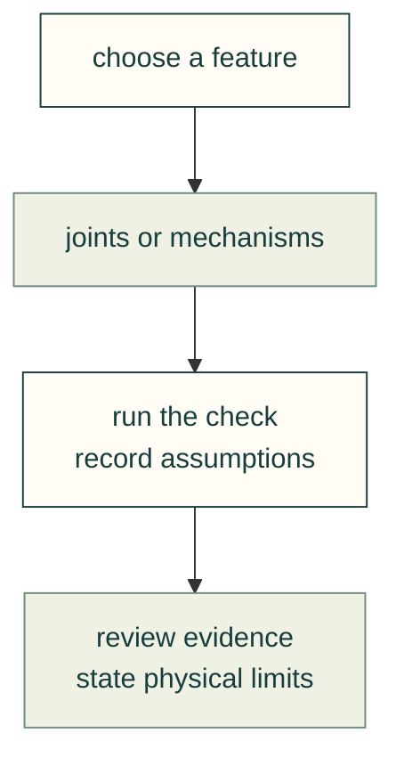

# Mechanical guides

Choose a feature, read its sources, then run the matching check. The [topic tree](../areas.yaml) records each area's evidence level.

| Task | Start here |
|---|---|
| Join printed parts | [Inserts](inserts.md), [screw bosses](screw-bosses.md), [printed joints](printed-joints.md) |
| Support or move a part | [Bearings](bearings.md), [linkages](linkages.md), [rendered motion](rendered-motion.md) |
| Flex or assemble a part | [Compliant mechanisms](compliant.md), [subassembly insertion](subassembly-insertion.md) |

[All guides](../README.md) · [Mechanical lessons](../lessons/mechanical/README.md) · [Skills](../../.agents/skills/README.md)
