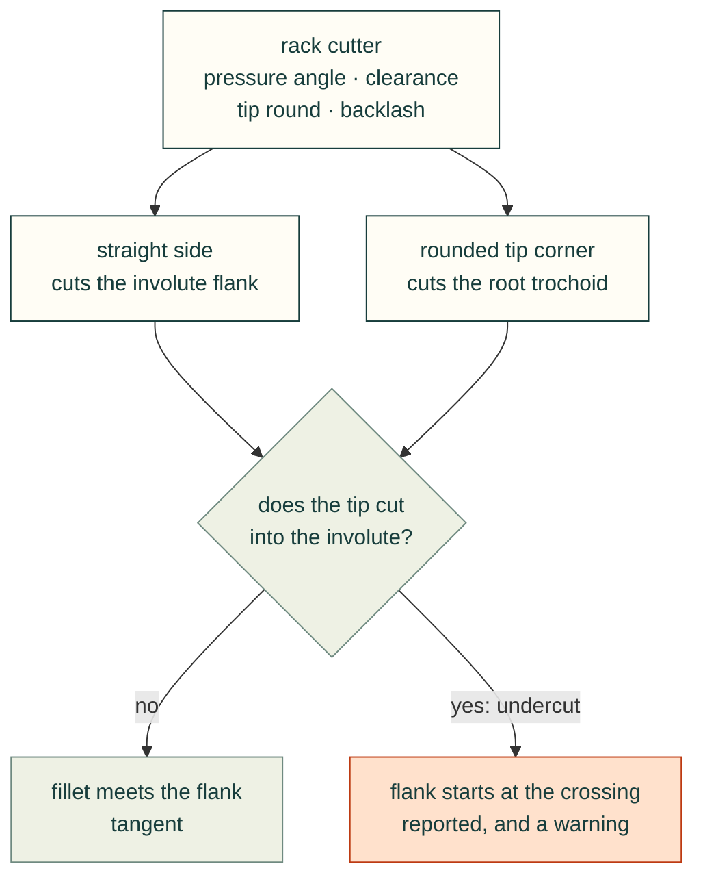
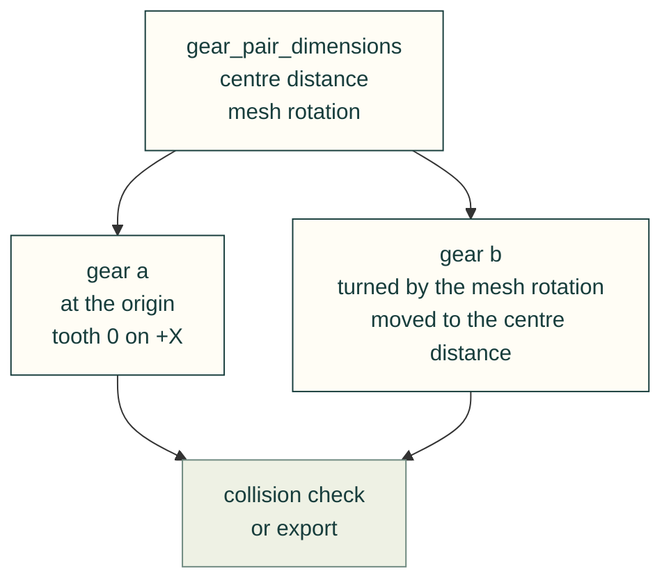
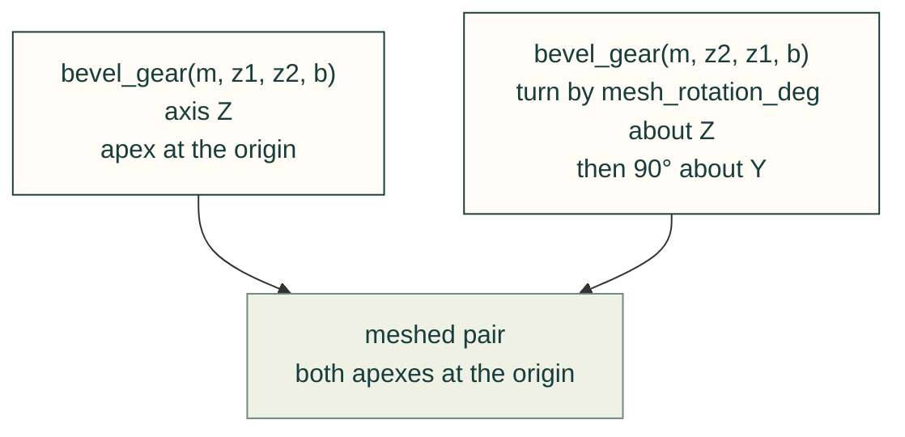

# Gears

`cadagent.mechanical.gears` makes gear solids a build script can place, check for collisions and export: external
involute spur gears, the same teeth on a ring, and straight bevel gears for shafts at 90°. It also returns the
reference dimensions of a gear and of a pair, so the script places two gears from numbers and a test can check them.
**The teeth are theoretical geometry. Nothing here says a gear is strong enough, and a pair that meshes in CAD is not
a pair that runs.** The strength formulas are a separate module (#721).

```python
from cadagent.mechanical.gears import (external_ring_gear, gear_pair_dimensions, module_from_diametral_pitch,
                                       spur_gear)

pair = gear_pair_dimensions(2.0, 18, 40, backlash=0.05)
pinion = spur_gear(2.0, 18, 10, bore=6, backlash=0.05)
steel = spur_gear(module_from_diametral_pitch(12), 16, 12.7, pressure_angle=14.5)   # warns: undercut
```

## How a tooth is drawn

The tooth is the shape a rack cutter leaves when it rolls round the pitch circle, which is how a hob cuts a gear.
Drawing it that way makes the difficult cases come out right without special rules.



| Part of the tooth | What is drawn |
|---|---|
| Flank | The true involute of the base circle, from the tip circle down to where the cutter's straight side ends (`involute_start_diameter_mm`). |
| Root | The trochoid swept by the cutter's rounded tip corner, tangent to the root circle and to the flank. `root_fillet` is that corner's radius in modules: by default it fills the clearance (0.38 at 20° with a clearance of 0.25), and `0` is a sharp corner, whose root is its plain trochoid. |
| Tip and root circles | Arcs: the tip `(1 + profile_shift)` modules outside the pitch circle, the root `(1 + clearance - profile_shift)` modules inside it. |
| Base circle above the root circle | Below 42 teeth at 20°. No radial line is added: the trochoid joins the root to the involute wherever it starts. |
| Undercut | Below 18 teeth at 20° and below 32 at 14.5°, the cutter's tip removes the bottom of the involute. The tooth is drawn undercut, as it would be cut; the dimensions say `undercut: True` and name the tooth count that avoids it, and the solid functions raise a `UserWarning`. A positive `profile_shift` removes it. |

Curves are sampled until the polygon through the samples stays within `chord_tolerance` (0.005 mm by default) of the
curve, and an interpolating spline is put through the samples.

`backlash` thins each tooth by that much along the pitch circle, so a pair made with the same value has about twice
that play. `tooth_thickness_mm` is π·m/2, plus 2·x·m·tan α for a profile shift x, less the backlash allowance.

## A pair

`gear_pair_dimensions` gives the centre distance (m·(z₁ + z₂)/2, or the distance at the working pressure angle when
the profile shifts do not sum to zero), the ratio, the contact ratio, the tip clearance and the turn that puts a
tooth space of the second gear against a tooth of the first.



```python
wheel = (spur_gear(2.0, 40, 10, bore=10, backlash=0.05)
         .rotate((0, 0, 0), (0, 0, 1), pair['mesh_rotation_b_deg'])    # a tooth space faces the pinion
         .translate((pair['centre_distance_mm'], 0, 0)))               # 58 mm
ring = external_ring_gear(2.0, 60, 8, inner_diameter=100)              # teeth outside, plain bore
```

`external_ring_gear` is the same gear with a large bore and a floor on the rim under the teeth (one module by
default: a drawing floor, not a strength rating). It is not an internal gear.

| Field | Meaning |
|---|---|
| `contact_ratio` | Counts contact on involute only, so an undercut gear lowers it; `contact_shortened` says when. Below 1.2 it adds a note. |
| `tip_past_involute` | A tip works inside the start of the other gear's involute, on its root fillet. This is the usual interference check, and it is cautious: in the cases tried, the solids showed no measurable overlap. |
| `tip_clearance_mm` | The smaller gap between a tip and the opposite root. Unbalanced profile shifts reduce it; the tips are not shortened to restore it. |

## Straight bevel gears

`bevel_gear(module, teeth, mate_teeth, face_width)` makes one gear of a 90° pair, with the pitch apex at the origin
and the axis on Z; swap the two tooth counts for its mate.



`bevel_gear_dimensions` gives the pitch, tip and root angles, the cone distance and the Z of the flat back and front
faces, for the mounting distance.

The tooth form is **Tredgold's approximation**: the large-end tooth is that of a spur gear with
teeth / cos(pitch angle) teeth, laid on the back cone, and every point of it runs straight to the apex. It is close
to, but not, the spherical involute or the octoid a bevel generator cuts. The body is plain: back and front cones
across the teeth, flat faces inside, a through bore.

## How it was checked

The tests measure the solids rather than only build them, and a meshed pair turns by the backlash it was given and no
further.

<details>
<summary>What was measured, and the build times</summary>

In [`tests/mechanical/test_gears.py`](../../tests/mechanical/test_gears.py):

- tooth count, by turning the gear one tooth pitch onto itself; tip and root radii; one valid solid;
- tooth thickness on the pitch circle and along the involute against the closed form, to 0.002 mm;
- a meshed pair has no common volume through a tooth pitch, the first gear can turn either way by the backlash
  allowance and no further, and the teeth collide when the centres are 0.3 mm closer. This holds for 20° and 14.5°
  pairs, an undercut pinion, a profile-shifted pinion and the bevel pairs at 90°;
- the measured play matched the backlash allowance within 0.002 mm for the spur pairs and within 0.006 mm for the
  bevel pairs, including one with an undercut virtual gear.

Build times on a desktop, CadQuery 2.8: a 176-tooth spur gear 0.2 s (0.8 s for the first solid of a session); bevel
gears of 16, 32 and 60 teeth 1.1 s,
1.9 s and 3.8 s.

</details>

## What it does not do

- **No strength, wear or life check.** No bending or contact stress, no material. Use the gear formulas (#721) for a
  first check and test the part.
- **No helical, internal, rack, worm, spiral-bevel or hypoid gears**, and no bevel shaft angle other than 90°.
- **No tip relief, crowning, chamfers, hubs or keyways**, and no tolerance classes: every tooth is identical and
  exact.
- **Printed gears need tuning.** A printer widens every wall by an amount that depends on the machine, the material
  and the nozzle, so a printed tooth is fatter than drawn and the root may not clear. Print a test pair, then set
  `backlash` and `clearance` from it; the defaults are for a cut gear.
- **Undercut is drawn, not fixed.** An undercut tooth is weaker at the root and has a shorter contact; choose more
  teeth, a larger pressure angle or a profile shift.
- **A bought gear may differ.** Catalogue gears have their own tip diameters, clearances and fillets; compare
  `spur_gear_dimensions` with the maker's drawing before trusting a mesh against a modelled bought part.

Related: [mechanical guides](README.md) · [`cadagent.mechanical`](../../software/cadagent/mechanical/README.md) ·
[range-of-motion clearance](../toolkit.md#range-of-motion-clearance-cadagentmechanicalclearance)
