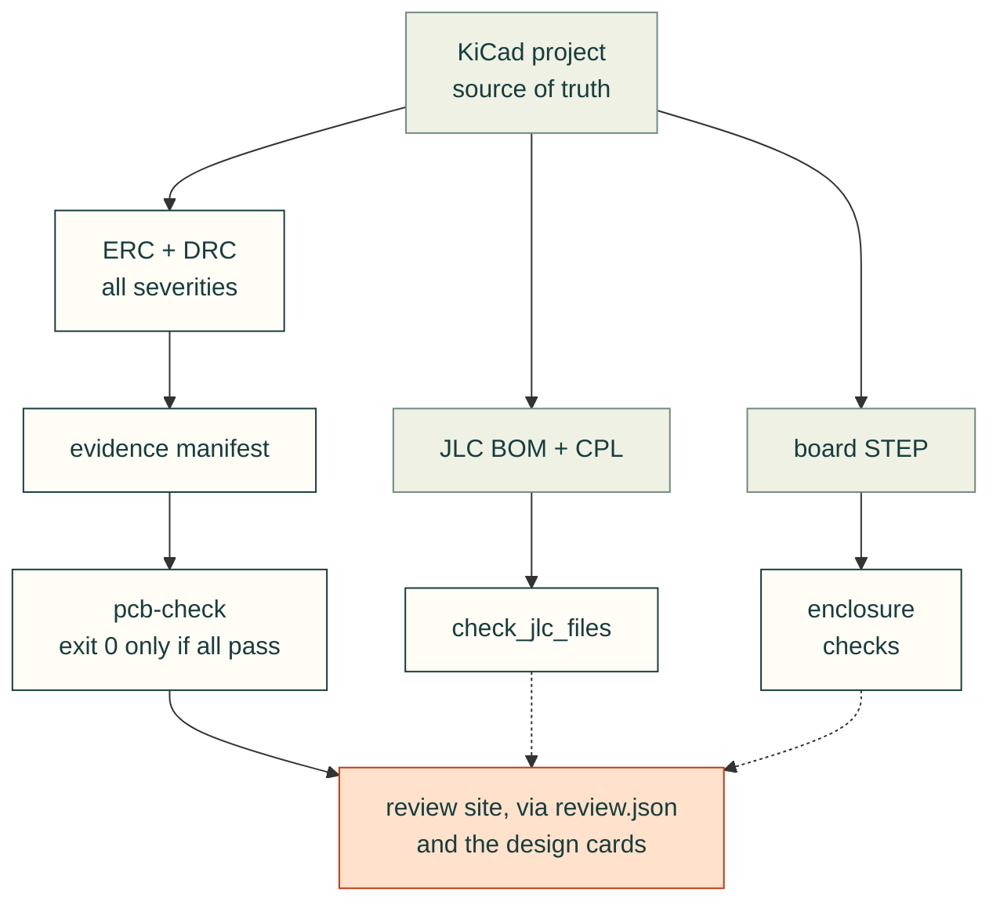

# PCB and assembly review workflow

cad-agent supports electronics and mechanical evidence in the same local project site. KiCad remains the electrical source of truth; cad-agent consumes its native reports and displays the files. The same embedded review groups work for a PCB, printed housing, robot assembly or any combination.



## Embedded review pattern

Set `cad.site.review: exports/review.json` in `cad-agent.yaml`:

```json
{"groups":[{"title":"Two-port adapter","summary":"Engineering prototype; fit testing pending","views":[{"title":"Schematic","kind":"pdf","file":"exports/2port/schematic.pdf"},{"title":"Top copper","kind":"svg","file":"exports/2port/pcb-top.svg"},{"title":"Housing","kind":"image","file":"preview/2port-open.png"}],"reports":[{"title":"Electrical CAD","file":"exports/2port/pcb-evidence.json"}],"downloads":[{"title":"PCB source","file":"hardware/2port/board.kicad_pcb"}]}]}
```

All drawings are embedded directly in the status page. Variants and views use reusable controls shipped in the web kit (`webkit/documents/review.js`), inlined into the page so a static copy of `site/index.html` works without the local server; without JavaScript every view is shown in turn. `image`, `svg`, `pdf`, local `html`, and `model` views are supported. A `model` file names the existing cad-agent viewer manifest and embeds that viewer; no second 3D engine is created. The viewer itself is served by `cad-agent site --serve`, so a static copy shows the frame with a note saying so. Configure `cad.view.groups: [{id: two, title: Two-port, prefix: "2port_"}]` to export a separate `exports/view/two.json` with only that assembly, reusing the same STL meshes. The id `view` is reserved (it is the full manifest), and every group must match at least one part; `cad-agent view` checks this before writing anything and reports a configuration error. Every view, report and download path must name a regular file inside the project root (symlinks are resolved): a missing file or one outside the root shows as "Pending asset" or "Pending download", and a report shows UNAVAILABLE, never a pass. Supply meaningful captions stating geometry provenance and qualification limits. The local server reloads after source changes, including KiCad, CSV and PDF files. Use `?live=0` to disable reload for an inspection.

## Source-bound electrical evidence

Use KiCad CLI 10 or newer for source-bound evidence. KiCad 9 reports lack the required severity metadata even with `--severity-all`; regenerate them with a supported version rather than editing the JSON. Run full ERC and DRC, including schematic parity, immediately before binding the results:

```sh
kicad-cli sch erc --format json --severity-all -o exports/erc.json hardware/board.kicad_sch
kicad-cli pcb drc --format json --severity-all --schematic-parity -o exports/drc.json hardware/board.kicad_pcb
```

`--severity-all` is required, and the adapter enforces it. kicad-cli 10 writes the severities it was asked for into the report as `included_severities`: the default run writes `["error","warning"]`, which leaves excluded violations out, and `--severity-error` drops warnings too. A report with missing or invalid `included_severities` fails with guidance to regenerate it using KiCad CLI 10 or newer and `--severity-all`; a severity list that does not contain `error`, `warning` and `exclusion` fails with "report filtered severities". The claimed KiCad version never substitutes for that metadata. DRC reports must also include `violations`, `unconnected_items` and `schematic_parity`. Do not reuse old reports after changing a board. Binding rejects reports with filesystem timestamps older than any listed source. This guard applies at local snapshot creation; subsequent freshness uses hashes so repository checkouts do not depend on timestamps. The adapter does not invoke KiCad and cannot prove that an arbitrary report was actually produced from an arbitrary source; the build orchestrator must run checks before the snapshot.

An evidence manifest supplies:

```json
{"reports":{"erc":"exports/erc.json","drc":"exports/drc.json"},"sources":["hardware/board.kicad_pcb","hardware/board.kicad_sch","hardware/board.kicad_pro","hardware/board.kicad_dru"],"release_gates":[{"id":"physical-fit","pass":false},{"id":"protection-tests","pass":false}],"waivers":{"missing_courtyard":"Mounting holes and logos have no courtyard by design; checked in the enclosure fit review"}}
```

Run `cad-agent pcb-check hardware/evidence-manifest.json --output exports/pcb-evidence.json`. The command exits 2 without writing anything when the manifest is malformed: `reports` must be an object whose keys are only `erc` and `drc`, `sources` a list of path strings, `release_gates` a list of objects, and `waivers` (optional) an object mapping each check key to a nonempty reason. Every source and report must be a regular file inside the project root after resolving symlinks; a path outside the root (`../`, an absolute path, a symlink out) or a directory makes the bundle fail with the reason in `problems`, and hashes are keyed by root-relative paths. Both ERC and DRC plus a nonempty source list are required for a passing bundle.

What fails a check: a missing or malformed report, filtered severities, an unknown violation severity, any error or warning, unconnected items, parity findings, and every ignored check or excluded violation that is not waived. KiCad lists the checks a project switched off in the report's `ignored_checks` (by key, for example `missing_courtyard`), and an excluded violation keeps its check key in `type`. Each such key is copied into the check's `ignored_checks` or `excluded_checks` and fails the check unless `waivers` names that key with a reason; waived keys stay listed under `waived` with their reasons, and the bundle records the waivers. A waiver is a reason (`"clearance": "reviewed net ties"`), which accepts every excluded instance of that key, or `{"reason": ..., "max": n}`, which accepts at most n excluded instances; more fail. Each check records how many instances each waiver accepted (`waived_counts`) and lists waivers that matched nothing (`unused_waivers`). Prefer fixing the design or reviewing each excluded instance in KiCad before waiving. Changing a recorded source or report invalidates freshness in the site: the design card, the review workbench and the `report` check row all use the same root-confined hash check. Hash equality establishes the recorded snapshot, not physical correctness.

Design cards can reference `pcb_evidence: exports/pcb-evidence.json`; they show CAD status separately from open release gates and production qualification. Never turn fabrication, fit, transient protection, CAN timing, stock or supplier orientation gates green based only on clean CAD checks.

## Select fabrication limits before routing

Record the supplier, service, dated source, layer count, copper thickness and side,
profiling method, and hole datum in the board decision. Transfer confirmed limits
into KiCad's project rules before routing; retain supplier DFM and order confirmation
as open release gates. A clean ERC/DRC bundle does not establish service eligibility.

The following are source-review examples from undated HTML pages read on
2026-11-12, not a fabrication checker. Recheck the selected order specification.
The suppliers describe different services; neither corroborates the other's limits.

<details>
<summary>PCBWay: copper side and thickness govern the selected row</summary>

In **Advanced PCB Capabilities**, rows 14–15, the normal-process,
before-compensation width/spacing pair at 70 µm copper is 6/8 mil inner and
7/8 mil outer. Thus a 6.5 mil trace with 8 mil spacing meets that selected inner
row but misses the outer row. Do not replace either with the Standard table's
rounded 0.1 mm / 4 mil headline. The source does not substantiate the old registry's
6 mil cost advice or universal 2/2 mil advanced minimum. Its Standard table also
separates drill size from finished-hole diameter; plating changes the hole datum.
No copper thickness, route or datum means an unanswered question, not a pass.
[ref:pcbway-pcb-capabilities]

</details>

<details>
<summary>Eurocircuits: service, pad diameter and board-edge datum</summary>

The **STANDARD pool Service Parameters** table gives pooled/non-pooled track and
gap as 0.100/0.090 mm: 0.095 mm misses the pooled row. Its PTH pad-diameter
additions are 0.300 mm outer and 0.350 mm inner, relative to **finished-hole**
diameter. For a 0.600 mm finished PTH these yield 0.900/0.950 mm pad diameters;
the nominal radial differences are 0.150/0.175 mm, before registration or other
allowances. Adding those radial differences once to the hole diameter undersizes
the pad. They are not a guaranteed residual ring around the drilled hole.
[ref:eurocircuits-standard-pool-services]

The same table's routed copper-to-edge minima differ by side: 0.250 mm outer,
0.400 mm inner; V-cut is 0.450 mm for both. A routed 0.300 mm gap meets only the
outer selected row. This measures copper edge to board edge, not drill centre.
The layer row enumerates pooled choices; it does not allow every integer through
eight. Thickness rows nevertheless label higher layers as pooled, and the surface
finish row conflicts with the opening immersion-silver eligibility statement.
Leave those choices unresolved for the supplier. Closing notes reserve confirmation
to the order; linked calculators and other capability pages were not read.
[ref:eurocircuits-standard-pool-services]

</details>

<details>
<summary>Reproduce selected rows and reject a missing scope</summary>

This deliberately small example reproduces only the selected source observations.
Its arguments name the service or row explicitly. Unknown combinations raise instead
of borrowing a reassuring value from another supplier, side or process column.
Dimensions returned are millimetres; one mil is exactly 0.0254 mm.

```python
from decimal import Decimal as D


def selected_pcb_observation(supplier, feature, scope):
    rows = {
        ("pcbway", "width-space", "normal-inner-70um-before-compensation"):
            (D("6") * D("0.0254"), D("8") * D("0.0254")),
        ("pcbway", "width-space", "normal-outer-70um-before-compensation"):
            (D("7") * D("0.0254"), D("8") * D("0.0254")),
        ("eurocircuits", "width-space", "pooled"):
            (D("0.100"), D("0.100")),
        ("eurocircuits", "width-space", "non-pooled"):
            (D("0.090"), D("0.090")),
        ("eurocircuits", "pth-pad-diameter-addition", "outer-finished-hole"):
            D("0.300"),
        ("eurocircuits", "pth-pad-diameter-addition", "inner-finished-hole"):
            D("0.350"),
        ("eurocircuits", "copper-to-edge", "outer-routed"): D("0.250"),
        ("eurocircuits", "copper-to-edge", "inner-routed"): D("0.400"),
        ("eurocircuits", "copper-to-edge", "outer-v-cut"): D("0.450"),
        ("eurocircuits", "copper-to-edge", "inner-v-cut"): D("0.450"),
    }
    try:
        return rows[(supplier, feature, scope)]
    except KeyError:
        raise ValueError("unlisted source observation; confirm supplier") from None
```

The regression examples run this published block with wrong-service, wrong-side,
unit and radial/diametral substitutions. They verify the transcription and scope;
no board is parsed, no production rule is installed, and neither source is promoted
to encoded or measured evidence.

</details>

## JLC assembly files

`cadagent.electrical.pcb.check_jlc_files(bom, cpl)` checks required columns, exact C-codes, duplicate references, finite coordinates, layers and BOM/CPL set equality. Build separate explicit populations for SMT-only versus SMT+THT assembly, and keep manual/consigned components visible in another file. CSV parity does not verify part availability, library zero-angle convention, solder process, panelization or quoted pricing.

## Mechanical enclosure checks

Import the native PCB STEP in the documented coordinate frame, and also check the nominal PCB outline and holes. Include connector mating envelopes, screws, captive nuts, cable paths and tool access. A board-only collision proxy misses components. Use measured/manufacturer dimensions when available and flag generic geometry. For ribbon relief, model hard stops, actual jacket thickness, compliant pads and a physical pull-test target; a cable hole alone is not strain relief.

Generic lessons from the first PCB and enclosure project that used this workflow are in [docs/lessons/electronics/pcb-evidence-and-review.md](lessons/electronics/pcb-evidence-and-review.md). Board-specific incident notes stay in that product's repository.

### Enclosure fasteners

Import `cadagent.mechanical.fasteners` for dimension-driven screw and insert envelopes and
`blind_insert_stack` for recessed-head axial checks. Supply sourced dimensions;
there is no implicit vendor catalog. Check screw-tip clearance and minimum thread
engagement across tolerances. A heat-set knurl deliberately intersects the
as-printed pilot: report this separately from unintended assembly collisions.
A supplier login or CAD download failure must remain visible. Never present an
original dimensioned envelope as an official vendor STEP file.

Final assembly pictures should render the exported STEP readback as well as the
in-memory model. Reimport for independent placement review, especially for text,
repeated instances and exploded scenes. Record export/source hashes and keep
nominal envelopes visibly distinct from official supplier geometry. A successful
CAD boolean, valid BREP and a watertight print mesh are separate checks: tangent
boss/wall contacts can pass one and fail another; use positive overlap at joins.

Release packagers should select the validated public manifest, not recursively
include every file in hardware folders. KiCad creates ignored `.kicad_prl` UI
state next to designs. Compare local and clean-checkout ZIP membership and hashes;
a passing source manifest does not automatically constrain a separate glob.

Use `filleted_wall_rib(thickness=…, reach=…, height=…, root_radius=…, overlap=…)`
for a boss-to-wall brace with explicit curved roots. Its wall is at `Y=reach`;
rotate/translate it into the assembly and overlap the floor and boss deliberately.
Check post-cut web widths around seam grooves and counterbores. Keep clamp ribs
outside the cable lane and provide driver access with the relevant lid state.
Side mounting ears need their own screw seats, filleted roots and installation
clearance; their mounting hardware is separate from the enclosure's insert screws.

### Prototype pads and user-facing controls

Preserve raw signals without promising software support from a net name. Trace the
module pin and its ownership in current platform documentation before advertising
GPIO/PWM/I²C access. Expose host power through explicit default-open links and
verify that no prototype rail bypasses them. Bare isolated pads should carry no
net and be excluded from assembly BOM/CPL; suppress automatic copper fill through
the free grid. Document the row/column pitch, power-row connections and allowable
component/lead envelopes. Re-run native DRC and schematic parity after the final
router import: a successfully exported route session can still leave a power
branch disconnected. Put illustrated controls beside native layers in the shared
review groups, including which shunt enables each termination resistor.
