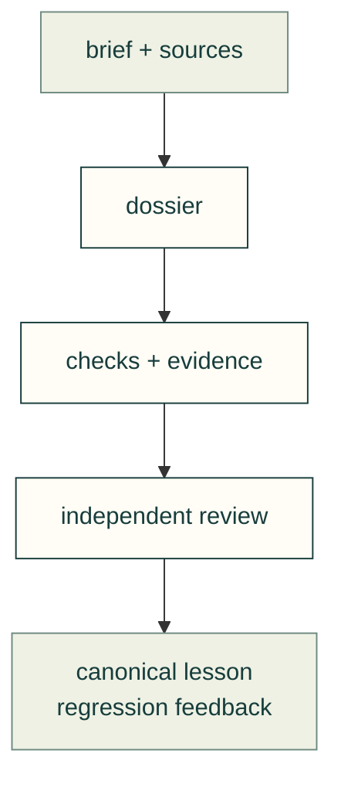

# Design and review practice

Follow the workflow from a requirement to an inspectable result. A passing software check records its assumptions; it does not prove physical fit or strength.

| Task | Start here |
|---|---|
| Set up and design | [Agent workflow](agent-workflow.md), [design process](design-process-plan.md), [experts](experts.md) |
| Review a result | [Dossier](dossier.md), [integrity gates](gates.md), [review packet](review-packet.md), [common issues](common-issues.md) |
| Publish readable evidence | [Style guide](style-guide.md), [animated figures](animated-figures.md), [project badge](share-badge.md), [web parts](web-parts.md), [file viewer](file-viewer.md) |
| Maintain the system | [Supply chain](supply-chain.md), [weekly updates](weekly-upstream-update.md), [process lessons](../lessons/process/README.md) |
| Plan shared engineering viewers | [Workbench integration design](workbench/README.md): SCADA, mechanical, PCB, electrical and harness ownership |

[All guides](../README.md) · [Skills](../../.agents/skills/README.md)

## File and child ownership

| File or folder | Purpose |
|---|---|
| [volume-precision.md](volume-precision.md) | Solid validity, units and aggregate numerical precision. |
| [web-diagrams.md](web-diagrams.md) | Shared browser diagram renderer and fallback limits. |
| [assembly-guide.md](assembly-guide.md) | Optional version-bound assembly instructions over the shared viewer |
| [assembly-guide-testing.md](assembly-guide-testing.md) | Requirement-to-test matrix and pending/verified acceptance |
| [standard-evaluation.md](standard-evaluation.md) | Fresh-agent analytical jobs, independent graders, runtime controls and recorded attempts |
